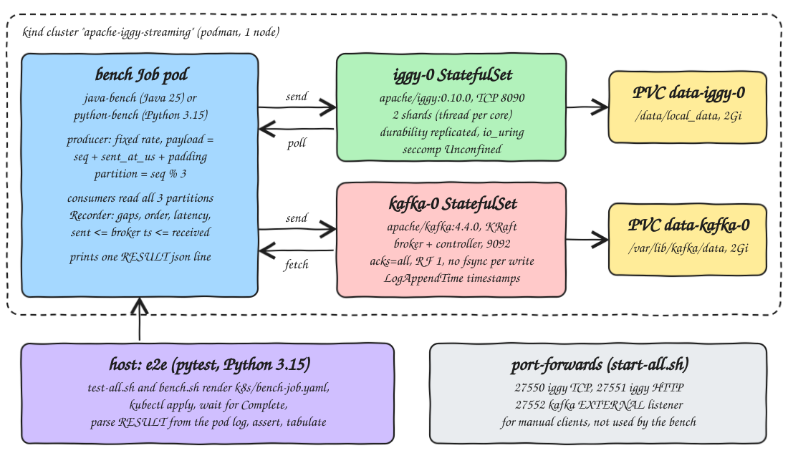

<p align="center"></p>

# apache-iggy-streaming

Apache Iggy 0.10.0 (the Rust message streaming server) next to a single-broker Apache Kafka 4.4.0 (KRaft) on a local kind cluster, both as plain StatefulSets with a PVC. The same benchmark is written twice, in Java 25 (Iggy Java SDK + kafka-clients) and in Python 3.15 (Iggy Python SDK + kafka-python), and runs as in-cluster Kubernetes Jobs. Each Job sends messages at a fixed rate with the send time inside the payload, reads them back, checks that every message arrived exactly once and in order per partition, and reports end-to-end latency (p50/p95/p99/max) and throughput.

## How it Works

1. `scripts/setup.sh` creates the kind cluster, builds the Java jar and both bench images (the Python image compiles the Iggy SDK from source, see below) and loads them plus `apache/iggy:0.10.0` and `apache/kafka:4.4.0` into kind.
2. `scripts/start-all.sh` applies `k8s/iggy.yaml` and `k8s/kafka.yaml` (one StatefulSet each, 2 CPU limit, 2Gi PVC) and port-forwards them to `localhost:27550-27552`.
3. The host side (`e2e/`) renders `k8s/bench-job.yaml` for one broker, client, rate and size, applies it, waits for `Complete` and parses the single `RESULT {json}` line from the pod log.
4. Inside the Job the bench creates a fresh 3-partition topic, starts the consumers first (one Iggy connection per partition, or one Kafka consumer `assign`ed to all 3 partitions, reading from offset 0), then starts the producer.
5. The producer is paced: every ~0.2 ms it sends the messages that are due for the target rate (capped at 1000 per tick). Message `seq` goes to partition `seq % 3` and its payload is `seq (u64) | sent_at_us (u64, wall clock taken right before the send) | zero padding` up to 100 B or 1 KB.
6. The consumer stamps each received batch with the wall clock and hands every message to a `Recorder`, which tracks the next expected `seq` per partition (gap, backwards or misrouted message), records `received_at - sent_at` after a 2 s warmup, and checks `sent_at <= broker append timestamp <= received_at`.
7. After the producer stops, the bench waits until `received == sent` (or 15 s), then prints the result. Everything runs on one kind node, so producer, broker and consumer read the same kernel clock.
8. The tests and the benchmark refuse any run that lost, duplicated, reordered or misrouted a message, or whose broker timestamps do not fall between send and receive.

## Architecture



## Features

* Same workload, two brokers, two languages: 4 combinations run the same paced producer and the same checks, so differences come from the broker and the client library.
* In-cluster Jobs: the bench never crosses a port-forward, so the numbers are pod-to-pod over the kind network.
* Real timestamps: latency is `received_at - sent_at` where `sent_at` is written into the payload by the producer, not taken from client or broker metadata.
* Independent clock check: the broker's own append timestamp (Iggy message timestamp, Kafka `LogAppendTime`) must lie between the payload send time and the receive time for every message, which proves the payload timestamps are real and on the same clock.
* Exactly-once and per-partition order check: `seq % partitions` fixes where each message must land, so a per-partition "next expected seq" finds gaps, duplicates, reordering and misrouting even when the total count matches.
* Fixed rates plus an unthrottled run: fixed rates show latency under a known load, the `max` rate (Java only) shows how far each broker goes with batches of up to 1000 messages per request.
* StatefulSet + PVC for both brokers: data lives on a `local-path` volume, not in the container layer, the same way for both.

## Stack

* Kubernetes v1.35.0 (`kindest/node`, kind v0.31 on podman): one node keeps all pods on one clock and leaves room for other clusters.
* Apache Iggy 0.10.0 (`docker.io/apache/iggy:0.10.0`, released 2026-11-07, latest stable): the broker under test.
* Apache Kafka 4.4.0 (`docker.io/apache/kafka:4.4.0`, official image, KRaft combined broker + controller, no operator): the baseline.
* Java 25 (Amazon Corretto 25.0.4 for the build, `eclipse-temurin:25.0.4.1_1-jre-noble` at runtime), Maven, virtual threads for the consumers.
* Iggy Java SDK `org.apache.iggy:iggy:0.10.0` (blocking TCP client) and `org.apache.kafka:kafka-clients:4.4.0`.
* Python 3.15.2 (`python:3.15.2-slim`) + uv 0.10.4, asyncio for the Iggy client and a thread for the Kafka consumer.
* Iggy Python SDK `apache-iggy==0.10.0` (Rust + PyO3, built from the sdist with Rust 1.99.1 in the image) and `kafka-python==3.0.13`.
* pytest 9.2.0 and ty 0.0.99 for the Python tests and type checks, JUnit 6.1.3 for Java.

## Java 25 and Python 3.15 support of the Iggy SDKs

* Java: `org.apache.iggy:iggy:0.10.0` is compiled for Java 17 (class file major version 61) and runs unchanged on Java 25. It pulls Netty 4.2, Jackson 3 and Apache HttpClient 5. Verified by the unit tests and by every Java Job in the e2e tests and the benchmark.
* Python: `apache-iggy==0.10.0` ships wheels only for CPython 3.11, 3.12 and 3.13, there is no `cp315` wheel on PyPI. It builds from the sdist on Python 3.15 with a Rust toolchain (locally on macOS arm64 and in the Linux arm64 image) and then works: connect, login, create stream/topic, send, long-poll, continuations. The cost is a Rust build stage in `python-bench/Containerfile` (the image takes a few minutes to build the first time).
* `confluent-kafka` has no 3.15 wheels, so the Python Kafka client is `kafka-python` 3.0.13 (pure Python). Its defaults already match the Java settings used here (`acks=all`, `enable_idempotence=True`, `linger_ms=0`).
* Spring Boot 4.1 is not used. The bench is a short-lived Job with no web layer, no database and no configuration beyond a few env vars, and Spring Boot's dependency management would override the `kafka-clients`, Netty and Jackson versions the Iggy SDK and the Kafka client are tested with. A plain `main` keeps the measured path free of framework code.

## Iggy on kind and podman: io_uring

Iggy 0.10.0 uses io_uring (thread-per-core runtime). Under plain rootless podman it panics at boot with `Cannot create server bootstrap executor`: first `Function not implemented` from the default seccomp profile, and with `--security-opt seccomp=unconfined` still `Permission denied` until SELinux labelling is also disabled (`--security-opt label=disable`) or the container is `--privileged`. Inside kind the node container is privileged, so the pod only needs `securityContext.seccompProfile.type: Unconfined` (in `k8s/iggy.yaml`). Iggy also pins one shard per CPU by default and would take all 12 CPUs of the node, so `IGGY_SHARDING_CPU_ALLOCATION=2` matches the 2 CPU limit that Kafka gets too.

## Durability settings used

| | Iggy | Kafka |
|---|---|---|
| Replicas | 1 node, replication factor 1 | 1 broker, `replication.factor=1`, `min.insync.replicas=1` |
| Write is acknowledged when | committed to the partition log (`durability = replicated`, the default), no fsync per write | written to the partition log (`acks=all`), no fsync per write (Kafka default `log.flush.interval.messages` is unlimited) |
| Producer | one send request per partition per tick, waits for the reply | `linger.ms=0`, `enable.idempotence=true`, async sends, `flush()` at the end |
| Consumer | `poll_messages` with `max_wait=100 ms`, `count<=1000`, from offset 0, no offset commits | `fetch.max.wait.ms=100`, `fetch.min.bytes=1`, `assign` + `seekToBeginning`, no commits |
| Broker timestamp | server timestamp in microseconds | `message.timestamp.type=LogAppendTime`, milliseconds |
| Storage | PVC (`local-path`), 2Gi | PVC (`local-path`), 2Gi |

Both acknowledge a write once it is in the broker's log and in the page cache, and neither fsyncs each message. Iggy's `durability = persisted` (flush and fsync before the ack) and Kafka's `flush.messages=1` would be the stricter equivalent pair and were not measured.

## Contracts

Bench Job env (`k8s/bench-job.yaml`, rendered with Python `string.Template` by `e2e/bench_e2e/cluster.py`):

| Variable | Meaning |
|---|---|
| `BROKER` | `iggy` or `kafka` |
| `IGGY_ADDRESS`, `KAFKA_BOOTSTRAP` | `iggy-0.iggy:8090`, `kafka-0.kafka:9092` |
| `TOPIC` | unique per Job, so runs never share data |
| `RATE` | target messages per second, `0` = as fast as possible |
| `SIZE` | payload size in bytes, at least 16 |
| `SECONDS`, `WARMUP_SECONDS` | send duration and the leading part left out of the latency numbers |
| `PARTITIONS` | 3 |

Payload (big endian, identical in Java and Python, unit tested byte by byte):

```
offset 0  u64 seq          global sequence, partition = seq % PARTITIONS
offset 8  u64 sent_at_us   wall clock in microseconds right before the send call
offset 16 ...              zero padding up to SIZE
```

Result line printed by every Job (same keys in Java and Python):

```
RESULT {"broker","client","rate","size","seconds","partitions","sent","received","send_errors",
        "gaps","backwards","misrouted","in_order","complete","send_rate","consume_rate","mb_per_s",
        "latency":{"samples","p50_ms","p95_ms","p99_ms","max_ms"},
        "ts_checked","ts_violations","run_started_us","run_finished_us","min_sent_at_us","max_sent_at_us"}
```

## Design decisions

* Producer and consumer live in the same pod and process, so latency uses one clock and needs no clock sync. The broker check uses the same kernel clock because kind runs every pod on one node.
* The payload timestamp is taken right before each send call, not the scheduled send time. If a client falls behind its target rate this hides queueing before the send (coordinated omission), which is why the result also reports the achieved send and consume rates.
* Percentiles are nearest-rank over every message after warmup, no histogram buckets and no sampling.
* Consumers are started and positioned at offset 0 before the producer sends anything, so the first messages are not lost to a late subscription and start-up cost lands in the warmup.
* Kafka consumers use `assign`, not a consumer group, so there is no rebalance delay; Iggy consumers poll fixed partitions by offset. Neither commits offsets, so both read paths are the plain fetch path.
* Fresh topic per Job: a rerun can never read messages from an earlier run, and the completeness check stays exact.

## How to run

Requirements: podman, kind, kubectl, uv, Maven, Java 25 at `~/.sdkman/candidates/java/25.0.4-amzn`, lsof.

```bash
./scripts/setup.sh
./scripts/start-all.sh
./scripts/test-all.sh
./scripts/bench.sh 15
./scripts/stop-all.sh
./scripts/teardown.sh
```

`test-all.sh` runs:

* `python-bench/tests`: payload round trip and size, gap / duplicate / reorder / misroute / missing tail detection, nearest-rank percentiles, latency from the payload timestamp, broker timestamp bracket check (micro and millisecond clocks), warmup exclusion, pacer, config.
* `uv run ty check` for `python-bench` and `e2e`.
* `java-bench` JUnit tests on Java 25: the same rules, plus byte compatibility of the payload with Python, the Iggy message header length, and the Kafka durability settings.
* `e2e/tests/test_streaming.py` against the kind cluster, for iggy and kafka with java and python (2000 msg/s, 100 B, 5 s, 3 partitions):
  * every message sent is received exactly once and in order per partition;
  * latency comes from payload send timestamps that bracket the broker append time, and every send timestamp falls inside the Job's own run window.

```
15 passed                       python-bench unit tests
All checks passed!              ty python-bench, ty e2e
Tests run: 19, Failures: 0      java-bench JUnit on Java 25
test_every_message_sent_is_received_exactly_once_and_in_order_per_partition[iggy-python] PASSED
test_every_message_sent_is_received_exactly_once_and_in_order_per_partition[iggy-java] PASSED
test_every_message_sent_is_received_exactly_once_and_in_order_per_partition[kafka-python] PASSED
test_every_message_sent_is_received_exactly_once_and_in_order_per_partition[kafka-java] PASSED
test_latency_comes_from_payload_send_timestamps_that_bracket_the_broker_append_time[iggy-python] PASSED
test_latency_comes_from_payload_send_timestamps_that_bracket_the_broker_append_time[iggy-java] PASSED
test_latency_comes_from_payload_send_timestamps_that_bracket_the_broker_append_time[kafka-python] PASSED
test_latency_comes_from_payload_send_timestamps_that_bracket_the_broker_append_time[kafka-java] PASSED
8 passed in 35.75s
all tests passed
```

## Results

`./scripts/bench.sh 15` on a single node kind cluster (podman machine, 12 CPUs, 48 GB, macOS arm64 laptop, other kind clusters running at the same time). 3 partitions, 15 s of sending per run, the first 2 s left out of the latency numbers, one run per row. Broker pods are limited to 2 CPUs each, the bench pod to 2 CPUs. Every row below was checked: `sent == received`, no gap, duplicate, reorder or misroute, no send error, and every broker timestamp between send and receive. The bench refuses to print a table otherwise.

| broker | client | size B | target msg/s | sent | received | complete | consumed msg/s | MB/s | p50 ms | p95 ms | p99 ms | max ms |
|---|---|---|---|---|---|---|---|---|---|---|---|---|
| iggy | python | 100 | 1000 | 14999 | 14999 | yes | 1000 | 0.10 | 0.28 | 0.69 | 1.67 | 9.93 |
| kafka | python | 100 | 1000 | 14999 | 14999 | yes | 1000 | 0.10 | 0.59 | 1.10 | 1.83 | 5.73 |
| iggy | java | 100 | 1000 | 14999 | 14999 | yes | 1000 | 0.10 | 0.18 | 0.30 | 0.71 | 2.66 |
| kafka | java | 100 | 1000 | 14999 | 14999 | yes | 1000 | 0.10 | 0.23 | 0.37 | 0.49 | 15.62 |
| iggy | python | 100 | 10000 | 149993 | 149993 | yes | 10000 | 1.00 | 0.41 | 0.75 | 1.00 | 38.35 |
| kafka | python | 100 | 10000 | 149999 | 149999 | yes | 9999 | 1.00 | 2.75 | 4.44 | 7.02 | 23.46 |
| iggy | java | 100 | 10000 | 149999 | 149999 | yes | 10000 | 1.00 | 0.27 | 0.52 | 1.76 | 11.22 |
| kafka | java | 100 | 10000 | 149999 | 149999 | yes | 10000 | 1.00 | 0.21 | 0.38 | 0.90 | 13.30 |
| iggy | python | 1024 | 1000 | 14999 | 14999 | yes | 1000 | 1.02 | 0.26 | 0.56 | 0.96 | 18.74 |
| kafka | python | 1024 | 1000 | 14999 | 14999 | yes | 1000 | 1.02 | 0.93 | 2.15 | 3.07 | 9.07 |
| iggy | java | 1024 | 1000 | 14999 | 14999 | yes | 1000 | 1.02 | 0.18 | 0.32 | 0.77 | 12.05 |
| kafka | java | 1024 | 1000 | 14999 | 14999 | yes | 1000 | 1.02 | 0.23 | 0.38 | 0.55 | 3.66 |
| iggy | python | 1024 | 10000 | 149998 | 149998 | yes | 10000 | 10.24 | 0.43 | 0.77 | 0.97 | 6.24 |
| kafka | python | 1024 | 10000 | 93003 | 93003 | yes | 5206 | 5.33 | 2566.99 | 3080.83 | 3178.45 | 3281.09 |
| iggy | java | 1024 | 10000 | 149996 | 149996 | yes | 10000 | 10.24 | 0.27 | 0.52 | 0.80 | 25.01 |
| kafka | java | 1024 | 10000 | 149999 | 149999 | yes | 10000 | 10.24 | 0.20 | 0.29 | 0.50 | 13.18 |
| iggy | java | 100 | max | 21136000 | 21136000 | yes | 1409059 | 140.91 | 0.44 | 0.92 | 1.36 | 40.17 |
| kafka | java | 100 | max | 27267000 | 27267000 | yes | 1796991 | 179.70 | 18.72 | 122.20 | 1849.27 | 2079.19 |
| iggy | java | 1024 | max | 11955000 | 11955000 | yes | 796983 | 816.11 | 0.79 | 1.44 | 2.09 | 59.45 |
| kafka | java | 1024 | max | 3115000 | 3115000 | yes | 206392 | 211.35 | 84.53 | 151.68 | 2143.89 | 2159.49 |

* consumed msg/s: messages received divided by the time from the first send to the last receive.
* Latency: `received_at - sent_at` from the payload, nearest-rank percentiles over every message after warmup (about 13000 samples at 1000 msg/s, 130000 at 10000 msg/s).

What the numbers say, and what they do not:

* At fixed rates with the Java clients, both brokers are sub-millisecond at p50 and p95, and the gap between them is a tenth of a millisecond either way. Iggy is a bit faster at 1000 msg/s, Kafka is a bit faster at 10000 msg/s. On a laptop with one run per row, these differences are inside the noise. The max column is driven by single stalls (GC, CFS throttling, other clusters on the same VM) and changes from run to run.
* With the Python clients Iggy is clearly faster: p50 0.3-0.4 ms against 0.6-2.8 ms for Kafka. Most of that is the client, not the broker. `apache-iggy` is a Rust core behind PyO3, while `kafka-python` encodes and sends records in pure Python.
* kafka-python could not keep up with 1 KB at 10000 msg/s: it only got about 5200 msg/s out, and records waited in its producer buffer for about 2.6 s. The row stays in because it is a real result for Python 3.15 today (`confluent-kafka`, the C based client, has no 3.15 wheels). It does not measure the Kafka broker.
* The `max` rows are not a like-for-like broker comparison. The Iggy Java producer is synchronous: it sends up to 1000 messages, waits for the reply, then sends the next batch. So latency stays low, and throughput is capped by round trips. The Kafka producer is asynchronous: `send()` only queues the record, so at full speed the latency includes seconds of client-side queueing. With 100 B messages Kafka moved more messages (1.8 M/s against 1.4 M/s). With 1 KB messages Iggy moved almost 4 times more data (816 MB/s against 211 MB/s), and Kafka at 2 CPUs was the bottleneck.
* All four clients delivered every message exactly once and in order on both brokers, in every run of the tests and of this table.
* This is kind on a laptop: one node, one broker, replication factor 1, a podman VM shared with other clusters, local-path volumes on a virtual disk, and no fsync per message on either side. It is not production. Real deployments have replication across machines, real disks and networks, and tuned clients (batching and linger for Kafka, background producers for Iggy). These numbers are useful as a relative, same-box comparison of the two brokers with default-ish settings, not as absolute capacity figures.

## Scripts

All scripts live in `scripts/` and run from any directory of the repository.

| Script | What it does |
|---|---|
| `./scripts/setup.sh` | Creates the kind cluster, builds the Java jar and both bench images, loads them plus Iggy and Kafka into kind |
| `./scripts/start-all.sh` | Deploys the Iggy and Kafka StatefulSets, waits until both are ready, port-forwards them and prints the URLs |
| `./scripts/status.sh` | Shows the cluster, Iggy, Kafka, the number of bench Jobs and every port as UP or DOWN |
| `./scripts/test-all.sh` | Runs Python and Java unit tests, ty, and the end-to-end Job tests on kind |
| `./scripts/bench.sh [seconds]` | Runs the benchmark matrix (default 15 s per run), saves `.run/results.json` and prints a markdown table |
| `./scripts/stop-all.sh` | Stops the port-forwards and deletes the bench Jobs, Iggy and Kafka (PVCs are kept) |
| `./scripts/teardown.sh` | Runs stop-all, deletes the kind cluster and removes the two bench images |

Ports are declared in `scripts/ports.env`: `iggy-tcp=27550` (`tcp://localhost:27550`, user `iggy`), `iggy-http=27551` (`http://localhost:27551`), `kafka=27552` (`localhost:27552`, the broker's `EXTERNAL` listener).

```bash
./scripts/setup.sh
./scripts/start-all.sh
./scripts/status.sh
curl http://localhost:27551/ping
./scripts/stop-all.sh
```
