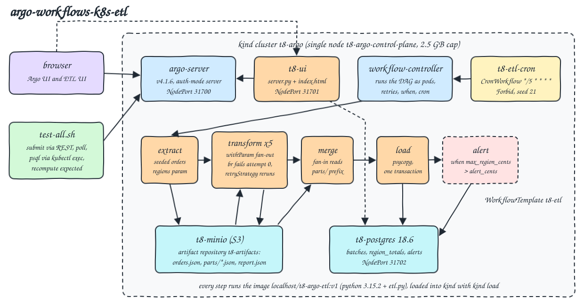
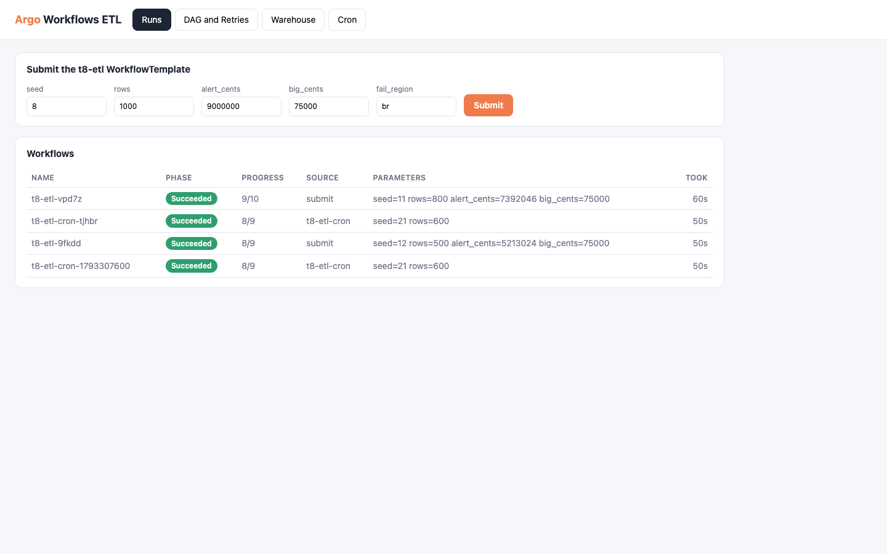
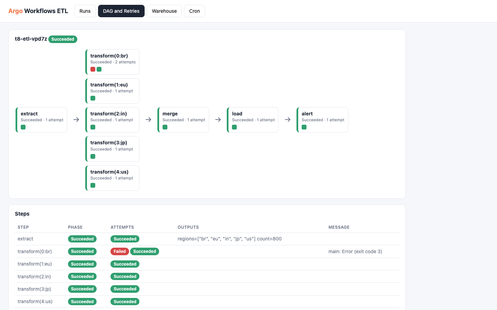
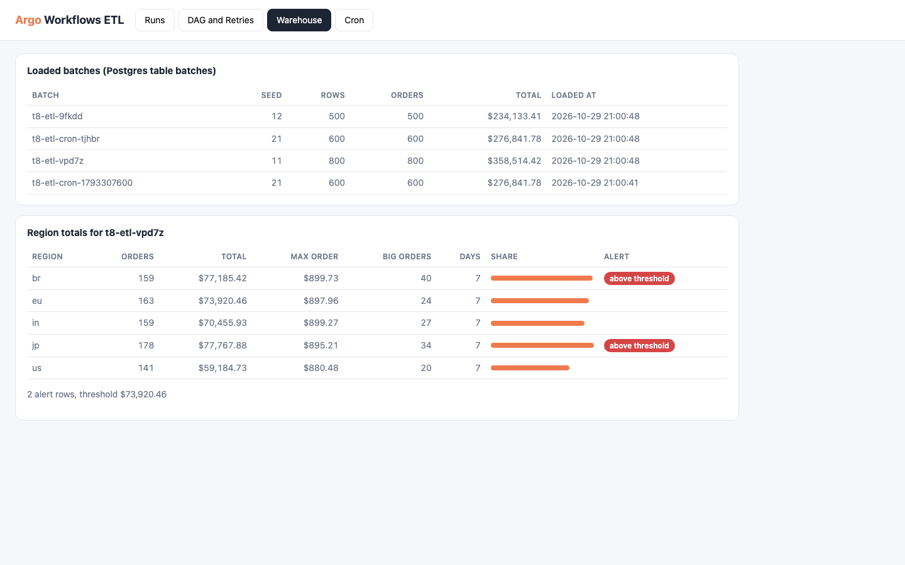
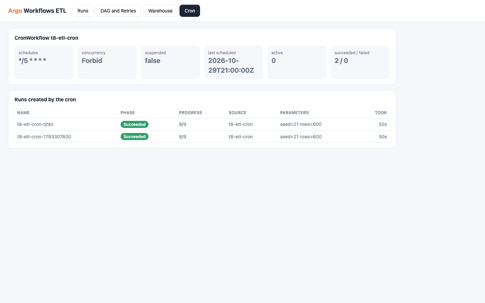
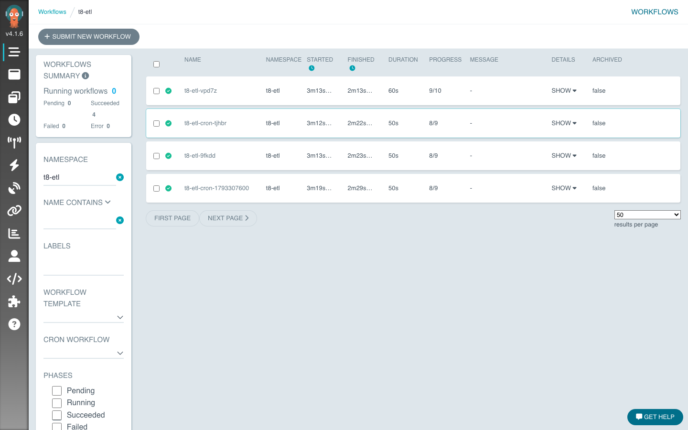
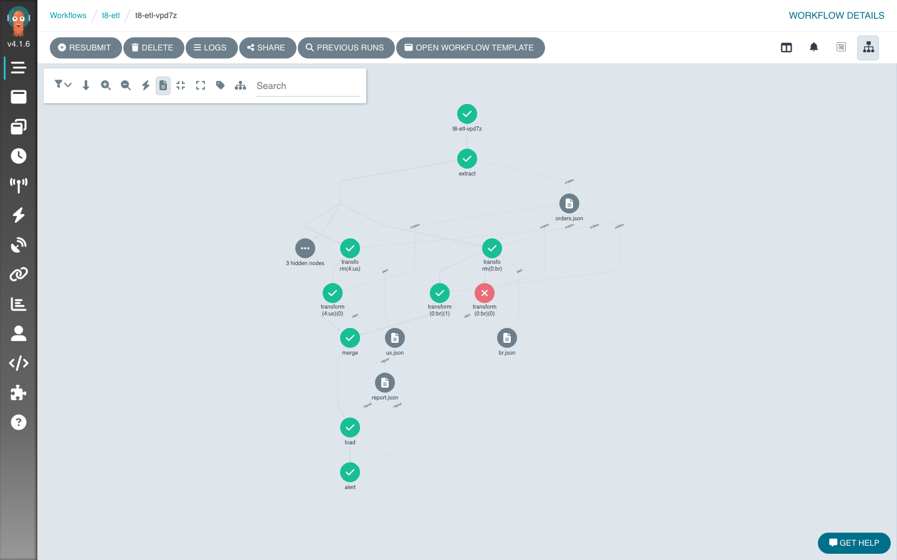
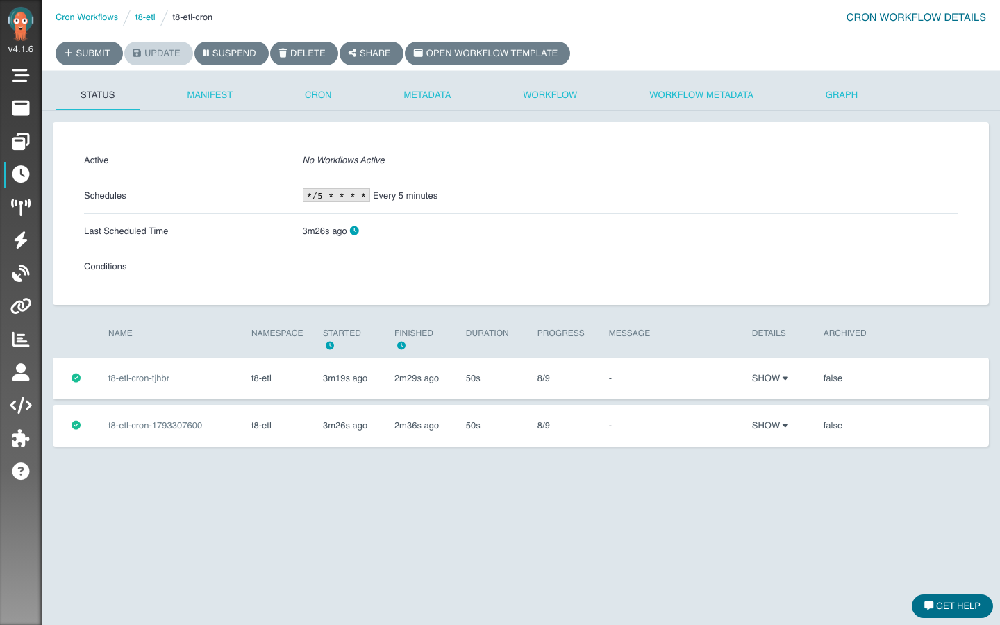

<p align="center"></p>

# argo-workflows-k8s-etl

Argo Workflows 4.1.6 as an ETL orchestrator on a single node local Kubernetes (kind). One `WorkflowTemplate` runs a DAG that extracts seeded orders, fans out one transform pod per region, fans back in to a merge step, loads the result into Postgres and runs an alert step only when a condition on the data is true. Artifacts move between pods through MinIO, one transform fails on purpose once and is retried by `retryStrategy`, and a `CronWorkflow` runs the same template every 5 minutes. A small web UI (Python stdlib + plain HTML) shows the runs, the DAG with every attempt, the loaded warehouse tables and the cron.

## How it Works

1. `scripts/start-all.sh` creates the kind cluster `t8-argo` (podman provider, own network `t8-kind`, node memory capped at 2.5 GB), installs the upstream Argo `install.yaml` for v4.1.6, switches `argo-server` to `--auth-mode=server --secure=false` and points the controller's default artifact repository at the in-cluster MinIO.
2. It deploys `t8-minio`, `t8-postgres` (schema from a ConfigMap), `t8-ui`, the `t8-etl` WorkflowTemplate and the `t8-etl-cron` CronWorkflow in the namespace `t8-etl`. Every step pod runs `localhost/t8-argo-etl:v1`, built from `Containerfile` and pushed into the node with `kind load`.
3. `extract` turns `seed` and `rows` into orders (`app/data.py`), writes `orders.json` as an artifact and the distinct regions as an output parameter.
4. `transform` runs once per region with `withParam`, receives `orders.json` as an input artifact and writes `parts/<region>.json` under a key that belongs to the workflow. For the region in `fail_region` (default `br`) it exits 3 when `{{retries}}` is 0, so Argo retries it once.
5. `merge` downloads the whole `parts/` prefix as one input artifact (fan-in), writes `report.json` and the output parameters `max_region_cents` and `total_cents`.
6. `load` writes `batches` and `region_totals` in one transaction, keyed by the workflow name so a rerun replaces its own rows.
7. `alert` has `when: max_region_cents > alert_cents` and writes the regions above the threshold to `alerts`, otherwise Argo marks it `Skipped`.
8. `scripts/test-all.sh` runs the step unit tests, then submits 3 workflows through the Argo REST API, waits for them and checks Postgres, the MinIO artifact, the retry and the conditional against answers recomputed in the test from the same seed.

## Architecture



## Features

* DAG with `depends`: extract, transform, merge, load and alert run in dependency order, the controller starts each pod only when its parents succeeded.
* Fan-out with `withParam`: the list of regions is data, produced by `extract`, so the number of transform pods follows the input.
* Fan-in through an S3 key prefix: every transform writes `{{workflow.name}}/parts/<region>.json` and `merge` takes the folder as one artifact, the documented Argo way to reduce looped outputs.
* Artifacts between steps: `orders.json`, `parts/*.json` and `report.json` live in MinIO, uncompressed (`archive: none`), and the Argo UI and API can download them.
* Parameters: `seed`, `rows`, `big_cents`, `alert_cents` and `fail_region` are workflow parameters with defaults, overridable from the UI, the API or the cron.
* Retries: `retryStrategy` with `limit: 2`, `retryPolicy: Always` and a 2 s backoff, the `br` transform fails attempt 0 and succeeds on attempt 1.
* Conditional step: `alert` runs only when `max_region_cents > alert_cents`, the skipped case shows `when '... > ...' evaluated false` in the node message.
* CronWorkflow: `*/5 * * * *` UTC, `concurrencyPolicy: Forbid`, history limit 3, seed 21 and 600 rows. It was seen firing on schedule (`t8-etl-cron-1793307600`) and can also be submitted on demand.
* Idempotent load: batch id is the workflow name, `load` and `alert` delete and rewrite their own rows inside one transaction.
* Archived logs: `archiveLogs: true` keeps step logs in MinIO after the pods are garbage collected (`podGC: OnWorkflowSuccess`).
* Lean: one kind node capped at 2.5 GB with every pod limited (argo 256 MB each, MinIO and Postgres 256 MB, UI and step pods 128 MB), observed around 2.0 GB used.

## Stack

* Argo Workflows v4.1.6 (`quay.io/argoproj/workflow-controller`, `argocli`, `argoexec`): latest stable release, upstream `install.yaml` with two JSON patches.
* kind v0.31 with `docker.io/kindest/node:v1.35.0` pinned by digest: the node image published for the installed kind, a single node cluster on podman.
* PostgreSQL 18.6 (`docker.io/library/postgres:18.6-alpine`): the load target, schema in a ConfigMap run by the entrypoint.
* MinIO `docker.io/pgsty/minio:RELEASE.2026-08-04T00-00-00Z`: S3 artifact repository, the community build used across this repo since upstream stopped publishing images.
* Python 3.15.2 (`docker.io/library/python:3.15.2-slim`): one image for every step and the UI.
* psycopg 3.3.6 (`psycopg[binary]`): the only Python library, used by `load`, `alert` and the UI.
* Python stdlib `http.server`, `urllib` and `unittest` with plain HTML, CSS and JS: UI, Argo REST client and tests without frameworks.

## Contracts/APIs

Argo server (`http://localhost:31700`, no auth, used by the tests and the UI):

| Method | Path | Use |
|---|---|---|
| POST | `/api/v1/workflows/t8-etl/submit` | `{"resourceKind":"WorkflowTemplate" or "CronWorkflow","resourceName":...,"submitOptions":{"parameters":["seed=11"]}}` |
| GET | `/api/v1/workflows/t8-etl/{name}` | workflow with `status.nodes` (Retry, Pod and Skipped nodes) |
| GET | `/api/v1/cron-workflows/t8-etl/t8-etl-cron` | cron spec and `lastScheduledTime` |
| GET | `/artifact-files/t8-etl/workflows/{name}/{nodeId}/outputs/{artifact}` | download an artifact from MinIO through Argo |

ETL UI (`http://localhost:31701`):

| Method | Path | Returns |
|---|---|---|
| GET | `/api/workflows` | runs, newest first: name, phase, progress, cron label, parameters |
| GET | `/api/workflows/{name}` | the run plus `steps`: one entry per step with every attempt and its output parameters |
| POST | `/api/submit?seed=&rows=&alert_cents=&big_cents=&fail_region=` | submits the template, returns `{"name": ...}` |
| GET | `/api/batches` | rows of `batches` |
| GET | `/api/batches/{batch}` | `region_totals` and `alerts` of one batch |
| GET | `/api/cron` | schedules, concurrency, last scheduled time, active, succeeded, failed |

Step command line (`app/etl.py`): `extract --seed --rows --out`, `transform --region --source --out --big-cents --fail-region --attempt`, `merge --parts --out`, `load --source --batch --seed --rows`, `alert --source --batch --threshold`.

## Key data structures and design decisions

* Order: `{"id", "region", "day", "cents"}`, generated by `random.Random(seed)`, one JSON object per line in `orders.json`.
* Part (one per region): `{"region", "orders", "cents", "max_cents", "big_orders", "days"}`. Report: `{"regions": [part...], "orders", "cents", "max_region_cents"}`.
* Tables: `batches(batch pk, seed, rows, orders, cents, loaded_at)`, `region_totals(batch, region, orders, cents, max_cents, big_orders, days)`, `alerts(batch, region, cents, threshold)`.
* Tests recompute the expected totals in `tests/expected.py` with their own loop over the seeded orders, not with the step code, so a wrong filter, sum, max or threshold in `etl.py` fails them.
* The forced failure keys off Argo's `{{retries}}` variable instead of a marker file, so it fails exactly the first attempt of every run and the test can assert `["Failed", "Succeeded"]` for `br` and `["Succeeded"]` for every other region.
* NodePorts 31700 to 31702 are mapped by kind `extraPortMappings` on 127.0.0.1, so there are no `kubectl port-forward` processes to babysit. The ports in `k8s/*.yaml` are placeholders filled from `scripts/ports.env`.
* The UI runs inside the cluster and talks to `argo-server` by service name and to Postgres with psycopg, so the host only needs kubectl, kind, podman and python3.
* No `podman-compose.yml`: everything runs inside kind as Kubernetes objects, the only container image built is the step and UI image from `Containerfile`.
* Changed from the first plan: the public images were first pulled into podman and pushed with `kind load`, which failed with `no space left on device` on the shared podman machine (the archive needs the space twice). Now the node pulls the pinned public images itself and only the app image is `kind load`ed.
* The kind node sets containerd `NoNewKeyring = true` for runc. Without it a run failed once with `unable to create session key: disk quota exceeded`: the shared podman machine allows 200 kernel keys per user and every container start took one. The retry test caught it because it expects the first `br` attempt to fail with exit code 3, not with any error.
* `stop-all.sh` deletes the kind cluster and the `t8-kind` network, so the next `start-all.sh` starts from an empty cluster and Postgres.

## How to run

```bash
./scripts/setup.sh
./scripts/start-all.sh
./scripts/status.sh
./scripts/test-all.sh
./scripts/ui.sh
./scripts/stop-all.sh
```

Test output (`./scripts/test-all.sh`):

```
Ran 3 tests in 0.008s
OK
test_alert_is_skipped_when_no_region_is_above_threshold ... ok
test_alert_runs_when_a_region_is_above_threshold ... ok
test_cron_workflow_schedule_and_submitted_run ... ok
test_every_run_succeeds ... ok
test_extract_artifact_in_minio_is_the_seeded_input ... ok
test_fan_out_one_transform_per_region_and_fan_in_after_all ... ok
test_flaky_region_failed_once_then_retried ... ok
test_loaded_totals_match_independent_computation ... ok
Ran 8 tests in 61.597s
OK
all tests passed
```

## Printscreens

### ETL UI, Runs



The submit form for the WorkflowTemplate with every parameter, and the list of runs: the two test runs, the run submitted from the cron and the one the cron created on its own schedule, with phase, progress and the parameters each one got.

### ETL UI, DAG and Retries



The test run `seed=11`: one extract, five transforms from `withParam`, merge, load and alert. `transform(0:br)` shows two attempts, red then green, and the steps table shows the first attempt's message `main: Error (exit code 3)` and the output parameters of extract.

### ETL UI, Warehouse



The `batches` table in Postgres and the `region_totals` of the selected run with the share of each region. The threshold was set by the test to the median region total, so the alert step ran and wrote exactly the two regions above it (`br`, `jp`).

### ETL UI, Cron



The CronWorkflow status read from the Argo API: schedule, `Forbid` concurrency, last scheduled time and the runs carrying its label.

### Argo UI, Workflows



The Argo Workflows 4.1.6 list for the namespace `t8-etl`, all four runs succeeded.

### Argo UI, workflow graph



The graph of the same run: `transform(0:br)(0)` is red and its retry `transform(0:br)(1)` is green, the artifact nodes (`orders.json`, `br.json`, `us.json`, `report.json`) show what flowed through MinIO, and `alert` ran after `load`.

### Argo UI, CronWorkflow



`t8-etl-cron` with `*/5 * * * *`, its last scheduled time and the two runs it owns.

## Scripts

All scripts live in `scripts/` and run from any directory of the repository.

| Script | What it does |
|---|---|
| `./scripts/setup.sh` | Checks the tools, downloads the Argo install manifest and builds the step and UI image |
| `./scripts/start-all.sh` | Creates the kind cluster, installs Argo and the stack and prints the full link of each service |
| `./scripts/status.sh` | Shows the cluster, the deployments and every service port as UP or DOWN |
| `./scripts/test-all.sh` | Runs the unit tests and the workflow integration tests |
| `./scripts/ui.sh` | Opens the ETL UI and the Argo UI in the browser |
| `./scripts/stop-all.sh` | Deletes the kind cluster and its network |
| `./scripts/sql-console.sh` | Opens psql on the Postgres warehouse |

Ports are declared in `scripts/ports.env`: Argo UI `http://localhost:31700`, ETL UI `http://localhost:31701`, Postgres `postgresql://localhost:31702/etl`.
