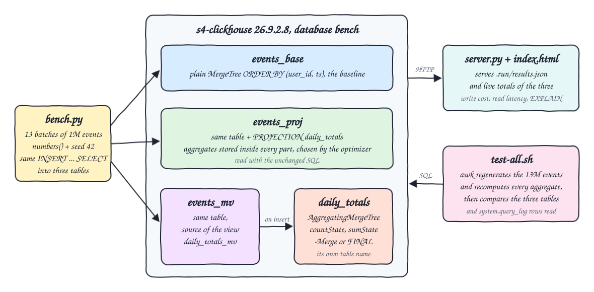
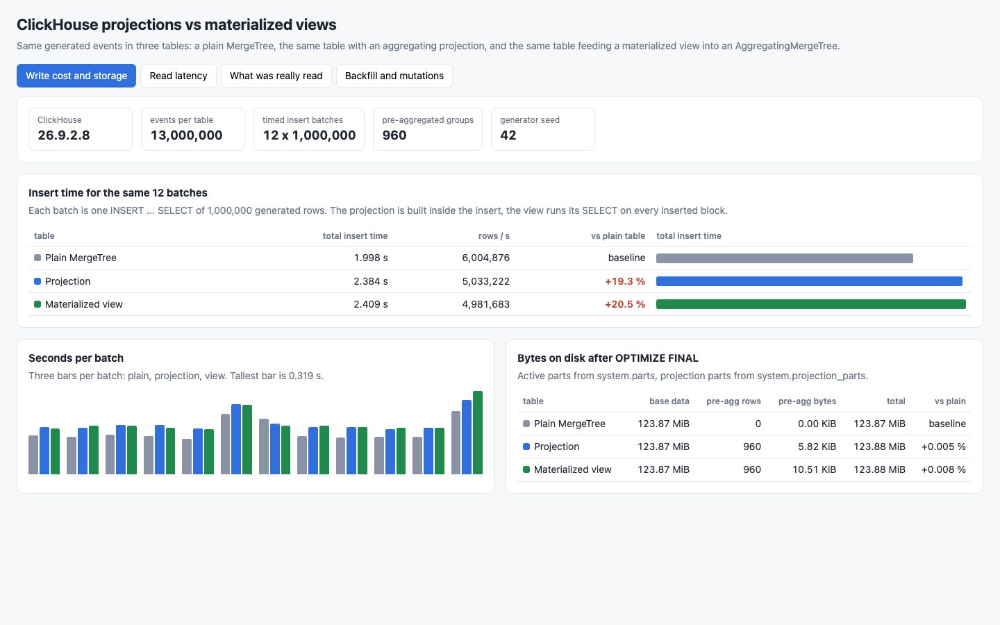
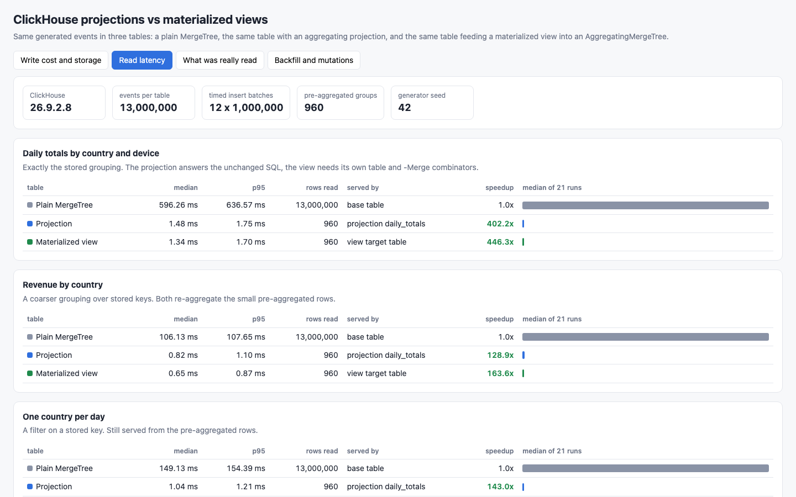
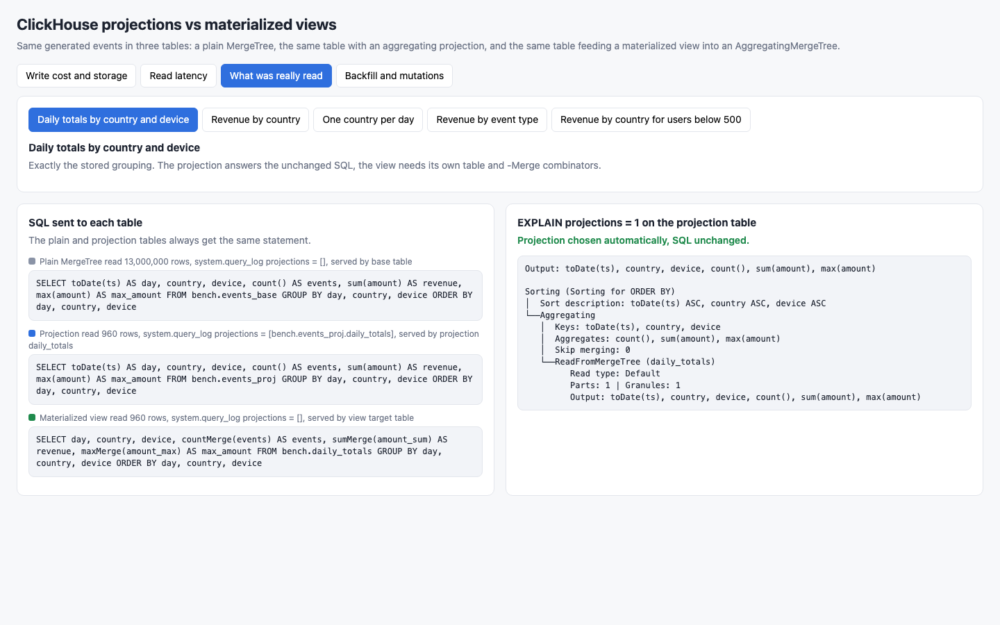
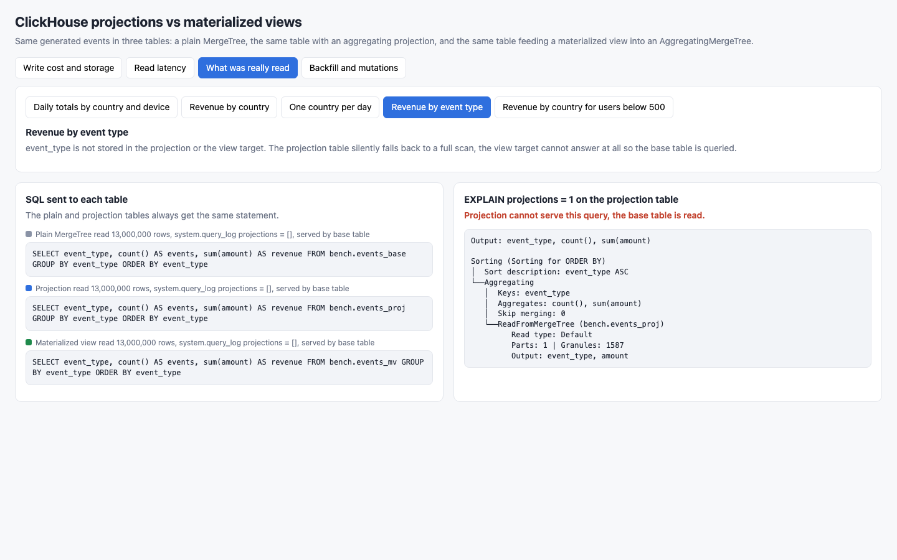
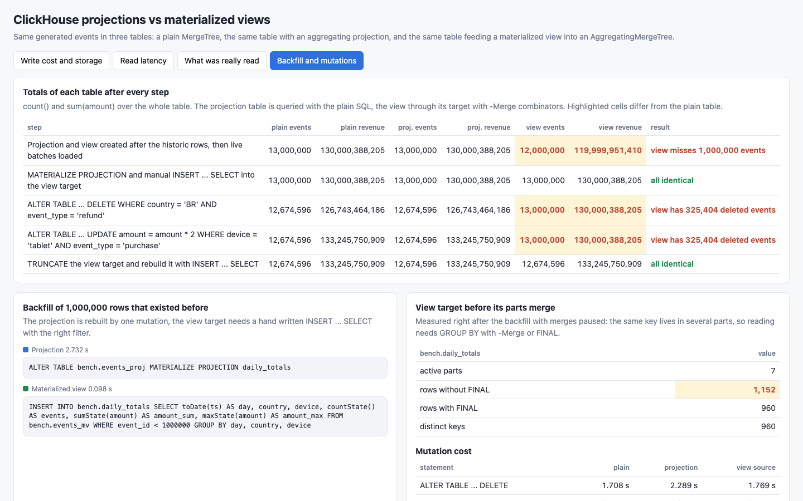

<p align="center"></p>

# clickhouse-projections-vs-mvs

Compares the two ways ClickHouse 26.9 pre-aggregates data, projections and materialized views, on write cost, bytes on disk and read speed. The same 13,000,000 generated events (deterministic seed 42) are loaded into three tables: a plain MergeTree baseline, the same table with an aggregating projection, and the same table feeding a materialized view into an AggregatingMergeTree target. Every aggregate is checked for identical results across the three tables before any timing is reported, and against an independent awk calculation in the tests. A small Python 3.14 UI shows the measured numbers, what each query really read, and how each approach behaves on backfill, `ALTER TABLE ... DELETE` and `ALTER TABLE ... UPDATE`.

## How it Works

1. `start-all.sh` starts `s4-clickhouse` and runs `app/bench.py`, which drops and recreates the `bench` database.
2. Three identical tables are created (`events_base`, `events_proj`, `events_mv`) and 1,000,000 historic events are inserted into each, before any pre-aggregation exists.
3. `ALTER TABLE events_proj ADD PROJECTION daily_totals` and `CREATE MATERIALIZED VIEW daily_totals_mv TO daily_totals` are created late, on purpose.
4. Twelve live batches of 1,000,000 events are inserted into each table with the same `INSERT ... SELECT`, rotating the table order per batch, timing every insert.
5. Totals are recorded: the projection table already answers right, the view target misses exactly the historic rows.
6. Backfill: `MATERIALIZE PROJECTION` for the projection, a hand written `INSERT ... SELECT ... WHERE event_id < 1000000` for the view target, both timed.
7. Correctness gate: five aggregate queries must return identical rows from all three variants or the run aborts with no timing reported.
8. `OPTIMIZE ... FINAL`, then bytes on disk from `system.parts` and `system.projection_parts`.
9. Each query runs 21 times per variant: median and p95 of the server side `elapsed_ns`, rows read, the `projections` column of `system.query_log` and `EXPLAIN projections = 1`.
10. `ALTER TABLE ... DELETE` and `ALTER TABLE ... UPDATE` run on all three tables, totals recorded after each, then the view target is truncated and rebuilt.
11. Results go to `.run/results.json`; `app/server.py` serves them plus live totals to `index.html`.
12. `test-all.sh` regenerates all 13,000,000 events in awk with the same formula, recomputes every aggregate and compares.

## Architecture



## Features

* Write cost: insert time and rows/s for the same twelve batches on the plain table, the projection table and the view source table.
* Storage: bytes of base data and of pre-aggregated data, from `system.parts` and `system.projection_parts`.
* Read latency: median and p95 over 21 runs for five queries on each variant, with rows read.
* Evidence of what was read: `system.query_log.projections`, `read_rows` and `EXPLAIN projections = 1` for every query.
* Projection served automatically: the plain SQL against `events_proj` reads 960 rows instead of 13,000,000.
* Projection fallback: a grouping by `event_type` or a filter on `user_id` silently reads the base table.
* View ergonomics: its own table name, `countMerge` / `sumMerge` / `maxMerge` or `FINAL`, and no answer at all for columns it does not store.
* Mutations: the projection stays consistent after `ALTER DELETE` and `ALTER UPDATE`, the view target keeps the old totals until rebuilt.
* Backfill: `MATERIALIZE PROJECTION` against a manual `INSERT ... SELECT` with the right filter.
* Correctness first: the benchmark aborts before any timing is reported when the three variants disagree.

## Stack

* ClickHouse 26.9.2.8 (`docker.io/clickhouse/clickhouse-server:26.9.2.8`, arm64), limited to 2 CPUs and 2 GiB.
* Python 3.14.7 in `.venv`, standard library only: benchmark, HTTP client for ClickHouse and the UI server.
* podman + podman-compose: runs ClickHouse on network `s4-net` with volume `s4-clickhouse-data`.
* awk: independent generator and aggregation used by the tests.
* Playwright 1.64.0 (headless Chromium): printscreens only.

## API

| Method | Path | Returns |
|---|---|---|
| GET | `/` | the UI; `?tab=write\|read\|cases\|consistency` opens a tab, `&case=<id>` picks a query on the cases tab |
| GET | `/api/results` | the recorded run: dataset, write cost, storage, backfill, merge state, read latency with query log evidence and EXPLAIN, totals per step, mutation cost |
| GET | `/api/live` | `count()` and `sum(amount)` of the three variants queried from ClickHouse at request time |

## Key Design Decisions

* Events are generated inside ClickHouse from `numbers()` with a small integer hash (`x = ((n+1)*48271 + seed) % 67108859`, `h1 = (x*x + n) % p`, `h2 = (h1*40503 + x) % p`). Every intermediate value stays below 2^53, so awk reproduces it exactly with doubles and the test needs no exported file.
* Amounts are integer cents, so sums are exact and comparable to the digit.
* The base tables are ordered by `(user_id, ts)`, unrelated to the pre-aggregation keys, as a realistic event table would be. The projection and the view both group by `toDate(ts), country, device`: 960 groups.
* The projection and the view are created after the first million rows so the backfill case is real and not simulated.
* Insert time is client wall clock around each `INSERT ... SELECT`; read latency is the server side `elapsed_ns` from the `X-ClickHouse-Summary` header, measured after `OPTIMIZE FINAL` with a warm cache.
* Merges on the view target are paused only while the backfill row count is recorded, so the "more rows than keys" state is deterministic.
* For queries the view target cannot answer, the view variant queries its source table `events_mv`, which is what an application would have to do.
* Write cost is reported but not asserted by the tests, because it is a timing on a shared machine. Everything the tests assert is either exact (aggregates, rows read, projection chosen) or a gap of two orders of magnitude (served read latency).
* With only 960 groups the pre-aggregated data is a few KiB. The storage overhead grows with the number of groups, not with the number of events.
* `stop-all.sh` removes the volume; every `start-all.sh` runs the whole benchmark again from an empty database.

## Verification

`./scripts/test-all.sh` output (17 checks passed, 0 failed):

```
computing expected aggregates for 13000000 events with awk, independent of clickhouse
PASS created late, the view misses the historic rows, the projection table still answers right
PASS after MATERIALIZE PROJECTION and manual INSERT SELECT all three match awk
PASS after ALTER DELETE plain and projection match awk, view target is stale
PASS after ALTER UPDATE plain and projection match awk, view target is stale
PASS after rebuilding the view target all three match awk
PASS live plain table groups match awk
PASS live projection table groups match awk with the same SQL
PASS live view target groups match awk through -Merge combinators
PASS live view target groups match awk through FINAL
PASS query_log shows the projection served the unchanged SQL reading only pre-aggregated rows
PASS query_log shows a grouping the projection lacks falls back to every base row
PASS the plain table reads every row for the grouped query
PASS the view target cannot answer a grouping it does not store
PASS recorded: served queries are faster than the plain table and read at most 960 rows
PASS recorded: unserved queries read the same rows as the plain table without a projection
PASS recorded: unmerged view target holds more rows than keys, FINAL collapses them
PASS recorded: projection and view both store 960 pre-aggregated rows
write cost, reported and not asserted because it is a timing on a shared machine:
base        1.998 s 6004875 rows/s
projection  2.384 s 5033221 rows/s
view        2.409 s 4981682 rows/s
read latency median / p95 in ms and rows read:
daily        base          596.26   636.57  13000000
daily        projection      1.48     1.75       960
daily        view            1.34     1.70       960
country      base          106.13   107.65  13000000
country      projection      0.82     1.10       960
country      view            0.65     0.87       960
one_country  base          149.13   154.39  13000000
one_country  projection      1.04     1.21       960
one_country  view            0.81     1.00       960
event_type   base          108.45   109.88  13000000
event_type   projection    108.45   114.47  13000000
event_type   view          111.33   115.63  13000000
user_range   base            3.15     3.40    196608
user_range   projection      3.13     3.32    196608
user_range   view            3.08     3.27    196608
17 checks passed, 0 failed
```

Correctness gate printed by `start-all.sh` before any timing:

```
before_backfill: base 13000000 events, projection 13000000 events, view 12000000 events
after_backfill: base 13000000 events, projection 13000000 events, view 13000000 events
correctness gate daily: 960 identical rows from all three variants
correctness gate country: 8 identical rows from all three variants
correctness gate one_country: 30 identical rows from all three variants
correctness gate event_type: 5 identical rows from all three variants
correctness gate user_range: 8 identical rows from all three variants
after_delete: base 12674596 events, projection 12674596 events, view 13000000 events
after_update: base 12674596 events, projection 12674596 events, view 13000000 events
after_repair: base 12674596 events, projection 12674596 events, view 12674596 events
```

Measured numbers of that run (12,000,000 timed rows, 13,000,000 rows per table):

| | Plain MergeTree | Projection | Materialized view |
|---|---|---|---|
| Insert time, 12 batches | 1.998 s | 2.384 s (+19.3 %) | 2.409 s (+20.6 %) |
| Insert rate | 6,004,875 rows/s | 5,033,221 rows/s | 4,981,682 rows/s |
| Base data on disk | 129,888,938 bytes | 129,888,938 bytes | 129,888,938 bytes |
| Pre-aggregated data on disk | 0 | 5,964 bytes, 960 rows | 10,759 bytes, 960 rows |
| Daily totals query, median / p95 | 596.26 / 636.57 ms | 1.48 / 1.75 ms | 1.34 / 1.70 ms |
| Rows read by that query | 13,000,000 | 960 | 960 |
| SQL for that query | unchanged | unchanged | other table, `-Merge` combinators |
| Group by `event_type` | 108.45 ms | 108.45 ms, full scan | target cannot answer, 111.33 ms on the source table |
| Backfill of 1,000,000 older rows | not needed | 2.732 s, `MATERIALIZE PROJECTION` | 0.098 s, manual `INSERT ... SELECT` |
| `ALTER TABLE ... DELETE` | 1.708 s | 2.289 s, stays consistent | 1.769 s, target keeps 325,404 deleted events |
| `ALTER TABLE ... UPDATE` | 0.507 s | 1.071 s, stays consistent | 0.475 s, target keeps the old revenue |
| Repair after mutations | not needed | not needed | 0.599 s, truncate and rebuild |

Right after the backfill the view target held 1,152 rows in 7 parts for 960 keys; `FINAL` or `GROUP BY` with `-Merge` returns 960.

What the run shows: both approaches cost about a fifth more insert time on this data and both turn a 13,000,000 row scan into a 960 row read. The projection keeps the SQL unchanged, falls back by itself, and survives deletes and updates at the price of slower mutations and a slower backfill. The view is slightly faster to read and much faster to backfill, but it is a second table that must be queried on purpose, merged at read time, and rebuilt by hand after any mutation of the source.

These numbers were taken on Apple Silicon inside a podman VM shared with other running stacks, with ClickHouse limited to 2 CPUs. Re-run on an idle machine before quoting them.

## Printscreens

Write cost and storage: insert time and rows/s for the same twelve batches, seconds per batch for the three tables, and bytes on disk split into base data and pre-aggregated data.



Read latency: median and p95 of 21 runs per query and variant, rows read, what served the query and the speedup against the plain table.



Projection chosen: the same SQL is sent to the plain and the projection table, `system.query_log` lists `bench.events_proj.daily_totals` and `EXPLAIN` reads `daily_totals`; the view needs its own statement with `countMerge`, `sumMerge` and `maxMerge`.



Projection fallback: grouping by `event_type`, which is not stored, reads all 13,000,000 rows from `bench.events_proj` with an empty projections list, and the view variant has to query its source table.



Backfill and mutations: totals of the three tables after every step, with the view cells highlighted while it misses the historic rows and while it is stale after the delete and the update, plus backfill statements with their time and the unmerged state of the view target.



## Scripts

All scripts live in `scripts/` and run from any directory of the repository.

| Script | What it does |
|---|---|
| `./scripts/setup.sh` | Creates the Python 3.14 venv and pulls the ClickHouse image |
| `./scripts/start-all.sh` | Starts ClickHouse, runs the benchmark, starts the UI and prints the full link of each service |
| `./scripts/status.sh` | Shows every service port as UP or DOWN |
| `./scripts/test-all.sh` | Recomputes every aggregate with awk and compares it with the three tables, the query log and the recorded run |
| `./scripts/ui.sh` | Opens the UI in the browser |
| `./scripts/stop-all.sh` | Stops the UI, the container and removes the volume |
| `./scripts/sql-console.sh` | Opens `clickhouse-client` on the `bench` database |

Ports are declared in `scripts/ports.env`: clickhouse 30300, ui 30301.

```bash
./scripts/setup.sh
./scripts/start-all.sh
./scripts/status.sh
./scripts/test-all.sh
./scripts/ui.sh
./scripts/stop-all.sh
```
