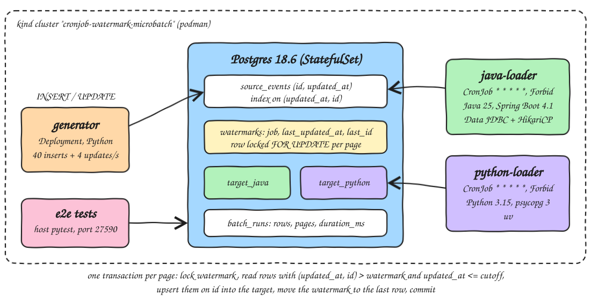

<p align="center"></p>

# cronjob-watermark-microbatch

Micro-batch loading using only Kubernetes CronJobs and a watermark table in Postgres, with no ETL framework. A generator keeps inserting and updating rows in `source_events`. Every minute, two CronJobs each copy the new rows into their own target table. One is written in Java 25 (Spring Boot 4.1, Spring Data JDBC, HikariCP) and the other in Python 3.15 (uv, psycopg 3). Each one keeps its own watermark row, `(last_updated_at, last_id)`, and upserts on the primary key. The target rows and the watermark move forward in the same transaction. End-to-end tests on kind check that nothing is missing or duplicated, that a rerun changes nothing, that a killed batch loses nothing, and that late rows with the same timestamp still arrive.

## How it Works

1. `scripts/setup.sh` creates the kind cluster `cronjob-watermark-microbatch`, builds both loader images, loads them and `postgres:18.6-alpine` into kind, and starts Postgres as a StatefulSet. On first start, Postgres runs `sql/schema.sql` from a ConfigMap.
2. `scripts/start-all.sh` deploys the generator (20 inserts and 2 updates every 500 ms, all stamped `updated_at = now()`) and both CronJobs (`* * * * *`, `concurrencyPolicy: Forbid`), then port-forwards Postgres to 27590.
3. Each scheduled run reads one `cutoff = clock_timestamp() - 2s`, then loads page by page (up to 500 rows per page). Each page is one transaction:
   * `SELECT ... FROM watermarks WHERE job = ? FOR UPDATE`
   * `SELECT ... FROM source_events WHERE (updated_at, id) > (wm_ts, wm_id) AND updated_at <= cutoff ORDER BY updated_at, id LIMIT 500`
   * `INSERT INTO target_<job> ... ON CONFLICT (id) DO UPDATE`
   * `UPDATE watermarks SET last_updated_at, last_id` = the largest `(updated_at, id)` on the page
   * `COMMIT`
4. The run stops at the first empty page, writes one `batch_runs` row (rows, pages, duration) and exits 0.

## Architecture



## Features

* Watermark plus id tiebreak: `(updated_at, id)` is a total order, so rows that share a timestamp are paged by id and never skipped, even when the tie spans several pages.
* Load and watermark in one transaction: a crash at any point either commits both or neither, so a gap or a double advance cannot happen.
* Upsert on primary key: loading a row again is harmless, so reruns and full replays are idempotent and nothing is duplicated.
* Updated rows flow through: an update moves `updated_at` past the watermark, so the next batch re-upserts the row with its new values.
* Commit-lag cutoff: rows newer than `now - 2s` wait for the next run, which gives in-flight insert transactions time to commit before the watermark passes them.
* `FOR UPDATE` on the watermark row: a manual run that overlaps a scheduled run waits instead of loading the same page twice. `concurrencyPolicy: Forbid` already stops scheduled runs from overlapping each other.
* Per-run metrics in `batch_runs`: rows, pages and wall-clock duration of every batch, for both loaders.

## Stack

* Kubernetes CronJob: the scheduler, retry and history keeper, so no Airflow or ETL engine is needed.
* Postgres 18.6 (`postgres:18.6-alpine`, StatefulSet): source, targets, watermarks and run log in one database.
* Java 25.0.4 (`eclipse-temurin:25.0.4.1_1-jre-noble`) + Spring Boot 4.1.2: non-web app that runs once and exits.
* Spring Data JDBC: `CrudRepository` for the watermark and run rows, with `@Query ... FOR UPDATE` for the lock; `JdbcClient` and `JdbcTemplate.batchUpdate` for the page read and upsert.
* HikariCP (Spring Boot default): connection pool, sized to 2, with `ApplicationName=loader-java` so the batch shows up in `pg_stat_activity`.
* Python 3.15.2 (`python:3.15.2-slim`) + uv 0.10.4: the second loader and the generator, in one image.
* psycopg 3.3.8: Postgres driver, with `sql.Identifier` for the table name and `class_row` for typed rows.
* pytest 9.2.0 and ty 0.0.99: unit tests, end-to-end tests and type checks.
* kind v0.31 on podman: local cluster with 1 node.

## Contracts and data structures

```sql
source_events (id bigserial PK, account text, amount_cents bigint, updated_at timestamptz)   index (updated_at, id)
target_java   (id bigint PK, account text, amount_cents bigint, updated_at timestamptz)
target_python (same as target_java)
watermarks    (job text PK, last_updated_at timestamptz, last_id bigint, advanced_at timestamptz)
batch_runs    (id, job, runner, started_at, duration_ms, rows_loaded, pages, last_updated_at, last_id)
```

Loader environment (same names for Java and Python):

| Variable | Default | Meaning |
|---|---|---|
| `PAGE_SIZE` | 500 | rows per transaction |
| `LAG_SECONDS` | 2 | rows newer than `now - lag` wait for the next run |
| `HOLD_BEFORE_COMMIT_MS` | 0 | sleep after the upsert and before the commit, used by the kill test |
| `JOB` (Python only) | python | watermark row and target table `target_<job>` |

Every run prints one line. These are the first scheduled runs of each loader, copied from the pod logs:

```
job=java runner=java-loader-29901251-h998g rows=2354 pages=5 duration_ms=128 watermark=2026-11-07T18:10:59.640144Z/2010
job=python runner=python-loader-29901251-gzrv6 rows=2333 pages=5 duration_ms=39 watermark=2026-11-07T18:10:59.101882+00:00/2284
```

## Design decisions

* Each loader owns its own watermark row and target table, so the Java and Python loaders run side by side and are checked against the same source on their own.
* The watermark never moves backwards: `advance` takes the max of the current watermark and the page (`Watermark.java`, `watermark.py`), and unit tests on both sides cover this.
* The job name becomes a table name, so it must match `[a-z]+` (both loaders reject anything else), and Python also quotes it with `sql.Identifier`.
* The cutoff is read once per run, so a run under heavy load still ends, and rows that arrive meanwhile go to the next minute.
* The Java loader ends with `System.exit(SpringApplication.exit(...))`, so the Job pod finishes as soon as the batch is done.
* Known limit: a transaction that stays open longer than `LAG_SECONDS` and then commits a row with an older `updated_at` would land behind the watermark. Raise `LAG_SECONDS` above your longest writer transaction, or stamp `updated_at` at commit time with a trigger.

## How to run

Requirements: podman, kind, kubectl, JDK 25 (sdkman `25.0.4-amzn`), Maven, uv, lsof.

```bash
./scripts/setup.sh
./scripts/start-all.sh
./scripts/test-all.sh
./scripts/sql-console.sh
./scripts/stop-all.sh
./scripts/teardown.sh
```

`test-all.sh` runs:

* `mvn test`: watermark ordering (ties broken by id, never moves back, same instant in different offsets) and config validation.
* `uv run pytest` + `uv run ty check` in `python-loader/`: the same rules for the Python loader.
* `e2e/tests/test_microbatch.py` against the cluster, each test for both `java` and `python`:
  * `test_scheduled_cronjobs_load_live_inserts_with_no_gaps_and_no_duplicates`: waits for two scheduled batches with rows while the generator is running. In one snapshot, every source row up to the watermark must be in the target with the same values, no target row may be missing from source, and no target row may be past the watermark.
  * `test_rerun_and_full_replay_change_nothing`: suspends the CronJobs and stops the generator. A rerun loads 0 rows, and the target fingerprint (md5 of all rows) and the watermark do not change. Then it resets the watermark to 1970 and replays every row: same fingerprint, same watermark.
  * `test_killed_batch_keeps_watermark_and_next_run_catches_up`: adds 300 rows and starts a batch with `HOLD_BEFORE_COMMIT_MS=300000`. It waits until that backend is `idle in transaction` (the upsert is done), checks that nothing is visible yet, then force-deletes the pod. After Postgres rolls back, the watermark and target are unchanged, and the next run loads exactly 300 rows.
  * `test_late_rows_with_the_watermark_timestamp_are_not_lost_across_pages`: inserts 1200 rows with `updated_at` equal to the current watermark timestamp. The next run loads all 1200 in exactly 3 pages of up to 500, and the watermark stays on that timestamp with a higher id.
* A summary query over `batch_runs`, shown in Results.

## Results

Measured on kind (1 node, podman, Apple Silicon) with the generator at 40 inserts and 4 updates per second. `duration_ms` covers the batch only, from the cutoff read to the last commit. JVM and pod startup are not included.

`./scripts/test-all.sh`: 8 Java unit tests, 9 Python unit tests, `ty` clean on both Python projects, and 8 end-to-end tests passed in 100.9 s:

```
test_scheduled_cronjobs_load_live_inserts_with_no_gaps_and_no_duplicates[java] PASSED
test_scheduled_cronjobs_load_live_inserts_with_no_gaps_and_no_duplicates[python] PASSED
test_rerun_and_full_replay_change_nothing[java] PASSED
test_rerun_and_full_replay_change_nothing[python] PASSED
test_killed_batch_keeps_watermark_and_next_run_catches_up[java] PASSED
test_killed_batch_keeps_watermark_and_next_run_catches_up[python] PASSED
test_late_rows_with_the_watermark_timestamp_are_not_lost_across_pages[java] PASSED
test_late_rows_with_the_watermark_timestamp_are_not_lost_across_pages[python] PASSED
8 passed in 100.89s
```

Every scheduled batch, one per minute (from `batch_runs`):

| Minute (UTC) | java rows | java pages | java ms | python rows | python pages | python ms |
|---|---|---|---|---|---|---|
| 18:11 (first run, catch-up) | 2354 | 5 | 128 | 2333 | 5 | 39 |
| 18:12 | 2511 | 6 | 95 | 2533 | 6 | 32 |
| 18:13 (missed slot run after tests resumed the CronJobs) | 1200 | 3 | 76 | 0 | 0 | 2 |
| 18:14 | 2009 | 5 | 86 | 1987 | 4 | 24 |
| 18:15 | 2601 | 6 | 109 | 2601 | 6 | 34 |
| 18:16 | 2596 | 6 | 97 | 2596 | 6 | 37 |
| 18:17 | 2604 | 6 | 92 | 2626 | 6 | 34 |

Summary over all batches seen by `test-all.sh` (manual = the runs the e2e tests started, including two full replays of 4860 rows):

| job | trigger | runs | rows total | rows avg | rows max | ms avg | ms p50 | ms max |
|---|---|---|---|---|---|---|---|---|
| java | cron | 2 | 4865 | 2433 | 2511 | 112 | 95 | 128 |
| java | manual | 7 | 6814 | 973 | 4860 | 66 | 59 | 135 |
| python | cron | 2 | 4866 | 2433 | 2533 | 36 | 32 | 39 |
| python | manual | 7 | 8014 | 1145 | 4860 | 15 | 7 | 57 |

* At steady state a batch moves about 2600 rows (one minute of inserts plus updated rows) in 6 pages. That takes about 90-110 ms in the Java loader and about 35 ms in the Python loader.
* Measured from Job start to completion, both CronJob runs take 3-4 s in Kubernetes. Pod scheduling and container start take most of that. The Java loader's Spring context starts in about 1 s.
* After the tests, with the CronJobs running again: `source_events` held 18240 rows, and `target_java` and `target_python` held 16860 each. Both watermarks were at the same `(updated_at, id)`, and the no-gap / no-orphan / not-ahead check still passed.

## Scripts

All scripts live in `scripts/` and run from any directory of the repository.

| Script | What it does |
|---|---|
| `./scripts/setup.sh` | Creates the kind cluster, builds and loads both loader images and Postgres, starts Postgres with the schema |
| `./scripts/start-all.sh` | Deploys the generator and both CronJobs, port-forwards Postgres and prints its URL |
| `./scripts/status.sh` | Shows the cluster, Postgres and generator readiness, CronJob state, each watermark with its run count, and every port as UP or DOWN |
| `./scripts/test-all.sh` | Runs Java and Python unit tests, ty, the end-to-end tests and prints batch results |
| `./scripts/sql-console.sh` | Opens psql inside the Postgres pod, or runs `psql` with the given args (such as `-c "SELECT * FROM watermarks"`) |
| `./scripts/stop-all.sh` | Stops the port-forward and removes the generator, CronJobs and Jobs. Postgres keeps its data |
| `./scripts/teardown.sh` | Deletes the kind cluster and the two local loader images |

Ports are declared in `scripts/ports.env`: `postgres=27590` (`postgresql://localhost:27590/microbatch`, user and password `microbatch`).

```bash
./scripts/setup.sh
./scripts/start-all.sh
./scripts/status.sh
./scripts/sql-console.sh
./scripts/stop-all.sh
```
