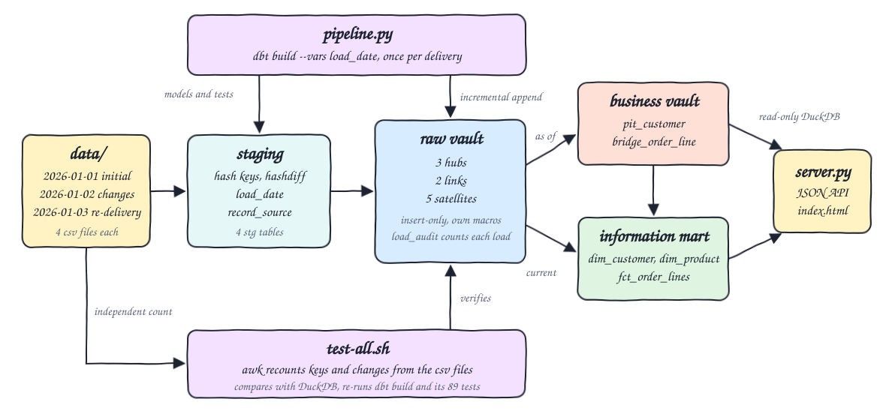
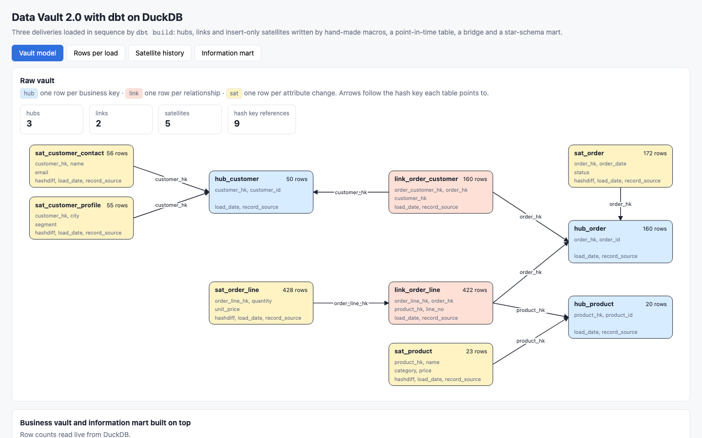
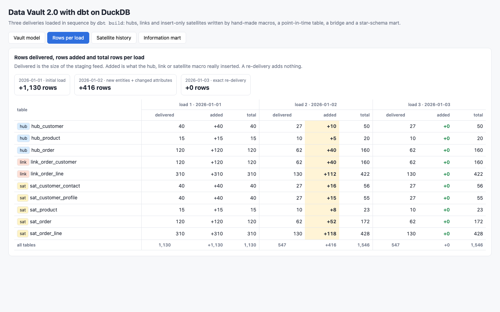
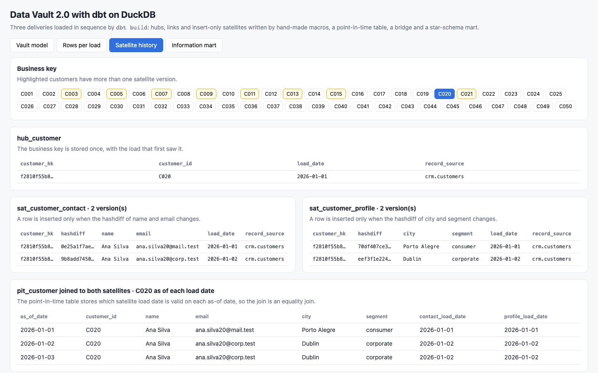
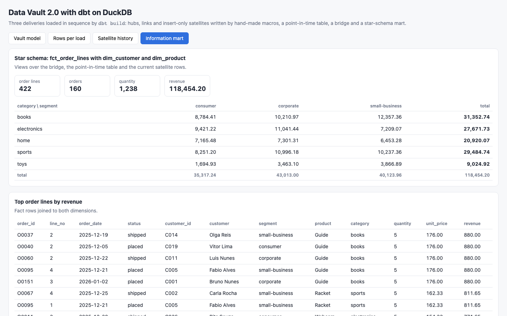

<p align="center"></p>

# data-vault-2-dbt

A Data Vault 2.0 warehouse modelled with dbt-core 1.12.5 on DuckDB 1.5.5 for a small domain: customers, products, orders and order lines. Staging adds hash keys, hashdiffs, load date and record source; the raw vault has 3 hubs, 2 links and 5 insert-only satellites written with hand-made dbt macros (no third-party package); the business vault adds a point-in-time table and a bridge; the information mart is a star schema of views. Three source deliveries are loaded in sequence (initial load, new entities plus changed attributes, exact re-delivery) and the Data Vault properties are proven with numbers recomputed by awk from the CSV files.

## How it Works

1. `data/` holds one folder per delivery, named by its load date, each with `customers.csv`, `products.csv`, `orders.csv` and `order_lines.csv`. `2026-01-03` is a byte-identical copy of `2026-01-02`.
2. `app/pipeline.py` deletes the DuckDB file and runs `dbt build --vars '{"load_date": "<date>"}'` once per delivery, in date order.
3. Staging models (`dbt/models/staging`) read the CSV files of that delivery and compute `md5` hash keys from business keys, one hashdiff per satellite, `load_date` and `record_source`.
4. The `hub` macro inserts a business key only when its hash key is not in the hub yet. The `link` macro does the same for a relationship hash key; `link_order_line` carries `line_no` as a dependent child key.
5. The `satellite` macro compares each staged hashdiff with the latest satellite row of the same parent key and inserts only new or changed rows. Nothing is ever updated or deleted.
6. `load_audit` appends, for every load date, the delivered rows and the total rows of each vault table.
7. `pit_customer` stores, for every customer and every load date, which load date of `sat_customer_contact` and `sat_customer_profile` was valid. `bridge_order_line` joins both links.
8. The mart exposes `dim_customer` (through the point-in-time table), `dim_product` and `fct_order_lines` as views.
9. `app/server.py` opens DuckDB read-only per request and serves JSON to `index.html`.
10. `test-all.sh` recounts keys and attribute changes with awk, compares with DuckDB, runs the last load again and checks nothing moved.

## Architecture



## Features

* Hash keys and hashdiffs: `hash_key` and `hashdiff` macros in `dbt/macros/hashing.sql`.
* Hubs, links and satellites as small macros: `dbt/macros/hub.sql`, `link.sql` and `satellite.sql`, each under 25 lines; a model is one macro call.
* Insert-only loading: every raw vault model is `incremental` with no unique key, so dbt only appends.
* Change detection: a satellite grows only when the hashdiff differs from the latest row of that key.
* Split satellites: customer contact (name, email) and profile (city, segment) change at different rates and grow independently.
* Idempotency: an exact re-delivery adds 0 rows; running the same load twice adds 0 rows.
* Business vault: point-in-time table over two satellites and a bridge over two links.
* Information mart: star schema views on top of the vault.
* 89 dbt data tests: `unique`, `not_null`, `relationships` plus two custom generic tests (`unique_per_load`, `changes_only`).
* UI: vault model diagram with live row counts, rows per load, satellite history for any customer and the mart.

## Stack

* dbt-core 1.12.5 with dbt-duckdb 1.11.0: models, macros and tests.
* DuckDB 1.5.5 (Python package): the warehouse, one file in `.run/vault.duckdb`.
* Python 3.14.7: pipeline, SQL console and HTTP server with the standard library only.
* awk: independent verification.
* No container: DuckDB is embedded, so there is no `podman-compose.yml`.

## API

| Method | Path | Returns |
|---|---|---|
| GET | `/api/model` | every table of the raw vault, business vault and mart with kind, columns and live row count, plus the hash key references between vault tables |
| GET | `/api/batches` | per load date and vault table: delivered rows, added rows and total rows |
| GET | `/api/customers` | every customer id with its number of contact and profile satellite versions |
| GET | `/api/history?customer_id=C020` | hub row, both satellite histories and the point-in-time view of one customer |
| GET | `/api/mart` | fact totals, revenue per category and segment, top order lines |

The UI accepts `?tab=model|batches|history|mart` and `&customer=<id>` to open a tab directly.

## Key Design Decisions

* DuckDB through dbt-duckdb, the adapter the other dbt projects of this repository use; no server to run.
* A delivery is a folder named by its load date, and `load_date` is the only dbt variable, so the same project loads any delivery.
* Hubs and links use `not exists` on the hash key; satellites use a left join to the latest row. The mechanics stay visible in plain SQL.
* Hash keys upper-case and trim business keys; hashdiffs only trim, so a change of letter case in an attribute is a change.
* `load_audit` is appended inside the same `dbt build`, so the per-load numbers are measured at load time and not reconstructed later.
* Each hub is fed by one staging model; the deliveries always contain the parents of the orders and order lines they bring, and the `relationships` tests fail the build when they do not.
* The second delivery re-sends unchanged rows on purpose (8 customers, 2 products, 10 orders, 12 order lines), so a satellite that ignored the hashdiff would grow too much and fail the tests.
* The server opens a read-only DuckDB connection per request so `dbt build` can take the write lock while the UI is up.

## Verification

`./scripts/test-all.sh` output:

```
PASS load 2026-01-01 row counts of 3 hubs, 2 links, 5 satellites match awk over the csv files
PASS load 2026-01-02 row counts of 3 hubs, 2 links, 5 satellites match awk over the csv files
PASS load 2026-01-03 row counts of 3 hubs, 2 links, 5 satellites match awk over the csv files
PASS hub_customer never duplicates a key
PASS hub_product never duplicates a key
PASS hub_order never duplicates a key
PASS link_order_customer never duplicates a key
PASS link_order_line never duplicates a key
PASS delivery 2026-01-03 is byte-identical to 2026-01-02
PASS re-delivered load 2026-01-03 adds zero rows to every hub, link and satellite
PASS satellites in load 2026-01-02 skip delivered rows whose hashdiff did not change
PASS api model connects every link and satellite to its parent by hash key
load 2026-01-03: PASS=110 WARN=0 ERROR=0 SKIP=0 NO-OP=0 REUSED=0 TOTAL=110
PASS dbt tests unique, not_null, relationships and custom all pass with zero errors
PASS dbt ran 89 data tests
PASS running the same load again changes no row count
PASS live row counts equal awk over all deliveries
PASS point-in-time table reproduces every customer as of every load date
PASS api history of C020 matches awk as of each load date
PASS mart revenue per category matches awk over the latest state of every order line
PASS api mart total revenue equals the awk total
PASS mart fact has one row per order line link
rows per load from awk (table total):
2026-01-01 hub_customer 40 hub_product 15 hub_order 120 link_order_customer 120 link_order_line 310 sat_customer_contact 40 sat_customer_profile 40 sat_product 15 sat_order 120 sat_order_line 310 
2026-01-02 hub_customer 50 hub_product 20 hub_order 160 link_order_customer 160 link_order_line 422 sat_customer_contact 56 sat_customer_profile 55 sat_product 23 sat_order 172 sat_order_line 428 
2026-01-03 hub_customer 50 hub_product 20 hub_order 160 link_order_customer 160 link_order_line 422 sat_customer_contact 56 sat_customer_profile 55 sat_product 23 sat_order 172 sat_order_line 428 
customer C020 as of each load date from awk:
2026-01-01|C020|Ana Silva|ana.silva20@mail.test|Porto Alegre|consumer
2026-01-02|C020|Ana Silva|ana.silva20@corp.test|Dublin|corporate
2026-01-03|C020|Ana Silva|ana.silva20@corp.test|Dublin|corporate
revenue per category from awk:
books|31352.74
electronics|27671.73
home|20920.07
sports|29484.74
toys|9024.92
all tests passed
```

Measured numbers:

| Table | Load 1 delivered / added / total | Load 2 delivered / added / total | Load 3 delivered / added / total |
|---|---|---|---|
| hub_customer | 40 / 40 / 40 | 27 / 10 / 50 | 27 / 0 / 50 |
| hub_product | 15 / 15 / 15 | 10 / 5 / 20 | 10 / 0 / 20 |
| hub_order | 120 / 120 / 120 | 62 / 40 / 160 | 62 / 0 / 160 |
| link_order_customer | 120 / 120 / 120 | 62 / 40 / 160 | 62 / 0 / 160 |
| link_order_line | 310 / 310 / 310 | 130 / 112 / 422 | 130 / 0 / 422 |
| sat_customer_contact | 40 / 40 / 40 | 27 / 16 / 56 | 27 / 0 / 56 |
| sat_customer_profile | 40 / 40 / 40 | 27 / 15 / 55 | 27 / 0 / 55 |
| sat_product | 15 / 15 / 15 | 10 / 8 / 23 | 10 / 0 / 23 |
| sat_order | 120 / 120 / 120 | 62 / 52 / 172 | 62 / 0 / 172 |
| sat_order_line | 310 / 310 / 310 | 130 / 118 / 428 | 130 / 0 / 428 |
| all | 1130 / 1130 / 1130 | 547 / 416 / 1546 | 547 / 0 / 1546 |

* Load 2 satellites: contact 16 = 10 new customers + 6 changed emails; profile 15 = 10 new + 5 changed city or segment; product 8 = 5 new + 3 price changes; order 52 = 40 new + 12 status changes; order line 118 = 112 new lines + 6 quantity changes.
* Each `dbt build` runs 110 nodes (21 models and 89 data tests) with 0 errors; a full reset and three loads take about 7 seconds.
* The mart has 422 order lines, 160 orders, quantity 1238 and revenue 118454.20.
* Mutation check done while building: replacing the hashdiff filter of the `satellite` macro with `where true` makes the `changes_only` dbt test fail the second load, and with dbt tests bypassed `test-all.sh` fails at the load 2 row counts.

## Printscreens

Vault model: the 3 hubs, 2 links and 5 satellites with their columns and live row counts, and an arrow for each of the 9 hash key references.



Rows per load: delivered, added and total rows of every vault table for the three loads. Highlighted cells are loads where fewer rows were added than delivered; the re-delivery column is all `+0`.



Satellite history of customer C020: one hub row, two versions in each satellite (email changed, city and segment changed on 2026-01-02) and the point-in-time view that returns the attributes valid on each load date.



Information mart: fact totals, revenue per product category and customer segment, and the top order lines joined to both dimensions.



## Scripts

All scripts live in `scripts/` and run from any directory of the repository.

| Script | What it does |
|---|---|
| `./scripts/setup.sh` | Creates the Python 3.14 venv and installs dbt-core, dbt-duckdb and DuckDB |
| `./scripts/start-all.sh` | Resets the vault, loads the three deliveries with `dbt build`, starts the UI and prints the full link of each service |
| `./scripts/status.sh` | Shows every service port as UP or DOWN |
| `./scripts/test-all.sh` | Verifies row counts per load, key uniqueness, idempotency, the point-in-time table and the mart against awk, and re-runs the dbt tests |
| `./scripts/ui.sh` | Opens the UI in the browser |
| `./scripts/stop-all.sh` | Stops the UI |
| `./scripts/sql-console.sh` | Opens a read-only SQL prompt on the vault, or runs the SQL given as argument |

Ports are declared in `scripts/ports.env`: ui 30900.

```bash
./scripts/setup.sh
./scripts/start-all.sh
./scripts/status.sh
./scripts/test-all.sh
./scripts/ui.sh
./scripts/stop-all.sh
```
