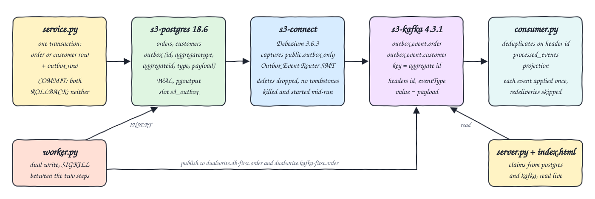
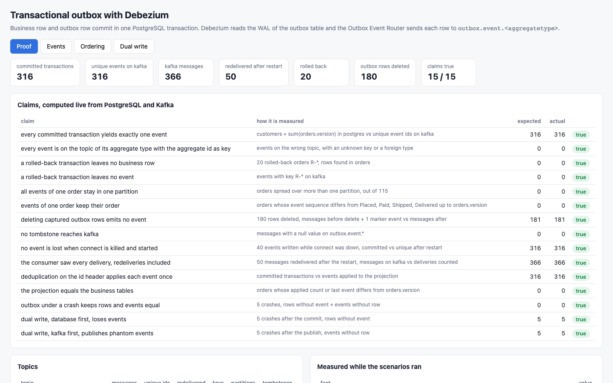
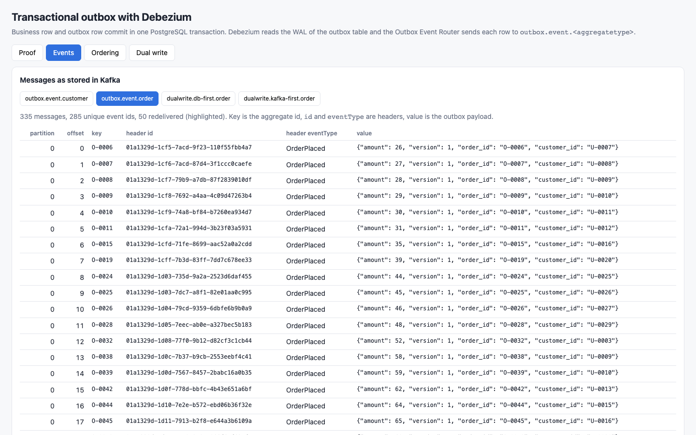
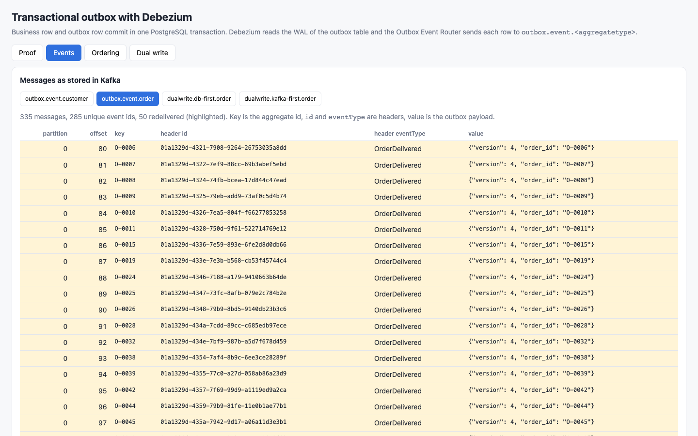
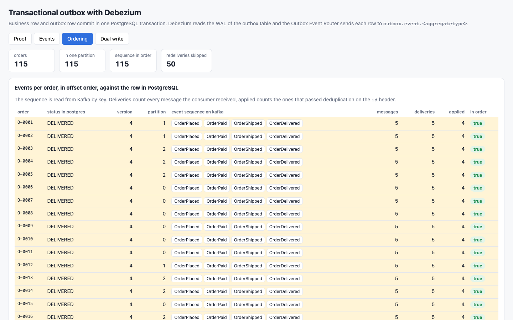
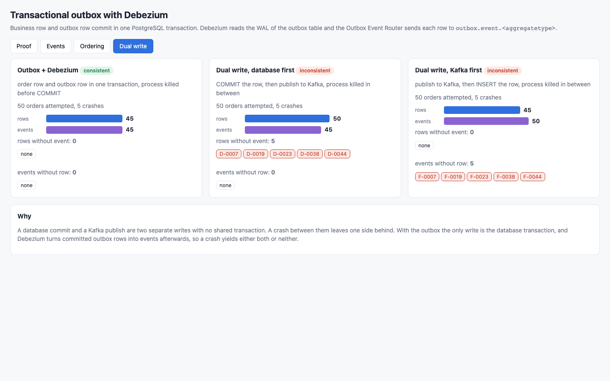

<p align="center"></p>

# debezium-outbox-pattern

The transactional outbox pattern with Debezium 3.6.3 on PostgreSQL 18.6 and Kafka 4.3.1 (KRaft). A small Python 3.14 service writes a business row (an order or a customer) and an `outbox` row in the same database transaction. Debezium captures only the `outbox` table from the WAL (`pgoutput`) and the Outbox Event Router SMT routes each row to a topic per aggregate type, with the aggregate id as the message key, the event id and type as headers and the payload as the value. The POC proves the guarantees with counts, kills Kafka Connect in the middle of the run, and contrasts the pattern with a dual write crashed between its two steps.

## How it Works

1. `start-all.sh` starts `s3-postgres`, `s3-kafka` and `s3-connect` from a clean state and registers `connect/outbox-connector.json`.
2. `app/service.py` holds the business operations; each one writes the business row and calls `emit`, which inserts into `outbox (id, aggregatetype, aggregateid, type, payload)`. The caller owns the transaction.
3. The connector includes only `public.outbox`; `io.debezium.transforms.outbox.EventRouter` sends rows to `outbox.event.order` and `outbox.event.customer`, key = `aggregateid`, headers `id` and `eventType`, value = `payload`.
4. `app/scenarios.py` commits 180 transactions (30 customers, 50 orders placed, paid and shipped), rolls back 20 (10 aborted by the service, 10 rejected by a `CHECK` constraint after the outbox insert), and runs the deduplicating consumer.
5. It deletes the 180 captured outbox rows, commits one marker event and compares the message count before and after.
6. It delivers the 50 orders, kills `s3-connect` with SIGKILL right after those events reach Kafka, writes 40 more events while Connect is down, and starts the container again.
7. `app/consumer.py` reads from its committed offsets, inserts each `id` header into `processed_events` (primary key) and applies the event to `projection` only when the insert is new.
8. `app/worker.py` writes 50 orders three ways (outbox, database first then Kafka, Kafka first then database) and kills itself with SIGKILL between the two steps at orders 7, 19, 23, 38 and 44; the service is restarted and continues with the next order.
9. `app/server.py` recomputes every claim live from PostgreSQL and Kafka and serves it to `index.html`.
10. `test-all.sh` checks the same claims with `psql`, `kafka-console-consumer`, `awk`, `sort` and `comm`, without the Python code.

## Architecture



## Features

* One transaction, two rows: business row and outbox row commit or roll back together.
* Debezium captures only the outbox table through a filtered publication and the `pgoutput` plugin.
* Outbox Event Router: topic per aggregate type, aggregate id as key, `id` and `eventType` headers, payload as value.
* Ordering: all events of one aggregate share a key, so they land in one partition of a 3-partition topic in commit order.
* Outbox cleanup: `DELETE FROM outbox` after capture emits nothing, `tombstones.on.delete` is `false` and the router drops delete records.
* Connect killed and started: no event lost, redelivered events are skipped by a consumer that deduplicates on the `id` header.
* Dual write contrast: the same crash points applied to database-first and Kafka-first variants, with the lost ids listed.
* UI: claims with expected and actual numbers, raw Kafka messages with headers, per-order sequences and the dual write comparison.

## Stack

* PostgreSQL 18.6 (`docker.io/library/postgres:18.6`), `wal_level=logical`, `uuidv7()` for event ids.
* Apache Kafka 4.3.1 in KRaft mode (`docker.io/apache/kafka:4.3.1`), 3 partitions per topic.
* Debezium Kafka Connect 3.6.3.Final (`quay.io/debezium/connect:3.6.3.Final`, Kafka Connect 4.3.0) with the PostgreSQL connector and the Outbox Event Router SMT.
* Python 3.14.7 with `psycopg` 3.3.6 and `confluent-kafka` 2.15.1; the HTTP server is the standard library.
* podman 5.7.1 + podman-compose 1.5.0: memory limits 384m (postgres), 900m (kafka), 900m (connect).
* psql, kafka-console-consumer, awk, sort, comm: independent verification.

## API

| Method | Path | Returns |
|---|---|---|
| GET | `/api/proof` | the 15 claims, each with how it is measured, expected, actual and `ok` |
| GET | `/api/topics` | per topic: messages, unique event ids, redelivered, keys, partitions, tombstones |
| GET | `/api/events` | every message of the outbox and dual write topics: topic, partition, offset, key, `id` and `eventType` headers, value |
| GET | `/api/aggregates` | per order: status and version in PostgreSQL, partitions, event sequence on Kafka, deliveries and applied events in the projection |
| GET | `/api/dualwrite` | per variant: attempts, crashes, rows, events, rows without event, events without row |
| GET | `/api/facts` | numbers recorded while the scenarios ran (message counts before and after the delete and the restart, consumer runs) |

The UI accepts `?tab=proof|events|ordering|dualwrite`, `&topic=<topic>` and `&only=redelivered`.

## Key Design Decisions

* `orders.version` grows by one in every committed order transaction, so `count(customers) + sum(orders.version)` is the number of committed transactions, computed from business tables only. That is the independent side of every count.
* In `place_order` the outbox row is inserted before the order row, so a `CHECK` violation on the order proves the already written outbox row disappears with it.
* Key and value use `StringConverter`: the key is the plain aggregate id and the value is the payload JSON as stored in the `jsonb` column.
* `snapshot.mode` is `no_data`: only changes written after the connector started are events.
* `OFFSET_FLUSH_INTERVAL_MS` is 10000. The scenario waits until the replication slot `confirmed_flush_lsn` has advanced, writes 50 events and kills Connect as soon as they are on Kafka, before the next offset flush. Debezium resumes from the last flushed LSN, so those 50 events are sent twice. Delivery is at least once; exactly-once processing comes from the consumer.
* The consumer commits Kafka offsets after the PostgreSQL transaction, and `processed_events.event_id` is the primary key, so a redelivery is an `ON CONFLICT DO NOTHING`.
* The dual write workers really die (`SIGKILL` on their own pid) between the two steps; nothing is simulated with flags.
* Rolled-back orders use ids `R-*`, crash variants `K-*` (outbox), `D-*` (database first) and `F-*` (Kafka first), so each population can be counted separately.
* `start-all.sh` always starts from empty volumes when the UI is down, so every run reproduces the same numbers.

## Verification

Measured numbers of the run:

| What | Number |
|---|---|
| committed transactions (31 customers + sum of `orders.version` over 115 orders) | 316 |
| unique event ids on `outbox.event.*` | 316 |
| Kafka messages on `outbox.event.*` | 366 (31 customer, 335 order) |
| messages redelivered after Connect was killed | 50 |
| events written while Connect was down, all delivered after start | 40 |
| rolled-back transactions / rows left / events left | 20 / 0 / 0 |
| outbox rows deleted / messages before / after one marker event | 180 / 180 / 181 |
| tombstones | 0 |
| orders in exactly one partition / with lifecycle sequence in order | 115 / 115 |
| consumer deliveries / events applied after deduplication | 366 / 316 |
| outbox with 5 crashes: rows / events / mismatches | 45 / 45 / 0 |
| dual write database first with 5 crashes: rows / events / rows without event | 50 / 45 / 5 |
| dual write Kafka first with 5 crashes: rows / events / events without row | 45 / 50 / 5 |

`./scripts/start-all.sh` scenario output:

```
committed: 180 transactions, 180 messages, 180 unique events
rolled back: 20 transactions, 10 aborted by the service, 10 rejected by a CHECK constraint
dedup consumer 1_before_restart: 180 messages delivered, 180 events processed in total
deleted 180 outbox rows: 180 messages before, 181 after one marker event
connect killed and started: 231 messages before, 40 events written while down, 321 messages after, 271 unique, 50 redelivered
dedup consumer 2_after_restart: 141 messages delivered, 271 events processed in total
crash contrast: 50 orders per variant, process killed 5 times between the two steps
dedup consumer 3_final: 45 messages delivered, 316 events processed in total
scenarios done: 316 committed transactions
```

`./scripts/test-all.sh` output:

```
reading the four topics with kafka-console-consumer
PASS committed transactions in postgres equal unique event ids on kafka
PASS each order has exactly orders.version events under its own key on outbox.event.order
PASS each customer has exactly one event under its own key on outbox.event.customer
PASS outbox.event.customer carries only CustomerRegistered in the eventType header
PASS outbox.event.order carries only order lifecycle types in the eventType header
PASS 20 transactions were rolled back
PASS rolled-back transactions left no order row and no outbox row
PASS rolled-back transactions left no event on kafka
PASS every aggregate id lives in exactly one partition
PASS per order the event sequence by offset is the lifecycle up to orders.version
PASS deleted outbox rows plus remaining outbox rows equal unique events
PASS no tombstone on the outbox topics
PASS every outbox row still in postgres has its event on kafka
PASS the consumer counted every kafka message, redeliveries included
PASS the consumer processed each event id once
PASS events applied to the projection equal committed transactions
PASS projection of every order equals orders.version and its last event
PASS outbox with 5 crashes: 45 rows, 45 events, nothing missing
PASS dual write database first with 5 crashes: 50 rows, 45 events, 5 rows without event
PASS dual write kafka first with 5 crashes: 45 rows, 50 events, 5 events without row
PASS the ui api reports every claim as true
PASS the ui api committed count equals the psql count
committed transactions 316, kafka messages 366, unique events 316, redelivered 50
outbox rows deleted 180, outbox rows remaining 136, rolled back 20, crashes per variant 5
variant rows events rows_without_event events_without_row
outbox 45 45 0 0
db-first 50 45 5 0
kafka-first 45 50 0 5
all 22 tests passed
```

The test fails when a claim is false: a customer row inserted with `psql` and no outbox row makes the first check fail with expected 317, actual 316. It also fails if the restart redelivered nothing, because then deduplication would not have been exercised.

## Printscreens

Proof tab: the totals on top and the 15 claims, each computed live from PostgreSQL and Kafka with its expected and actual number.



Events tab on `outbox.event.order`: the messages as stored in Kafka, with the aggregate id as key, the `id` and `eventType` headers and the outbox payload as value.



Events tab filtered to redelivered messages: the 50 `OrderDelivered` events that Debezium sent a second time after Connect was killed, same `id` header as the first delivery.



Ordering tab: every order with its row in PostgreSQL, its single partition and its event sequence in offset order. Highlighted orders received 5 deliveries and applied 4, the redelivery was skipped.



Dual write tab: the same 5 crashes applied to the three variants. The outbox keeps 45 rows and 45 events, database first leaves 5 rows without event, Kafka first leaves 5 events without row, with the ids listed.



## Scripts

All scripts live in `scripts/` and run from any directory of the repository.

| Script | What it does |
|---|---|
| `./scripts/setup.sh` | Creates the Python 3.14 venv, installs `psycopg` and `confluent-kafka`, pulls images |
| `./scripts/start-all.sh` | Starts Postgres, Kafka and Debezium Connect, registers the connector, runs the scenarios, starts the UI and prints the full link of each service |
| `./scripts/status.sh` | Shows every service port as UP or DOWN |
| `./scripts/test-all.sh` | Verifies every claim with psql, kafka-console-consumer and awk |
| `./scripts/ui.sh` | Opens the UI in the browser |
| `./scripts/stop-all.sh` | Stops every service |
| `./scripts/sql-console.sh` | Opens `psql` on the `shop` database |

Ports are declared in `scripts/ports.env`: postgres 30200, kafka 30201, connect 30202, ui 30203.

```bash
./scripts/setup.sh
./scripts/start-all.sh
./scripts/status.sh
./scripts/test-all.sh
./scripts/ui.sh
./scripts/stop-all.sh
```
