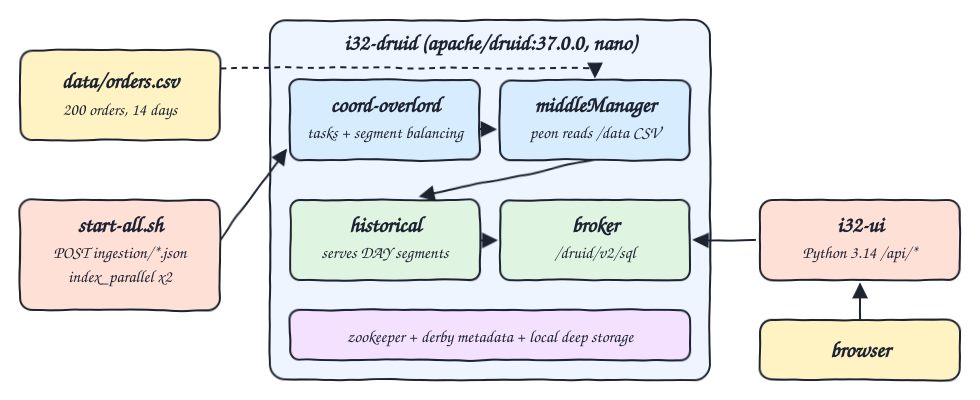
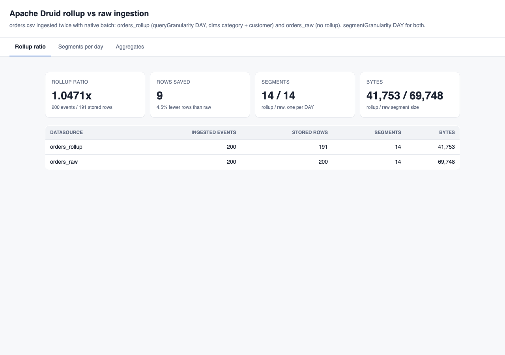
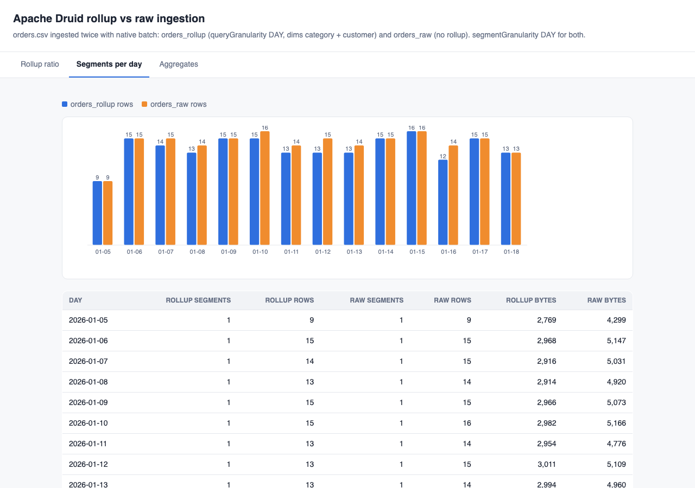
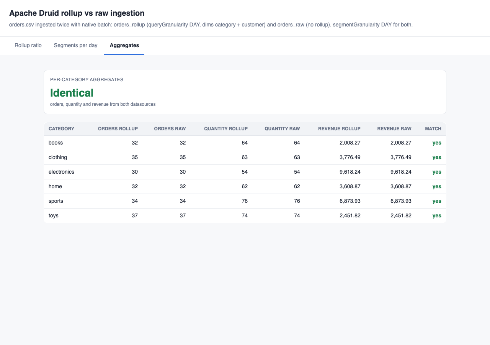

# druid-rollup-ingestion

Apache Druid 37.0.0 running in one container with the single-server nano topology. The same `orders.csv` is ingested twice with native batch (`index_parallel`, local input source): once into `orders_rollup` with rollup on (queryGranularity DAY, dimensions category + customer, metrics count / sum quantity / sum revenue) and once into `orders_raw` with rollup off. Both use segmentGranularity DAY. A small Python UI queries the Druid SQL API and shows the rollup ratio, the segments per day and proves that the per-category aggregates are identical from both datasources. Everything is checked against awk.

## How it Works

1. `i32-druid` starts ZooKeeper, coordinator-overlord, broker, historical and middleManager from the stock nano-quickstart configs through `druid/launch.sh` (the image is distroless, so the perl `supervise` script can not run).
2. `scripts/start-all.sh` POSTs `ingestion/orders_rollup.json` and `ingestion/orders_raw.json` to the overlord task API, waits for `SUCCESS`, then waits until every published segment is available on the historical.
3. The rollup spec truncates `ts` to the day and merges rows with the same day + category + customer, keeping `count`, `quantity` and `revenue` (`quantity * price` from a transform) as pre-aggregated metrics.
4. The raw spec keeps every CSV line as one Druid row (`rollup: false`, `queryGranularity: NONE`).
5. `i32-ui` (Python 3.14 stdlib only) runs Druid SQL against the broker, including `sys.segments`, and serves JSON under `/api/*` plus a single `index.html`.
6. `scripts/test-all.sh` recomputes every number with awk and compares.

## Architecture



## Features

- Two native batch ingestions of the same file: isolates what rollup changes and what it does not.
- Rollup ratio card: ingested events divided by stored rows, read from `SUM("count")` and `COUNT(*)`.
- Segments per day chart and table from `sys.segments`: shows segmentGranularity DAY (one segment per day in both datasources) and the rows each segment keeps.
- Aggregates tab: per-category orders, quantity and revenue from both datasources side by side with a match flag.
- awk verification of row counts, rows per day segment, ratio and per-category aggregates.
- `sql-console.sh`: run any Druid SQL against the broker from the terminal.

## Stack

- Apache Druid 37.0.0 (`docker.io/apache/druid:37.0.0`, latest stable, image is linux/amd64 only and runs under Rosetta on Apple Silicon).
- Druid bundled Java 17 (the image ships its own JVM, no Java code is written in this POC).
- Python 3.14.7 (`python:3.14.7-slim`) with only the standard library for the UI backend.
- Plain HTML + JS + SVG UI, light theme, no frameworks.
- podman + podman-compose.

## Contracts / APIs

UI backend on `http://localhost:23201`:

| Method | Path | Returns |
|---|---|---|
| GET | `/` | the UI |
| GET | `/api/summary` | per datasource `events`, `stored_rows`, `segments`, `bytes`, plus `rollup_ratio` and `rows_saved` |
| GET | `/api/segments` | one entry per day with segments, rows and bytes of each datasource |
| GET | `/api/categories` | `rollup` and `raw` per-category `orders`, `quantity`, `revenue` and `identical` |

Druid:

| Endpoint | Use |
|---|---|
| `POST http://localhost:23202/druid/indexer/v1/task` | submit an ingestion spec |
| `GET http://localhost:23202/druid/indexer/v1/task/{id}/status` | task state |
| `POST http://localhost:23200/druid/v2/sql` | Druid SQL on the broker |

## Key design decisions

- Rollup datasource queries must use `SUM("count")` to count orders; `COUNT(*)` counts stored rows. The tests assert both on purpose.
- Revenue is computed at ingestion with a transform `cast(quantity) * cast(price)` because CSV columns arrive as strings.
- The raw datasource keeps `quantity`, `price` and `revenue` as typed long / double dimensions so every original row is queryable.
- Router is left out to keep memory low: SQL goes to the broker port, tasks go to the coordinator-overlord port.
- JVMs run with `-XX:+UseSerialGC -XX:TieredStopAtLevel=1`, Xms 64m, broker and historical heaps cut from 512m to 256m. Under Rosetta each Druid JVM still needs roughly 300 MB beyond the heap, so the container settles at about 2.1-2.2 GB (4 Druid JVMs + ZooKeeper + a peon during ingestion).
- No volume: every start is a fresh cluster and `start-all.sh` re-ingests; on an already running cluster it skips datasources whose segments are loaded.
- Segment bytes are shown for context only: the raw datasource also stores order_id, product and price, so its bytes are not a pure rollup comparison.

## Results

| | orders_rollup | orders_raw |
|---|---|---|
| ingested events | 200 | 200 |
| stored rows | 191 | 200 |
| segments (DAY) | 14 | 14 |

Rollup ratio 200 / 191 = 1.0471. The data has 20 customers over 14 days, so only 9 day + category + customer pairs repeat; the ratio is small because the input is small, not because rollup is off. Per-category aggregates are identical in both datasources and match awk:

| category | orders | quantity | revenue |
|---|---|---|---|
| books | 32 | 64 | 2008.27 |
| clothing | 35 | 63 | 3776.49 |
| electronics | 30 | 54 | 9618.24 |
| home | 32 | 62 | 3608.87 |
| sports | 34 | 76 | 6873.93 |
| toys | 37 | 74 | 2451.82 |

## How to run

```bash
./scripts/setup.sh
./scripts/start-all.sh
./scripts/test-all.sh
./scripts/ui.sh
./scripts/sql-console.sh "SELECT __time, category, customer, \"count\" FROM orders_rollup WHERE \"count\" > 1"
./scripts/stop-all.sh
```

## Printscreens

Rollup ratio: 200 ingested events stored as 191 rows in `orders_rollup` against 200 rows in `orders_raw`, 14 DAY segments each.



Segments per day: one segment per day in both datasources, blue bars are the rows the rollup segment keeps, orange bars the raw rows. Days where a customer bought twice in the same category are the days where blue is shorter.



Aggregates: orders, quantity and revenue per category from both datasources, every row matches.



## Scripts

All scripts live in `scripts/` and run from any directory of the repository.

| Script | What it does |
|---|---|
| `./scripts/setup.sh` | Pulls the Druid image and builds the UI image |
| `./scripts/start-all.sh` | Starts Druid, runs both ingestions, starts the UI and prints the full link of each service |
| `./scripts/status.sh` | Shows every service port as UP or DOWN |
| `./scripts/test-all.sh` | Verifies row counts, segments per day, ratio and aggregates against awk |
| `./scripts/ui.sh` | Opens the UI in the browser |
| `./scripts/stop-all.sh` | Stops every service |
| `./scripts/sql-console.sh` | Opens a Druid SQL console on the broker |

Ports are declared in `scripts/ports.env`: broker 23200, ui 23201, overlord 23202.

```bash
./scripts/setup.sh
./scripts/start-all.sh
./scripts/status.sh
./scripts/ui.sh
./scripts/stop-all.sh
```
