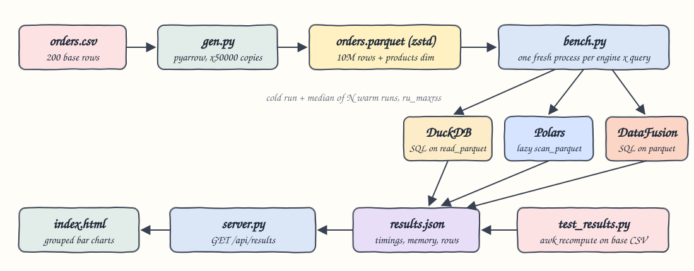
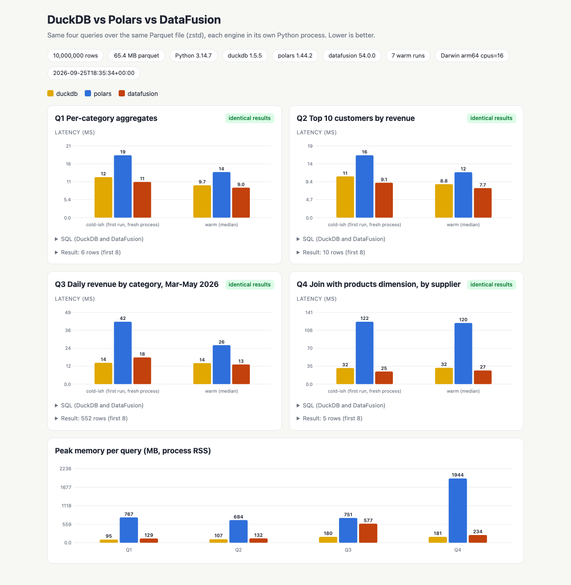
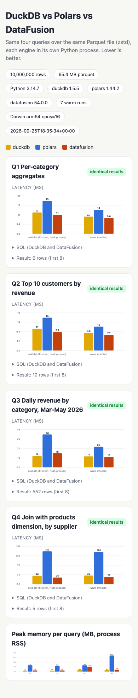

# DuckDB vs Polars vs DataFusion

Runs the same four analytical queries in DuckDB, Polars and Apache DataFusion on Python 3.14, all reading one 10M-row Parquet file (zstd). It records a cold-ish run and the median of N warm runs, plus peak process memory. It checks that all three engines return exactly the same rows, checks the results against an awk recompute of the base CSV, and shows everything in a small web UI with grouped bar charts.

## How it Works?

1. `src/gen.py` reads the 200-row `data/orders.csv` and writes 50,000 deterministic copies to `data/orders.parquet` (10,000,000 rows, zstd, 50 row groups, about 65 MB). Copy `k` gets `order_id = k*100000 + id` and its timestamp moves forward `k % 365` days. Customer, product, category, quantity and price stay the same, so each aggregate is the base value times 50,000.
2. Prices are stored as integer cents (`price_cents`), so revenue sums are exact integers in all three engines and can be compared with `==`.
3. It also writes `data/products.parquet`, a 31-row products dimension that assigns each product to one of 5 suppliers.
4. `src/bench.py` starts a fresh Python process (`src/worker.py`) for every engine and query pair. The worker opens the engine, runs the query once (cold-ish), runs it N more times (warm, N=7), and reports the median and the `ru_maxrss` peak memory from the `resource` module.
5. Every run starts from the Parquet file, and the timing covers query plus materialization into Python rows.
6. Rows are normalized (dates become ISO strings) and compared across engines. If any query differs, the benchmark fails.
7. `tests/test_results.py` recomputes Q1 and Q2 with awk over the base CSV times the expansion factor and checks Q3's date range and Q4's join cardinality.
8. `src/server.py` (stdlib `http.server`) serves `ui/index.html` and `GET /api/results`.

## Architecture



## Features

- **Same data, same answers**: every query is checked for identical output across the three engines, so the speed comparison is between equivalent results.
- **Independent check**: awk recomputes Q1 and Q2 from the 200-row CSV, so a bug that all three engines share would still be caught.
- **Process isolation**: each engine and query pair runs in its own process, so caches, allocators and thread pools never carry over between engines.
- **Cold-ish vs warm**: the first run in a new process includes planning and allocator warm-up. The warm median shows steady-state speed.
- **Peak memory**: RSS high-water mark per process, with the baseline after engine import also recorded.
- **Exact integer money**: revenue is in cents (int64), so there are no float-ordering differences between engines.

## Stack

- **Python 3.14.7**: required language version. All three engines publish cp314 wheels.
- **DuckDB 1.5.5**: embedded analytical SQL engine.
- **Polars 1.44.2**: DataFrame engine, used through its lazy API (`scan_parquet`).
- **DataFusion 54.0.0**: Apache Arrow DataFusion Python bindings (SQL).
- **PyArrow 25.0.1**: generates the dataset and converts DataFusion results.
- **awk**: independent verification of the results.
- **stdlib http.server + plain JS/SVG**: UI with no frameworks.

All versions were the latest on PyPI when this was built. No container is used because the benchmark is pure in-process Python and needs no infrastructure.

## Queries

| Id | Query | DuckDB / DataFusion | Polars |
|---|---|---|---|
| Q1 | Per-category count, sum quantity, sum revenue | SQL `GROUP BY category` | `group_by().agg()` |
| Q2 | Top 10 customers by revenue (ties by name) | `ORDER BY revenue DESC, customer LIMIT 10` | `sort().head(10)` |
| Q3 | Daily revenue by category, `2026-03-01 <= ts < 2026-06-01` | `CAST(ts AS DATE)` group | `dt.date()` group |
| Q4 | Join orders with the products dimension, by supplier: orders, distinct customers, revenue | `JOIN products` | `join(products)` |

DuckDB and DataFusion run the exact same SQL text from `src/queries.py`. The Polars expressions are in `src/polars_queries.py`.

## Results

Apple Silicon (arm64), 16 cores, 10,000,000 rows, 7 warm runs. Values are in ms and MB peak RSS.

| Query | DuckDB cold / warm / MB | Polars cold / warm / MB | DataFusion cold / warm / MB |
|---|---|---|---|
| Q1 | 12.1 / 9.7 / 95 | 18.6 / 13.6 / 767 | 10.7 / 9.0 / 129 |
| Q2 | 10.8 / 8.8 / 107 | 16.3 / 11.9 / 684 | 9.1 / 7.7 / 132 |
| Q3 | 14.5 / 14.2 / 180 | 42.3 / 26.4 / 751 | 18.0 / 13.3 / 577 |
| Q4 | 31.6 / 32.0 / 181 | 122.5 / 120.0 / 1944 | 24.7 / 26.8 / 234 |

In this run, DuckDB and DataFusion were close on every query. Polars was slower on Q3 and much slower on Q4, where the join on the string `product` column materializes the joined frame before aggregating. Polars also had the highest peak RSS for every query. "Cold-ish" means a new process but a warm OS page cache: the file is read from memory, not disk. Your numbers will depend on the machine.

Verification output:

```
q1 identical=True rows=6
q2 identical=True rows=10
q3 identical=True rows=552
q4 identical=True rows=5
all engines returned identical results for every query
Ran 7 tests ... OK
```

The awk recompute for Q1 matches all engines:

```
books 1600000 3200000 10041350000
clothing 1750000 3150000 18882450000
electronics 1500000 2700000 48091200000
home 1600000 3100000 18044350000
sports 1700000 3800000 34369650000
toys 1850000 3700000 12259100000
```

## Contracts / APIs

| Method | Path | Response |
|---|---|---|
| GET | `/` | the UI |
| GET | `/api/results` | `results.json`: `dataset_rows`, `versions`, `warm_runs`, and `queries[]` with `id`, `title`, `sql`, `columns`, `identical`, `result`, and `engines.{duckdb,polars,datafusion}.{cold_ms,warm_ms,warm_median_ms,base_rss_mb,peak_rss_mb}` |

## Key design decisions

- Revenue is integer cents instead of float dollars, so results compare exactly and awk can recompute them.
- Timestamps are naive `timestamp[us]` (UTC wall clock), so `CAST(ts AS DATE)` does not depend on the session time zone in any engine.
- Each measurement runs in its own subprocess, so `ru_maxrss` is a clean per-engine and per-query peak.
- The dataset is written once by `setup.sh` and reused. `test-all.sh` reruns the full benchmark and then verifies it.

## How to run

```bash
./scripts/setup.sh
./scripts/start-all.sh
./scripts/test-all.sh
./scripts/stop-all.sh
```

Set `BENCH_RUNS` to change the number of warm runs: `BENCH_RUNS=15 ./scripts/test-all.sh`.

## Printscreens

Desktop view. There is one card per query with grouped bars: the left group is the cold-ish first run in a fresh process, the right group is the warm median. The badge shows whether all three engines returned identical rows. Each card can expand to show the SQL and the first result rows. The bottom chart compares peak process memory per query.



Phone-width view of the same page. The cards stack in a single column.



## Scripts

All scripts live in `scripts/` and run from any directory of the repository.

| Script | What it does |
|---|---|
| `./scripts/setup.sh` | Creates the Python 3.14 venv, installs dependencies and generates the 10M-row Parquet dataset |
| `./scripts/start-all.sh` | Runs the benchmark if `results.json` is missing, starts the UI and prints its link |
| `./scripts/status.sh` | Shows the UI port as UP or DOWN |
| `./scripts/test-all.sh` | Reruns the benchmark and verifies engine agreement and the awk recompute |
| `./scripts/ui.sh` | Opens the UI in the browser |
| `./scripts/stop-all.sh` | Stops the UI server |

Ports are declared in `scripts/ports.env` (UI on 22900).

```bash
./scripts/setup.sh
./scripts/start-all.sh
./scripts/status.sh
./scripts/ui.sh
./scripts/stop-all.sh
```
