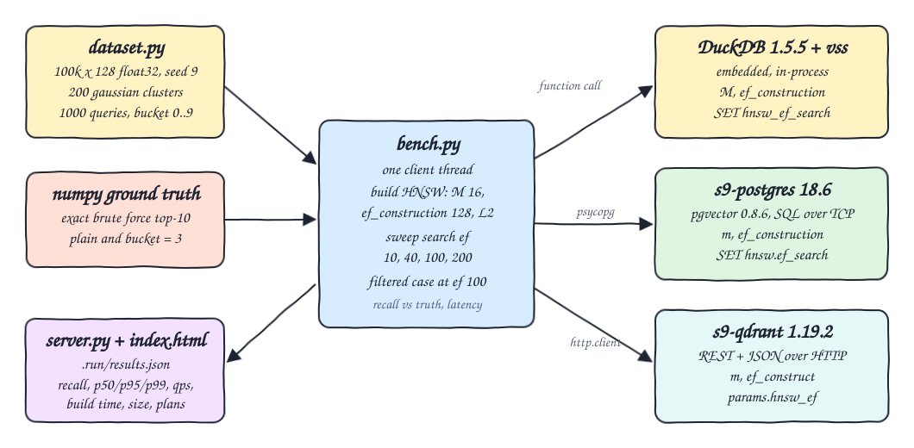
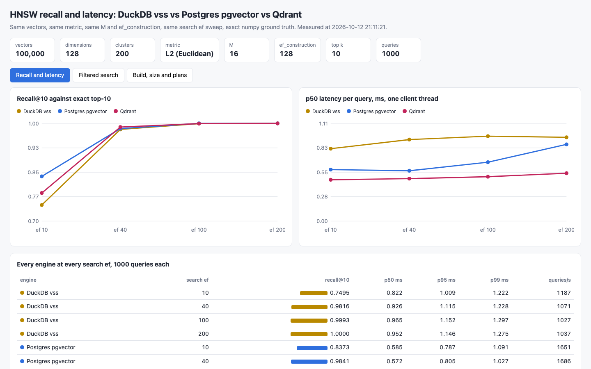
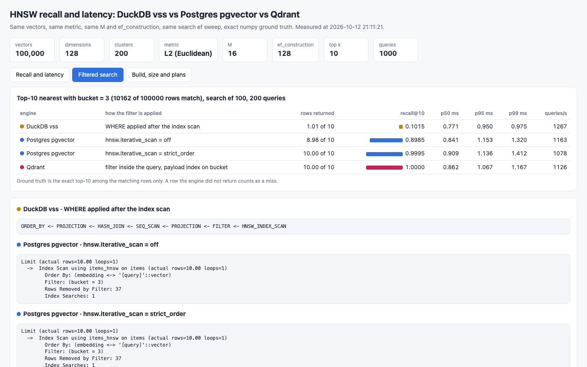
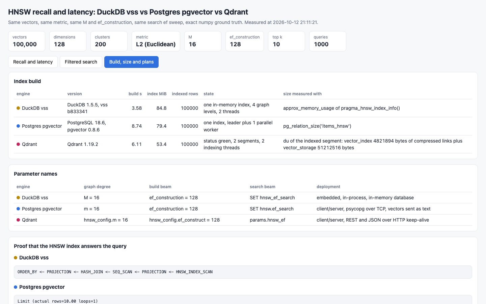

<p align="center">&nbsp;&nbsp;&nbsp;&nbsp;&nbsp;&nbsp;</p>

# duckdb-vss-vs-pgvector-vs-qdrant

Three HNSW implementations measured on recall and latency with the same index settings: the DuckDB 1.5.5 `vss` extension (embedded), PostgreSQL 18.6 with pgvector 0.8.6, and Qdrant 1.19.2. All three index the same 100,000 clustered 128-dimension vectors with L2 distance, `M = 16` and `ef_construction = 128`, and answer the same 1,000 queries at search ef 10, 40, 100 and 200. Ground truth is an exact brute-force top-10 computed with numpy. A filtered search (vector search plus `bucket = 3`) is measured too, because the three engines behave very differently there. A small Python 3.14 UI shows the results.

## How it Works

1. `start-all.sh` starts `s9-postgres` and `s9-qdrant` (896 MiB and 2 CPUs each) and runs `app/bench.py`.
2. `app/dataset.py` generates 100,000 float32 vectors around 200 gaussian cluster centres with a fixed seed, 1,000 queries from the same clusters and a random `bucket` 0..9 per row.
3. numpy computes the exact top-10 for every query, plain and restricted to `bucket = 3`.
4. Each engine loads the same rows, then builds one HNSW index with `M 16`, `ef_construction 128`, L2. Only the index build is timed.
5. For each search ef, 50 warm-up queries run, then 1,000 queries are timed one by one on a single client thread.
6. Recall@10 is the share of the exact top-10 ids the engine returned; p50, p95, p99 and queries/s come from the per-query timings.
7. The filtered case runs 200 queries at search ef 100 and counts every row the engine failed to return as a miss.
8. Raw returned ids go to `.run/ids/`, the summary to `.run/results.json`, served by `app/server.py` to `index.html`.
9. `test-all.sh` recomputes every recall with awk, checks numpy against a Postgres sequential scan and a Qdrant `exact` search, and proves the indexes are used.

## Architecture



## Features

* Same data everywhere: deterministic seed, 100,000 x 128 float32, clustered so that recall is meaningful.
* Same HNSW settings: degree 16, build beam 128, L2, search beam swept over 10, 40, 100, 200.
* Independent ground truth: exact brute force in numpy, cross-checked by two other exact scans.
* Per engine and ef: recall@10, p50, p95, p99, queries/s, plus build time and index size.
* Proof of index use: `EXPLAIN` in Postgres, `HNSW_INDEX_SCAN` in the DuckDB plan, `indexed_vectors_count` and green status in Qdrant.
* Filtered search: the same predicate in each engine, with recall and rows returned.
* UI with three tabs: recall and latency, filtered search, build size and plans.

## Stack

* DuckDB 1.5.5 (Python package) with the `vss` extension build `b833341`: embedded HNSW (usearch).
* PostgreSQL 18.6 with pgvector 0.8.6 (`docker.io/pgvector/pgvector:0.8.6-pg18-trixie`).
* Qdrant 1.19.2 (`docker.io/qdrant/qdrant:v1.19.2`), called through REST with the Python standard library.
* Python 3.14.7, numpy 2.5.4, psycopg 3.3.6: data generation, ground truth, benchmark, HTTP server.
* podman + podman-compose: runs Postgres and Qdrant.
* awk, psql and curl: independent verification.

### Parameter mapping

| Meaning | DuckDB vss | pgvector | Qdrant |
|---|---|---|---|
| max links per node (layer 0 gets 2 x m in pgvector and Qdrant, and `M0` defaults to 2 x `M` in DuckDB vss) | `M = 16` | `m = 16` | `hnsw_config.m = 16` |
| candidate list while building | `ef_construction = 128` | `ef_construction = 128` | `hnsw_config.ef_construct = 128` |
| candidate list while searching | `SET hnsw_ef_search = n` | `SET hnsw.ef_search = n` | `params.hnsw_ef = n` per request |
| distance | `metric = 'l2sq'`, `array_distance` | `vector_l2_ops`, `<->` | `distance: Euclid` |

## API

| Method | Path | Returns |
|---|---|---|
| GET | `/` | the UI, `?tab=sweep`, `?tab=filtered` or `?tab=build` opens a tab directly |
| GET | `/api/results` | settings, and per engine: version, build seconds, index bytes, plan, the ef sweep (recall, returned, p50, p95, p99, queries/s) and the filtered runs |

## Key Design Decisions

* Latency is the whole client call: building the query text or JSON, the round trip, reading 10 ids back. That is what an application sees, and it is also why the three are not perfectly like-for-like.
* DuckDB runs inside the measuring process with no network; pgvector is reached with psycopg over TCP with the vector sent as text; Qdrant is reached with REST and JSON over a keep-alive HTTP connection (gRPC would be faster). At 100,000 vectors the graph walk is so short that this fixed cost dominates, so latency barely moves with ef.
* The DuckDB query inlines the vector as a literal. With a bound parameter the same query took about 8 ms instead of 0.8 ms on this version, so the literal form is used.
* The DuckDB index is in memory (HNSW persistence is still experimental in `vss`), so its build time and size are not measured on disk like the other two.
* Qdrant is loaded with `indexing_threshold = 0` (no index), then the threshold is set back to 10000 and the time until the collection is green with `indexed_vectors_count = 100000` is the build time. Without that wait Qdrant would answer from unindexed segments with an exact scan.
* Qdrant uses `default_segment_number = 1`; it still reports 2 segments, one holding the whole HNSW graph and one small appendable segment. More segments would mean several smaller graphs searched and merged, which changes both recall and latency.
* Quantization is off in all three (`quantization_config` is null in Qdrant, plain `vector` in pgvector, float32 in DuckDB).
* Build threads are aligned at 2: DuckDB `threads = 2`, Postgres leader plus 1 parallel worker with `maintenance_work_mem = 384MB`, Qdrant `max_indexing_threads = 2`. The containers have 2 CPUs each, the DuckDB process is not limited by a container.
* Index size is not the same thing in each engine: DuckDB reports approximate memory of graph plus vectors, pgvector the on-disk index relation (graph plus a copy of the vectors), Qdrant keeps compressed links (4.6 MiB) apart from the vector storage (48.8 MiB); the two are added.
* One client thread only. Nothing here says how the engines scale with concurrent clients.
* HNSW builds with more than one thread are not deterministic, so recall changes in the third decimal from run to run.
* Filtered search: DuckDB `vss` applies `WHERE` after the index returned its top 10, so about 1 row of 10 survives a 10% filter. pgvector also filters after the index scan, over `ef_search` candidates, so it returns fewer than 10 rows unless `hnsw.iterative_scan` keeps scanning. Qdrant evaluates the filter during the search with a payload index on `bucket` and always returned the exact answer.
* Other POCs were being built in the same podman VM while these numbers were measured. Re-run on an idle machine before quoting any latency.

## Verification

`./scripts/test-all.sh` output:

```
ground truth: numpy brute force against two other exact scans
PASS numpy top-10 equals postgres sequential scan top-10 on 20 queries
PASS numpy top-10 equals qdrant exact=true top-10 on 20 queries
reported recall recomputed with awk from the raw ids each engine returned
PASS duckdb-vss ef 10 recall@10 matches awk
PASS duckdb-vss ef 40 recall@10 matches awk
PASS duckdb-vss ef 100 recall@10 matches awk
PASS duckdb-vss ef 200 recall@10 matches awk
PASS duckdb-vss recall grows with ef, ef 10 against ef 200 (0.7495 < 1.0000)
PASS duckdb-vss recall@10 at ef 200 (1.0000 >= 0.99)
PASS pgvector ef 10 recall@10 matches awk
PASS pgvector ef 40 recall@10 matches awk
PASS pgvector ef 100 recall@10 matches awk
PASS pgvector ef 200 recall@10 matches awk
PASS pgvector recall grows with ef, ef 10 against ef 200 (0.8373 < 1.0000)
PASS pgvector recall@10 at ef 200 (1.0000 >= 0.99)
PASS qdrant ef 10 recall@10 matches awk
PASS qdrant ef 40 recall@10 matches awk
PASS qdrant ef 100 recall@10 matches awk
PASS qdrant ef 200 recall@10 matches awk
PASS qdrant recall grows with ef, ef 10 against ef 200 (0.7862 < 1.0000)
PASS qdrant recall@10 at ef 200 (1.0000 >= 0.99)
same data and same hnsw settings in every engine
PASS postgres holds 100000 rows
PASS qdrant holds 100000 points
PASS qdrant hnsw index covers every point
PASS qdrant collection is green
PASS qdrant m
PASS qdrant ef_construct
PASS qdrant quantization is off
PASS postgres hnsw index definition
PASS duckdb plan reads from HNSW_INDEX_SCAN
PASS vector 4242 is identical in postgres and qdrant
the indexes are really used, live queries
PASS postgres EXPLAIN uses the hnsw index
PASS postgres filtered EXPLAIN uses the hnsw index
PASS postgres live hnsw recall@10 at ef 200 against its own exact scan (1.0000 >= 0.95)
PASS qdrant live hnsw recall@10 at ef 200 against its own exact search (1.0000 >= 0.95)
filtered search, bucket = 3
PASS duckdb-vss-filtered0 recall@10 matches awk
PASS duckdb-vss-filtered0 returns only bucket 3
PASS pgvector-filtered0 recall@10 matches awk
PASS pgvector-filtered0 returns only bucket 3
PASS pgvector-filtered1 recall@10 matches awk
PASS pgvector-filtered1 returns only bucket 3
PASS qdrant-filtered0 recall@10 matches awk
PASS qdrant-filtered0 returns only bucket 3
PASS duckdb vss filters after the index scan and returns fewer than 10 rows (1.015 < 10)
PASS duckdb vss filtered recall collapses (0.1015 < 0.5)
PASS pgvector without iterative scan returns fewer than 10 rows (8.985 < 10)
PASS pgvector iterative scan off recall is below strict_order (0.8985 < 0.9995)
PASS pgvector iterative scan strict_order filtered recall (0.9995 >= 0.99)
PASS qdrant filtered recall (1.0000 >= 0.99)
recall@10 per engine and ef (engine ef recall):
duckdb-vss 10 0.7495
duckdb-vss 40 0.9816
duckdb-vss 100 0.9993
duckdb-vss 200 1.0000
pgvector 10 0.8373
pgvector 40 0.9841
pgvector 100 1.0000
pgvector 200 1.0000
qdrant 10 0.7862
qdrant 40 0.9889
qdrant 100 0.9994
qdrant 200 1.0000
filtered recall@10 (run returned recall):
duckdb-vss-filtered0 1.015 0.1015
pgvector-filtered0 8.985 0.8985
pgvector-filtered1 10.000 0.9995
qdrant-filtered0 10.000 1.0000
all 48 checks passed
```

Measured numbers of that run (1,000 queries per row, one client thread):

| Engine | search ef | recall@10 | p50 ms | p95 ms | p99 ms | queries/s |
|---|---|---|---|---|---|---|
| DuckDB vss | 10 | 0.7495 | 0.822 | 1.009 | 1.222 | 1187 |
| DuckDB vss | 40 | 0.9816 | 0.926 | 1.115 | 1.228 | 1071 |
| DuckDB vss | 100 | 0.9993 | 0.965 | 1.152 | 1.297 | 1027 |
| DuckDB vss | 200 | 1.0000 | 0.952 | 1.146 | 1.275 | 1037 |
| pgvector | 10 | 0.8373 | 0.585 | 0.787 | 1.091 | 1651 |
| pgvector | 40 | 0.9841 | 0.572 | 0.805 | 1.027 | 1686 |
| pgvector | 100 | 1.0000 | 0.669 | 0.928 | 1.127 | 1430 |
| pgvector | 200 | 1.0000 | 0.871 | 1.132 | 1.450 | 1117 |
| Qdrant | 10 | 0.7862 | 0.469 | 0.592 | 0.643 | 2079 |
| Qdrant | 40 | 0.9889 | 0.483 | 0.580 | 0.634 | 2038 |
| Qdrant | 100 | 0.9994 | 0.504 | 0.629 | 0.702 | 1932 |
| Qdrant | 200 | 1.0000 | 0.544 | 0.673 | 0.772 | 1794 |

| Engine | build s | index MiB | measured with |
|---|---|---|---|
| DuckDB vss | 3.58 | 84.8 | `approx_memory_usage` of `pragma_hnsw_index_info()` |
| pgvector | 8.74 | 79.4 | `pg_relation_size('items_hnsw')` |
| Qdrant | 6.11 | 53.4 | `du` of `vector_index` plus `vector_storage` of the indexed segment |

Filtered search, `bucket = 3` (10,162 of 100,000 rows match), search ef 100, 200 queries:

| Engine | filter applied | rows returned of 10 | recall@10 | p50 ms | p95 ms | p99 ms | queries/s |
|---|---|---|---|---|---|---|---|
| DuckDB vss | `WHERE` after the index scan | 1.01 | 0.1015 | 0.771 | 0.950 | 0.975 | 1267 |
| pgvector | `hnsw.iterative_scan = off` | 8.98 | 0.8985 | 0.841 | 1.153 | 1.320 | 1163 |
| pgvector | `hnsw.iterative_scan = strict_order` | 10.00 | 0.9995 | 0.909 | 1.136 | 1.412 | 1078 |
| Qdrant | filter in the query, payload index | 10.00 | 1.0000 | 0.862 | 1.067 | 1.167 | 1126 |

Postgres plan of the plain and of the filtered query:

```
Limit (actual rows=10.00 loops=1)
  ->  Index Scan using items_hnsw on items (actual rows=10.00 loops=1)
        Order By: (embedding <-> '[query]'::vector)
        Index Searches: 1

Limit (actual rows=10.00 loops=1)
  ->  Index Scan using items_hnsw on items (actual rows=10.00 loops=1)
        Order By: (embedding <-> '[query]'::vector)
        Filter: (bucket = 3)
        Rows Removed by Filter: 37
        Index Searches: 1
```

DuckDB plan operators, top to bottom, plain and filtered:

```
ORDER_BY <- PROJECTION <- HASH_JOIN <- SEQ_SCAN <- PROJECTION <- HNSW_INDEX_SCAN
ORDER_BY <- PROJECTION <- HASH_JOIN <- SEQ_SCAN <- PROJECTION <- FILTER <- HNSW_INDEX_SCAN
```

What the numbers say: at equal settings the three graphs reach the same recall from ef 40 up (0.98 to 0.99, then 1.00), and differ only at ef 10 where pgvector is ahead. Latency differences are below half a millisecond and mostly client and protocol cost, not graph search. The real difference is filtered search.

## Printscreens

Recall and latency: recall@10 and p50 latency per search ef for the three engines, and the table with recall, p50, p95, p99 and queries/s.



Filtered search: rows returned and recall with `bucket = 3`, and the plan of each engine showing where the filter runs.



Build, size and plans: versions, index build time, index size and how it was measured, the parameter name of each engine, and the plans proving the HNSW index answers the query.



## Scripts

All scripts live in `scripts/` and run from any directory of the repository.

| Script | What it does |
|---|---|
| `./scripts/setup.sh` | Creates the Python 3.14 venv, installs the requirements and the DuckDB `vss` extension, pulls images |
| `./scripts/start-all.sh` | Starts Postgres and Qdrant, builds the three indexes, runs the measurements, starts the UI and prints the full link of each service |
| `./scripts/status.sh` | Shows every service port as UP or DOWN |
| `./scripts/test-all.sh` | Recomputes recall with awk, checks the ground truth against two exact scans, the settings and the index use |
| `./scripts/ui.sh` | Opens the UI in the browser |
| `./scripts/stop-all.sh` | Stops every service |
| `./scripts/sql-console.sh` | Opens `psql` on the pgvector database |

Ports are declared in `scripts/ports.env`: postgres 30800, qdrant 30801, ui 30802. Sizes and settings are in `app/config.py`.

```bash
./scripts/setup.sh
./scripts/start-all.sh
./scripts/status.sh
./scripts/test-all.sh
./scripts/ui.sh
./scripts/stop-all.sh
```
