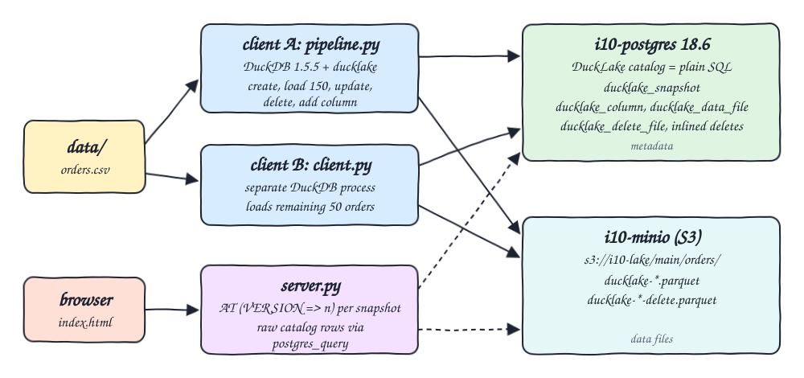
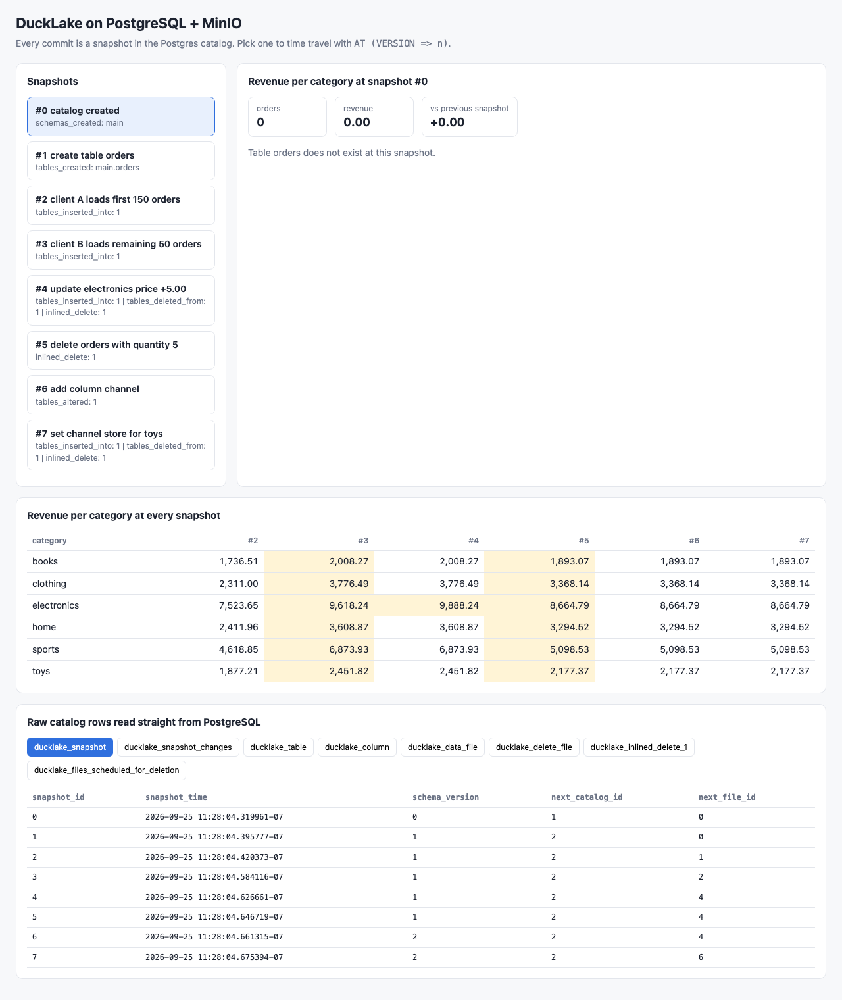
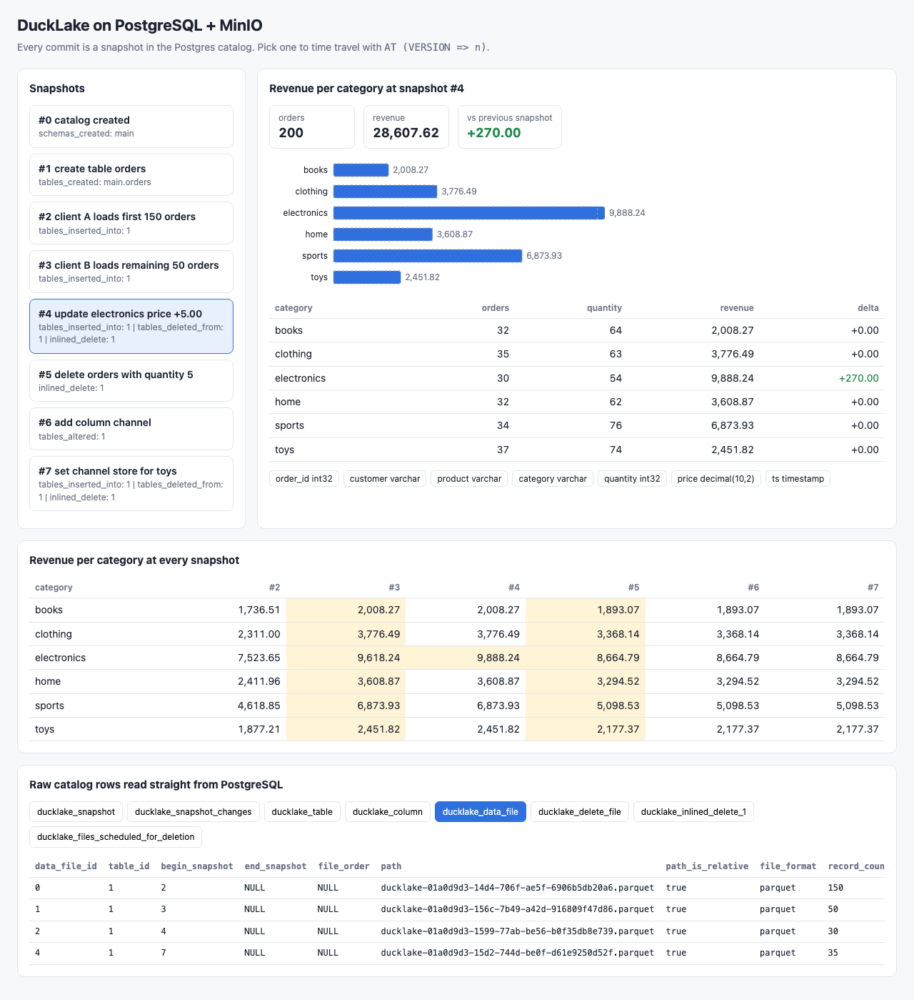
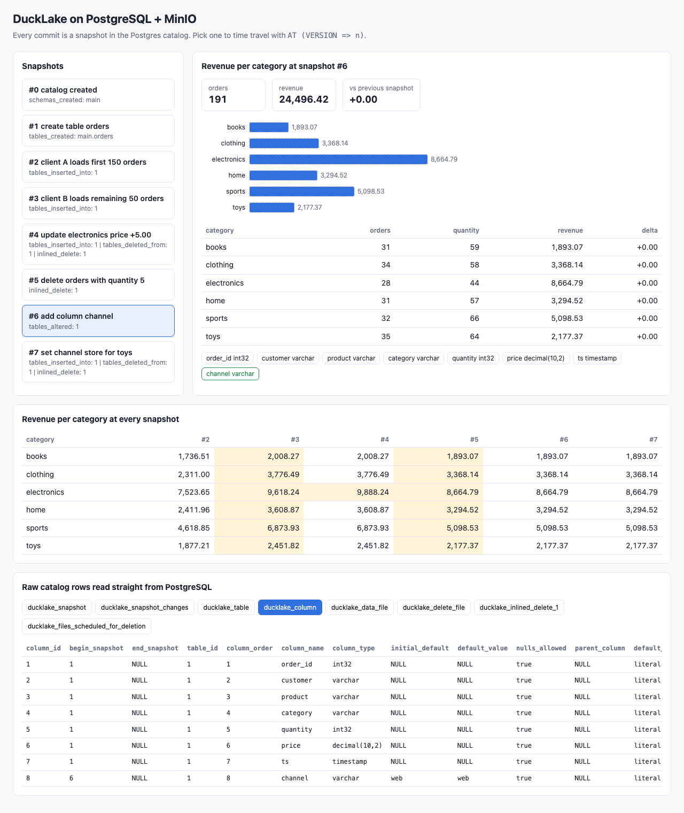

<p align="center"></p>

# ducklake-duckdb

A DuckLake lakehouse built with DuckDB 1.5.5 and its `ducklake` extension. The catalog (snapshots, schemas, columns, file lists, deletes) lives in a plain PostgreSQL 18.6 database and the table data lives as Parquet files on MinIO (S3). Two separate DuckDB processes attach the same lake, write to it, and see each other's commits. A small Python 3.14 UI shows every snapshot, the per-category revenue at each snapshot through time travel, and raw catalog rows read straight from Postgres.

## How it Works

1. `start-all.sh` starts `i10-postgres` and `i10-minio`, resets the catalog schema and the `i10-lake` bucket.
2. `app/pipeline.py` (client A) attaches `ducklake:postgres:...` with `DATA_PATH 's3://i10-lake/'`.
3. Client A creates `orders` and loads the first 150 rows of `data/orders.csv`, each step committed with `set_commit_message`.
4. Client A keeps its connection open and spawns `app/client.py` (client B), a second DuckDB process that attaches the same lake and loads the last 50 rows.
5. Client A sees 200 rows without re-attaching, then updates electronics prices (+5.00), deletes orders with quantity 5, adds a `channel` column, and updates it for toys.
6. Every commit becomes a row in `ducklake_snapshot`; Parquet data and delete files land in MinIO; small deletes are inlined into a Postgres table.
7. `app/server.py` queries `lake.orders AT (VERSION => n)` for each snapshot and reads catalog tables with `postgres_query`, serving JSON to `index.html`.
8. `test-all.sh` checks every snapshot against awk, queries Postgres with `psql` directly, checks every catalog file exists on MinIO, and runs two concurrent DuckDB reader processes.

## Architecture



## Features

* DuckLake catalog on PostgreSQL: the lake metadata is ordinary SQL tables, queryable with `psql`.
* Parquet on MinIO: data and delete files are written to S3 through DuckDB `httpfs`.
* Snapshots with commit messages: each transaction is one snapshot, labelled with who and why.
* Time travel: `AT (VERSION => n)` reproduces revenue at any snapshot.
* Update and delete: updates write new Parquet plus delete files; tiny deletes are inlined in Postgres.
* Schema change: `ALTER TABLE ADD COLUMN` adds a new row in `ducklake_column` with its begin snapshot, older snapshots keep the old schema.
* Multi-client: two separate DuckDB processes attach the same lake and commit to it.
* UI: snapshots, revenue matrix across snapshots, columns per snapshot and raw Postgres catalog rows.

## Stack

* DuckDB 1.5.5 (Python package) with `ducklake`, `postgres` and `httpfs` extensions: the lake engine.
* Python 3.14.7: pipeline, second client and the HTTP server with only the standard library besides `duckdb`.
* PostgreSQL 18.6 (`docker.io/library/postgres:18.6`): the DuckLake catalog.
* MinIO community fork `docker.io/pgsty/minio:RELEASE.2026-08-04T00-00-00Z`: S3 storage for Parquet (official MinIO images are no longer pullable).
* podman + podman-compose: runs Postgres and MinIO.
* awk + psql: independent verification.

## API

| Method | Path | Returns |
|---|---|---|
| GET | `/api/snapshots` | every snapshot with id, time, commit message, changes and per-category orders, quantity and revenue at that snapshot |
| GET | `/api/revenue?version=n` | per-category revenue at snapshot `n` (latest when omitted) |
| GET | `/api/columns?version=n` | columns of `orders` at snapshot `n`, read from `ducklake_column` in Postgres |
| GET | `/api/metadata` | up to 12 raw rows of `ducklake_snapshot`, `ducklake_snapshot_changes`, `ducklake_table`, `ducklake_column`, `ducklake_data_file`, `ducklake_delete_file`, `ducklake_inlined_delete_1`, `ducklake_files_scheduled_for_deletion` |

The UI accepts `?snapshot=n&table=<catalog table>` to open a snapshot and a catalog tab directly.

## Key Design Decisions

* Snapshots: 0 catalog created, 1 create table, 2 client A loads 150, 3 client B loads 50, 4 update, 5 delete, 6 add column, 7 update new column.
* `price` is `DECIMAL(10,2)` so revenue sums are exact and match awk to the cent.
* The server reads the catalog through DuckDB's `postgres_query` in read-only mode, the tests read it with `psql` inside the container: both prove the catalog is plain Postgres.
* Catalog rows are cast to `VARCHAR` before leaving DuckDB so the UI renders them as stored, without extra Python time zone libraries.
* The superseded delete file from snapshot 4 stays on MinIO until cleanup; DuckLake lists it in `ducklake_files_scheduled_for_deletion`.

## Verification

`./scripts/test-all.sh` output:

```
PASS snapshot 1 created table is empty before load
PASS snapshot 2 client A 150 orders match awk
PASS snapshot 3 client B remaining 50 orders match awk
PASS snapshot 4 update electronics price +5 matches awk
PASS snapshot 5 delete quantity 5 matches awk
PASS snapshot 6 add column keeps data
PASS snapshot 7 channel update keeps revenue
PASS postgres ducklake_snapshot has 8 snapshots
PASS postgres commit messages written by both clients
PASS postgres ducklake_column shows channel added at snapshot 6
PASS postgres ducklake_column keeps price column active after schema change
PASS every parquet file in the postgres catalog exists on minio
catalog lists 5 live parquet files, minio holds 6 objects
PASS duckdb process 1 attached the same ducklake
PASS duckdb process 2 attached the same ducklake
latest per category from awk (category orders quantity revenue):
books 31 59 1893.07
clothing 34 58 3368.14
electronics 28 44 8664.79
home 31 57 3294.52
sports 32 66 5098.53
toys 35 64 2177.37
all tests passed
```

## Printscreens

Latest snapshot: the snapshot list on the left, revenue per category at snapshot 7 with the delta against snapshot 6, the columns including the new `channel`, the revenue matrix across all snapshots (changed cells highlighted) and raw `ducklake_snapshot` rows from Postgres.



Time travel to snapshot 4: electronics revenue is up 270.00 after the price update, the schema still has 7 columns, and the `ducklake_data_file` tab shows the Parquet files registered in Postgres with the snapshot where each one begins.



Schema change at snapshot 6: the `channel` column is highlighted as new and the `ducklake_column` tab shows it with `begin_snapshot` 6 and default `web`.



## Scripts

All scripts live in `scripts/` and run from any directory of the repository.

| Script | What it does |
|---|---|
| `./scripts/setup.sh` | Creates the Python 3.14 venv, installs DuckDB and its extensions, pulls images |
| `./scripts/start-all.sh` | Starts Postgres and MinIO, runs the two-client pipeline, starts the UI and prints the full link of each service |
| `./scripts/status.sh` | Shows every service port as UP or DOWN |
| `./scripts/test-all.sh` | Verifies snapshots against awk, the catalog in Postgres, files on MinIO and two concurrent clients |
| `./scripts/ui.sh` | Opens the UI in the browser |
| `./scripts/stop-all.sh` | Stops every service |
| `./scripts/sql-console.sh` | Opens `psql` on the DuckLake catalog database |

Ports are declared in `scripts/ports.env`: postgres 21000, minio 21001, minio console 21002, ui 21003.

```bash
./scripts/setup.sh
./scripts/start-all.sh
./scripts/status.sh
./scripts/test-all.sh
./scripts/ui.sh
./scripts/stop-all.sh
```
