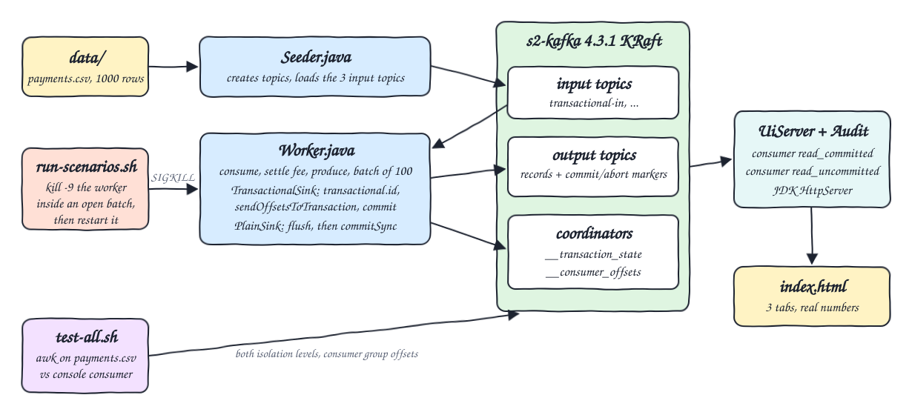
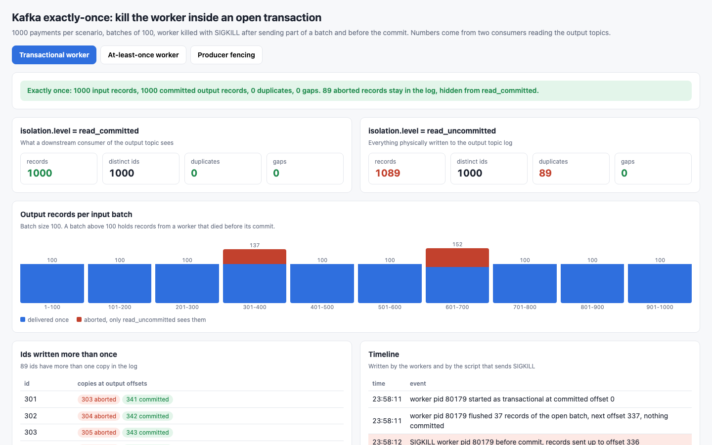
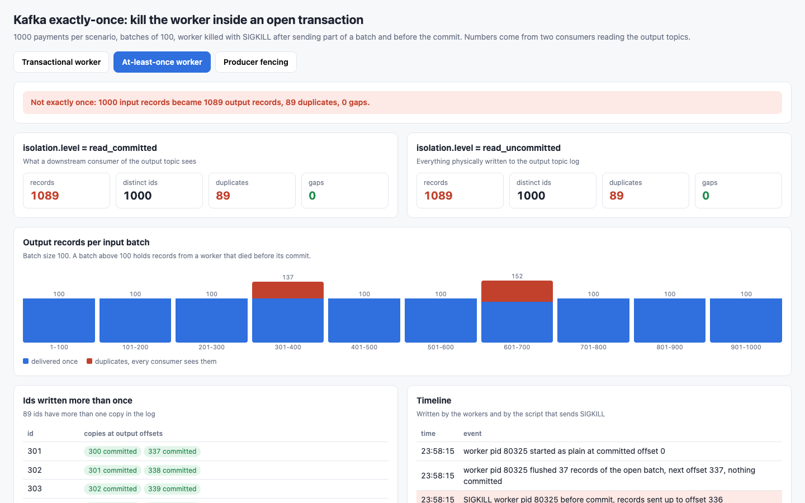
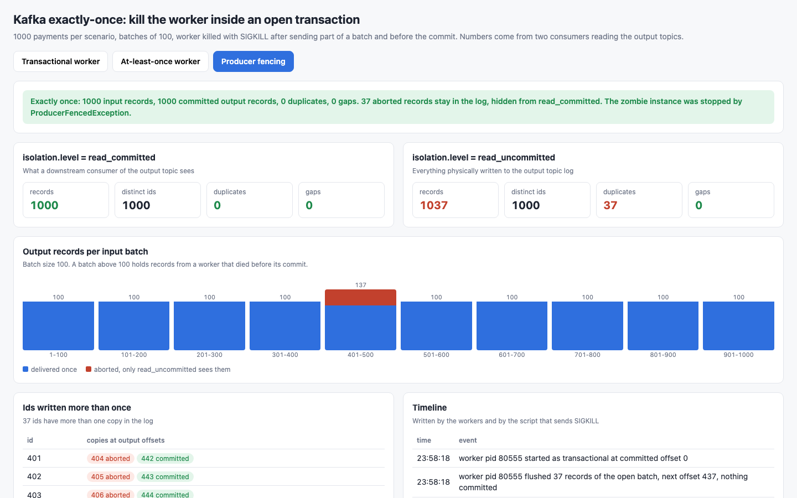

<p align="center"></p>

# exactly-once-kafka-transactions

Proof of Kafka exactly-once semantics by killing the process in the middle of a batch. A consume-transform-produce worker written in Java reads 1000 payments from an input topic and writes 1000 settled payments to an output topic in batches of 100. The run sends SIGKILL to the worker while a transaction is open (records already flushed to the broker, commit not sent), twice, and restarts it until the input is drained. A `read_committed` consumer then sees exactly 1000 records with zero duplicates and zero gaps, while `read_uncommitted` sees 1089 because the 89 aborted records are still in the log. The same kills against a plain at-least-once worker leave 89 duplicates that every consumer sees. A third scenario keeps a zombie instance alive and shows the broker fencing it with `ProducerFencedException`.

## How it Works

1. `start-all.sh` starts a fresh single-node Apache Kafka 4.3.1 broker in KRaft mode (`s2-kafka`).
2. `Seeder` creates three input and three output topics (one partition each) and loads `data/payments.csv` into every input topic.
3. `Worker` assigns the input partition, starts at the committed offset of its group, and for each record sends `account,cents,fee` (fee is 3% of cents) to the output topic. Every 100 input offsets it commits.
4. With `TransactionalSink` the commit is `sendOffsetsToTransaction` plus `commitTransaction`, so output records and input offsets move together. With `PlainSink` it is `flush` and then `commitSync`.
5. `run-scenarios.sh` starts the worker with a hold offset. The worker flushes the partial batch, creates a marker file and waits. The script sends `kill -9` at offsets 337 and 652, then runs the worker again until it drains the input.
6. On restart the transactional worker calls `initTransactions` with the same `transactional.id`: the broker aborts the dangling transaction and the worker resumes from offset 300 (then 600). The plain worker resumes from the same offsets and sends the same records again.
7. Fencing: a zombie worker holds an open transaction at offset 437 and stays alive. A second instance with the same `transactional.id` drains the input. The zombie resumes and its commit is rejected with `ProducerFencedException`.
8. `UiServer` reads each output topic with a `read_committed` and a `read_uncommitted` consumer and serves the counts to `index.html`.
9. `test-all.sh` recomputes the expected output from `payments.csv` with awk and compares it line by line with what `kafka-console-consumer.sh` reads inside the container.

## Architecture



## Features

* Transactional consume-transform-produce: `transactional.id`, `beginTransaction`, `sendOffsetsToTransaction`, `commitTransaction`.
* Real crash: the worker process gets SIGKILL from the shell while its transaction is open and its records are already on the broker.
* Two isolation levels side by side: `read_committed` hides aborted records, `read_uncommitted` shows them.
* Contrast worker: same code path with a non-transactional producer and `commitSync`, same kills, visible duplicates.
* Producer fencing: two live instances with one `transactional.id`, the older one is rejected.
* UI with one tab per scenario: verdict, counts per isolation level, records per batch, every id written more than once with its offsets, and the timeline of kills and restarts.
* Independent verification with awk and the Kafka console tools.

## Stack

* Apache Kafka 4.3.1 in KRaft mode (`docker.io/apache/kafka:4.3.1`), one node acting as broker and controller, 512 MB heap, 1200 MB container limit.
* Java 27 (Corretto 27.0.0) runtime, compiled with `--release 25` by Maven 3.9.12.
* `org.apache.kafka:kafka-clients` 4.3.1: the only dependency.
* JDK `com.sun.net.httpserver.HttpServer`: serves the UI and the API.
* podman + podman-compose: runs the broker.
* awk, jq, `kafka-console-consumer.sh`, `kafka-consumer-groups.sh`: independent verification.

## API

| Method | Path | Returns |
|---|---|---|
| GET | `/api/report` | input size, batch size and, per scenario: records, distinct ids, duplicates and gaps for `read_committed` and `read_uncommitted`, aborted record count, records per batch, every id with more than one copy and its offsets, and the fencing exception if any |
| GET | `/api/events` | the timeline: time, scenario and message written by the workers and by the script that sends SIGKILL |

The UI accepts `?tab=transactional`, `?tab=at-least-once` or `?tab=fencing` to open a scenario directly.

## Key Design Decisions

* The kill is a real `kill -9` from bash, not an exception in Java. The worker flushes the partial batch and waits on a marker file so the kill always lands after the sends and before the commit, which makes the numbers reproducible: 37 records at offset 337, 52 at offset 652.
* Batches are defined by input offset (every 100), not by `poll` size, so the committed offsets after a kill are always 300 and 600.
* The consumer uses `assign` with a `group.id` instead of `subscribe`. Offsets are still stored in the group, and restarts do not wait for a rebalance or a session timeout.
* One partition per topic keeps the output order equal to the input order, so a line by line comparison with awk is possible.
* The plain worker commits after sending, the standard at-least-once order. Its producer is idempotent, which does not help: idempotence protects retries of one producer session, not a new process sending the same records.
* In the transactional output topic the offsets of committed records are not contiguous: each commit or abort marker takes one offset, and aborted records keep theirs. Id 301 sits at offset 303 (aborted) and 341 (committed).
* The broker has no volume. `start-all.sh` always starts from an empty log, so every run gives the same numbers.
* The report is computed once when the UI starts, after the scenarios finished.

## Verification

`./scripts/test-all.sh` output:

```
PASS transactional read_committed equals awk settlement of payments.csv, exactly once
PASS transactional read_committed has 1000 records, 0 duplicates
PASS transactional read_uncommitted also holds the records of both killed transactions
PASS transactional api numbers equal the console consumer read_committed
PASS transactional api numbers equal the console consumer read_uncommitted
PASS at-least-once read_committed shows the re-sent records as duplicates
PASS at-least-once output differs from exactly once
PASS at-least-once api numbers equal the console consumer read_committed
PASS fencing zombie was rejected with ProducerFencedException
PASS fencing read_committed equals awk settlement, the zombie added nothing
PASS fencing read_uncommitted holds only the zombie records sent before it was fenced
PASS fencing api reports the exception
PASS every consumer group committed offset 1000, the input is drained
input payments:                    1000
transactional  read_committed:     records=1000 distinct=1000 duplicates=0
transactional  read_uncommitted:   records=1089 distinct=1000 duplicates=89
at-least-once  read_committed:     records=1089 distinct=1000 duplicates=89
fencing        read_committed:     records=1000 distinct=1000 duplicates=0
fencing        read_uncommitted:   records=1037 distinct=1000 duplicates=37
all tests passed
```

Measured numbers of this run:

| Scenario | Kills | `read_committed` | `read_uncommitted` | Duplicates seen by consumers | Gaps |
|---|---|---|---|---|---|
| transactional | SIGKILL at offsets 337 and 652 | 1000 | 1089 (89 aborted) | 0 | 0 |
| at-least-once | SIGKILL at offsets 337 and 652 | 1089 | 1089 | 89 | 0 |
| fencing | none, zombie rejected with `ProducerFencedException` | 1000 | 1037 (37 aborted) | 0 | 0 |

`start-all.sh` took 17 seconds including the broker start, the three scenarios and eight worker processes. `test-all.sh` took 25 seconds. The broker used 355 MB of memory.

`./scripts/start-all.sh` output:

```
starting a fresh kafka broker
seeding input topics from data/payments.csv
transactional: killed worker at offset 337
transactional: killed worker at offset 652
transactional: restarted worker drained the input
at-least-once: killed worker at offset 337
at-least-once: killed worker at offset 652
at-least-once: restarted worker drained the input
fencing: zombie fenced with ProducerFencedException
starting ui
SERVICE    PORT     STATE  PID
kafka      30100    UP     20948
ui         30101    UP     80571
links
kafka    kafka://localhost:30100
ui       http://localhost:30101
api      http://localhost:30101/api/report
api      http://localhost:30101/api/events
```

`./scripts/status.sh` after `./scripts/stop-all.sh` (exit code 2, one per service down):

```
SERVICE    PORT     STATE  PID
kafka      30100    DOWN   -
ui         30101    DOWN   -
```

## Printscreens

Transactional worker: 1000 committed records, 0 duplicates, 0 gaps. `read_uncommitted` counts 1089. The bars show the two batches where a worker died (137 and 152 records in the log, 100 visible), the table shows each aborted copy next to its committed copy, and the timeline shows the SIGKILL rows.



At-least-once worker: the same two kills. Both isolation levels count 1089 records and 89 duplicates, and every copy in the table is committed, so every consumer reads them.



Producer fencing: the zombie sent 37 records in batch 401-500 and was rejected with `ProducerFencedException` when it resumed. Those 37 records are aborted and the committed output is still exactly 1000.



## Scripts

All scripts live in `scripts/` and run from any directory of the repository.

| Script | What it does |
|---|---|
| `./scripts/setup.sh` | Checks the tools, pulls the Kafka image and builds the Java app with Maven |
| `./scripts/start-all.sh` | Starts a fresh broker, runs the three scenarios, starts the UI and prints the full link of each service |
| `./scripts/run-scenarios.sh` | Seeds the topics, kills and restarts the workers, runs the fencing scenario (called by `start-all.sh`) |
| `./scripts/status.sh` | Shows every service port as UP or DOWN |
| `./scripts/test-all.sh` | Compares both isolation levels of every output topic with an awk calculation over `data/payments.csv` |
| `./scripts/ui.sh` | Opens the UI in the browser |
| `./scripts/stop-all.sh` | Stops the UI, any worker and the broker |

Ports are declared in `scripts/ports.env`: kafka 30100, ui 30101. There is no database, so there is no `sql-console.sh`.

```bash
./scripts/setup.sh
./scripts/start-all.sh
./scripts/status.sh
./scripts/test-all.sh
./scripts/ui.sh
./scripts/stop-all.sh
```
