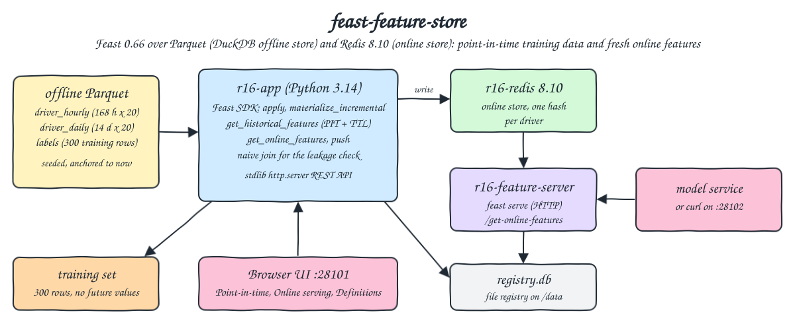
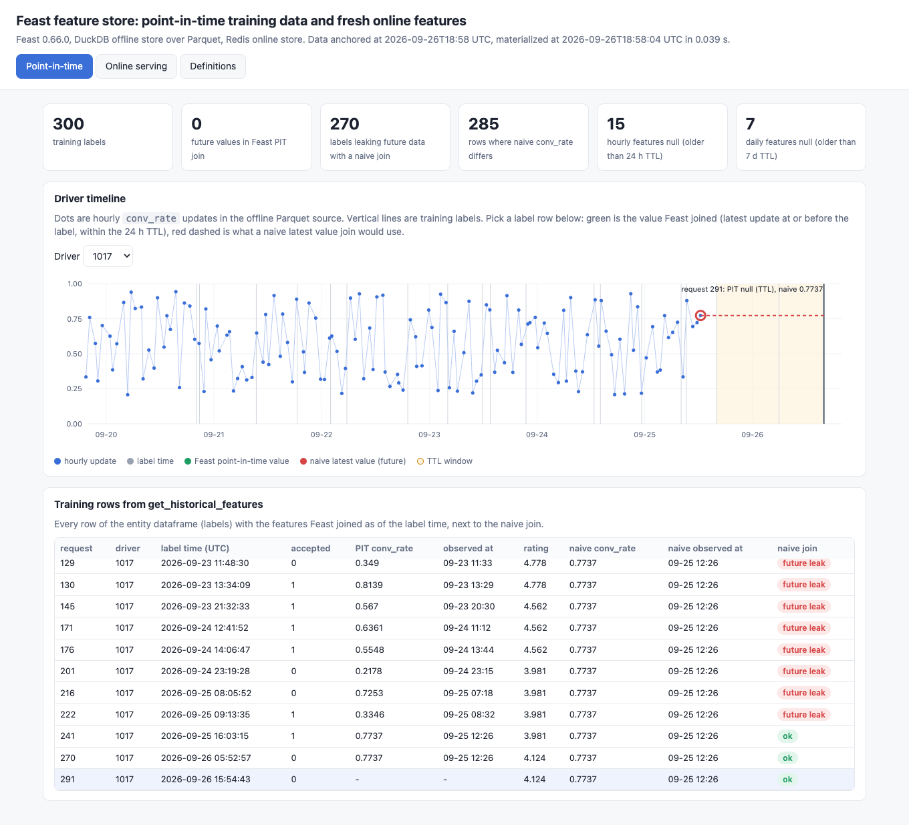
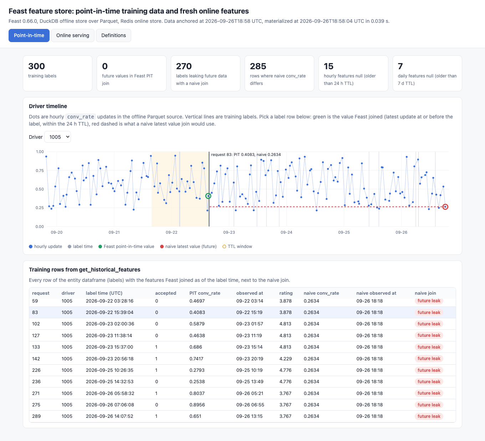
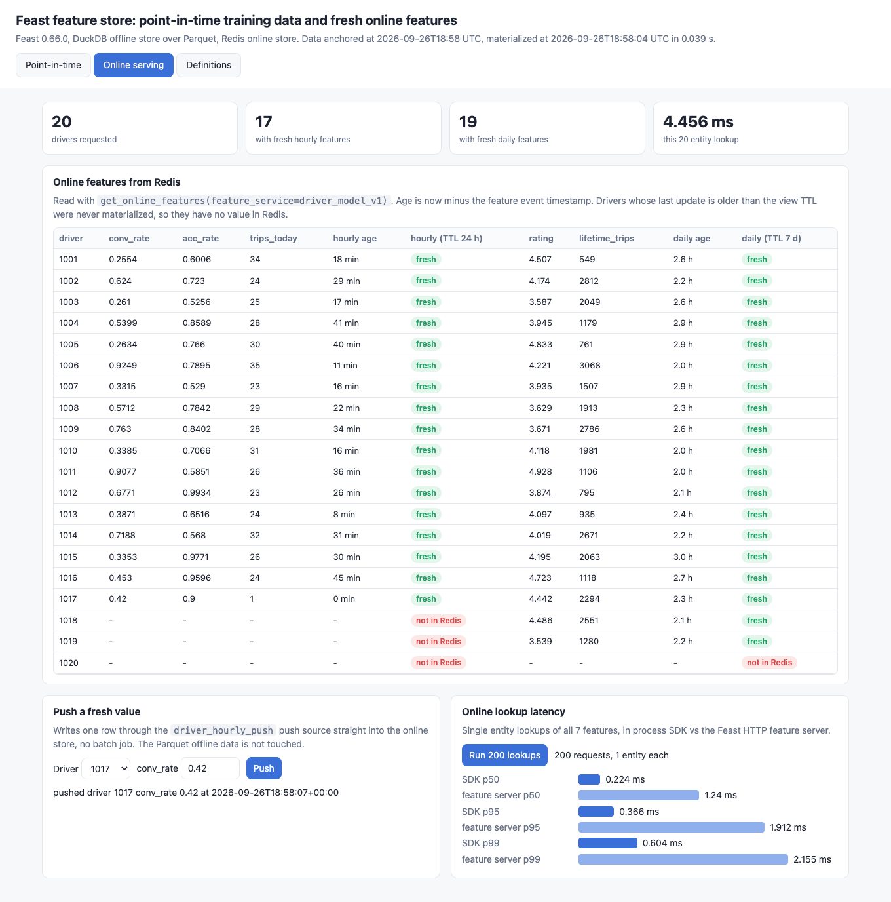
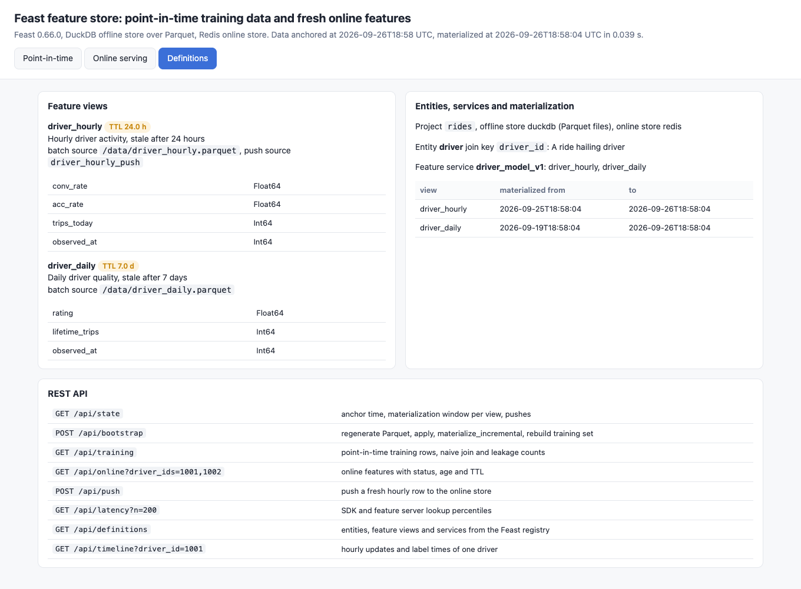

<p align="center"></p>

# feast-feature-store

Feast 0.66.0 feature store over Parquet files (Feast DuckDB offline store) and Redis 8.10 (online store). The POC defines a `driver` entity, two feature views with different TTLs (hourly activity with 24 h, daily quality with 7 days) and a feature service, then proves four things: `get_historical_features` builds a point-in-time correct training set with zero future values while a naive latest value join leaks the future into 270 of 300 labels, the TTL turns stale features into nulls, `materialize_incremental` loads only fresh rows into Redis, and online lookups are sub millisecond from the SDK and about 1.5 ms through the Feast HTTP feature server. A push source writes fresh values straight into Redis. A small web UI shows all of it.

## How it Works

1. On start `r16-app` generates three Parquet files from a seeded `random.Random(16)`, anchored to the current minute: hourly driver stats for 7 days, daily driver stats for 14 days and 300 labeled trip requests (the entity dataframe). Drivers 1017 to 1020 stop sending hourly updates 30 to 100 hours before now, driver 1020 also stops daily updates 9 days ago.
2. It deletes the old registry, flushes Redis, runs `FeatureStore.apply` on `repo/features.py` and `materialize_incremental(end_date=now)`. With no prior run Feast starts each view at `now - ttl`, so only rows inside the TTL reach Redis.
3. `get_historical_features(entity_df=labels, features=driver_model_v1)` joins, for each label, the latest feature row at or before the label time and not older than the view TTL. The result is saved as `data/training.parquet`.
4. Every feature view carries `observed_at` (the row's own event time as epoch seconds) so every training value can be audited against its label time. A naive join (latest row per driver, ignoring time) is computed next to it to show what leakage looks like.
5. Online reads go through `get_online_features` in process and through `r16-feature-server` (`feast serve`), both reading the same Redis and file registry.
6. `POST /api/push` sends a new hourly row through the `driver_hourly_push` push source with `PushMode.ONLINE`, so the online value becomes fresh without touching the offline Parquet data.
7. `app/server.py` (stdlib `http.server`) serves the REST API and `app/index.html`.

## Architecture



## Features

* Point-in-time correct training data: every one of the 300 training rows only sees features observed at or before its label time, checked against an independent DuckDB `ASOF JOIN`.
* Leakage made visible: the naive latest value join uses a future value for 270 labels and a different `conv_rate` for 285, the UI draws both choices on the driver timeline.
* TTL in training: 15 labels get a null hourly feature and 7 a null daily feature because the newest row was older than the view TTL at label time.
* TTL in serving: `materialize_incremental` starts at `now - ttl`, so the 4 stale drivers have no hourly values in Redis and driver 1020 has no daily values.
* Freshness per feature: the API returns the event timestamp, age and TTL of every online value, so a model can tell fresh from stale.
* Push source: a pushed value is online and fresh within the same second, the offline Parquet data does not change.
* Two serving paths: in process SDK and the official Feast HTTP feature server return the same values, with measured p50, p95 and p99.
* Reproducible: seeded values, timestamps anchored to now on every start so TTL and freshness always behave the same.

## Stack

* Feast 0.66.0 (`feast[redis,duckdb]`): latest Feast release on PyPI, registry, offline and online retrieval, materialization, push and `feast serve`.
* DuckDB 1.5.5 through ibis-framework 12.0.0: Feast `duckdb` offline store over the Parquet files, and the independent `ASOF JOIN` in the tests.
* Redis 8.10.2 (`docker.io/library/redis:8.10.2-alpine`): latest Redis, the online store, no persistence, 96 MB maxmemory.
* Python 3.14.7 (`docker.io/library/python:3.14.7-slim`): one image runs the app, the feature server and the tests.
* pandas 2.3.3 and pyarrow 25.0.1: pulled by Feast (Feast 0.66 requires pandas below 3), write the Parquet files.
* redis-py 7.4.1: pulled by `feast[redis]` (it requires redis-py below 8), also used by the tests to count keys.
* Python stdlib `http.server` + plain HTML, CSS and JS: the UI and REST API, no framework.
* podman + podman-compose: runs the three containers.

## Contracts / APIs

| Method | Path / endpoint | Description |
|---|---|---|
| GET | `/` | UI |
| GET | `/api/state` | anchor time, materialization window per view, pushes |
| POST | `/api/bootstrap` | regenerate the Parquet files, apply, `materialize_incremental`, rebuild the training set |
| GET | `/api/training` | point-in-time training rows next to the naive join, with leakage and TTL counts |
| GET | `/api/online?driver_ids=1001,1017` | online features with Feast status, `found`, event time, age, TTL and `fresh` (all 20 drivers when omitted) |
| POST | `/api/push` | `{"driver_id": 1017, "conv_rate": 0.42, "acc_rate": 0.9, "trips_today": 1}` pushed to the online store |
| GET | `/api/latency?n=200` | single entity lookups, SDK vs feature server percentiles in ms |
| GET | `/api/definitions` | entities, feature views, TTLs and feature services from the Feast registry |
| GET | `/api/timeline?driver_id=1001` | hourly `conv_rate` updates and label times of one driver |
| POST | `http://localhost:28102/get-online-features` | Feast feature server, `{"feature_service": "driver_model_v1", "entities": {"driver_id": [1001]}, "full_feature_names": true}` |

```json
{"latency_ms": 5.0, "rows": [{"driver_id": 1001, "features": {
  "driver_hourly__conv_rate": {"value": 0.2554, "status": "PRESENT", "found": true, "event_epoch": 1790449140, "age_seconds": 1080, "ttl_seconds": 86400, "fresh": true},
  "driver_daily__rating": {"value": 4.507, "status": "PRESENT", "found": true, "event_epoch": 1790442000, "age_seconds": 9360, "ttl_seconds": 604800, "fresh": true}}}]}
```

```json
{"summary": {"labels": 300, "pit_future_values": 0, "naive_future_values": 270, "naive_differs": 285, "hourly_null_by_ttl": 15, "daily_null_by_ttl": 7}}
```

## Key data structures and design decisions

* `driver_hourly` (`conv_rate`, `acc_rate`, `trips_today`, `observed_at`, TTL 24 h, batch source `driver_hourly.parquet`, push source `driver_hourly_push`) and `driver_daily` (`rating`, `lifetime_trips`, `observed_at`, TTL 7 days). Both keyed by `driver_id`, grouped in the `driver_model_v1` feature service, read with `full_feature_names=True` because both views have `observed_at`.
* The first build used Feast's `file` (dask) offline store and the tests caught a real problem: with a TTL, a label whose driver has feature rows but none inside the TTL window is dropped from the training set instead of getting nulls (285 rows came back instead of 300). The Feast `duckdb` offline store keeps every entity row with nulls, so this POC uses it.
* For a driver that has a Redis hash but no value for one view (driver 1017 hourly), Feast 0.66 returns status `PRESENT` with a null value and a zero event timestamp. The API adds `found` (present, non null, timestamp set) and computes `fresh` from it instead of trusting the status alone.
* Feast's standard online read path does not drop values older than the TTL at read time, freshness comes from what `materialize_incremental` loaded. The API reports age against the TTL so a caller can see it.
* Timestamps are regenerated relative to now on every start (and on `POST /api/bootstrap`), values come from the same seed, so the proofs never decay with the wall clock.
* The file registry lives on the shared `data/` mount so the app and `feast serve` see the same definitions, `cache_ttl_seconds: 5` lets the feature server pick up a new bootstrap.
* Every container and the network start with `r16-` (`r16-redis`, `r16-app`, `r16-feature-server`, `r16-net`). Memory limits: 128 + 768 + 512 MB, measured use about 7 MB, 230 MB and 255 MB.

## How to run

Requirements: podman, podman-compose, curl and lsof. Python and every library run inside the containers.

```bash
./scripts/setup.sh
./scripts/start-all.sh
./scripts/test-all.sh
./scripts/ui.sh
./scripts/stop-all.sh
```

`test-all.sh` runs `tests/test_feast.py` inside `r16-app`. The tests bootstrap a fresh state, then check:

* Every training value (hourly `conv_rate`, `trips_today`, `observed_at`, daily `rating`, `observed_at`) equals an independent DuckDB `ASOF JOIN` over the raw Parquet files with the TTL applied, for all 300 labels.
* No training value was observed after its label time, and the API reports 0 future values.
* The naive latest value join leaks future data into exactly as many labels as recomputed from the raw files (more than 250).
* The number of labels with null hourly features equals the labels with no hourly row inside 24 h, recomputed in DuckDB, and it is above 0.
* Every online value equals the latest Parquet row of that driver when it falls inside the materialization window, and is missing otherwise: drivers 1017 to 1020 for hourly, 1020 for daily.
* Every found online value is fresh and its age matches its event timestamp, every missing one has no timestamp and is not fresh.
* Redis holds exactly one key per driver that has any fresh feature.
* The Feast HTTP feature server returns the same statuses and values as the SDK.
* 100 single entity lookups have p50 under 25 ms (SDK) and 50 ms (feature server).
* The registry holds the declared TTLs, the join key and the feature service.
* A push makes stale driver 1017 fresh online within 30 s with the pushed values while the offline Parquet data has no such row, then the state is bootstrapped again.

```
test_a_naive_latest_value_join_would_leak_future_data ... ok
test_feast_feature_server_returns_what_the_sdk_returns ... ok
test_historical_features_equal_an_independent_duckdb_asof_join_with_ttl ... ok
test_no_training_row_sees_a_feature_observed_after_its_label ... ok
test_online_freshness_age_matches_the_event_timestamp_and_ttl ... ok
test_online_lookup_latency_is_low ... ok
test_online_store_holds_the_latest_row_inside_the_ttl_window ... ok
test_redis_has_one_key_per_driver_with_any_fresh_feature ... ok
test_registry_holds_the_declared_ttls_and_feature_service ... ok
test_ttl_turns_stale_features_into_nulls_in_training ... ok
test_ui_page_has_every_tab ... ok
test_zz_push_makes_a_stale_driver_fresh_online_but_not_in_offline_data ... ok

----------------------------------------------------------------------
Ran 12 tests

OK
all tests passed
```

## Printscreens

Point-in-time tab on stale driver 1017: the tiles show 300 labels, 0 future values in the Feast join, 270 labels that a naive join would leak, and the TTL nulls. The selected label (dark line, right) sits more than 24 h after the driver's last update, so the shaded TTL window is empty and Feast returns null, while the naive join (red dashed) would still hand the model the last value.



Point-in-time tab on active driver 1005: for request 83 Feast picks the hourly update just before the label (green circle), the naive join reaches days into the future (red circle). The table lists every training row with the observed time Feast used and the naive observed time with a future leak badge.



Online serving tab: all 20 drivers read from Redis with age and freshness per feature view. Driver 1017 was just pushed (age 0 min, `conv_rate` 0.42), 1018 to 1020 have no hourly values and 1020 no daily values because they were older than the TTL at materialization. The latency panel compares 200 single entity lookups through the SDK (about 0.2 ms p50) and the Feast feature server (about 1.3 ms p50).



Definitions tab: the feature views with TTL, sources and typed features, the entity and join key, the feature service, the materialization window per view, and the REST API.



## Scripts

All scripts live in `scripts/` and run from any directory of the repository.

| Script | What it does |
|---|---|
| `./scripts/setup.sh` | Pulls the Redis and Python images and builds the app image |
| `./scripts/start-all.sh` | Starts Redis, the app (generate, apply, materialize, training set) and the feature server, waits for each, prints every link |
| `./scripts/status.sh` | Shows every service port as UP or DOWN |
| `./scripts/test-all.sh` | Runs the tests inside `r16-app` |
| `./scripts/ui.sh` | Opens the UI in the browser |
| `./scripts/sql-console.sh` | Opens `redis-cli` on the online store |
| `./scripts/stop-all.sh` | Stops every container and waits until the ports are free |

Ports are declared in `scripts/ports.env`: Redis 28100 (`redis://localhost:28100`), UI and API 28101 (`http://localhost:28101`), Feast feature server 28102 (`http://localhost:28102`).

```bash
./scripts/setup.sh
./scripts/start-all.sh
./scripts/status.sh
./scripts/ui.sh
./scripts/stop-all.sh
```
