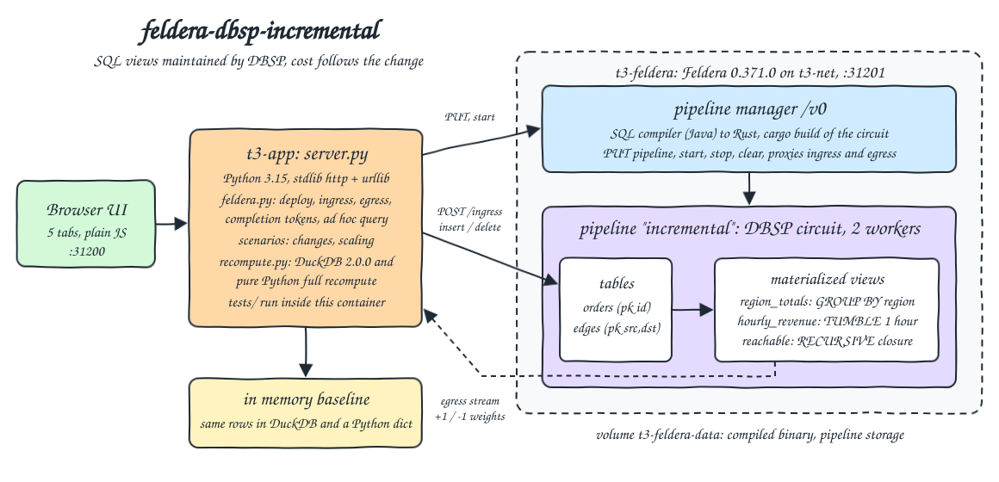
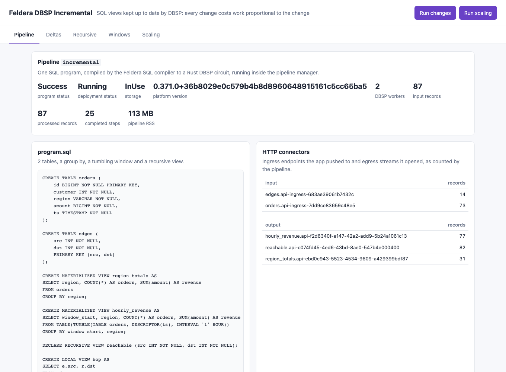
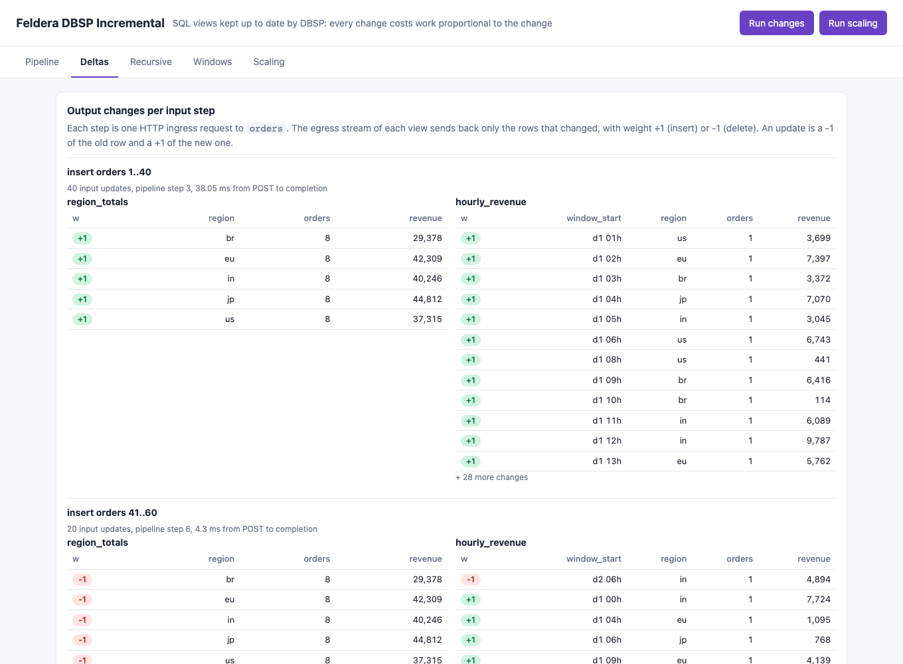
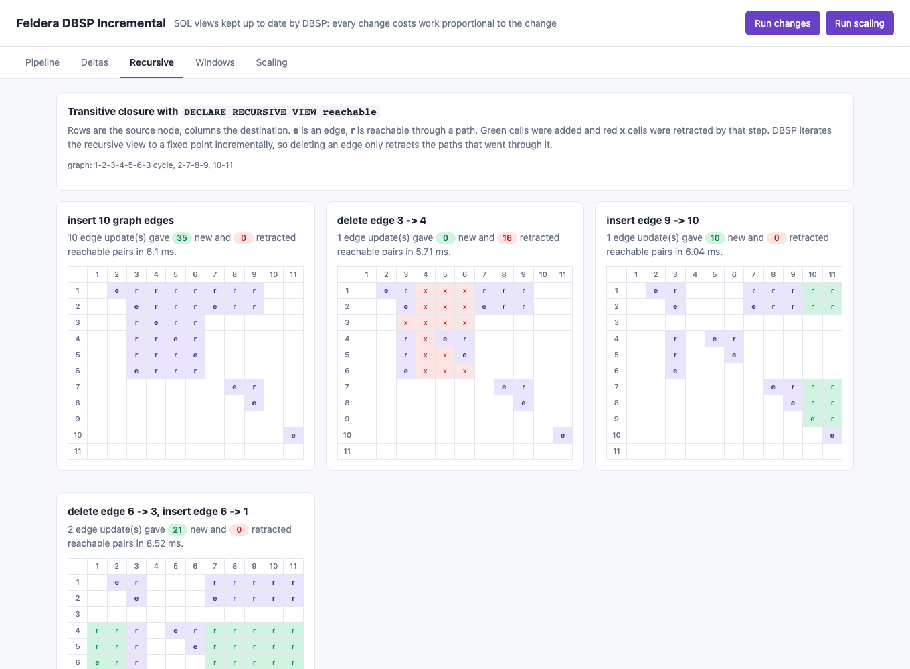
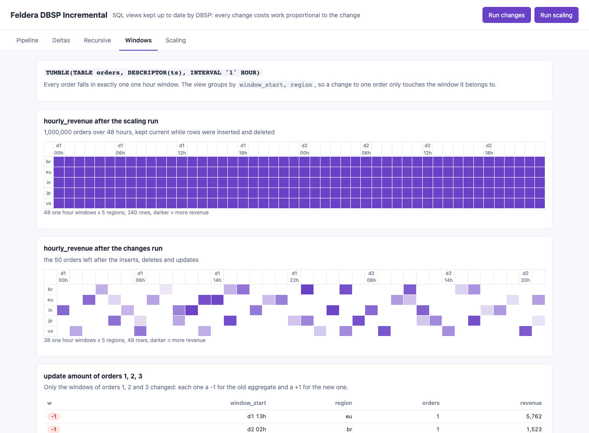
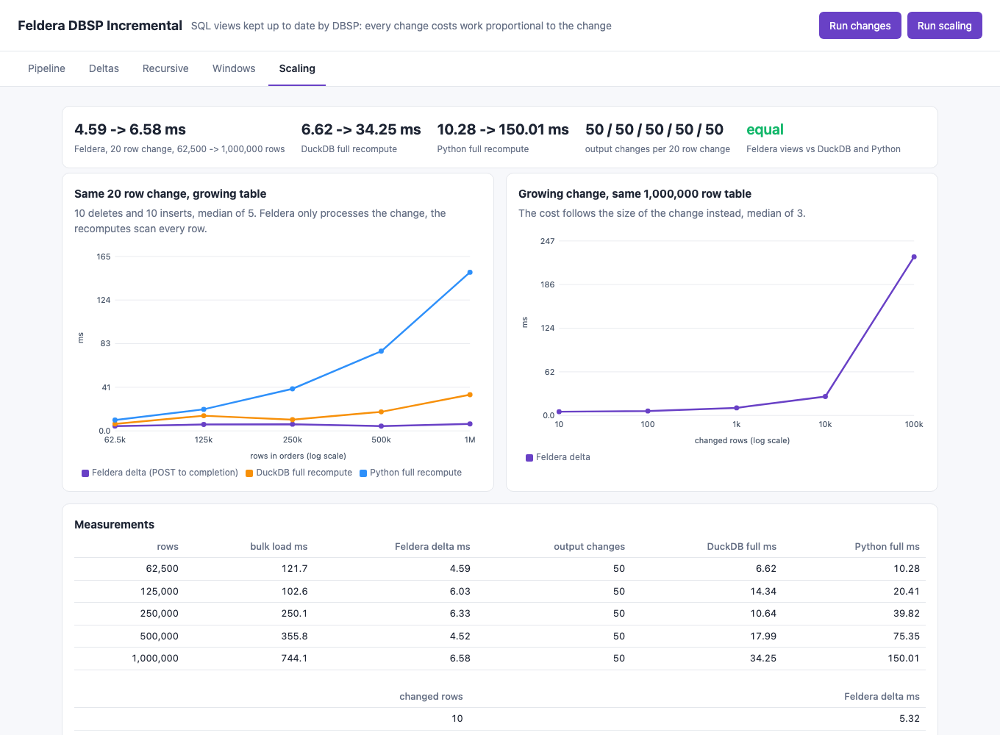

<p align="center"></p>

# feldera-dbsp-incremental

Feldera as an incremental SQL engine. This POC runs the open source Feldera 0.371.0 pipeline manager, deploys one SQL program (a group by, a one hour tumbling window and a recursive transitive closure), pushes inserts, deletes and updates through the HTTP ingress API, and reads the output changes as +1 / -1 weighted rows from the HTTP egress streams. It then grows the table from 62,500 to 1,000,000 rows and shows that the same 20 row change costs Feldera about the same few milliseconds at every size, while a full recompute in DuckDB 2.0.0 and in plain Python grows with the table. The tests check that every view equals an answer computed independently from the input after a sequence of inserts and deletes.

## How it Works

1. `t3-feldera` runs `ghcr.io/feldera/pipeline-manager:0.371.0`. It holds the SQL compiler (SQL to a Rust DBSP circuit), the Rust toolchain that builds the circuit, and the runner that starts the pipeline process.
2. `t3-app` runs `app/server.py` (stdlib `http.server`). On `start-all.sh` it `PUT`s `sql/program.sql` as pipeline `incremental` with 2 workers, waits for `program_status` `Success` (about 45 s the first time) and starts it.
3. DBSP keeps every view as a Z-set (row -> weight). An input change is a small Z-set, each operator turns its input delta into an output delta using the indexed state it already holds, so the work follows the size of the change, not the size of the table.
4. `app/feldera.py` pushes JSON `insert` / `delete` arrays (and CSV for bulk loads) to `/ingress/<table>`, waits on the completion token the response returns, and reads `/egress/<view>` as a newline delimited JSON stream of `insert` (+1) and `delete` (-1) rows, split by the `processed_steps` markers.
5. The `changes` scenario applies 8 steps (inserts, deletes, an update, graph edge inserts and deletes) and records the delta every view streamed for each step. The `scaling` scenario loads up to 1M orders and times the same change in Feldera against a full recompute of the same views in DuckDB and in Python, over the same rows.
6. `app/index.html` renders five tabs: Pipeline, Deltas, Recursive, Windows, Scaling.
7. `scripts/test-all.sh` reruns both scenarios and runs `tests/test_incremental.py` inside `t3-app`.

## Architecture



## Features

* Incremental group by: `region_totals` streams only the regions a change touched, an update is one -1 of the old aggregate and one +1 of the new one.
* Windowed aggregate: `TUMBLE(TABLE orders, DESCRIPTOR(ts), INTERVAL '1' HOUR)` grouped by window and region, a change to one order only touches the window it falls in.
* Recursive query: `DECLARE RECURSIVE VIEW reachable` computes the transitive closure of `edges` to a fixed point, and a deleted edge retracts exactly the paths that went through it (16 pairs when the 3 -> 4 edge of the 3-4-5-6 cycle goes away).
* Deltas with weights: the HTTP egress stream returns only changed rows, insert = +1, delete = -1, so the streamed weights integrate to the view.
* Completion tokens: every `/ingress` response carries a token, `/completion_status` says when that input and every output it caused are done, so timings are POST to fully processed.
* Ad hoc queries on materialized views (`/query?sql=...`) give the current snapshot the tests compare with.
* Scaling proof: the same 20 row change stays at 4.5 to 6.6 ms from 62,500 to 1,000,000 rows, DuckDB full recompute goes from 6.6 to 34 ms and Python from 10 to 150 ms.
* Delta proof: at 1M rows the cost follows the change, 5 ms for 10 rows, 27 ms for 10,000 rows, 225 ms for 100,000 rows.
* Output work is constant: a 20 row change produced exactly 50 output changes at every table size.
* Lean: one Feldera container (2 GB limit, 360 MB peak during the 1M row run) and one app container (768 MB limit, about 600 MB peak with 1M rows in DuckDB and in a Python dict).

## Stack

* Feldera 0.371.0 (`ghcr.io/feldera/pipeline-manager:0.371.0`): latest stable release, the official open source image from GHCR, multi arch with an arm64 build.
* DBSP: the incremental engine Feldera compiles every SQL program into, Rust, runs inside the pipeline process.
* DuckDB 2.0.0: the full recompute baseline, a fast vectorized engine, so the comparison is against a strong batch engine and not only against Python.
* Python 3.15.2 (`docker.io/library/python:3.15.2-slim`): app, UI server, pure Python recompute and tests in one image.
* Python stdlib `http.server`, `http.client`, `urllib`, `unittest` + plain HTML, CSS and JS: no web framework, no Feldera SDK, no test framework.
* podman + podman-compose: the 2 containers, network `t3-net` and volume `t3-feldera-data`.

## Contracts / APIs

| Method | Path / endpoint | Description |
|---|---|---|
| GET | `http://localhost:31201` | Feldera web console |
| PUT | `:31201/v0/pipelines/incremental` | Creates or updates the pipeline with `program_code` and `runtime_config`, triggers compilation |
| GET | `:31201/v0/pipelines/incremental` | `program_status`, `deployment_status`, `storage_status`, errors |
| POST | `:31201/v0/pipelines/incremental/{start,stop?force=true,clear}` | Starts, stops, clears storage |
| POST | `:31201/v0/pipelines/incremental/ingress/{orders,edges}?format=json&update_format=insert_delete&array=true` | Pushes `[{"insert": {...}}, {"delete": {"id": 5}}]`, returns `{"token": ...}` |
| POST | `:31201/v0/pipelines/incremental/ingress/orders?format=csv` | Bulk load |
| GET | `:31201/v0/pipelines/incremental/completion_status?token=...` | `{"status": "complete", "step": 7}` |
| POST | `:31201/v0/pipelines/incremental/egress/{view}?format=json&backpressure=true` | Stream of changes and step markers |
| GET | `:31201/v0/pipelines/incremental/query?sql=...&format=json` | Ad hoc query of a materialized view |
| GET | `http://localhost:31200/` | UI |
| GET | `/api/results` | Last result of every scenario, `{}` when none ran |
| GET | `/api/pipeline` | Pipeline status, program, metrics, connectors |
| POST | `/api/deploy` | Creates, compiles and starts the pipeline when needed |
| POST | `/api/run/{changes,scaling}` | Runs one scenario |
| POST | `/api/run-all` | Runs scaling, then changes |

Egress stream, one line per chunk:

```json
{"sequence_number":0,"snapshot":false,"json_data":[{"delete":{"region":"us","orders":2,"revenue":505}},{"insert":{"region":"us","orders":3,"revenue":510}}]}
{"sequence_number":1,"snapshot":false,"processed_steps":11}
```

Scenario results:

```json
{"changes": {"steps": [{"label": "delete edge 3 -> 4", "table": "edges", "step": 15, "ms": 5.71,
                        "deltas": {"reachable": [{"weight": -1, "row": {"src": 1, "dst": 4}}, "..."], "region_totals": [], "hourly_revenue": []}}],
             "streamed": {"region_totals": ["..."]}, "snapshot": {"region_totals": [{"region": "us", "orders": 8, "revenue": 43629}]}},
 "scaling": {"by_size": [{"rows": 1000000, "load_ms": 744.1, "feldera_delta_ms": 6.58, "output_changes": 50, "duckdb_full_ms": 34.25, "python_full_ms": 150.01}],
             "by_delta": [{"rows": 1000000, "changed_rows": 100000, "feldera_delta_ms": 224.95}],
             "final": {"rows": 1000000, "matches_duckdb": true, "matches_python": true, "deleted_ids": ["..."]}}}
```

## Key data structures and design decisions

* Tables: `orders (id PK, customer, region, amount, ts)` and `edges (src, dst, PK both)`. With a primary key, an `insert` of an existing id is an upsert and a `delete` needs only the key.
* Views are `MATERIALIZED` so they can be read with ad hoc queries. `hop` is a `LOCAL VIEW` used inside the recursion, it is not an output.
* Input rows come from `app/data.py`: `order(i)` is a pure function of `i` (region, amount and a timestamp spread over 48 hours), so the tests rebuild any state from ids alone.
* Each scenario does `stop?force=true`, `clear` and `start`, so it starts from empty tables and never depends on an earlier run.
* Measured time is POST `/ingress` to `/completion_status` `complete`, polled in a tight loop. It includes the HTTP round trip through the manager, so the few ms floor seen here is mostly the round trip and step scheduling, not DBSP work on the change.
* The recompute baselines hold the same rows as Feldera: DuckDB (2 threads, `GROUP BY` and `date_trunc('hour')`) and a Python dict of packed ints (group id * 100000 + amount). The Python version first held tuples per row and the app hit its 512 MB limit and stalled at 1M rows; packing the row and raising the app limit to 768 MB fixed it.
* Deltas per step: after each push the app waits until every egress stream has a `processed_steps` marker at or after the step the completion token returned, then slices the changes that arrived. The tests check each slice equals the difference between two independently computed states.
* The egress JSON writes timestamps as `2026-01-01 08:00:00` and the ad hoc query as `2026-01-01T08:00:00`. The first test run failed on this; the tests and the UI normalize the separator.
* After the Feldera container was recreated, the manager still said `Running` for a pipeline whose process was gone, then switched to `Stopped` with a `RunnerCheckError`. `ensure_running` now waits until `/stats` answers and starts the pipeline again when it is `Stopped`.
* Timing assertions are loose on purpose, the podman VM is shared with other stacks: the 1M row Python recompute must be more than 5x the 62,500 row one and more than 5x the Feldera delta, DuckDB must grow more than 2x and stay above the Feldera delta, and a 100,000 row change must cost more than 10x a 10 row change. The output change count (50) is exact.
* Containers, network and volume start with `t3-`. The volume keeps the compiled pipeline, so later starts skip the 45 s compilation.

## How to run

Requirements: podman, podman-compose, curl and lsof. Everything else runs in containers. The Feldera image is about 8 GB.

```bash
./scripts/setup.sh
./scripts/start-all.sh
./scripts/test-all.sh
./scripts/ui.sh
./scripts/stop-all.sh
```

`tests/test_incremental.py` (11 tests, inside `t3-app`) checks:

* `region_totals` and `hourly_revenue` equal a pure Python group by over the orders left after 60 inserts, 10 deletes and 3 updates.
* `reachable` equals a BFS transitive closure of the final edge set.
* For each of the 8 steps, the streamed weighted delta of every view equals the difference between the expected states before and after that step.
* The streamed weights of each view sum to exactly the ad hoc snapshot, every row ending at weight 1.
* Deleting edge 3 -> 4 only retracts (-1) pairs, including 3 -> 3 and 1 -> 4.
* The update of orders 1, 2, 3 only touches their own hourly windows and retracts one row per touched region.
* After the scaling run, the 1,000,000 row views equal a Python recompute from the loaded, deleted and inserted ids.
* A 20 row change gives the same number of output changes at every table size, at most 2 x 20 windows + 2 x 5 regions.
* Full recompute grows with the table while the Feldera delta stays below both recomputes.
* The delta cost grows with the size of the change.
* The UI page has every tab.

```
running the scaling scenario (up to 1M rows) and then the changes scenario
test_an_update_only_touches_the_windows_of_the_updated_orders ... ok
test_breaking_the_cycle_retracts_every_path_that_used_the_deleted_edge ... ok
test_every_step_streams_exactly_the_difference_between_two_states ... ok
test_recursive_view_equals_a_bfs_transitive_closure_after_edge_deletes ... ok
test_streamed_weights_integrate_to_the_view_snapshot ... ok
test_views_equal_an_independent_answer_after_inserts_deletes_and_updates ... ok
test_a_fixed_change_produces_the_same_output_work_at_every_table_size ... ok
test_delta_cost_grows_with_the_size_of_the_change ... ok
test_final_views_equal_an_independent_recompute_of_a_million_rows ... ok
test_full_recompute_grows_with_the_table_while_the_delta_stays_small ... ok
test_ui_page_has_every_tab ... ok

Ran 11 tests in 3.778s
OK
all tests passed
```

Measured in that run:

| rows | Feldera 20 row change ms | output changes | DuckDB full ms | Python full ms |
|---|---|---|---|---|
| 62,500 | 4.59 | 50 | 6.62 | 10.28 |
| 125,000 | 6.03 | 50 | 14.34 | 20.41 |
| 250,000 | 6.33 | 50 | 10.64 | 39.82 |
| 500,000 | 4.52 | 50 | 17.99 | 75.35 |
| 1,000,000 | 6.58 | 50 | 34.25 | 150.01 |

| changed rows at 1M | 10 | 100 | 1,000 | 10,000 | 100,000 |
|---|---|---|---|---|---|
| Feldera ms | 5.32 | 6.36 | 10.79 | 26.84 | 224.95 |

## Printscreens

Pipeline tab: the pipeline status read from the manager (compiled, running, 2 workers), input and processed record counts, completed steps and RSS, the SQL program, and the HTTP ingress and egress connectors the app used with their record counts.



Deltas tab: for each ingress request to `orders`, the rows the `region_totals` and `hourly_revenue` egress streams sent back with their weights. The first insert is all +1; the second step retracts each region total (-1) and inserts the new one (+1).



Recursive tab: the reachability matrix after each edge step, built only from the streamed deltas. Inserting 10 edges added 35 pairs, deleting 3 -> 4 retracted the 16 pairs that needed it (red x), inserting 9 -> 10 added 10, and replacing 6 -> 3 by 6 -> 1 added 21 and retracted none, because 6 still reaches 3 through 1 and 2.



Windows tab: `hourly_revenue` as a heat map of 48 one hour windows x 5 regions for the 1M row scaling run (evenly spread data) and for the 50 orders of the changes run, plus the update step showing that only the windows of orders 1, 2 and 3 changed.



Scaling tab: left, the same 20 row change as the table grows 16x: Feldera stays flat while DuckDB and Python full recomputes climb. Right, at 1M rows the Feldera cost follows the size of the change. The table has every measurement and the badge confirms the Feldera views equal both recomputes.



## Scripts

All scripts live in `scripts/` and run from any directory of the repository.

| Script | What it does |
|---|---|
| `./scripts/setup.sh` | Pulls the Feldera and Python images and builds the app image |
| `./scripts/start-all.sh` | Starts Feldera and the app, creates, compiles and starts the pipeline, runs both scenarios when there are no results, prints every link |
| `./scripts/status.sh` | Shows every service port as UP or DOWN |
| `./scripts/test-all.sh` | Reruns both scenarios and runs the tests |
| `./scripts/ui.sh` | Opens the UI in the browser |
| `./scripts/stop-all.sh` | Stops every container and waits until the ports are free, the volume is kept |

Ports are declared in `scripts/ports.env`: UI 31200 (`http://localhost:31200`), Feldera 31201 (`http://localhost:31201`).

```bash
./scripts/setup.sh
./scripts/start-all.sh
./scripts/status.sh
./scripts/ui.sh
./scripts/stop-all.sh
```
