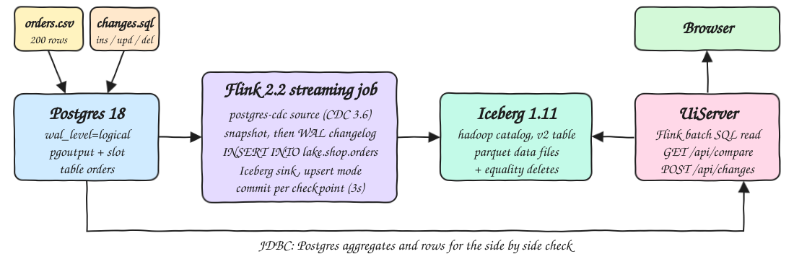
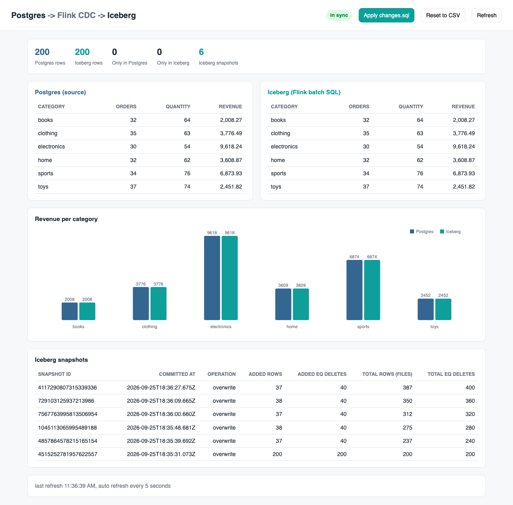
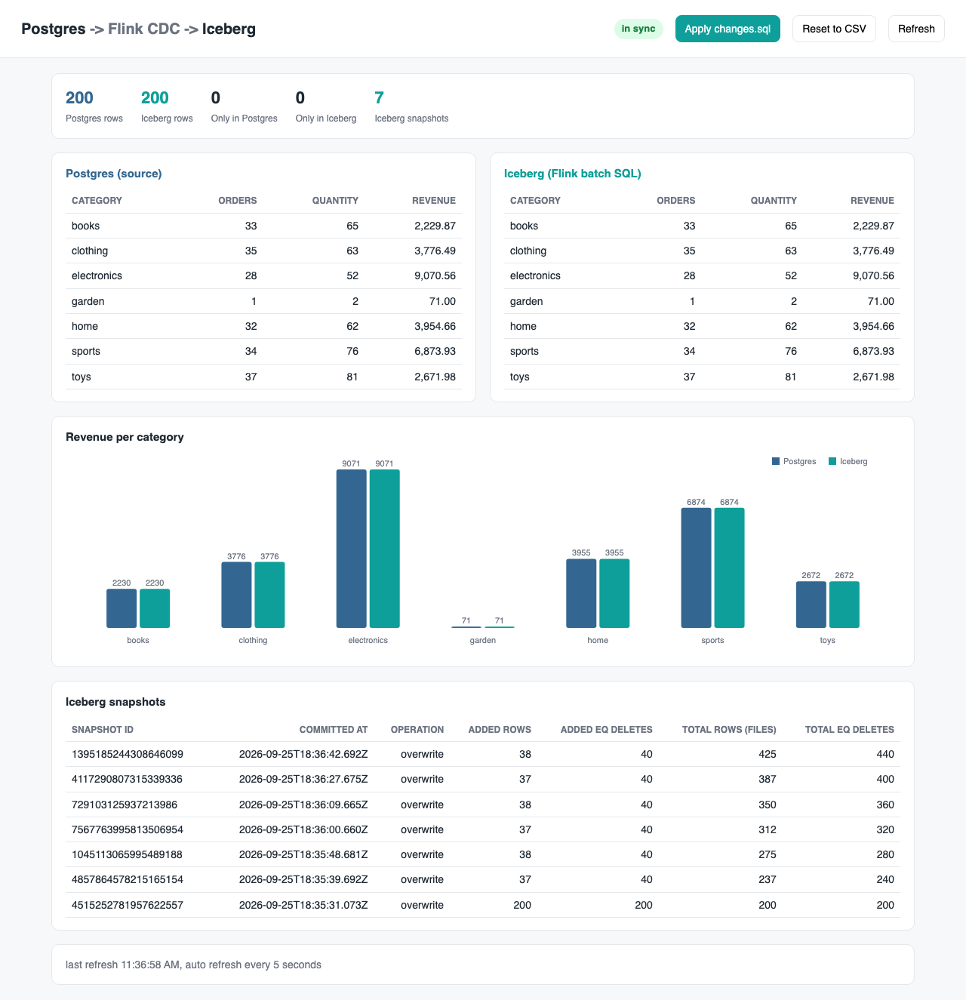

# flink-cdc-postgres-iceberg

A Flink CDC pipeline, written in Java 25, that streams the `orders` table from Postgres 18 (logical replication) into an Apache Iceberg v2 table in upsert mode. The initial snapshot of 200 rows lands in Iceberg first. After that, every INSERT, UPDATE and DELETE in Postgres shows up in Iceberg as data files plus equality deletes keyed by `order_id`. A small web UI puts the Postgres and Iceberg per-category aggregates side by side.

## How it Works

1. Postgres 18.6 starts with `wal_level=logical`. `sql/init.sql` creates `orders` (primary key `order_id`, `REPLICA IDENTITY FULL`) and loads `data/orders.csv` with `COPY`.
2. `CdcPipeline` runs Flink 2.2 locally (embedded MiniCluster) and declares `pg_orders` with the `postgres-cdc` connector (Flink CDC 3.6, `pgoutput`, incremental snapshot).
3. It registers an Iceberg Hadoop catalog on the local `warehouse/` folder and creates `lake.shop.orders` with `format-version=2` and `write.upsert.enabled=true`. The primary key `order_id` becomes the Iceberg identifier field.
4. `INSERT INTO lake.shop.orders SELECT * FROM pg_orders` first reads the snapshot, then follows the WAL. The Iceberg sink commits one snapshot per Flink checkpoint (every 3s). Empty commits are skipped.
5. In upsert mode every changed row is written as an equality delete on `order_id` plus a new data row. A delete is written as an equality delete only.
6. `UiServer` reads Iceberg through Flink batch SQL, which applies the equality deletes. It reads Postgres through JDBC and returns both sides, a row-level diff and the Iceberg snapshot log on `GET /api/compare`.
7. `scripts/test-all.sh` checks the initial load against `awk`, applies `sql/changes.sql`, and checks the result against an independent Python calculation.

## Architecture



## Features

* Initial snapshot plus streaming: Flink CDC incremental snapshot reads the 200 existing rows, then switches to the WAL with no gap.
* Upsert into Iceberg: `order_id` is the identifier field, so updates and deletes become equality deletes, not duplicates.
* Row-level verification: the UI compares every row fingerprint, not only the aggregates, so a missed update cannot hide behind equal sums.
* Side by side aggregates: orders, quantity and revenue per category from Postgres (SQL) and Iceberg (Flink batch SQL), with a revenue bar chart.
* Snapshot log: every Iceberg commit shows the rows and equality deletes it added.
* One-click changes: the UI can apply `sql/changes.sql` or reset Postgres back to the CSV, and you can watch Iceberg catch up.
* Independent tests: `awk` checks the initial load, and Python `Decimal` replays the same changes on the CSV to check the final state.

## Stack

* Java 25 (25.0.4): language level and runtime for the pipeline and the UI server.
* Apache Flink 2.2.1: streaming runtime for CDC and batch SQL for reading Iceberg. It is the newest Flink that Flink CDC 3.6 supports.
* Apache Flink CDC 3.6.0 (`flink-sql-connector-postgres-cdc:3.6.0-2.2`): the `postgres-cdc` SQL source (bundles Debezium 1.9.8 and PgJDBC).
* Apache Iceberg 1.11.0 (`iceberg-flink-runtime-2.1`): Flink catalog, upsert sink and source.
* Hadoop client 3.5.0 (`hadoop-client-api` / `hadoop-client-runtime`): the Hadoop catalog and the local file system. 3.5.0 runs on Java 25.
* PostgreSQL 18.6 (`docker.io/library/postgres:18.6`): the source database, with `wal_level=logical`.
* JDK `com.sun.net.httpserver`: the UI backend, with no web framework.
* Plain HTML, JS and SVG: the UI, with no frontend framework.
* podman and podman-compose: run Postgres.

### Version compatibility notes

* Flink CDC 3.6.0 is the latest release. It ships builds only for Flink 1.20 (`3.6.0-1.20`) and Flink 2.2 (`3.6.0-2.2`), so this POC uses Flink 2.2.1, not Flink 2.3.
* Iceberg 1.11.0 publishes Flink runtimes only up to Flink 2.1. This POC runs `iceberg-flink-runtime-2.1` on Flink 2.2.1: the snapshot, the upserts, the equality deletes and the batch reads all work in the tests. There is no Iceberg runtime built for Flink 2.2 yet.
* Flink 2.2 officially lists Java 11/17/21. It runs here on Java 25 with `--add-opens` and `--sun-misc-unsafe-memory-access=allow` (see `scripts/common.sh`).

## Contracts / APIs

The UI server is on `http://localhost:21880`.

| Method | Path | Description |
|---|---|---|
| GET | `/` | The UI page |
| GET | `/api/compare` | Postgres and Iceberg aggregates per category, row counts, rows only on one side, the `in_sync` flag and the Iceberg snapshots |
| POST | `/api/changes` | Runs `sql/changes.sql` on Postgres |
| POST | `/api/reset` | Runs `sql/reset.sql`: brings Postgres back to exactly `data/orders.csv` |

`GET /api/compare` response shape:

```json
{
  "postgres": {"rows": 200, "categories": [{"category": "books", "orders": 33, "quantity": 65, "revenue": 2229.87}]},
  "iceberg":  {"rows": 200, "categories": [{"category": "books", "orders": 33, "quantity": 65, "revenue": 2229.87}]},
  "categories_match": true,
  "rows_only_in_postgres": 0,
  "rows_only_in_iceberg": 0,
  "in_sync": true,
  "snapshots": [{"snapshot_id": "4515252781957622557", "committed_at": "2026-09-25T18:35:31.073Z", "operation": "overwrite",
                 "added-records": 200, "deleted-records": 0, "added-equality-deletes": 200, "added-position-deletes": 0,
                 "total-records": 200, "total-equality-deletes": 200}]
}
```

Snapshot ids are strings, so JavaScript does not lose precision on 64-bit ids. The Flink REST API of the CDC job is on `http://localhost:21881/jobs/overview`.

## Key data structures and design decisions

* Postgres `orders(order_id INT PRIMARY KEY, customer, product, category, quantity INT, price NUMERIC(10,2), ts TIMESTAMP)` with `REPLICA IDENTITY FULL`, so update and delete events carry the full before image.
* Iceberg `lake.shop.orders` uses the same columns (`DECIMAL(10,2)`, `TIMESTAMP(6)`), `PRIMARY KEY (order_id) NOT ENFORCED`, `format-version=2`, `write.upsert.enabled=true` and `flink.max-continuous-empty-commits=2147483647`, so the snapshot log only shows commits that carry data.
* Upsert mode writes an equality delete for every upserted key, inserts included. The initial 200 rows therefore commit 200 data rows and 200 equality deletes. `sql/changes.sql` touches 40 keys (3 inserts, 1001 quantity, 1004 category, 33 books rows repriced +10%, 3 deletes). Its commit was measured at 38 data rows and 40 equality deletes.
* Hadoop catalog on the local file system: the simplest Iceberg catalog, with no REST server and no object store to run.
* One Flink job, parallelism 1, checkpoint every 3s: Iceberg commits happen on checkpoints, so 3s is the latency from Postgres to Iceberg.
* The replication slot `i18_orders_slot` is dropped when the job stops (the Flink CDC default). Every start takes a new snapshot, and upsert makes that idempotent.
* The UI reads with one reused batch `TableEnvironment`, pinned to a single thread (the Calcite planner metadata is thread-local).
* `OrderRow.fingerprint()` gives the row-level diff. `CategoryStats` is computed by each engine itself (Postgres SQL and Flink SQL), not in Java, so the two sides are independent.
* Every host port is in 21800-21899 (`scripts/ports.env`), including the Flink blob, data and REST ports of both MiniClusters.

## How to run

Requirements: podman, podman-compose, Java 25, Maven 3.9, curl, python3.

```bash
./scripts/setup.sh
./scripts/start-all.sh
./scripts/test-all.sh
./scripts/ui.sh
./scripts/sql-console.sh
./scripts/stop-all.sh
```

To apply changes by hand, open `./scripts/sql-console.sh` and run any SQL on `orders`. Iceberg follows within one checkpoint.

`./scripts/test-all.sh` output (abridged):

```
step 1: reset postgres to data/orders.csv
expected from awk on data/orders.csv
books,32,64,2008.27
clothing,35,63,3776.49
electronics,30,54,9618.24
home,32,62,3608.87
sports,34,76,6873.93
toys,37,74,2451.82
actual from iceberg (flink batch sql)
(identical)
initial load ok: 200 rows, iceberg == postgres == awk
step 2: apply sql/changes.sql (3 inserts, 3 updates, 3 deletes)
expected from python on data/orders.csv plus the same changes
books,33,65,2229.87
clothing,35,63,3776.49
electronics,28,52,9070.56
garden,1,2,71.00
home,32,62,3954.66
sports,34,76,6873.93
toys,37,81,2671.98
actual from iceberg (flink batch sql)
(identical)
tests passed
```

## Printscreens

### Initial snapshot



Right after `start-all.sh` (or `Reset to CSV`): 200 rows on both sides, zero rows only on one side, and the six categories match `awk` on `data/orders.csv`. The first Iceberg snapshot is the CDC snapshot: 200 rows added and 200 equality deletes (upsert mode deletes the key before every write).

### After INSERT / UPDATE / DELETE



After `sql/changes.sql`: the new `garden` category appears, electronics drops to 28 orders (1007 deleted, 1004 moved to home), books revenue rises by the 10% reprice, and toys quantity reflects order 1001 going to 5 units plus the new 2003 order. The newest snapshot added 38 data rows and 40 equality deletes, and both sides stay `in sync`. Cells that differ between the two sides are shown in red while Iceberg catches up.

## Scripts

All scripts live in `scripts/` and run from any directory of the repository.

| Script | What it does |
|---|---|
| `./scripts/setup.sh` | Checks tools, pulls the Postgres image and builds the Java app |
| `./scripts/start-all.sh` | Starts Postgres, the Flink CDC job and the UI, waits for the initial snapshot to land in Iceberg, then prints the full link of each service |
| `./scripts/status.sh` | Shows every service port as UP or DOWN |
| `./scripts/test-all.sh` | Resets Postgres, checks Iceberg against awk, applies `sql/changes.sql`, checks Iceberg against Python |
| `./scripts/ui.sh` | Opens the UI in the browser |
| `./scripts/stop-all.sh` | Stops every service |
| `./scripts/sql-console.sh` | Opens psql on the `shop` database |

Ports are declared in `scripts/ports.env`: Postgres `21832`, UI `21880`, Flink REST `21881`, and internal Flink ports `21840-21844`.

```bash
./scripts/setup.sh
./scripts/start-all.sh
./scripts/status.sh
./scripts/ui.sh
./scripts/stop-all.sh
```
