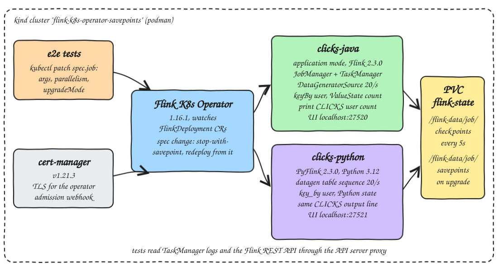
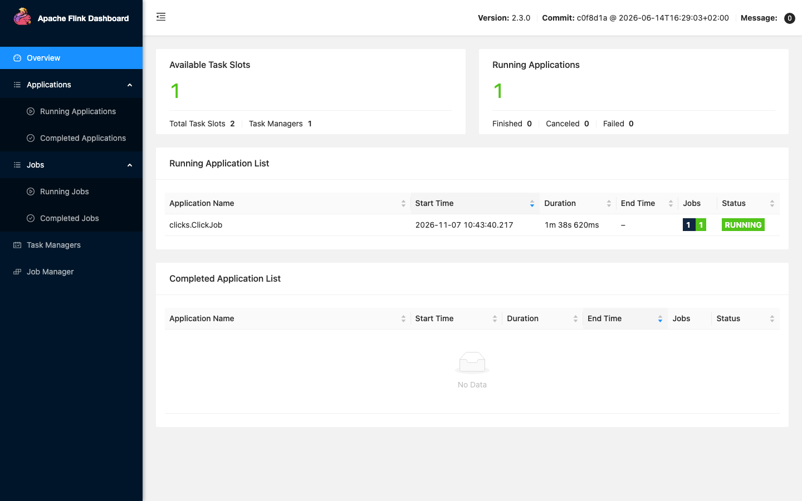
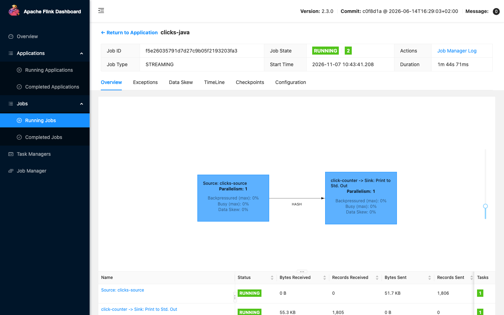
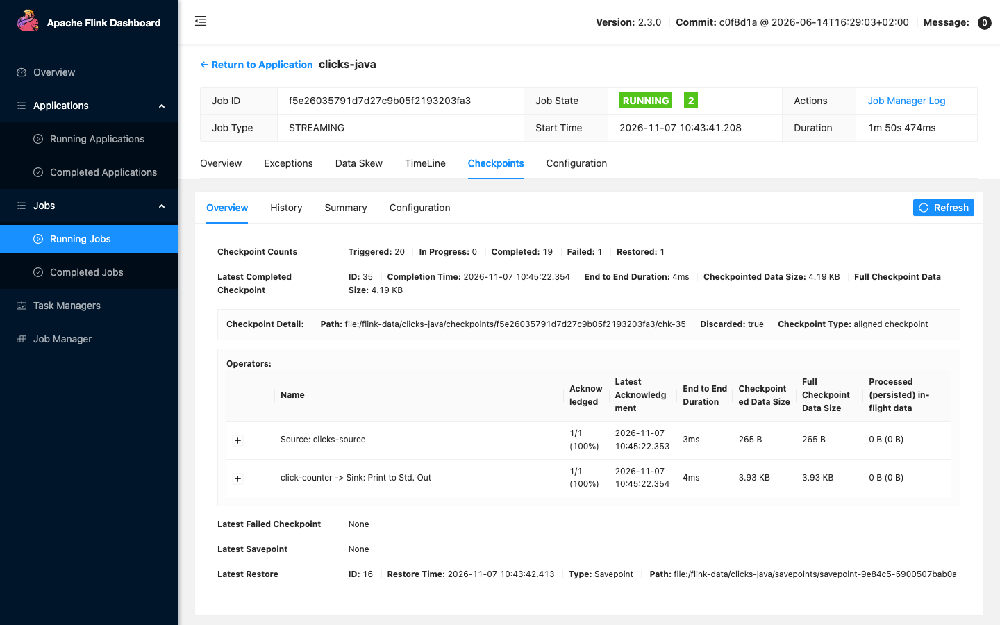
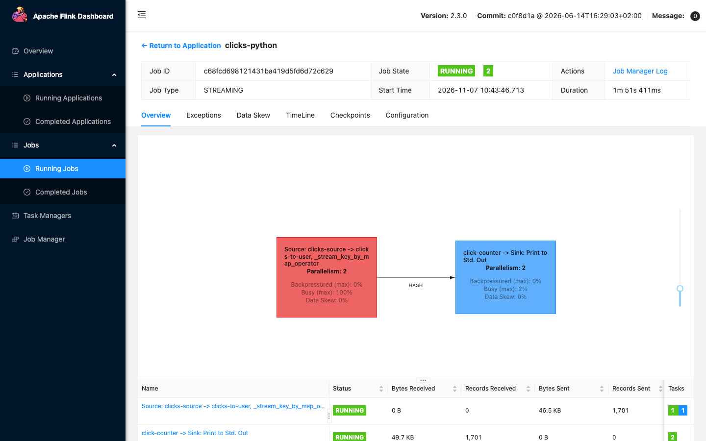
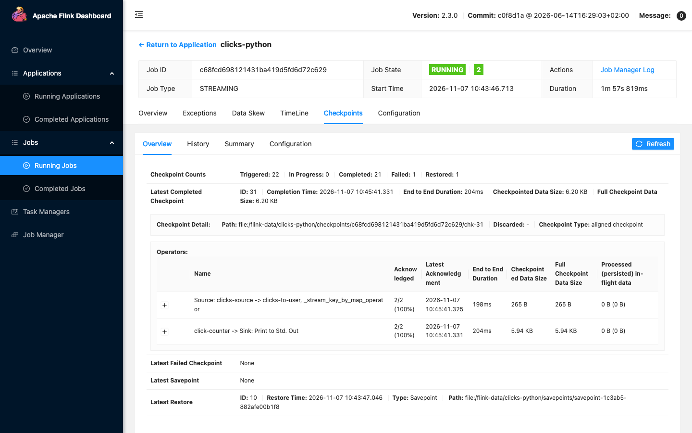

<p align="center"></p>

# flink-k8s-operator-savepoints

The Apache Flink Kubernetes Operator 1.16.1 on a local kind cluster, running two `FlinkDeployment`s in application mode on Flink 2.3.0: a Java DataStream job (plain Maven jar) and a PyFlink job. Both count clicks per user from a deterministic source, with keyed `ValueState`, checkpoints every 5 s, and savepoints on a PVC. End-to-end tests prove three things against the real cluster: a spec upgrade with `upgradeMode: savepoint` keeps every user's count, rescaling 1 -> 2 -> 1 restores the same counts from savepoints, and `upgradeMode: stateless` throws the state away.

## How it Works

1. `scripts/setup.sh` creates the kind cluster, builds the Java jar and both job images, loads them plus cert-manager and the operator images into kind, installs cert-manager v1.21.3 and the operator Helm chart 1.16.1.
2. `scripts/start-all.sh` creates the `flink-state` PVC and the `clicks-java` and `clicks-python` FlinkDeployments, waits for both jobs to be `RUNNING` and port-forwards both Flink UIs.
3. Click number `seq` belongs to `user-(seq % 10)`. The Java job reads `seq` from `DataGeneratorSource` (20 per second), the Python job from `NumberSequenceSource` throttled to 20 per second.
4. Both key by user, keep the count in `ValueState`, and print `CLICKS job=.. version=.. user=.. seq=.. count=..` on the TaskManager stdout.
5. A test patches `spec.job` (new `--version` arg or a new `parallelism`). The operator does stop-with-savepoint, writes it under `/flink-data/<job>/savepoints`, tears the cluster down and deploys the new spec restored from that savepoint.
6. The test follows the old TaskManager log to its end, reads the new TaskManager log and compares, per user, the last count before the upgrade with the first count after it.
7. With `savepoint` the first count after must be exactly the last count before plus one, and the source must continue at the next `seq` for that user. With `stateless` the first count after is 1 for every user.
8. The Flink REST API (read through the Kubernetes API server proxy) tells the test that the new job was restored from a savepoint and which parallelism it runs with.

## Architecture



## Features

* `upgradeMode: savepoint`: a spec change becomes stop-with-savepoint plus restore, so keyed state survives code and config upgrades.
* Rescale by editing `spec.job.parallelism`: the new job redistributes key groups from the savepoint, so every user keeps its count on whichever subtask now owns it.
* `upgradeMode: stateless` contrast: the same spec change starts from empty state, which shows what the savepoint is buying.
* Stable operator uids (`clicks-source`, `click-counter`, `clicks-print`) in both jobs, so savepoint state maps back to the same operators after an upgrade.
* Deterministic source: the same `seq` always maps to the same user, so "count continues" and "source neither skipped nor replayed" can both be checked exactly, per user.
* One output line format for Java and Python, so one parser and one set of assertions covers both jobs.
* Checkpoints and savepoints on one PVC mounted by JobManager and TaskManager through `podTemplate`, no object store needed.
* Upgrade and rescale times are measured on every test run and written to `.run/results.tsv`.

## Stack

* Kubernetes v1.35.0 (`kindest/node`, kind v0.31 on podman): single node cluster.
* cert-manager v1.21.3: the operator's admission webhook needs its certificates.
* Flink Kubernetes Operator 1.16.1 (Helm chart from the Apache archive, image `ghcr.io/apache/flink-kubernetes-operator:1.16.1`): latest stable release, manages `FlinkDeployment` with `flinkVersion: v2_3`.
* Flink 2.3.0 (`flink:2.3.0-scala_2.12-java21`): newest Flink release, runs both jobs.
* Java job: built with JDK 25 (Amazon Corretto 25.0.4), Maven, `maven.compiler.release` 21, `flink-streaming-java` and `flink-connector-datagen` 2.3.0, JUnit 5 with Flink's operator test harness.
* Python job: PyFlink (`apache-flink`) 2.3.0 on Python 3.12 (3.12.3 from Ubuntu noble in the image), uv, pytest 9.2.0, ty 0.0.99.
* e2e tests: Python 3.15, pytest 9.2.0, ty 0.0.99, only `kubectl` underneath (no Kubernetes client library).

## Version deviations

* Java 25: no Flink release supports Java 25 yet. Flink 2.3.0 ships images for Java 11, 17 and 21 only, and JDK 25 is a non-blocking CI lane with known failures (FLINK-37719, FLINK-39654). The job is compiled by JDK 25 with `--release 21`, so the bytecode runs on the Java 21 JRE inside the official Flink image. The unit tests run on JDK 25 itself. Everything Java outside the Flink runtime is on 25.
* Python 3.15: PyFlink 2.3.0 supports Python 3.9 to 3.12 only, and ships no Linux arm64 wheels. The image installs Ubuntu noble's Python 3.12.3 and builds `apache-flink` 2.3.0 from source; `python-job` is a uv project pinned to 3.12 so `ty` checks against the real PyFlink API. The e2e test project stays on Python 3.15.
* The Python job does not use the `datagen` SQL connector with `kind = sequence`. In Flink 2.3 that connector still uses the legacy `SequenceGenerator`, which puts every remaining number into a Java deque and into checkpoint state, and refuses ranges above 2^31. `NumberSequenceSource` keeps only a split position in state.

## Contracts

`FlinkDeployment` fields the tests change:

| Field | Values | Effect |
|---|---|---|
| `spec.job.args` | `--version v1` -> `v2` | spec change, operator upgrades the job |
| `spec.job.parallelism` | 1 -> 2 -> 1 | spec change, operator redeploys with the new parallelism |
| `spec.job.upgradeMode` | `savepoint` or `stateless` | how the operator carries state across the change |

Job arguments (both jobs): `--version` (label in the output), `--users` (10), `--rate` (20 clicks per second).

Output line on TaskManager stdout (the only contract between jobs and tests):

```
CLICKS job=java version=v2 user=user-3 seq=4573 count=458
```

Flink configuration in both manifests:

```yaml
taskmanager.numberOfTaskSlots: "2"
execution.checkpointing.interval: 5s
execution.checkpointing.dir: file:///flink-data/<job>/checkpoints
execution.checkpointing.savepoint-dir: file:///flink-data/<job>/savepoints
state.backend.type: hashmap
```

## Design decisions

* Counting is the smallest piece of state where a reset is obvious: a lost count shows up as `count=1`, a replay as a jump, so a single number per user proves or disproves the claim.
* The tests check exact continuity (`after == before + 1` and `seq_after == seq_before + 10` for every user), not "roughly the same". Stop-with-savepoint means nothing is processed after the savepoint barrier, so the numbers must match exactly.
* The old TaskManager pod is deleted during the upgrade and its new replacement often has the same name, so the test starts `kubectl logs -f` on the old pods before patching and reads it to the end; new pods are told apart by uid.
* The Flink REST API is reached through `kubectl get --raw .../services/<job>-rest:8081/proxy`, so tests work even while a port-forward is reconnecting to a new JobManager.
* `start-all.sh` runs each port-forward in a reconnect loop, because every upgrade replaces the JobManager pod behind the service.
* The Python job throttles in a Python map (`time.sleep(1/rate)`) because `NumberSequenceSource` has no rate limiter; backpressure keeps the source at the same pace.
* Each e2e test deploys its job from scratch, so tests do not depend on each other; when the module finishes the jobs are redeployed at v1, parallelism 1, `savepoint`.
* Without HA the operator still supports `savepoint` mode (not `last-state`), which is enough for planned upgrades and keeps the cluster small.

## How to run

Requirements: podman, kind, kubectl, helm, uv, Maven, Java 25 at `~/.sdkman/candidates/java/25.0.4-amzn`, lsof.

```bash
./scripts/setup.sh
./scripts/start-all.sh
./scripts/test-all.sh
./scripts/ui.sh
./scripts/stop-all.sh
./scripts/teardown.sh
```

`test-all.sh` runs:

* `java-job` JUnit on JDK 25: a user's count equals its number of clicks; restoring an operator snapshot into a `v2` operator continues the count instead of starting at 1; without restored state the count starts at 1; repartitioning a parallelism 1 snapshot to 2 subtasks keeps every user count; the generator is deterministic.
* `python-job` pytest and `ty check`: same user mapping, count start and continue rules, same output line as Java, argument parsing next to PyFlink's own arguments.
* `e2e` `ty check` and pytest: parser and gap detector unit tests, then for both jobs on kind:
  * a savepoint upgrade of the job spec keeps every user count;
  * rescaling 1 -> 2 -> 1 restores the same counts from savepoints (parallelism checked through the REST API);
  * a stateless upgrade loses the counts and starts over at 1, with `seq` back at 0;
  * the operator reports both jobs running after their last upgrade.

```
Tests run: 4, Failures: 0   clicks.ClickCounterTest  (JDK 25)
Tests run: 3, Failures: 0   clicks.ClickGeneratorTest
7 passed                    python-job pytest
All checks passed!          ty python-job, ty e2e
tests/test_clicks.py ... 3 PASSED
test_savepoint_upgrade_of_the_job_spec_keeps_every_user_count[java] PASSED
test_savepoint_upgrade_of_the_job_spec_keeps_every_user_count[python] PASSED
test_rescale_one_to_two_to_one_restores_the_same_counts_from_savepoints[java] PASSED
test_rescale_one_to_two_to_one_restores_the_same_counts_from_savepoints[python] PASSED
test_stateless_upgrade_loses_the_counts_and_starts_over[java] PASSED
test_stateless_upgrade_loses_the_counts_and_starts_over[python] PASSED
test_the_operator_reports_both_jobs_running_after_their_last_upgrade PASSED
10 passed in 553.11s
all tests passed
```

## Results

Measured by `./scripts/test-all.sh` on a single node kind cluster (podman machine, 12 CPUs), 10 users, 20 clicks per second, checkpoints every 5 s, hashmap state backend. One run, each transition once.

| job | transition | upgradeMode | parallelism after | patch -> new job RUNNING (s) | patch -> first new count (s) | user-0 count before -> after | state kept |
|---|---|---|---|---|---|---|---|
| java | upgrade v1 -> v2 | savepoint | 1 | 22.6 | 22.7 | 23 -> 24 | yes |
| python | upgrade v1 -> v2 | savepoint | 1 | 29.9 | 29.9 | 13 -> 14 | yes |
| java | rescale 1 -> 2 | savepoint | 2 | 22.6 | 22.7 | 23 -> 24 | yes |
| java | rescale 2 -> 1 | savepoint | 1 | 22.7 | 22.8 | 36 -> 37 | yes |
| python | rescale 1 -> 2 | savepoint | 2 | 33.1 | 33.1 | 10 -> 11 | yes |
| python | rescale 2 -> 1 | savepoint | 1 | 29.8 | 29.9 | 19 -> 20 | yes |
| java | upgrade v1 -> v2 | stateless | 1 | 22.5 | 22.6 | 23 -> 1 | no |
| python | upgrade v1 -> v2 | stateless | 1 | 31.0 | 31.1 | 9 -> 1 | no |

* "patch -> new job RUNNING": from `kubectl patch` on the host until the Flink REST API shows a new job id with every vertex `RUNNING`. It covers the operator noticing the change, stop-with-savepoint (or cancel for stateless), deleting the old JobManager and TaskManager, starting new pods and restoring state. Polled every second.
* "patch -> first new count": until the first `CLICKS` line from a new TaskManager pod; it is within 0.1 s of RUNNING because the source starts emitting at once.
* "state kept" is computed from the logs: yes means every one of the 10 users went from `n` to `n + 1`; the tests assert that, plus the `seq` continuity, and assert `count=1` for every user in the stateless rows.
* The user-0 numbers are small because each test deploys from scratch and upgrades about 10 to 20 s later.

What the numbers say:

* The savepoint costs almost nothing here: a savepoint upgrade (22.6 s Java) takes as long as a stateless one (22.5 s Java). With a few KB of state the time is spent on pod lifecycle and JVM and Flink startup, not on writing or reading state.
* Rescaling through the spec is a full redeploy: 1 -> 2 takes the same time as a version upgrade, not an in-place change.
* PyFlink takes about 7 to 10 s more per transition than Java (29.8 to 33.1 s against 22.5 to 22.8 s). The new TaskManager has to start the Python worker process (Beam SDK harness) before the job reaches RUNNING.
* The Java times are within 0.2 s of each other across all four transitions; why they are so even (an operator reconcile interval is one guess) was not looked into.

## Printscreens

Flink UI of `clicks-java` (`localhost:27520`): one application with one job, one TaskManager with 2 slots.



`clicks-java` job graph after a savepoint upgrade to `v2`: the source vertex and the `click-counter -> Sink` vertex, joined by a HASH (keyBy) edge.



`clicks-java` Checkpoints tab: `Latest Restore` is of type `Savepoint`, path `file:/flink-data/clicks-java/savepoints/savepoint-...`. That is the savepoint the operator took when the spec changed. The one failed checkpoint in the counts was seen on every restored job in this run; its cause was not looked into, and it did not affect the counts.



`clicks-python` after rescaling to parallelism 2: both vertices run with 2 subtasks. The source vertex shows 100% busy because the Python throttle map sleeps 50 ms per click inside that chain.



`clicks-python` Checkpoints tab after the rescale: restored from the savepoint `file:/flink-data/clicks-python/savepoints/savepoint-...`, every checkpoint since then acknowledged by 2 of 2 subtasks.



## Scripts

All scripts live in `scripts/` and run from any directory of the repository.

| Script | What it does |
|---|---|
| `./scripts/setup.sh` | Creates the kind cluster, builds the jar and both images, loads images, installs cert-manager and the Flink operator |
| `./scripts/start-all.sh` | Creates the state PVC and both FlinkDeployments, waits for RUNNING, port-forwards both Flink UIs and prints their URLs |
| `./scripts/status.sh` | Shows the cluster, the operator, each job's state, upgrade mode and parallelism, and every port as UP or DOWN |
| `./scripts/test-all.sh` | Runs Java and Python unit tests, ty, the end-to-end upgrade, rescale and stateless tests, and prints the measured times |
| `./scripts/ui.sh` | Opens both Flink UIs in the browser |
| `./scripts/stop-all.sh` | Stops the port-forwards and deletes both FlinkDeployments and the state PVC |
| `./scripts/teardown.sh` | Runs stop-all, deletes the kind cluster and removes the two job images |

Ports are declared in `scripts/ports.env`: `java-ui=27520` (`http://localhost:27520`), `python-ui=27521` (`http://localhost:27521`).

```bash
./scripts/setup.sh
./scripts/start-all.sh
./scripts/status.sh
./scripts/ui.sh
./scripts/stop-all.sh
```
