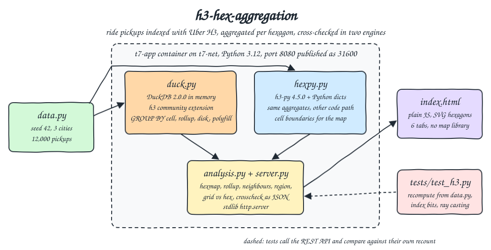
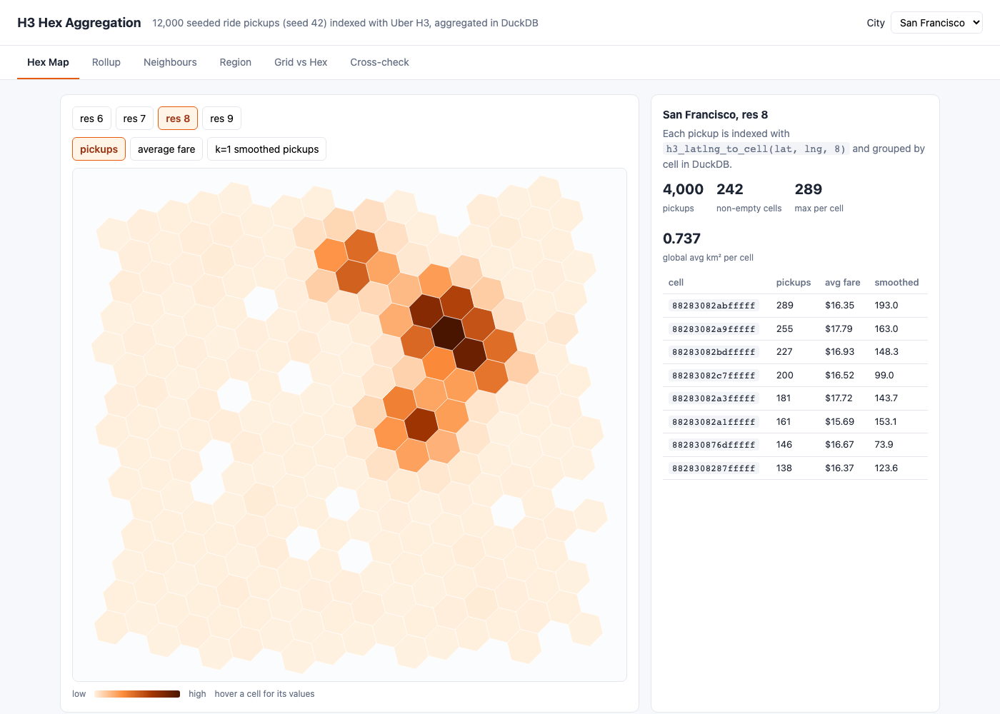
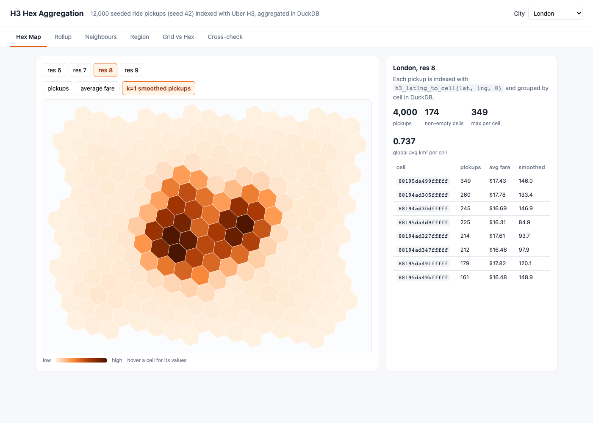
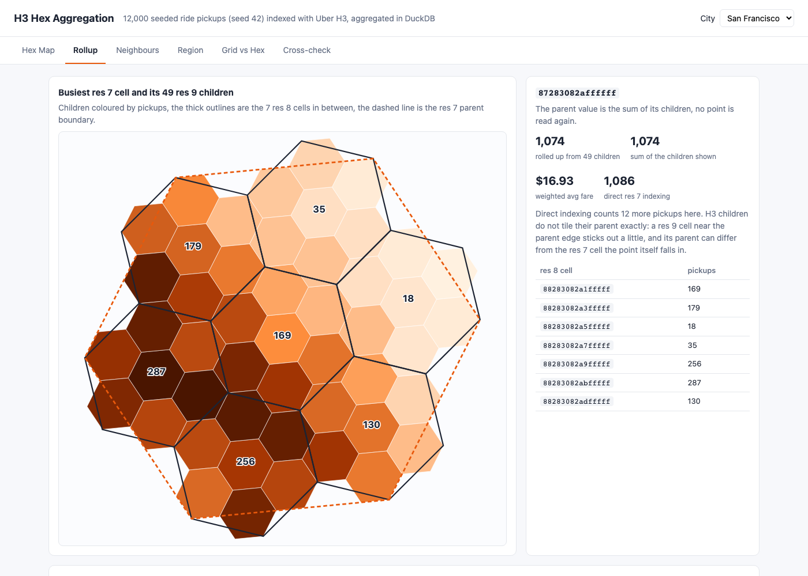
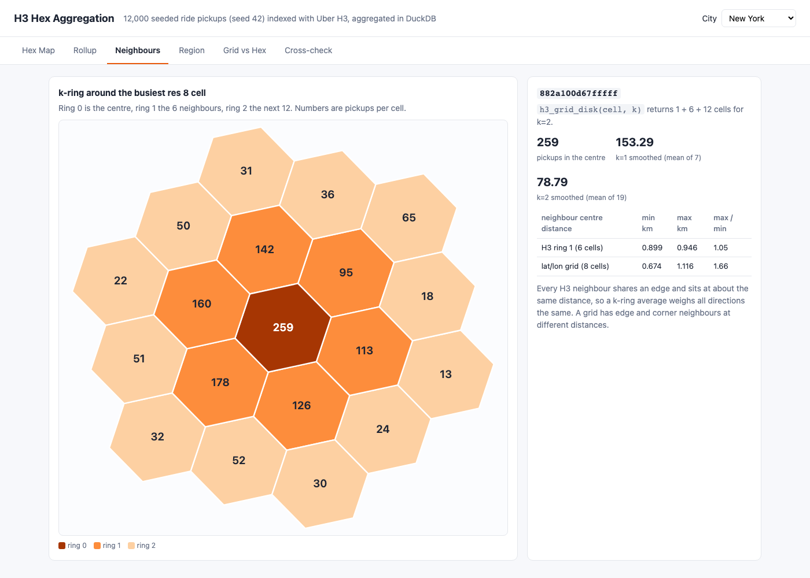
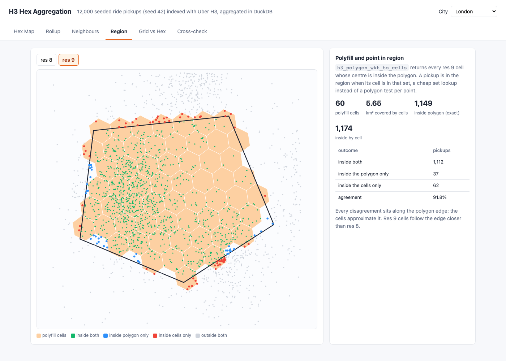
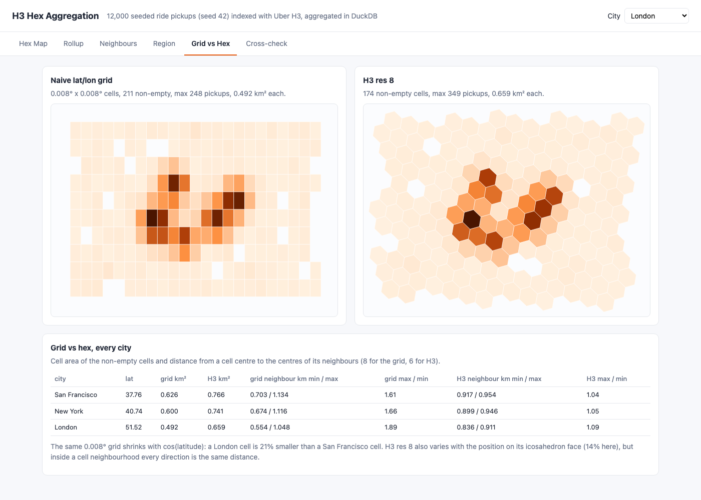
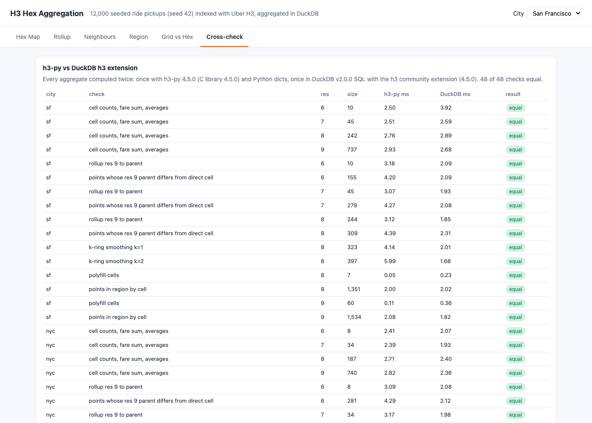

<p align="center"></p>

# h3-hex-aggregation

Uber H3 hexagonal indexing for geospatial aggregation. This POC generates 12,000 seeded ride pickups around San Francisco, New York and London, indexes them with H3 at resolutions 6 to 9, and aggregates them per hexagon (pickups, average fare, average wait) in DuckDB 2.0.0 with the h3 community extension. It rolls res 9 children up to their parents, smooths counts over k-ring neighbours, fills a region polygon with cells (polyfill) to answer point-in-region with a set lookup, and compares H3 against a naive 0.008° lat/lon grid. Every aggregate is computed a second time with h3-py 4.5.0 and plain Python, and both engines agree on all 48 checks. A plain JS UI draws the hexagons as SVG.

## How it Works

1. `app/data.py` generates 4,000 pickups per city from a fixed seed (42): gaussian hotspots plus a uniform background inside a bounding box, each with `id`, `city`, `lat`, `lng`, `fare_cents`, `wait_s`.
2. `app/duck.py` loads the pickups into an in-memory DuckDB table and runs every aggregate as SQL with the h3 extension: `h3_latlng_to_cell` + `GROUP BY`, `h3_cell_to_parent` for rollups, `h3_grid_disk` for smoothing, `h3_polygon_wkt_to_cells` for polyfill.
3. `app/hexpy.py` computes the same aggregates with h3-py and Python dicts, through a different code path (smoothing is a gather in Python and a scatter in SQL).
4. `app/analysis.py` builds the payload of each UI tab from the DuckDB results and the cell boundaries from h3-py, and runs the 48 cross-checks between the two engines.
5. `app/server.py` (stdlib `http.server`) serves the JSON API and `app/index.html`, which renders the tabs Hex Map, Rollup, Neighbours, Region, Grid vs Hex and Cross-check with a small Web Mercator projection into SVG.
6. `scripts/test-all.sh` runs `tests/test_h3.py` inside `t7-app`. The tests call the API and recompute every expected answer from `app/data.py` on their own: plain recounts, parent cells derived from the H3 index bits, neighbours found by stepping across each hexagon edge, and ray casting for polygons.

## Architecture



## Features

* Multi-resolution indexing: every pickup gets a cell at res 6, 7, 8 and 9 (36, 5.2, 0.74 and 0.11 km² on average), one `GROUP BY` per resolution.
* Per-cell aggregates: pickups, fare sum, average fare and average wait per cell, the base for any heat map.
* Parent rollup: res 9 cell totals summed per `h3_cell_to_parent` give res 8, 7 and 6 without reading a point again, and every level still adds up to 4,000 pickups and the same fare sum.
* Fuzzy containment made visible: H3 children do not tile their parent exactly, so 4% to 8% of the pickups land in a different res 6, 7 or 8 cell when indexed directly than when rolled up from res 9. The Rollup tab shows the count per level.
* k-ring smoothing: the smoothed value of a cell is the mean over the cell and its 6 neighbours (k=1, 7 cells) or 18 neighbours (k=2, 19 cells), empty cells count as 0.
* Polyfill and point-in-region: the region polygon becomes a set of res 8 or res 9 cells (by cell centre), and a pickup is in the region when its cell is in the set. Agreement with an exact polygon test is 82% to 88% at res 8 and 92% to 96% at res 9, and every disagreement sits within about one cell edge of the polygon border.
* Grid vs hex: a 0.008° grid cell is 0.626 km² in San Francisco and 0.492 km² in London (cos latitude), and its 8 neighbours sit at distances that differ by a factor of 1.6 to 1.9. The 6 H3 neighbours differ by at most 1.09.
* Two engines cross-checked: DuckDB SQL and h3-py agree on cell counts, sums and averages, rollups, mismatch counts, smoothing, polyfill and region membership for every city, with the time each took.

## Stack

* DuckDB 2.0.0 (Python package `duckdb==2.0.0`): in-process SQL engine for the aggregates, latest stable release.
* DuckDB h3 community extension (bundles H3 4.5.0): H3 as SQL functions, installed at image build time with `INSTALL h3 FROM community`.
* h3-py 4.5.0: the official H3 Python binding, used for the cross-check and for cell boundaries.
* Python 3.12.16 (`docker.io/library/python:3.12.16-slim`): DuckDB 2.0.0 ships wheels only for CPython 3.11 and 3.12, so this is the newest Python it runs on.
* Python stdlib `http.server`, `unittest` + plain HTML, CSS, JS and SVG: no web framework, no map library, no test framework.
* podman + podman-compose: one container `t7-app` on network `t7-net`, 512 MB limit, about 52 MB used.

## Contracts / APIs

| Method | Path | Description |
|---|---|---|
| GET | `/` | UI |
| GET | `/api/summary` | Seed, point counts, resolutions, grid step, versions, cities with bounding box and region polygon, average hexagon area per resolution |
| GET | `/api/hexmap?city=sf&res=8` | Every cell with pickups, average fare, average wait, k=1 smoothed value and boundary (res 6 to 9) |
| GET | `/api/rollup?city=sf` | Busiest res 7 parent, its 49 res 9 children and 7 res 8 cells, rollup vs direct count, totals and mismatches per level |
| GET | `/api/neighbours?city=sf` | k=2 disk around the busiest res 8 cell with ring number and counts, k=1 and k=2 smoothed values, neighbour distances for H3 and the grid |
| GET | `/api/region?city=sf&res=9` | Polyfill cells (res 8 or 9), pickups near the region flagged exact and by cell, agreement counts |
| GET | `/api/compare?city=sf` | Grid cells and H3 res 8 cells with counts and areas, area and neighbour distance statistics |
| GET | `/api/compare-all` | The statistics of `/api/compare` for every city |
| GET | `/api/crosscheck` | The 48 h3-py vs DuckDB checks with result, size and time |

Invalid `city` or `res` returns 400.

```json
{"rollup": {"parent": "87283082affffff", "rollup": {"n": 1074, "fare_sum": 1818778}, "direct": {"n": 1086},
            "levels": [{"res": 9, "rollup_total": 4000, "mismatched_points": 0},
                       {"res": 8, "rollup_total": 4000, "direct_total": 4000, "mismatched_points": 309},
                       {"res": 7, "rollup_total": 4000, "direct_total": 4000, "mismatched_points": 279}]},
 "neighbours": {"center": "882a100d67fffff", "center_n": 259, "smooth_k1": 153.29, "smooth_k2": 78.79,
                "hex_neighbour_km": {"min": 0.899, "max": 0.946}, "grid_neighbour_km": {"min": 0.674, "max": 1.116}},
 "region": {"city": "london", "res": 9, "exact": 1149, "hex": 1174, "both": 1112, "only_exact": 37, "only_hex": 62},
 "crosscheck": {"all_equal": true, "checks": [{"city": "sf", "check": "k-ring smoothing k=1", "res": 8, "equal": true, "size": 323}]}}
```

## Key data structures and design decisions

* Points live in one DuckDB table `points(id, city, lat, lng, fare_cents, wait_s)`. Cells are `UBIGINT` inside SQL and converted to the 15 character hex string with `h3_h3_to_string` at the edge, so both engines compare the same string keys.
* Smoothing in SQL is a scatter: each non-empty cell sends its count to every cell of its disk with `unnest(h3_grid_disk(cell, k))`, then a `GROUP BY` target divides by the disk size `1 + 3k(k+1)`. Because a disk is symmetric this equals the gather done in Python, and the cross-check proves it.
* Rollup groups res 9 cells, not points, so a parent costs one pass over the children. The tests derive the parent independently from the index bits (resolution field set to the parent resolution, finer digits set to 7) instead of calling `cell_to_parent`.
* Fuzzy containment is reported, not hidden: the busiest San Francisco res 7 cell has 1,074 pickups rolled up from its 49 children and 1,086 by direct indexing. Rollups are consistent with each other, direct indexing is consistent with geometry, and you have to pick one per pipeline.
* Polyfill uses H3 centre containment in both engines. The tests rebuild the expected cell set by sampling the region bounding box every 0.0004° and keeping the cells whose centre is inside the polygon by their own ray casting.
* The first version of the "every point lies in its cell" test used planar ray casting on the hexagon vertices and failed for one pickup at res 6, 0.1 m outside the planar polygon: H3 edges are great circle arcs, not straight lines in lat/lng. The test now accepts a point outside the planar hexagon only when it is less than 1 m from the edge.
* The first region test had fixed agreement thresholds (85% at res 8) that London missed (82%). The intent is that finer cells follow the border better, so the test now asserts res 9 agrees more than res 8 for every city, plus a floor of 75%.
* H3 areas are not constant either: res 8 non-empty cells average 0.766 km² in San Francisco and 0.659 km² in London (the position on the icosahedron face matters). The clear H3 win in this data is the neighbourhood: 6 edge neighbours at almost the same distance, against 4 edge and 4 corner neighbours on a grid.
* Mutation checks run during development: dividing the smoothing by 6 instead of 7, or summing `count(*)` instead of the child counts in the rollup, made 3 tests fail each.
* Python 3.12 instead of 3.14: DuckDB 2.0.0 was released a week before this POC with wheels for CPython 3.11 and 3.12 only. The extension is installed at build time, so the container needs no network at runtime.
* Everything is computed once and cached in memory (`functools.cache`), the server warms the cross-check on start. Startup takes about 3 s, mostly inserting the 12,000 rows.
* The container, the image and the network start with `t7-`. The UI is on port 31600.

## How to run

Requirements: podman, podman-compose, curl and lsof. Everything else runs in the container.

```bash
./scripts/setup.sh
./scripts/start-all.sh
./scripts/test-all.sh
./scripts/ui.sh
./scripts/stop-all.sh
```

`tests/test_h3.py` (13 tests, inside `t7-app`) checks:

* Every pickup lies inside the boundary of the cell it was indexed to, at every resolution.
* The hex map counts, average fare and average wait of every cell, for every city and resolution, equal a plain recount of the input, and add up to 4,000.
* Coarser resolutions have fewer cells.
* The k=1 smoothed value of every non-empty cell is the mean over the cell and 6 neighbours found by stepping across each hexagon edge (each shares exactly 2 vertices), and every smoothed empty cell touches a non-empty one.
* The rollup parent is the busiest parent by index bits, its count and fare sum equal the sum of its 49 children, and every child sits under the right res 8 and res 7 cell.
* Every rollup level keeps 4,000 pickups and the full fare sum, and the number of pickups that land in a different cell when indexed directly equals the test's own count (more than 0, less than 15%).
* The k=2 disk is the centre, its 6 edge neighbours and the 12 cells beyond them, with the right counts, k=1 and k=2 means and neighbour distances within 10% of each other.
* The polyfill cells are exactly the cells whose centre is inside the region.
* Point-in-region by cell matches the test's count, disagrees with exact ray casting only within 1.2 cell edges of the border, and agrees better at res 9 than at res 8.
* The naive grid counts equal a recount with `floor(lat / 0.008)`, grid neighbour distances differ by more than 1.4x while H3 differs by less than 1.1x, and the London / San Francisco grid cell area ratio equals the cosine ratio of their latitudes.
* h3-py and DuckDB agree on all 48 checks.
* Bad city or resolution returns 400, and the UI page has every tab.

```
running the h3 tests inside t7-app
test_bad_input_is_rejected ... ok
test_coarser_resolutions_have_fewer_and_fuller_cells ... ok
test_each_point_lies_inside_the_polygon_of_the_cell_it_was_indexed_to ... ok
test_every_rollup_level_keeps_every_point_and_reports_the_fuzzy_containment ... ok
test_h3_py_and_duckdb_agree_on_every_check ... ok
test_hexmap_counts_and_averages_equal_a_plain_recount_of_the_input ... ok
test_k1_smoothing_is_the_mean_of_a_cell_and_its_six_edge_neighbours ... ok
test_k_ring_two_is_the_centre_six_edge_neighbours_and_twelve_beyond ... ok
test_naive_grid_counts_and_its_latitude_distortion ... ok
test_point_in_region_by_cell_only_disagrees_with_the_exact_test_near_the_edge ... ok
test_polyfill_is_every_cell_whose_centre_is_inside_the_region ... ok
test_rollup_parent_is_the_sum_of_its_children_by_index_bits ... ok
test_ui_page_has_every_tab ... ok

Ran 13 tests in 0.668s
OK
all tests passed
```

## Printscreens

Hex Map tab, San Francisco at res 8: 242 non-empty cells coloured by pickups, the downtown and SoMa hotspots stand out. The table lists the busiest cells with average fare and k=1 smoothed value, hovering a cell shows all its values.



Hex Map tab, London with k=1 smoothed pickups: every cell shows the mean over itself and its 6 neighbours, so empty cells next to a hotspot get a value and the five hotspots blend into one area.



Rollup tab, San Francisco: the busiest res 7 cell (dashed), its 7 res 8 cells (thick outlines, labelled with their counts) and 49 res 9 children. The children stick out of the parent boundary, and 1,074 pickups roll up against 1,086 by direct indexing. The table below shows the totals per level and the pickups that change cell.



Neighbours tab, New York: the k=2 disk around the busiest res 8 cell (259 pickups), its 6 neighbours and the 12 cells of ring 2, with the k=1 and k=2 means. The 6 H3 neighbours sit 0.899 to 0.946 km away, the 8 grid neighbours 0.674 to 1.116 km.



Region tab, London at res 9: the 60 polyfill cells under the region polygon. Green pickups are inside by both tests, blue only inside the exact polygon, red only inside the cells. Every blue and red dot sits along the border.



Grid vs Hex tab, London: the same pickups on the 0.008° grid and on H3 res 8, and the table for all three cities. The grid cell shrinks 21% from San Francisco to London and its neighbours are 1.61x to 1.89x apart, H3 neighbours at most 1.09x.



Cross-check tab: all 48 checks between h3-py and DuckDB with the size of each result and the time each engine took, every one equal.



## Scripts

All scripts live in `scripts/` and run from any directory of the repository.

| Script | What it does |
|---|---|
| `./scripts/setup.sh` | Pulls the Python image and builds the app image with DuckDB, the h3 extension and h3-py |
| `./scripts/start-all.sh` | Starts `t7-app`, waits until the API answers, prints every link |
| `./scripts/status.sh` | Shows the UI port as UP or DOWN |
| `./scripts/test-all.sh` | Runs `tests/test_h3.py` inside the container |
| `./scripts/ui.sh` | Opens the UI in the browser |
| `./scripts/stop-all.sh` | Stops the container and waits until the port is free |

Ports are declared in `scripts/ports.env`: UI 31600 (`http://localhost:31600`).

```bash
./scripts/setup.sh
./scripts/start-all.sh
./scripts/status.sh
./scripts/ui.sh
./scripts/stop-all.sh
```
