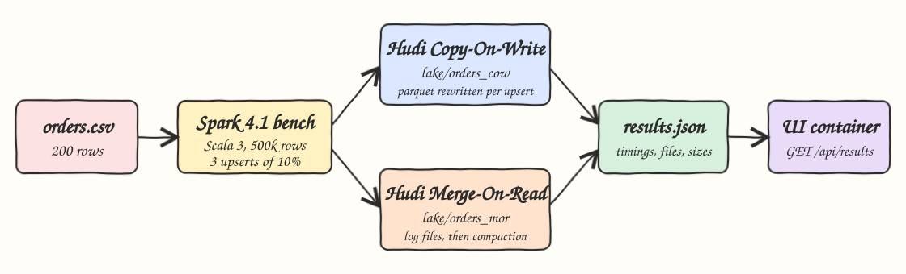
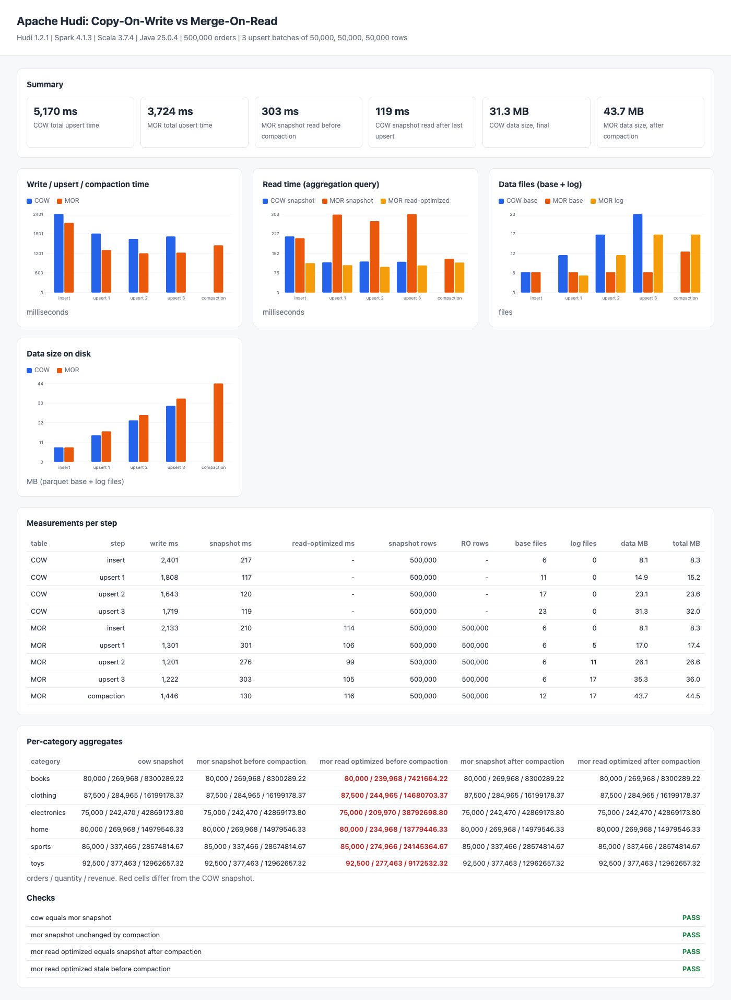

# hudi-spark-cow-mor

Benchmark of the two Apache Hudi table types, Copy-On-Write (COW) and Merge-On-Read (MOR), on the same data.
A Spark 4.1 job written in Scala 3 writes 500,000 orders into both tables, runs 3 upsert batches that each update 10% of the rows,
compacts the MOR table, and records write time, snapshot read time, read-optimized read time, file counts and storage size into `results/results.json`.
A small UI compares COW and MOR side by side and shows that both tables hold identical per-category aggregates.

## How it Works

1. `data/orders.csv` (200 orders) is expanded deterministically 2,500 times: `order_id = copy * 10000 + order_id`, `quantity = quantity + copy % 3`.
2. Both tables are partitioned by `category`, keyed by `order_id`, and ordered by a `version` column.
3. Step `insert` writes the 500,000 rows with the Hudi `insert` operation.
4. Steps `upsert 1..3` update the rows where `order_id % 10 == batch - 1` (50,000 rows each): `quantity += batch`, `version = batch`.
5. After every step the job runs an aggregation query (count, sum quantity, sum quantity * price per category) as a snapshot query, and on MOR also as a read-optimized query, and walks the table folder to count parquet base files, log files and bytes.
6. The MOR table is compacted with `CALL run_compaction(op => 'scheduleAndExecute', ...)` and measured again.
7. A warm-up run on a tiny table is done first so JIT warm-up does not favour the second table.
8. `test-all.sh` recomputes the final aggregates with awk straight from the CSV and compares them with every table result.

## Architecture



## Features

* COW vs MOR write cost: COW rewrites whole parquet files per upsert, MOR appends log files, so upserts are cheaper on MOR.
* Snapshot vs read-optimized queries: MOR snapshot merges logs at read time, read-optimized only reads base files and is stale until compaction.
* Compaction: measures how long it takes and how it brings the MOR snapshot read time back to COW level.
* Storage accounting: parquet base files, log files, data bytes and total bytes (including `.hoodie` metadata) after every step.
* Correctness: per-category aggregates must be identical in COW, MOR snapshot (before and after compaction), MOR read-optimized after compaction, and an awk recomputation.
* Deterministic data: the same 500,000 rows and the same 150,000 updates on every run.

## Stack

* Apache Hudi 1.2.1 (`hudi-spark4.1-bundle_2.13`): latest Hudi release, its newest bundle targets Spark 4.1.
* Apache Spark 4.1.3: newest Spark line Hudi 1.2.1 ships a bundle for (there is no Spark 4.2 bundle yet).
* Hadoop client 3.5.0 (override): Spark 4.1 ships Hadoop 3.4.2, which fails on Java 25 with `getSubject is not supported`, 3.5.0 fixes it.
* Scala 3.7.4 with `CrossVersion.for3Use2_13`: Spark and the Hudi bundle are Scala 2.13 jars, the job only uses the DataFrame and SQL APIs so Scala 3 works.
* Java 25 (Amazon Corretto 25.0.4 locally, Temurin 25 in the container).
* sbt 2.0.9: build tool for both modules.
* JDK `HttpServer`: tiny UI backend with no extra libraries.
* podman / podman-compose: runs the UI container.
* Local filesystem for the lake (`lake/`): simplest option, no object store needed.

## Contracts / APIs

| Method | Path | Returns |
|---|---|---|
| GET | `/` | the UI page |
| GET | `/api/results` | `results/results.json` as produced by the benchmark, 404 when it was not generated yet |

`results.json` shape:

```json
{
  "versions": {"hudi": "1.2.1", "spark": "4.1.3", "scala": "3.7.4", "java": "25.0.4"},
  "rows": 500000,
  "copies": 2500,
  "batchUpdates": [50000, 50000, 50000],
  "tables": {
    "cow": [{"step": "insert", "writeMs": 0, "snapshotMs": 0, "snapshotRows": 0, "readOptimizedMs": null, "readOptimizedRows": null,
             "storage": {"baseFiles": 0, "logFiles": 0, "otherFiles": 0, "baseBytes": 0, "logBytes": 0, "dataBytes": 0, "totalBytes": 0}}],
    "mor": []
  },
  "aggregates": {"cow_snapshot": [{"category": "books", "orders": 0, "quantity": 0, "revenue": "0.00"}]},
  "checks": {"cow_equals_mor_snapshot": true}
}
```

## Key design decisions

* `price` is `decimal(10,2)`, so revenue sums are exact and can be compared as strings with the awk result computed in integer cents.
* Inline and async compaction are disabled on writes so the MOR log files stay until the explicit compaction step.
* `hoodie.compact.inline.max.delta.commits=1` is passed to `run_compaction`, otherwise the default of 5 delta commits means 4 delta commits schedule nothing.
* The cleaner is left at its defaults, so older COW file versions stay on disk, which is why COW data size grows per upsert.
* Data file counts only include `*.parquet` and `*.log.*` outside `.hoodie`, everything else goes into `otherFiles`.

## Results (one local run)

| table | step | write ms | snapshot ms | read-optimized ms | base files | log files | data MB |
|---|---|---|---|---|---|---|---|
| COW | insert | 2,401 | 217 | - | 6 | 0 | 8.1 |
| COW | upsert 1 | 1,808 | 117 | - | 11 | 0 | 14.9 |
| COW | upsert 2 | 1,643 | 120 | - | 17 | 0 | 23.1 |
| COW | upsert 3 | 1,719 | 119 | - | 23 | 0 | 31.3 |
| MOR | insert | 2,133 | 210 | 114 | 6 | 0 | 8.1 |
| MOR | upsert 1 | 1,301 | 301 | 106 | 6 | 5 | 17.0 |
| MOR | upsert 2 | 1,201 | 276 | 99 | 6 | 11 | 26.1 |
| MOR | upsert 3 | 1,222 | 303 | 105 | 6 | 17 | 35.3 |
| MOR | compaction | 1,446 | 130 | 116 | 12 | 17 | 43.7 |

* MOR upserts were about 30% faster than COW upserts, MOR snapshot reads were about 2.5x slower than COW until compaction.
* After compaction the MOR snapshot read dropped back to COW level (130 ms vs 119 ms).
* Before compaction the MOR read-optimized query returned the pre-upsert quantities (stale by design); after compaction it matched the snapshot.
* MOR log files are row-based Avro blocks and were larger than the parquet rewrite (about 9.4 MB per 50,000 updated rows).

Final aggregates, identical in every table and in the awk recomputation:

```
books 80000 269968 8300289.22
clothing 87500 284965 16199178.37
electronics 75000 242470 42869173.80
home 80000 269968 14979546.33
sports 85000 337466 28574814.67
toys 92500 377463 12962657.32
```

## How to run

```bash
./scripts/setup.sh
./scripts/start-all.sh
./scripts/test-all.sh
./scripts/ui.sh
./scripts/stop-all.sh
```

`test-all.sh` runs the benchmark (`sbt bench/run`, about 35 seconds), then verifies `results.json` against the awk recomputation and checks that the API serves it.

## Printscreens



The page header shows the versions and the workload. The summary tiles compare total upsert time, snapshot read time and final data size.
The four charts compare COW (blue) and MOR (orange) per step: write/upsert/compaction time, read time (MOR read-optimized in yellow),
file counts (base and log files) and data size. The step table lists every raw measurement. The aggregates table shows the per-category
orders / quantity / revenue for every query; the red column is the MOR read-optimized query before compaction, which still sees the
original base files. The checks at the bottom must all be PASS.

## Scripts

All scripts live in `scripts/` and run from any directory of the repository.

| Script | What it does |
|---|---|
| `./scripts/setup.sh` | Installs dependencies, compiles the Scala build and builds the UI image |
| `./scripts/start-all.sh` | Starts the UI container and prints the full link of each service |
| `./scripts/status.sh` | Shows every service port as UP or DOWN |
| `./scripts/test-all.sh` | Runs the Hudi benchmark and verifies results against awk and the API |
| `./scripts/ui.sh` | Opens the UI in the browser |
| `./scripts/stop-all.sh` | Stops every service |

Ports are declared in `scripts/ports.env` (UI on 20380).

```bash
./scripts/setup.sh
./scripts/start-all.sh
./scripts/status.sh
./scripts/ui.sh
./scripts/stop-all.sh
```
