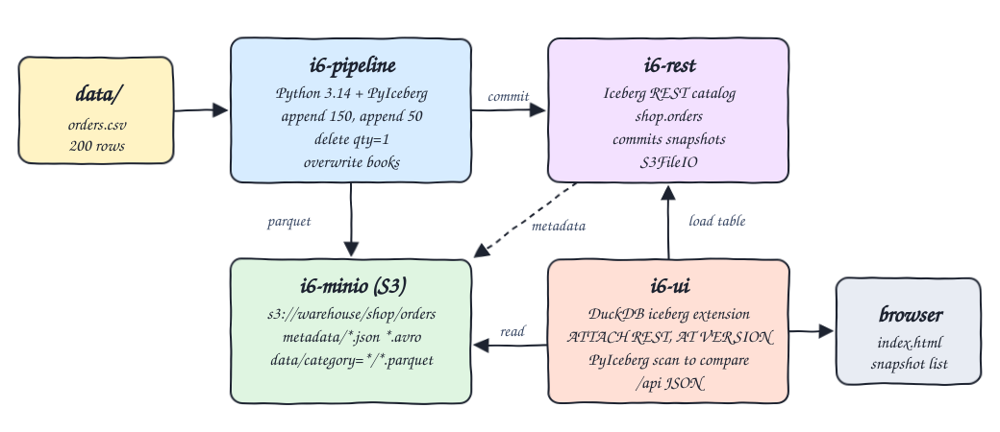
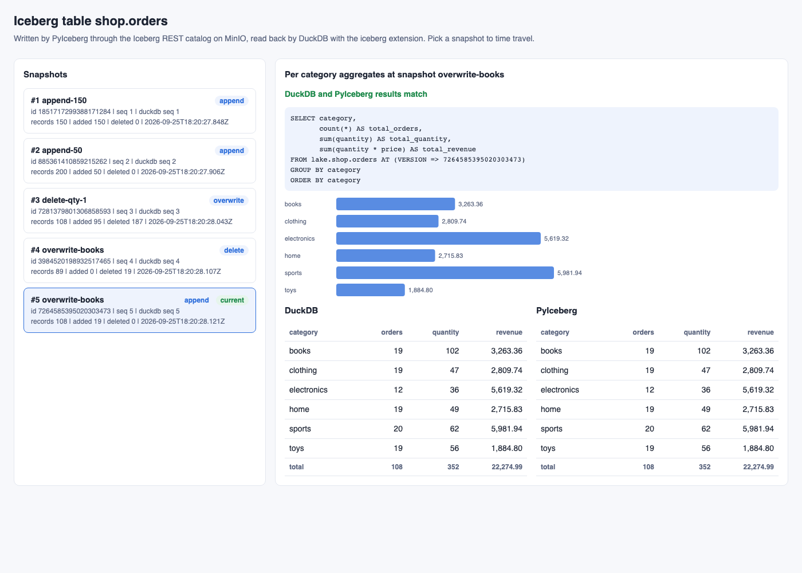
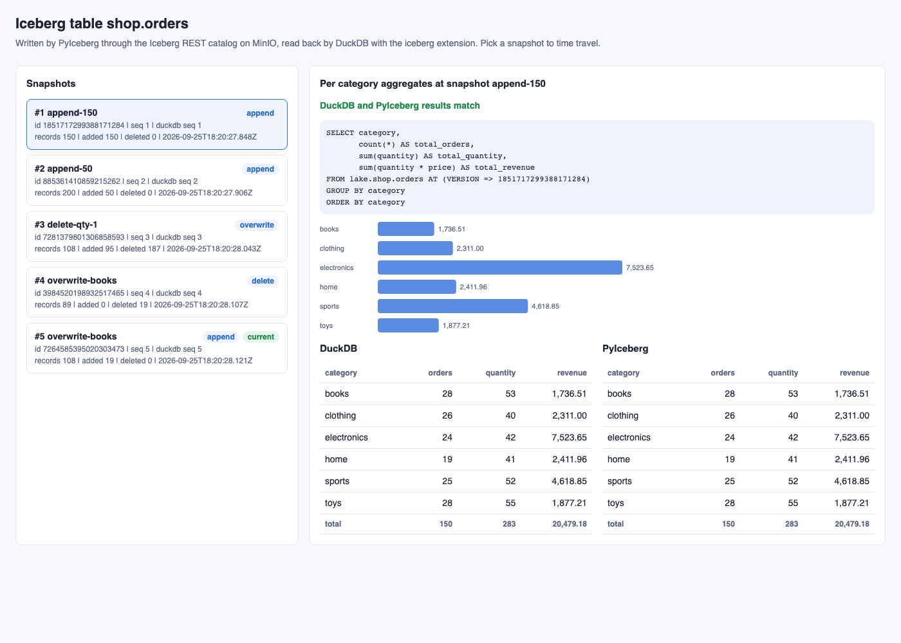
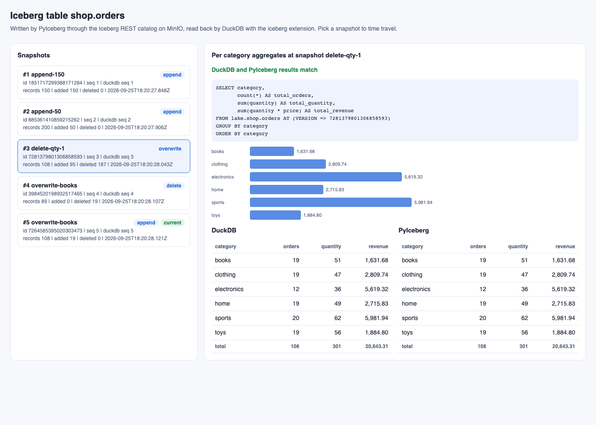

# iceberg-pyiceberg-duckdb

Python 3.14 + PyIceberg writes the orders dataset as an Apache Iceberg table partitioned by `category`, through an Iceberg REST catalog with the warehouse on MinIO (S3). It creates several snapshots (two appends, a delete and an overwrite). DuckDB with the `iceberg` extension then attaches the same REST catalog and computes per-category aggregates on every snapshot, including older ones via time travel. A small UI shows the snapshot list and the DuckDB query results next to the PyIceberg results.

## How it Works

1. `i6-minio` holds the bucket `warehouse`; `i6-rest` is the Iceberg REST catalog (`apache/iceberg-rest-fixture`) using `S3FileIO` against MinIO.
2. `i6-pipeline` (PyIceberg) recreates `shop.orders` partitioned by `identity(category)` and commits:
   - `append-150`: first 150 rows of `data/orders.csv`
   - `append-50`: the remaining 50 rows
   - `delete-qty-1`: row-level delete of every order with `quantity = 1` (copy-on-write rewrite)
   - `overwrite-books`: the `books` partition replaced by the same rows with `quantity * 2` (PyIceberg commits this as a `delete` + `append` snapshot pair)
3. Every snapshot carries a `step` property in its summary so it is easy to tell apart.
4. `i6-ui` runs DuckDB: `ATTACH 'warehouse' AS lake (TYPE iceberg, ENDPOINT ...)`, `iceberg_snapshots(lake.shop.orders)` and `FROM lake.shop.orders AT (VERSION => <snapshot_id>)`.
5. The same aggregates are computed by a PyIceberg scan (`table.scan(snapshot_id=...)` + pyarrow `group_by`) so the two engines are compared on every request.
6. `scripts/test-all.sh` recomputes every snapshot with `awk` straight from the CSV and checks DuckDB == PyIceberg == awk.

## Architecture



## Features

- Iceberg REST catalog: the catalog is a service, so writer (PyIceberg) and reader (DuckDB) share one source of truth.
- Partitioning by category: data files land in `data/category=<name>/`, verified by the tests.
- Multiple snapshots: append, append, delete, overwrite give 5 snapshots to time travel over.
- DuckDB time travel: `AT (VERSION => id)` reads any older snapshot straight from the catalog.
- Cross engine check: each API answer carries both engine results and a `match` flag.
- Independent verification: awk recomputes every snapshot from the raw CSV.

## Stack

- Python 3.14.7: runtime for the pipeline and the UI backend.
- PyIceberg 0.12.0 (`pyiceberg[pyarrow]`): writes the Iceberg table without Spark or a JVM client.
- pyarrow 25.0.1: reads the CSV and aggregates the PyIceberg scan.
- DuckDB 1.5.5 + `iceberg` and `httpfs` extensions: reads the table via the REST catalog.
- apache/iceberg-rest-fixture 1.10.1: simplest Iceberg REST catalog container (newest published tag; Iceberg 1.11.0 exists on Maven but has no fixture tag yet).
- MinIO (`pgsty/minio` community build, RELEASE.2026-08-04): S3 compatible warehouse storage.
- podman + podman-compose: runs everything in containers.

## Contracts / APIs

| Method | Path | Description |
|---|---|---|
| GET | `/` | UI (`app/index.html`) |
| GET | `/api/snapshots` | Snapshots from PyIceberg (id, parent, operation, step, record counts, current) joined with DuckDB `iceberg_snapshots` sequence numbers |
| GET | `/api/aggregates` | Per category aggregates of the current snapshot |
| GET | `/api/aggregates?snapshot=<id>` | Per category aggregates at a given snapshot: `{snapshot_id, sql, duckdb: [...], pyiceberg: [...], match}` |

Each aggregate row: `{category, total_orders, total_quantity, total_revenue}`. Snapshot ids are returned as strings because they are 64 bit and do not fit a JavaScript number.

## Key design decisions

- Table schema: `order_id long, customer string, product string, category string, quantity int, price double, ts timestamptz`, partition spec `identity(category)`.
- The pipeline purges and recreates the table on each run, and `start-all.sh` recreates the REST catalog container (its catalog is in memory) and the `warehouse` bucket together, so catalog and storage never drift apart.
- DuckDB is the query engine shown in the UI; PyIceberg is used as the reference reader.
- Revenue is `quantity * price` in double, rounded to 2 decimals for comparison.

## How to run

```bash
./scripts/setup.sh
./scripts/start-all.sh
./scripts/test-all.sh
./scripts/ui.sh
./scripts/stop-all.sh
```

Test output (current snapshot, `category orders quantity revenue`):

```
books 19 102 3263.36
clothing 19 47 2809.74
electronics 12 36 5619.32
home 19 49 2715.83
sports 20 62 5981.94
toys 19 56 1884.80
```

Oldest snapshot (`append-150`):

```
books 28 53 1736.51
clothing 26 40 2311.00
electronics 24 42 7523.65
home 19 41 2411.96
sports 25 52 4618.85
toys 28 55 1877.21
```

## Printscreens

Current snapshot (`overwrite-books` append): the `books` partition shows 19 orders with doubled quantity (102). DuckDB and PyIceberg tables match.



Oldest snapshot (`append-150`): DuckDB time travel with `AT (VERSION => ...)` returns the first 150 orders only.



After the delete (`delete-qty-1`): every order with quantity 1 is gone, 108 records remain.



## Scripts

All scripts live in `scripts/` and run from any directory of the repository.

| Script | What it does |
|---|---|
| `./scripts/setup.sh` | Pulls images and builds the pipeline/UI image |
| `./scripts/start-all.sh` | Starts MinIO, the REST catalog, runs the pipeline, starts the UI and prints the full link of each one |
| `./scripts/status.sh` | Shows every service port as UP or DOWN |
| `./scripts/test-all.sh` | Checks snapshots, partitions and DuckDB == PyIceberg == awk for every snapshot |
| `./scripts/ui.sh` | Opens the UI in the browser |
| `./scripts/stop-all.sh` | Stops every service |

Ports are declared in `scripts/ports.env`: MinIO 20600, MinIO console 20601, REST catalog 20602, UI 20603.

```bash
./scripts/setup.sh
./scripts/start-all.sh
./scripts/status.sh
./scripts/ui.sh
./scripts/stop-all.sh
```
