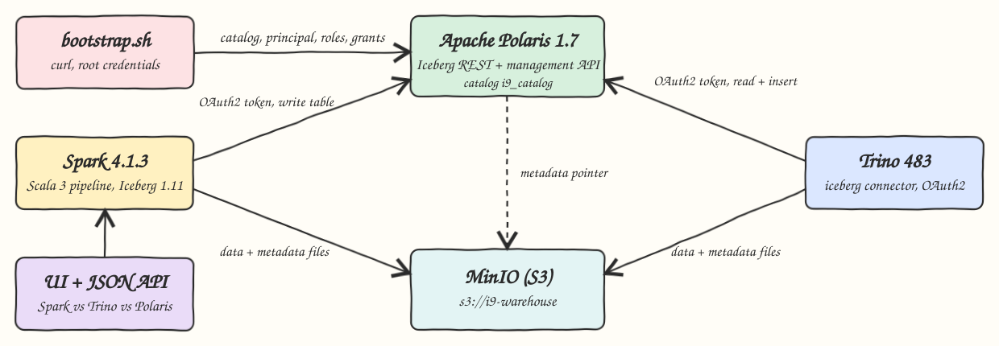
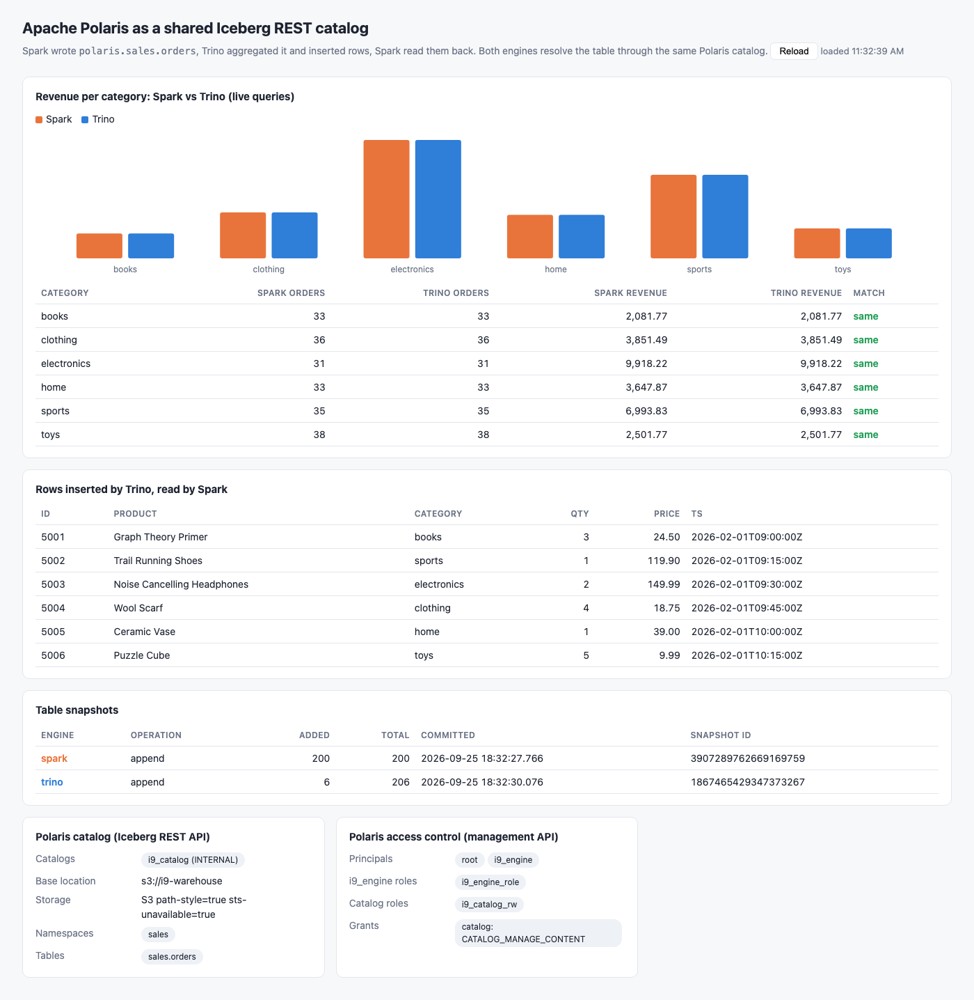

# Iceberg REST catalog with Apache Polaris

One Iceberg table, two engines, one catalog. Apache Polaris is the Iceberg REST catalog, MinIO holds the warehouse. Spark writes `sales.orders` through Polaris, Trino reads the same table through Polaris and computes per-category aggregates, then Trino inserts rows and Spark reads them back. Both engines only know the Polaris URL and an OAuth2 client credential, so the table they share is the catalog entry, not a path.

## How it works

1. `podman-compose` starts MinIO (bucket `i9-warehouse`) and Polaris 1.7 with in-memory persistence and bootstrap root credentials for realm `POLARIS`.
2. `polaris/bootstrap.sh` gets a root token and calls the Polaris management REST API: creates catalog `i9_catalog` (S3 on MinIO, path-style, `stsUnavailable`), principal role `i9_engine_role`, catalog role `i9_catalog_rw` with grant `CATALOG_MANAGE_CONTENT`, and principal `i9_engine` bound to the principal role. The principal client id and secret are written to `.run/polaris.env`.
3. Trino starts with those credentials (`iceberg.rest-catalog.security=OAUTH2`).
4. The Scala `Pipeline` job: Spark creates `polaris.sales.orders` and appends `data/orders.csv` (200 rows), Trino (JDBC) aggregates per category, Trino inserts the 6 rows of `data/trino_inserts.csv`, Spark reads those rows back and aggregates again.
5. `UiServer` keeps a Spark session and a Trino JDBC connection and serves live results plus what Polaris reports about catalogs, namespaces, tables, roles and grants.
6. `test-all.sh` compares every number with `awk` over the CSV files.

## Architecture



## Features

- Polaris bootstrap as code: every catalog, principal, role and grant is created through the management REST API, so the RBAC setup is reproducible.
- Shared catalog between engines: Spark and Trino use the same OAuth2 principal and the same `i9_catalog` warehouse.
- Cross-engine writes: Spark appends, Trino inserts, both commits land in the same Iceberg snapshot history, tagged by engine.
- Live comparison UI: Spark and Trino aggregates side by side with a per-category match flag.
- Independent verification: `awk` recomputes counts, quantities and revenue from the CSV files.

## Stack

- Apache Polaris 1.7.0 (`apache/polaris:1.7.0`): the Iceberg REST catalog with principals, roles and grants.
- Trino 483: SQL engine reading and writing Iceberg through the REST catalog, JVM heap capped at 1G.
- Spark 4.1.3 + Iceberg 1.11.0 (`iceberg-spark-runtime-4.1_2.13`): Iceberg 1.11 ships Spark runtimes only up to 4.1.
- Scala 3.7.4 on Java 25: Scala 3.8+ breaks Spark through scala-reflect.
- Hadoop client 3.5.0: 3.4.x crashes on Java 25.
- MinIO community build `pgsty/minio:RELEASE.2026-08-04T00-00-00Z`: S3 storage, the official image is no longer pullable.
- trino-jdbc 483: Trino queries from the Scala backend.
- JDK `HttpServer` and `HttpClient`: UI backend and Polaris API calls without extra libraries.

## Contracts / APIs

UI backend on port 20980:

| Endpoint | Returns |
|---|---|
| `GET /` | the UI |
| `GET /api/spark/aggregates` | Spark: `[{category, orders, quantity, revenue}]` |
| `GET /api/trino/aggregates` | Trino: same shape, same SQL |
| `GET /api/spark/trino-rows` | rows with `order_id >= 5001` (written by Trino) as read by Spark |
| `GET /api/snapshots` | Iceberg snapshots: `snapshot_id` (string), `operation`, `engine`, `added_records`, `total_records` |
| `GET /api/polaris` | raw Polaris responses: `catalogs`, `principals`, `principalRoles`, `catalogRoles`, `grants` (management API, root) and `namespaces`, `tables` (Iceberg REST API, `i9_engine`) |

Polaris calls made by `polaris/bootstrap.sh`:

| Call | Purpose |
|---|---|
| `POST /api/catalog/v1/oauth/tokens` | root token, client credentials grant |
| `POST /api/management/v1/catalogs` | catalog `i9_catalog` on `s3://i9-warehouse` |
| `POST /api/management/v1/principal-roles` | principal role `i9_engine_role` |
| `POST /api/management/v1/catalogs/i9_catalog/catalog-roles` | catalog role `i9_catalog_rw` |
| `PUT /api/management/v1/catalogs/i9_catalog/catalog-roles/i9_catalog_rw/grants` | `CATALOG_MANAGE_CONTENT` |
| `PUT /api/management/v1/principal-roles/i9_engine_role/catalog-roles/i9_catalog` | catalog role to principal role |
| `POST /api/management/v1/principals` | principal `i9_engine`, returns client id and secret |
| `PUT /api/management/v1/principals/i9_engine/principal-roles` | principal role to principal |

## Design decisions

- `stsUnavailable=true`: MinIO keys are configured in each engine instead of credential vending, which keeps the S3 setup identical for Spark on the host and Trino in a container. Polaris hands clients `endpoint` (host port) and uses `endpointInternal` (container network) itself.
- Polaris runs with in-memory persistence, so the catalog lives as long as the container. `start-all.sh` re-runs the idempotent bootstrap and the pipeline whenever Polaris is fresh, and recreates Trino when the principal secret changes.
- The catalog enables `polaris.config.drop-with-purge.enabled` so the pipeline can `DROP TABLE ... PURGE` and start clean on every run.
- Spark catalog caching is off so the UI session sees Trino commits right away.
- Snapshot ids are returned as strings to keep JavaScript precision.

## How to run

Requirements: podman, podman-compose, Java 25, sbt, python3, curl.

```bash
./scripts/setup.sh
./scripts/start-all.sh
./scripts/test-all.sh
./scripts/ui.sh
./scripts/stop-all.sh
```

`test-all.sh` output:

```
awk over orders.csv + trino_inserts.csv
books 33 67 2081.77
clothing 36 67 3851.49
electronics 31 56 9918.22
home 33 63 3647.87
sports 35 77 6993.83
toys 38 79 2501.77
PASS spark wrote every csv row through polaris
PASS trino aggregates on the spark-written table match awk
PASS trino inserted every row of trino_inserts.csv
PASS spark read back every row trino wrote
PASS spark aggregates after the trino insert match awk
PASS live spark api matches awk
PASS live trino api matches awk
PASS spark sees the exact rows trino inserted
PASS one spark append and one trino append in the table history
PASS polaris lists catalog, namespace, table and grant
tests passed
```

## UI



- Revenue per category: Spark and Trino run the same aggregate SQL live against `sales.orders`; bars and the table show both engines return identical orders and revenue, including the rows Trino inserted.
- Rows inserted by Trino, read by Spark: the 6 rows from `trino_inserts.csv`, returned by a Spark query.
- Table snapshots: the Iceberg history, one `append` of 200 rows committed by Spark and one `append` of 6 rows committed by Trino, both on the same table in Polaris.
- Polaris catalog: catalog, base location, storage settings, namespaces and tables from the Polaris APIs.
- Polaris access control: principals, the principal role of `i9_engine`, the catalog role and its grant, as created by `bootstrap.sh`.

## Scripts

All scripts live in `scripts/` and run from any directory of the repository.

| Script | What it does |
|---|---|
| `./scripts/setup.sh` | Pulls images and compiles the Scala project |
| `./scripts/start-all.sh` | Starts MinIO, Polaris, bootstraps Polaris, starts Trino, runs the pipeline, starts the UI and prints the full link of each service |
| `./scripts/status.sh` | Shows every service port as UP or DOWN |
| `./scripts/test-all.sh` | Re-runs the pipeline and checks every result against awk |
| `./scripts/ui.sh` | Opens the UI in the browser |
| `./scripts/stop-all.sh` | Stops every service |

Ports are declared in `scripts/ports.env`: MinIO 20900, MinIO console 20901, Polaris 20902, Polaris health 20903, Trino 20904, UI 20980.

```bash
./scripts/setup.sh
./scripts/start-all.sh
./scripts/status.sh
./scripts/ui.sh
./scripts/stop-all.sh
```
