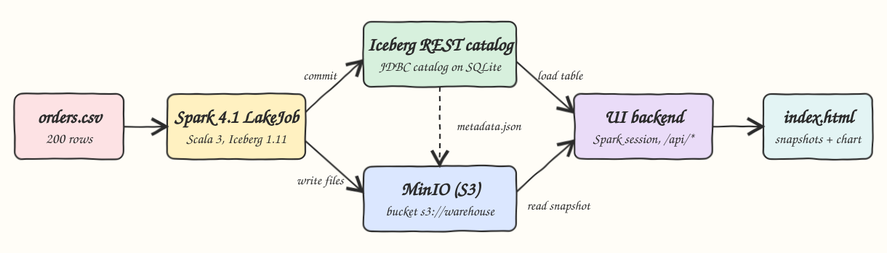
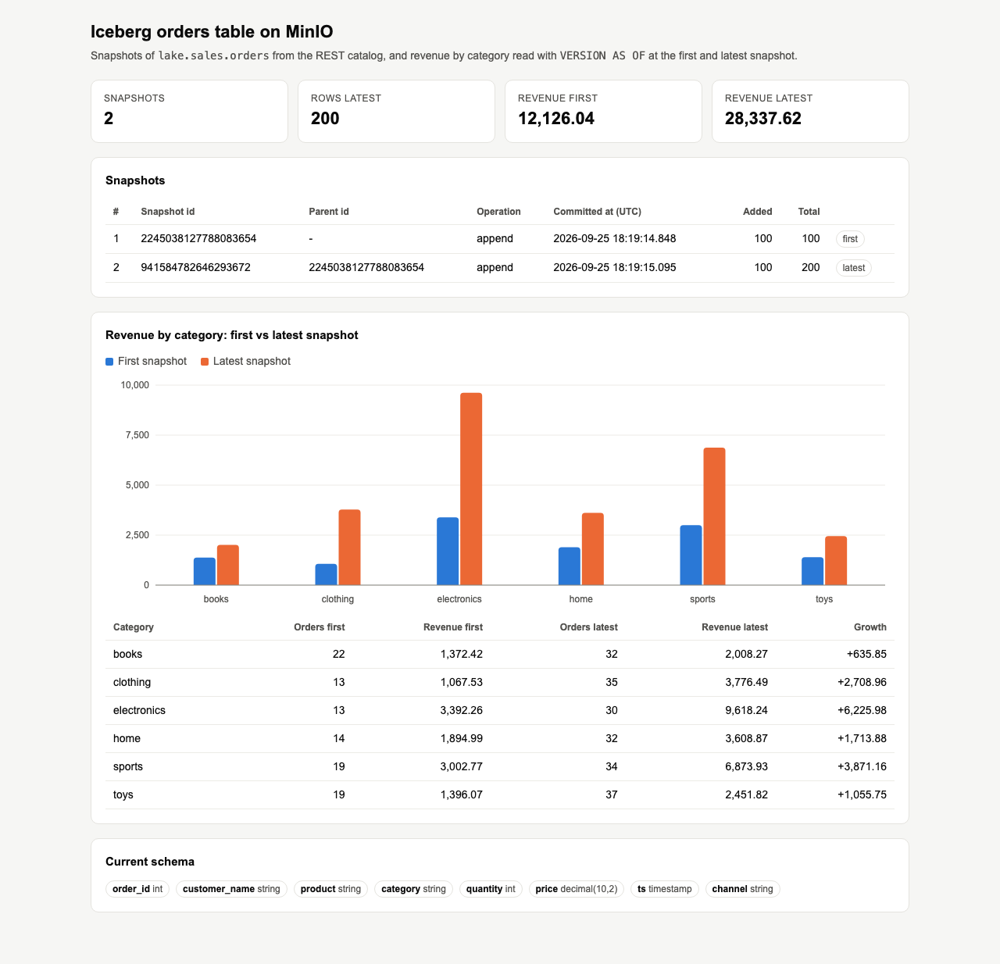

# iceberg-spark-minio

A Spark 4.1 job written in Scala 3 writes the 200 orders from `data/orders.csv` into an Apache Iceberg table `lake.sales.orders`. The table's data and metadata files are stored on MinIO (S3), and an Iceberg REST catalog keeps track of the table. The job appends twice, reads old data with time travel (`VERSION AS OF` and `TIMESTAMP AS OF`), changes the schema (adds a column, renames a column) and lists the snapshots. A small UI shows the snapshots and compares revenue per category at the first and latest snapshot. `test-all.sh` checks every number against `awk` run on the CSV.

## How it Works

1. `podman-compose` starts MinIO, a one-shot `mc` container that creates the `warehouse` bucket, and the Apache Iceberg REST catalog (`apache/iceberg-rest-fixture`). The catalog uses a JDBC catalog on SQLite, saved in a volume, and `S3FileIO` pointed at MinIO.
2. `LakeJob` (Spark in local mode on the host) reads the CSV with a fixed schema and runs `DROP TABLE ... PURGE`, then `CREATE TABLE ... USING iceberg PARTITIONED BY (category)`.
3. First append: orders `1001-1100` go in and create snapshot 1. Second append: orders `1101-1200` go in and create snapshot 2.
4. It lists `orders.snapshots` and `orders.history`. Then it counts rows with `VERSION AS OF <snapshot 1>`, with `TIMESTAMP AS OF '<snapshot 1 commit time>'`, and at the latest snapshot.
5. Schema evolution: `ADD COLUMN channel STRING` and `RENAME COLUMN customer TO customer_name`. Both change only metadata, so no data file is rewritten. Snapshot 1 is still read with the schema it had when it was written.
6. The UI backend opens its own Spark session on the same catalog and serves `/api/snapshots`, `/api/revenue?snapshot=first|latest|<id>` and `/api/schema`.

## Architecture



## Features

* **Iceberg table on S3 (MinIO)**: Parquet data files and Iceberg metadata live in `s3://warehouse/sales/orders`, split into one folder per category.
* **REST catalog**: this is the standard Iceberg catalog protocol, so any engine that speaks REST can open the same table.
* **Create + two appends**: each append makes a new snapshot that points to the snapshot before it.
* **Time travel**: `VERSION AS OF <snapshot_id>` and `TIMESTAMP AS OF '<ts>'` both return the 100 rows of snapshot 1.
* **Schema evolution**: a column is added and a column is renamed without rewriting data. Iceberg tracks columns by id, so old files still read correctly.
* **Snapshot listing**: the job and the UI read the `snapshots` and `history` metadata tables.
* **UI**: shows the snapshot list, a bar chart and a table of revenue per category at the first and latest snapshot, and the current schema.
* **Independent check**: `test-all.sh` compares the API numbers with `awk` run on the raw CSV.

## Stack

* **Java 25** (Amazon Corretto 25.0.4): the JVM that runs Spark, the job and the UI.
* **Scala 3.7.4**: the job and the UI backend. Spark only ships `_2.13` jars, so the build uses `CrossVersion.for3Use2_13`.
* **Apache Spark 4.1.3**: this is the newest Spark that Iceberg supports. Iceberg 1.11.0 ships runtimes for Spark 3.4, 3.5, 4.0 and 4.1, and there is no `iceberg-spark-runtime-4.2` yet.
* **Apache Iceberg 1.11.0**: `iceberg-spark-runtime-4.1_2.13` plus `iceberg-aws-bundle` for `S3FileIO`.
* **Hadoop client 3.5.0** (the build forces this version): Spark 4.1.3 pulls in Hadoop 3.4.2, which calls `Subject.getSubject`, and that method throws on Java 25.
* **Iceberg REST catalog `apache/iceberg-rest-fixture:1.10.1`**: the newest tagged image. It runs as one container with a SQLite JDBC backend.
* **MinIO `cgr.dev/chainguard/minio` (RELEASE.2026-09-22) and `cgr.dev/chainguard/minio-client`**: `minio/minio` can no longer be pulled from Docker Hub or quay.io, and Chainguard publishes current free builds.
* **sbt 2.0.9**: the build tool.
* **JDK `HttpServer`**: serves the UI and JSON API with no web framework.

## Contracts

| Method | Path | Returns |
|---|---|---|
| GET | `/` | the UI (`index.html`) |
| GET | `/api/snapshots` | `[{snapshot_id, parent_id, operation, committed_at, added_records, total_records}]` |
| GET | `/api/revenue?snapshot=first\|latest\|<id>` | `{snapshot_id, rows:[{category, orders, quantity, revenue}]}` from `VERSION AS OF` |
| GET | `/api/schema` | `[{name, type}]` of the current table schema |

Snapshot ids are returned as strings because they are larger than 2^53, and JavaScript numbers lose digits above that.

Iceberg REST catalog: `http://localhost:20102/v1` (such as `/v1/namespaces/sales/tables/orders`).

## Design Decisions

* **REST catalog instead of a direct JDBC catalog in Spark**: the REST catalog is the most portable choice, and the fixture image is a single container. SQLite keeps it free of a separate database, and the SQLite file is saved in a volume so the catalog survives a restart.
* **Client-side S3 settings**: the catalog reaches MinIO at `i1-minio:9000` inside the network, while Spark on the host reaches it at `localhost:20100`. Each side sets its own `s3.endpoint`.
* **The job is idempotent**: `DROP TABLE ... PURGE` followed by a fresh create means every run produces exactly two snapshots, so the checks are deterministic.
* **The split is by order id** (`<= 1100`): this way `awk '$1<=1100'` on the CSV gives exactly the expected result for the first snapshot.
* **The UI uses Spark for live queries** (`cache-enabled=false`): the UI always reads the current catalog state, even after the job rebuilds the table.
* **Java 25 flags**: `--add-opens` for Spark, plus `--sun-misc-unsafe-memory-access=allow`. Without that flag, the shaded Netty inside Iceberg's Arrow vectorized Parquet reader fails on Java 25.

## How to Run

```bash
./scripts/setup.sh
./scripts/start-all.sh
./scripts/test-all.sh
./scripts/ui.sh
./scripts/stop-all.sh
```

Output of `test-all.sh`, which checks the API against awk on the CSV:

```
PASS two append snapshots of 100 rows each
PASS VERSION AS OF first snapshot sees 100 rows
PASS TIMESTAMP AS OF first commit sees 100 rows
PASS latest snapshot sees 200 rows
PASS schema evolved with customer renamed and channel added
books 22 42 1372.42
clothing 13 21 1067.53
electronics 13 20 3392.26
home 14 31 1894.99
sports 19 35 3002.77
toys 19 36 1396.07
PASS revenue at first snapshot matches awk on first 100 csv rows
books 32 64 2008.27
clothing 35 63 3776.49
electronics 30 54 9618.24
home 32 62 3608.87
sports 34 76 6873.93
toys 37 74 2451.82
PASS revenue at latest snapshot matches awk on all csv rows
tests passed
```

## Printscreens



The top tiles show the snapshot count, the row count at the latest snapshot, and total revenue at the first and latest snapshot. The Snapshots table lists both append commits with their ids, parent ids, commit times and record counts. The chart and table below it compare revenue per category read with `VERSION AS OF` on the first snapshot (blue) and the latest snapshot (orange). The Current schema list shows the evolved columns: `customer_name` (renamed from `customer`) and the new `channel` column.

## Scripts

All scripts live in `scripts/` and run from any directory of the repository.

| Script | What it does |
|---|---|
| `./scripts/setup.sh` | Pulls the images, installs Java 25 through sdkman if it is missing, and compiles |
| `./scripts/start-all.sh` | Starts MinIO, the bucket init and the REST catalog, runs the lake job, starts the UI, and prints the full link of each service |
| `./scripts/status.sh` | Shows every service port as UP or DOWN |
| `./scripts/test-all.sh` | Reruns the lake job and checks snapshots, time travel, schema and revenue against awk |
| `./scripts/ui.sh` | Opens the UI in the browser |
| `./scripts/stop-all.sh` | Stops every service |

Ports are declared in `scripts/ports.env`: MinIO S3 `20100`, MinIO console `20101`, Iceberg REST catalog `20102`, UI `20180`.

```bash
./scripts/setup.sh
./scripts/start-all.sh
./scripts/status.sh
./scripts/ui.sh
./scripts/stop-all.sh
```
