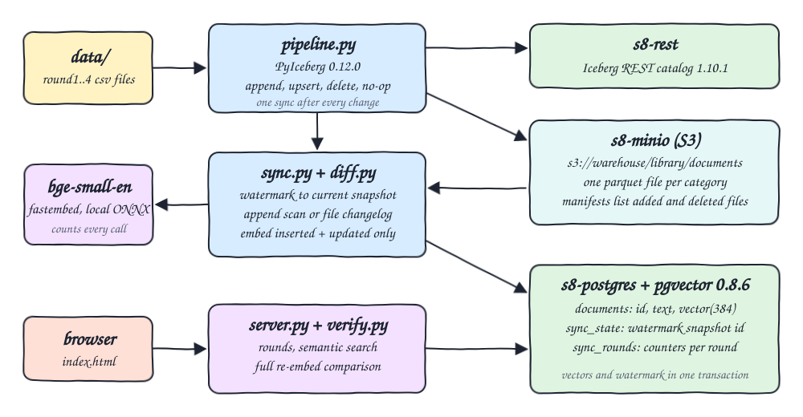
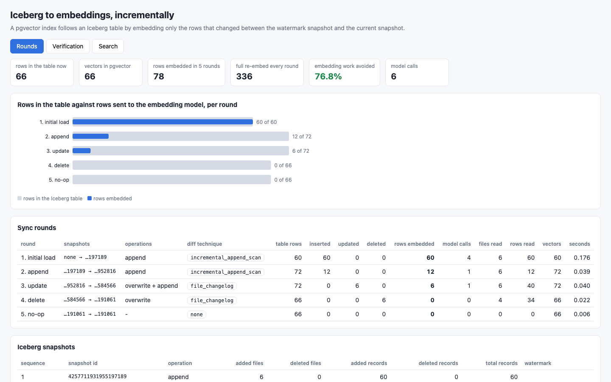
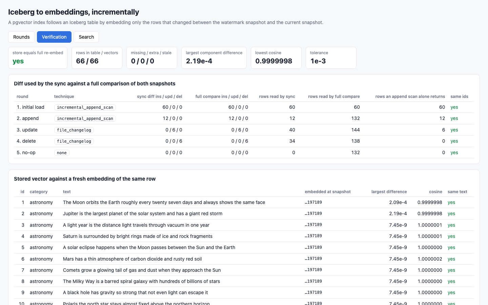
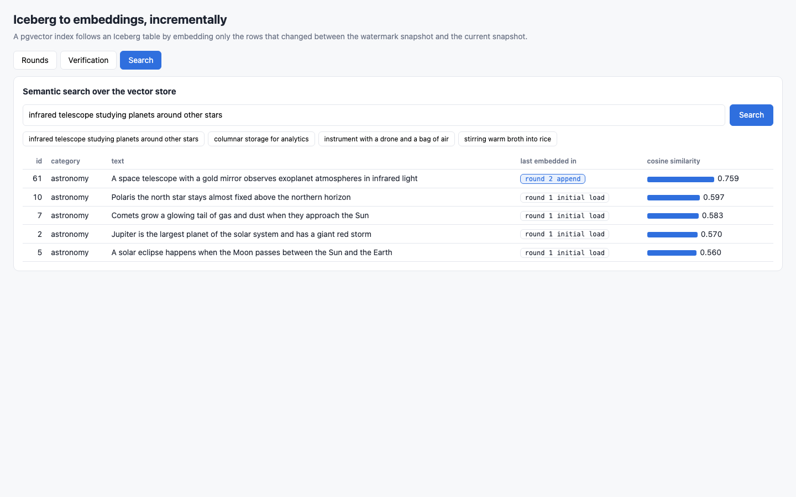
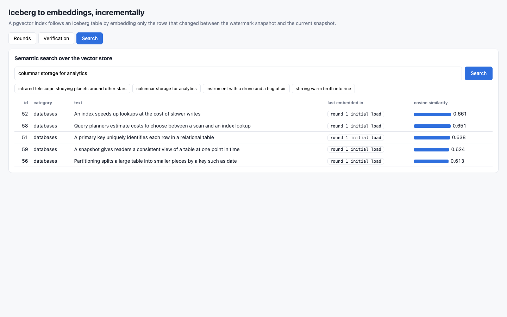

<p align="center"></p>

# iceberg-to-embeddings-incremental

Keeps a pgvector index in sync with an Apache Iceberg table by embedding only the rows that changed between two snapshots, never the whole table. The table of text documents lives on MinIO behind an Iceberg REST catalog and is written with PyIceberg 0.12.0. A sync job stores the last processed snapshot id as a watermark in Postgres, computes the diff from that snapshot to the current one, embeds the inserted and updated rows with a local `bge-small-en-v1.5` model, upserts them into pgvector and removes the vectors of deleted rows. Five rounds run on every start: initial load, append, update, delete and a no-op. At the end the vector store is compared against a full re-embed of the current table.

## How it Works

1. `start-all.sh` starts `s8-minio`, `s8-postgres` (pgvector) and a fresh `s8-rest` catalog, then resets the `warehouse` bucket and the vector tables.
2. `app/pipeline.py` creates `library.documents` (id, category, text), partitioned by `category`, so every category is its own Parquet file.
3. Each round applies one change from `data/` with PyIceberg (`append`, `upsert`, `delete`, or nothing) and then calls `app/sync.py` once.
4. `sync.py` reads the watermark from `sync_state`, asks `app/diff.py` for the changes up to the current snapshot and gets back inserted rows, updated rows and deleted ids.
5. When every snapshot in the range is an `append`, the diff is PyIceberg's `incremental_append_scan`.
6. When the range contains an `overwrite` or `delete` snapshot, the diff is a file changelog: the manifests written by those snapshots list the data files they added and deleted, only those files are read, and rows are compared by `id`.
7. Inserted and updated rows go to the model in batches of 16; `app/embed.py` counts every row and every model call.
8. Vectors, deletes, the new watermark and the round counters are written in one Postgres transaction.
9. `app/verify.py` re-embeds the whole current table, compares it to the store, and recomputes every round's diff by fully scanning both snapshots.
10. `app/server.py` serves the rounds, the verification and a semantic search to `index.html`.

## Architecture



## Features

* Snapshot watermark: the last synced snapshot id is stored next to the vectors, so a sync always knows where to resume.
* Incremental append scan for append-only ranges, straight from PyIceberg.
* File changelog for overwrite and delete snapshots, built from manifest entries with status `ADDED` and `DELETED`.
* Upserts and deletes in pgvector, so updated rows replace their vector and deleted rows lose it.
* Model call accounting at the model boundary: rows embedded and model calls per round.
* No-op rounds cost zero model calls and read zero data files.
* Full re-embed check: same ids, same text, same vectors within tolerance.
* UI with three tabs: rounds, verification, semantic search.

## Stack

* Apache Iceberg table format through PyIceberg 0.12.0 with PyArrow 25.0.1.
* Iceberg REST catalog `docker.io/apache/iceberg-rest-fixture:1.10.1` (in-memory catalog, same one used by `iceberg-pyiceberg-duckdb/`).
* MinIO community fork `docker.io/pgsty/minio:RELEASE.2026-08-04T00-00-00Z`: S3 storage for Parquet and metadata.
* PostgreSQL 18 with pgvector 0.8.6 `docker.io/pgvector/pgvector:0.8.6-pg18-trixie`: vector store, watermark and round counters.
* fastembed 0.8.1 with `BAAI/bge-small-en-v1.5` (384 dimensions, quantized ONNX, runs locally on CPU), as in `pgvector-embeddings-pipeline/`.
* psycopg 3.3.6, Python 3.14.7, standard library HTTP server.
* podman 5.7.1 + podman-compose 1.5.0.
* awk + psql: independent verification.

## API

| Method | Path | Returns |
|---|---|---|
| GET | `/api/rounds` | one entry per sync round: snapshot range, operations, diff technique, table rows, inserted, updated and deleted ids, rows embedded, model calls, files read, rows read, vectors after, seconds |
| GET | `/api/snapshots` | Iceberg snapshots with operation, added and deleted files and records, total records and which one is the watermark |
| GET | `/api/verify` | live full re-embed of the current table compared to the store, plus every round's diff recomputed by full snapshot comparison |
| GET | `/api/search?q=text&k=5` | nearest documents by cosine distance |

The UI accepts `?tab=rounds|verify|search` and `&q=<question>` on the search tab.

## Key Design Decisions

How the diff is really computed, and what it costs:

* Append snapshots: `table.incremental_append_scan(from_snapshot_id_exclusive, to_snapshot_id_inclusive)`. It reads only files added by append snapshots. Rounds 1 and 2 use it and read 60 and 12 rows.
* That scan skips every snapshot that is not an append. Measured here: over the delete round it returns 0 rows, so 6 deleted vectors would stay in the store forever; over the update round it returns the 6 new row versions but says nothing about what was removed. It cannot be the only technique.
* Overwrite and delete snapshots: PyIceberg 0.12.0 has no changelog scan, so `diff.py` builds one. For each snapshot in the range it opens only the manifests that snapshot wrote, collects data files with entry status `ADDED` and `DELETED`, reads those Parquet files, and compares rows by `id`: only in added files means inserted, only in deleted files means deleted, in both with different content means updated, in both and identical means carried over.
* Cost of the file changelog: PyIceberg writes updates and deletes as copy-on-write, so changing 3 rows of a 10-row file rewrites the file. The changelog reads the old and the new version of every rewritten file. Round 3 read 6 files and 40 rows to find 6 updated rows (14 carried over); round 4 read 4 files and 34 rows to find 6 deleted rows. The cost follows the size of the touched files, not the size of the diff and not the size of the table. Partitioning by `category` keeps the touched files small.
* The alternative, comparing two full snapshots, is implemented in `diff.full_compare` and used only as the referee in `verify.py`. It would have read 144 and 138 rows for the same two rounds, and 132 rows for the no-op.
* Reading more rows than the diff is cheap; calling the model is the expensive part. Rows embedded always equal inserted plus updated.
* `upsert` skips rows whose content is identical: `data/round3-update.csv` has 8 rows, 2 are unchanged, 6 are embedded.

Limits, stated plainly:

* The file changelog covers copy-on-write only. If a snapshot in the range wrote a delete manifest (merge-on-read), `diff.py` raises instead of returning a wrong diff. That path is not exercised here.
* The watermark snapshot must still be an ancestor of the current snapshot. After snapshot expiration or a rollback the sync raises and a full resync is needed. Not exercised here.
* Compaction is not exercised. By construction it would show up as deleted plus added files whose rows are all carried over: files read, nothing embedded.
* Rows need a unique `id`.
* Vectors are equal within a tolerance, not bit for bit: the model pads every batch to its longest text, and a row's vector moves slightly with the other rows in its batch. The largest difference measured between the incremental store and the full re-embed is 2.19e-04 on one component, lowest cosine 0.99999976. The check uses 1e-03 per component and cosine 0.9999; a stale vector of another text differs by orders of magnitude more and fails it.
* The REST catalog keeps its state in memory, so `start-all.sh` rebuilds table and vectors from scratch on every start.
* The table is tiny (72 rows at most). The row counts are exact; the seconds are not a benchmark.

Other decisions:

* Search is an exact scan ordered by `<=>`, with no approximate index, so results are deterministic for the tests.
* Table size per round comes from the snapshot summary (`total-records`), not from a scan.
* Snapshot ids travel as strings in JSON because they do not fit a JavaScript number.

## Verification

Measured numbers of the last run:

| Round | Change | Snapshot operations | Diff technique | Table rows | Inserted | Updated | Deleted | Rows embedded | Model calls | Files read | Rows read | Vectors | Seconds |
|---|---|---|---|---|---|---|---|---|---|---|---|---|---|
| 1 | initial load | append | incremental_append_scan | 60 | 60 | 0 | 0 | 60 | 4 | 6 | 60 | 60 | 0.176 |
| 2 | append | append | incremental_append_scan | 72 | 12 | 0 | 0 | 12 | 1 | 6 | 12 | 72 | 0.039 |
| 3 | update | overwrite + append | file_changelog | 72 | 0 | 6 | 0 | 6 | 1 | 6 | 40 | 72 | 0.040 |
| 4 | delete | overwrite | file_changelog | 66 | 0 | 0 | 6 | 0 | 0 | 4 | 34 | 66 | 0.022 |
| 5 | no-op | none | none | 66 | 0 | 0 | 0 | 0 | 0 | 0 | 0 | 66 | 0.006 |

Total rows embedded: 78 in 6 model calls. A full re-embed on every round would have embedded 336 rows, so 76.8% of the embedding work was avoided. Container memory while running: MinIO 144 MB, REST catalog 189 MB, Postgres 19 MB.

`./scripts/test-all.sh` output (38 checks passed, 0 failed):

```
columns: table_rows inserted updated deleted rows_embedded model_calls vectors
PASS round 1 initial load embeds all 60 rows
PASS round 2 append embeds only the 12 appended rows of 72
PASS round 3 update embeds only the 6 changed rows of 72
PASS round 4 delete embeds nothing and removes 6 vectors
PASS round 5 no-op makes zero model calls
PASS round 3 updated ids match awk, unchanged rows of the update file are skipped
PASS round 4 deleted ids match the delete file
PASS rows embedded equal inserted plus updated in every round and stay below the table size after the initial load
PASS total rows embedded over five rounds is the sum of the diffs
full re-embed on every round would have embedded 336 rows, incremental sync embedded 78
PASS vector store rows equal the final table computed by awk
PASS watermark in postgres is the current iceberg snapshot
full re-embed of the current table against the vector store, and file changelog against full snapshot comparison:
table_rows=66 store_rows=66 missing=0 extra=0 stale_text=0
max_abs_diff=2.19e-04 min_cosine=0.99999976 tolerance=1e-03
round 1 initial load: changelog={'inserted': 60, 'updated': 0, 'deleted': 0} full_compare={'inserted': 60, 'updated': 0, 'deleted': 0} rows_read changelog=60 full_compare=60 append_scan_only_rows=60 equal=True
round 2 append: changelog={'inserted': 12, 'updated': 0, 'deleted': 0} full_compare={'inserted': 12, 'updated': 0, 'deleted': 0} rows_read changelog=12 full_compare=132 append_scan_only_rows=12 equal=True
round 3 update: changelog={'inserted': 0, 'updated': 6, 'deleted': 0} full_compare={'inserted': 0, 'updated': 6, 'deleted': 0} rows_read changelog=40 full_compare=144 append_scan_only_rows=6 equal=True
round 4 delete: changelog={'inserted': 0, 'updated': 0, 'deleted': 6} full_compare={'inserted': 0, 'updated': 0, 'deleted': 6} rows_read changelog=34 full_compare=138 append_scan_only_rows=0 equal=True
round 5 no-op: changelog={'inserted': 0, 'updated': 0, 'deleted': 0} full_compare={'inserted': 0, 'updated': 0, 'deleted': 0} rows_read changelog=0 full_compare=132 append_scan_only_rows=0 equal=True
watermark=4096705613705191061 current_snapshot=4096705613705191061 equal=True
PASS vector store equals a full re-embed and every diff equals a full snapshot comparison
PASS search finds appended row 61 first
PASS search finds appended row 62 first
PASS search finds appended row 63 first
PASS search finds appended row 64 first
PASS search finds appended row 65 first
PASS search finds appended row 66 first
PASS search finds appended row 67 first
PASS search finds appended row 68 first
PASS search finds appended row 69 first
PASS search finds appended row 70 first
PASS search finds appended row 71 first
PASS search finds appended row 72 first
PASS search finds updated row 12 by its new text
PASS search finds updated row 13 by its new text
PASS search finds updated row 15 by its new text
PASS search finds updated row 42 by its new text
PASS search finds updated row 44 by its new text
PASS search finds updated row 47 by its new text
PASS search for the text of deleted row 33 does not return it
PASS search for the text of deleted row 34 does not return it
PASS search for the text of deleted row 38 does not return it
PASS search for the text of deleted row 55 does not return it
PASS search for the text of deleted row 57 does not return it
PASS search for the text of deleted row 60 does not return it
PASS question about an infrared telescope returns appended row 61
PASS question about columnar storage does not return deleted row 55
all tests passed
```

The expected numbers come from `awk` over the CSV files in `data/`, the store content from `psql`, the current snapshot from the REST catalog, and the vectors from a fresh full re-embed. Overwriting one stored vector with another row's vector makes `test-all.sh` exit non-zero at the full re-embed check.

## Printscreens

Rounds: rows in the table against rows sent to the model per round, the counters of every sync with the diff technique used, and the Iceberg snapshots.



Verification: the store equals a full re-embed (66 of 66 rows, nothing missing, extra or stale), the diff of every round equals a full comparison of both snapshots while reading fewer rows, and each stored vector is compared with a fresh embedding of the same row.



Search for a row that exists only after the incremental rounds: the question about an infrared telescope returns row 61, embedded in round 2.



Search for a deleted row: the question about columnar storage no longer returns row 55, removed in round 4; the nearest remaining database rows come back instead.



## Scripts

All scripts live in `scripts/` and run from any directory of the repository.

| Script | What it does |
|---|---|
| `./scripts/setup.sh` | Creates the Python 3.14 venv, installs requirements, downloads the embedding model into `.models/`, pulls images |
| `./scripts/start-all.sh` | Starts MinIO, the REST catalog and Postgres, runs the five rounds, starts the UI and prints the full link of each service |
| `./scripts/status.sh` | Shows every service port as UP or DOWN |
| `./scripts/test-all.sh` | Verifies rows embedded against awk, the store against psql and a full re-embed, and the semantic search |
| `./scripts/ui.sh` | Opens the UI in the browser |
| `./scripts/stop-all.sh` | Stops every service |
| `./scripts/sql-console.sh` | Opens `psql` on the vector store database |

Ports are declared in `scripts/ports.env`: minio 30700, minio console 30701, rest catalog 30702, postgres 30703, ui 30704.

```bash
./scripts/setup.sh
./scripts/start-all.sh
./scripts/status.sh
./scripts/test-all.sh
./scripts/ui.sh
./scripts/stop-all.sh
```
