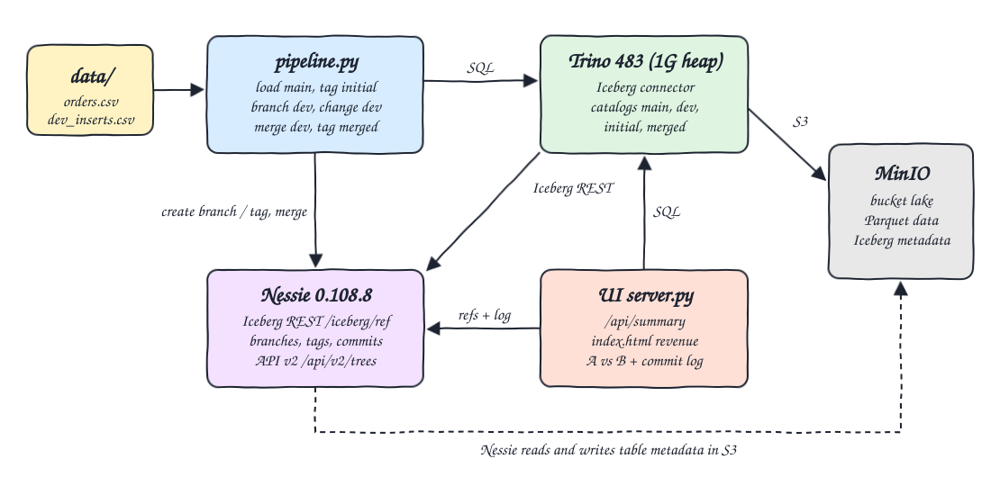
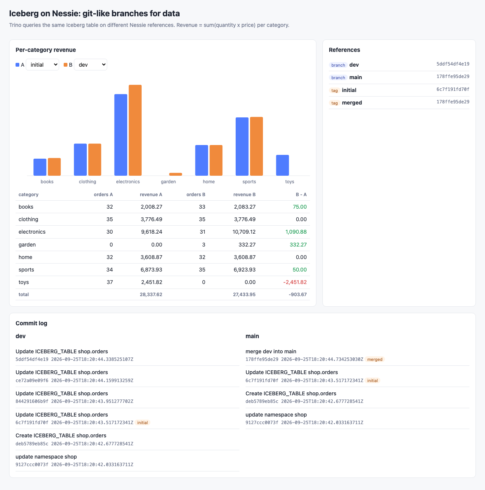

# iceberg-trino-nessie

Git-like branching for data: Trino 483 writes an Iceberg `orders` table through Project Nessie 0.108.8 (Iceberg REST catalog) with the warehouse on MinIO. Orders are loaded into `main`, a `dev` branch is cut, prices are raised, a category is deleted and rows are inserted on `dev` only, `main` is shown unchanged, then `dev` is merged into `main` through the Nessie REST API and tagged. A small Python UI compares per-category revenue across refs and shows the commit log.

## How it Works

1. `start-all.sh` starts MinIO, Nessie (in-memory version store) and Trino (`-Xmx1G`), and creates the `lake` bucket.
2. Trino has one Iceberg catalog per Nessie reference: `main`, `dev`, `initial`, `merged`. Each points to `http://i4-nessie:19120/iceberg/<ref>`, the Nessie way of selecting a branch or tag with Iceberg REST.
3. `app/pipeline.py` runs `CREATE SCHEMA`, `CREATE TABLE` and one `INSERT` of `data/orders.csv` into `main.shop.orders`.
4. It creates the tag `initial` and the branch `dev` from `main` with `POST /api/v2/trees`.
5. On `dev.shop.orders` it runs `UPDATE` (electronics price x 1.10), `DELETE` (category toys) and `INSERT` of `data/dev_inserts.csv` (new category garden).
6. It checks that `main` still equals `initial`, merges `dev` into `main` with `POST /api/v2/trees/main@<hash>/history/merge`, and tags `merged`.
7. `app/server.py` serves `index.html` and JSON built from Trino queries and the Nessie commit log.

## Architecture



## Features

- Branch isolation: every change on `dev` is invisible to `main` until the merge, proven by the merge commit parent being the `initial` tag.
- Tags as immutable snapshots: `initial` keeps the pre-merge state queryable forever through the `initial` Trino catalog.
- Catalog-level merge: Nessie merges the whole catalog state in one commit, not a single table snapshot.
- Row-level DML on a branch: Trino `UPDATE` and `DELETE` on Iceberg v2 write delete files only on `dev`.
- Side-by-side UI: pick any two refs and see per-category revenue, the delta and the commit log with tags.
- Independent verification: awk and Python recompute every state from the CSV files.

## Stack

- Trino 483: SQL engine with the Iceberg connector and Iceberg REST catalog support, heap capped at 1G.
- Project Nessie 0.108.8: transactional catalog with branches, tags and merges, exposing Iceberg REST.
- Apache Iceberg (v2 tables, Parquet): open table format stored in MinIO.
- MinIO (`pgsty/minio` community build): S3 compatible object store for data and metadata.
- Python 3.14.7 standard library only: pipeline, Trino HTTP client, Nessie client and UI server with zero dependencies.
- podman and podman-compose: runs every service with the `i4-` prefix.

## Contracts / APIs

UI server on port 20404:

| Method | Path | Returns |
|---|---|---|
| GET | `/` | the UI |
| GET | `/api/summary` | `refs`, `revenue` per ref, `log` per branch |
| GET | `/api/refs` | Nessie branches and tags with hashes |
| GET | `/api/revenue?ref=main` | `[{category, orders, quantity, revenue}]` for `initial`, `dev`, `main` or `merged` |
| GET | `/api/log?ref=main` | `[{hash, parent, message, author, time}]` |

Nessie REST calls used by the pipeline (port 20402):

| Call | Purpose |
|---|---|
| `GET /api/v2/trees/{ref}` | resolve a branch or tag hash |
| `POST /api/v2/trees?name=dev&type=BRANCH` | create branch `dev` from the posted reference |
| `POST /api/v2/trees?name=initial&type=TAG` | create a tag |
| `POST /api/v2/trees/main@{hash}/history/merge` | merge `dev` into `main` |
| `GET /api/v2/trees/{ref}/history` | commit log |

## Key design decisions

- Iceberg REST instead of the Trino `nessie` catalog type: Nessie recommends REST, and it keeps S3 settings for metadata inside Nessie.
- One Trino catalog per ref: the Nessie `table@ref` syntax is not accepted by Trino, while `uri=.../iceberg/<ref>` works for branches and tags. Catalogs are resolved lazily, so `dev`, `initial` and `merged` can be declared before they exist.
- `price` is `decimal(10,2)` so revenue is exact; the Python check replays the 10% raise with `ROUND_HALF_UP`, the same rounding Trino uses on the cast.
- Nessie runs with the in-memory store: `start-all.sh` resets the bucket and Nessie when the `merged` tag is missing, so every fresh start replays the whole story.

## Verified results

Tag `initial` (main before branching), checked with awk over `data/orders.csv`:

| category | orders | quantity | revenue |
|---|---|---|---|
| books | 32 | 64 | 2008.27 |
| clothing | 35 | 63 | 3776.49 |
| electronics | 30 | 54 | 9618.24 |
| home | 32 | 62 | 3608.87 |
| sports | 34 | 76 | 6873.93 |
| toys | 37 | 74 | 2451.82 |

Branch `dev`, and `main` plus tag `merged` after the merge, checked with Python:

| category | orders | quantity | revenue |
|---|---|---|---|
| books | 33 | 68 | 2083.27 |
| clothing | 35 | 63 | 3776.49 |
| electronics | 31 | 55 | 10709.12 |
| garden | 3 | 6 | 332.27 |
| home | 32 | 62 | 3608.87 |
| sports | 35 | 78 | 6923.93 |

## How to run

```bash
./scripts/setup.sh
./scripts/start-all.sh
./scripts/test-all.sh
./scripts/ui.sh
./scripts/sql-console.sh
./scripts/stop-all.sh
```

Inside `sql-console.sh` try `SELECT category, sum(quantity * price) FROM initial.shop.orders GROUP BY 1;` and the same on `dev` or `main`.

## Printscreens



The chart compares tag `initial` (A, blue, main before branching) with branch `dev` (B, orange): electronics grows by the 10% price raise, toys disappears, garden appears, books and sports grow by the inserted rows. The table shows orders and revenue for both refs and the delta. The References panel lists the branches `dev` and `main` and the tags `initial` and `merged` with their hashes; `main` and `merged` share the same hash. The commit log shows `dev` with its three Trino commits and `main` with the single `merge dev into main` commit sitting right on top of the commit tagged `initial`.

## Scripts

All scripts live in `scripts/` and run from any directory of the repository.

| Script | What it does |
|---|---|
| `./scripts/setup.sh` | Pulls images and builds the pipeline and UI image |
| `./scripts/start-all.sh` | Starts every service, runs the branching pipeline once and prints the full link of each one |
| `./scripts/status.sh` | Shows every service port as UP or DOWN |
| `./scripts/test-all.sh` | Verifies every ref against awk and Python |
| `./scripts/ui.sh` | Opens the UI in the browser |
| `./scripts/stop-all.sh` | Stops every service |
| `./scripts/sql-console.sh` | Opens the Trino CLI on catalog `main`, schema `shop` |

Ports are declared in `scripts/ports.env`: MinIO 20400, MinIO console 20401, Nessie 20402, Trino 20403, UI 20404.

```bash
./scripts/setup.sh
./scripts/start-all.sh
./scripts/status.sh
./scripts/ui.sh
./scripts/stop-all.sh
```
