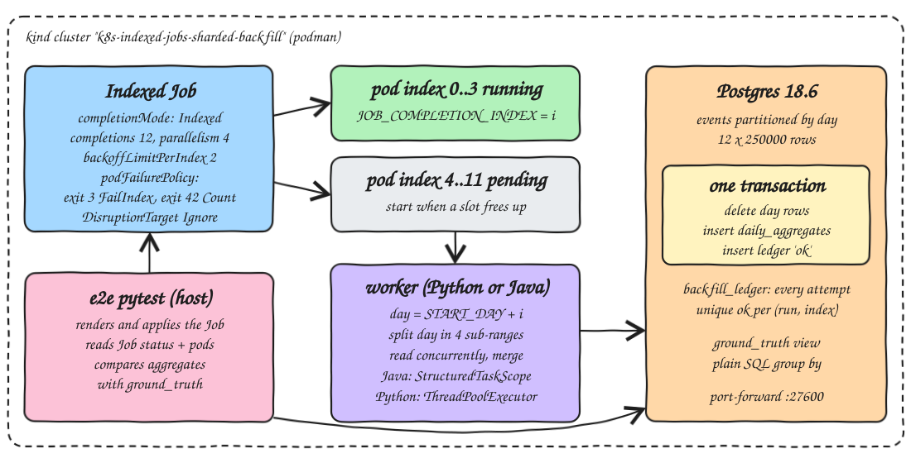

<p align="center"></p>

# k8s-indexed-jobs-sharded-backfill

A sharded backfill on a local kind cluster built on Kubernetes Indexed Jobs (`completionMode: Indexed`). A Postgres 18.6 source table `events` is split into 12 day partitions (250000 rows each, 3 million rows). One Job with 12 completions and parallelism 4 runs one pod per partition; each pod reads `JOB_COMPLETION_INDEX`, turns it into a day, aggregates that day and writes per-category daily aggregates. The same backfill is written twice: a Python 3.15 worker (uv, psycopg 3) and a Java 25 worker (Spring Boot 4.1 non-web, Spring Data JDBC, HikariCP, `StructuredTaskScope` on virtual threads). End-to-end tests prove exactly-once per partition, per-index retry and idempotent reruns, and a benchmark compares both workers.

## How it Works

1. `scripts/setup.sh` creates the kind cluster, builds both worker images, and loads them plus `postgres:18.6-alpine` into kind.
2. `scripts/start-all.sh` deploys Postgres, applies `sql/schema.sql`, seeds `sql/seed.sql` (12 range partitions `events_20261001` .. `events_20261012`) and port-forwards Postgres to `localhost:27600`.
3. The e2e tests render `k8s/backfill-job.yaml` for one worker and apply it. Kubernetes creates 12 indexes but only 4 pods run at a time.
4. Each pod maps index `i` to day `2026-10-01 + i`, splits that UTC day into 4 equal sub-ranges and reads them concurrently (Java: one virtual thread per sub-range in a `StructuredTaskScope`; Python: a `ThreadPoolExecutor` with one connection per sub-range).
5. The sub-range results are merged into count, sum, min and max per category.
6. In one transaction the worker deletes that worker's rows for the day, inserts the new aggregates and inserts an `ok` row in `backfill_ledger`. A crash before commit leaves nothing behind; a rerun overwrites, never adds.
7. A forced transient failure (`FAIL_INDEX`) rolls the transaction back, records a `transient` ledger row and exits 42; the Job's `podFailurePolicy` counts it against `backoffLimitPerIndex`, so only that index gets a new pod.
8. A forced fatal failure (`FATAL_INDEX`) exits 3; the policy says `FailIndex`, so that index is failed at once with no retry, while every other index still completes.
9. The tests compare `daily_aggregates` with the `ground_truth` view (a plain SQL `group by` over `events`) and check the ledger and the Job's pods per index.

## Architecture



## Features

* Indexed Job sharding: the partition is chosen by `JOB_COMPLETION_INDEX`, so no queue, lock or coordinator is needed.
* `parallelism` 4 < `completions` 12: caps load on Postgres while every partition still gets processed.
* `backoffLimitPerIndex: 2`: a failing partition retries on its own, without restarting or blocking the others.
* `podFailurePolicy`: exit 3 means bad input (`FailIndex`, no retry), exit 42 means transient (`Count`), node disruptions are `Ignore`d and do not burn retries.
* `maxFailedIndexes: 3`: a broken backfill stops early instead of running every bad partition to the end.
* Attempt number from the `batch.kubernetes.io/job-index-failure-count` pod annotation via the downward API, so the worker knows if it is a retry.
* Transactional replace per (worker, day): the backfill is idempotent and a rerun of the whole Job gives the same rows.
* Ledger with a partial unique index `(run_id, idx) where status = 'ok'`: the database itself refuses a second success for the same index in one run.
* Two workers with the same contract, so they are tested and benchmarked against each other.

## Stack

* Kubernetes v1.35.0 (`kindest/node`, kind v0.31 on podman): Indexed Jobs, `backoffLimitPerIndex` and `podFailurePolicy` are GA here.
* Postgres 18.6 (`postgres:18.6-alpine`): source table with declarative range partitions and the target tables.
* Python 3.15.2 (`python:3.15.2-slim`) + uv 0.10.4 + psycopg 3.3.8 (binary): Python worker.
* Java 25 (Amazon Corretto 25.0.4 for the build, `eclipse-temurin:25.0.4.1_1-jre-noble` at runtime) + Spring Boot 4.1.2 non-web + Spring Data JDBC + HikariCP + PostgreSQL JDBC: Java worker.
* pytest 9.2.0 and ty 0.0.99: Python unit and e2e tests and type checking.
* JUnit 5 (from `spring-boot-starter-test`): Java unit tests.

## Java 25 preview note

`StructuredTaskScope` is still a preview API in Java 25 (JEP 505, fifth preview). It is enabled explicitly: `--enable-preview` in `maven-compiler-plugin` and `maven-surefire-plugin` in `java-worker/pom.xml`, and `java --enable-preview -jar app.jar` in `java-worker/Containerfile`. Without the flag the class does not load.

## Contracts

Job template `k8s/backfill-job.yaml`, rendered with Python `string.Template` by the tests:

| Placeholder | Meaning |
|---|---|
| `JOB_NAME` | also the `RUN_ID` written to the ledger |
| `WORKER` | `python` or `java`, used in table keys and pod labels |
| `IMAGE` | worker image, `imagePullPolicy: Never` |
| `PARTITIONS`, `PARALLELISM` | 12 and 4 |
| `START_DAY`, `SUBRANGES` | `2026-10-01` and 4 |
| `FAIL_INDEX` | index that fails once with exit 42, `-1` for none |
| `FATAL_INDEX` | index that always fails with exit 3, `-1` for none |

Worker exit codes:

| Code | Meaning | podFailurePolicy |
|---|---|---|
| 0 | partition written and committed | - |
| 42 | transient failure, transaction rolled back | `Count` (retry this index, up to 2) |
| 3 | fatal failure, retry cannot help | `FailIndex` (no retry) |

Tables (`sql/schema.sql`):

```sql
events(id, ts timestamptz, category, amount_cents) partition by range (ts)
daily_aggregates(worker, day, category, event_count, amount_total, amount_min, amount_max, run_id)  primary key (worker, day, category)
backfill_ledger(id, worker, run_id, idx, day, pod, attempt, status ok|transient|fatal, rows_read, started_at, finished_at)
ground_truth  view: select day, category, count, sum, min, max from events group by 1, 2
```

## Design decisions

* Partition key is the day, and both the source table partitions and the Job indexes follow it, so a pod scans exactly one Postgres partition.
* Sub-range windows are half-open `[start, end)` and tile the day with no gaps or overlaps (unit tested), so each row is read exactly once even with 4 concurrent readers.
* All aggregation is in the worker, not in SQL, so the benchmark measures the workers; Postgres only computes the ground truth.
* `StructuredTaskScope.open()` fails the whole scope if one sub-range fails and cancels the rest, so a partial day is never written (unit tested).
* Each worker writes under its own `worker` key, so Python and Java results can be compared side by side and tests for one never touch the other.
* The ledger records failed attempts too, and the tests check both the ledger and the Job's pods per `batch.kubernetes.io/job-completion-index` label, so "only that index was retried" is checked from both sides.
* Postgres uses an `emptyDir`; `start-all.sh` seeds it again when it starts empty.

## How to run

Requirements: podman, kind, kubectl, uv, Maven, Java 25 at `~/.sdkman/candidates/java/25.0.4-amzn`, lsof.

```bash
./scripts/setup.sh
./scripts/start-all.sh
./scripts/test-all.sh
./scripts/bench.sh 3
./scripts/sql-console.sh
./scripts/stop-all.sh
./scripts/teardown.sh
```

`test-all.sh` runs:

* `python-worker/tests`: partition-to-day mapping, sub-ranges tile the day, merging sub-range results equals the whole, the transient failure only hits attempt 0, fatal hits every attempt.
* `uv run ty check` for `python-worker` and `e2e`.
* `java-worker` JUnit tests on Java 25 with `--enable-preview`: the same partition rules, plus `StructuredTaskScope` merge equals sequential, one virtual thread per sub-range, one failing sub-range fails the whole partition.
* `e2e/tests/test_backfill.py`, for both workers, against the kind cluster:
  * every partition is backfilled exactly once and matches the SQL ground truth;
  * a transient failure of index 3 retries only index 3 (ledger `transient` then `ok`, pods `Failed` then `Succeeded`, every other index has one pod and one attempt);
  * rerunning the whole Job is idempotent (same aggregates, all rows now owned by the second run, one `ok` per index);
  * a fatal failure of index 5 fails only index 5 with no retry (`failedIndexes: "5"`, `completedIndexes: "0-4,6-11"`), and every other day is still written.

```
14 passed                       python-worker unit tests
All checks passed!              ty python-worker, ty e2e
Tests run: 14, Failures: 0      java-worker JUnit on Java 25 --enable-preview
test_every_partition_is_backfilled_exactly_once_and_matches_sql_ground_truth[python] PASSED
test_every_partition_is_backfilled_exactly_once_and_matches_sql_ground_truth[java] PASSED
test_transient_failure_of_one_index_retries_only_that_index[python] PASSED
test_transient_failure_of_one_index_retries_only_that_index[java] PASSED
test_rerunning_the_whole_job_is_idempotent[python] PASSED
test_rerunning_the_whole_job_is_idempotent[java] PASSED
test_fatal_error_fails_only_its_index_without_retry_and_others_still_complete[python] PASSED
test_fatal_error_fails_only_its_index_without_retry_and_others_still_complete[java] PASSED
8 passed in 136.81s
all tests passed
```

## Results

`./scripts/bench.sh 3` on a single node kind cluster (podman machine, 12 CPUs), 12 partitions x 250000 rows, parallelism 4, 4 sub-ranges per partition. Every round is checked against the ground truth before it counts.

| worker | Job wall median s | wall min s | wall max s | per-index work mean s | per-index work median s | per-index work max s | per-index pod runtime mean s |
|---|---|---|---|---|---|---|---|
| python | 9.4 | 9.4 | 10.5 | 0.10 | 0.10 | 0.11 | 0.6 |
| java | 15.7 | 14.6 | 15.7 | 0.14 | 0.14 | 0.24 | 2.1 |

* Job wall: from `kubectl apply` until the Job has condition `Complete`, measured on the host. It includes pod scheduling and 3 waves of 4 pods.
* Per-index work: `finished_at - started_at` from the ledger. It covers reading the 4 sub-ranges, merging and the commit, and leaves out process startup.
* Per-index pod runtime: container `startedAt` to `finishedAt` (second precision), so it includes interpreter or JVM and Spring Boot startup.

What the numbers say:

* Python wins this shape of job, by about 6 s of wall time. Each partition is only 250000 rows and takes about 0.1 s of real work, so the time per pod goes to startup: about 0.6 s for Python and about 2.1 s for a JVM plus a Spring Boot context and a Hikari pool.
* The Java work time is also a bit higher (0.14 s against 0.10 s). Every pod is a fresh JVM, so the aggregation loop runs mostly in the interpreter before the JIT warms up. psycopg's binary C driver decodes rows quickly.
* Both workers spend almost all their wall time on Kubernetes pod lifecycle, not on the backfill. With Indexed Jobs, fewer and bigger partitions win over many tiny ones. Bigger partitions were not measured here, so these numbers do not say whether Java pulls ahead with more rows per pod.

## Scripts

All scripts live in `scripts/` and run from any directory of the repository.

| Script | What it does |
|---|---|
| `./scripts/setup.sh` | Creates the kind cluster, builds the Java jar and both worker images, loads them and Postgres into kind |
| `./scripts/start-all.sh` | Deploys Postgres, applies the schema, seeds 12 day partitions, port-forwards Postgres and prints its URL |
| `./scripts/status.sh` | Shows the cluster, Postgres, the number of backfill Jobs and every port as UP or DOWN |
| `./scripts/test-all.sh` | Runs Python and Java unit tests, ty, and the end-to-end Indexed Job tests on kind |
| `./scripts/bench.sh [rounds]` | Runs the full backfill for each worker `rounds` times (default 3) and prints a timing table |
| `./scripts/sql-console.sh` | Opens `psql` inside the Postgres pod (also accepts `-c "sql"`) |
| `./scripts/stop-all.sh` | Stops the port-forward and deletes the backfill Jobs and Postgres |
| `./scripts/teardown.sh` | Runs stop-all, deletes the kind cluster and removes the two worker images |

Ports are declared in `scripts/ports.env`: `postgres=27600` (`postgresql://backfill@localhost:27600/backfill`).

```bash
./scripts/setup.sh
./scripts/start-all.sh
./scripts/status.sh
./scripts/sql-console.sh -c "select * from backfill_ledger order by id desc limit 12"
./scripts/stop-all.sh
```
