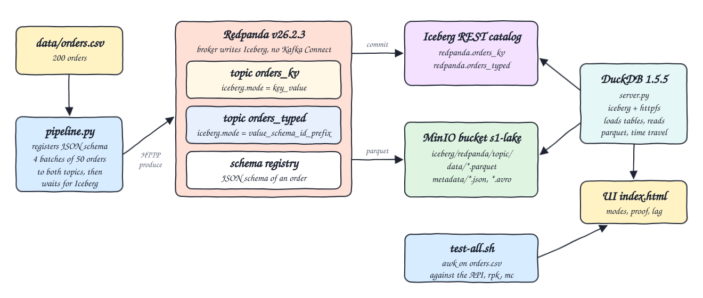
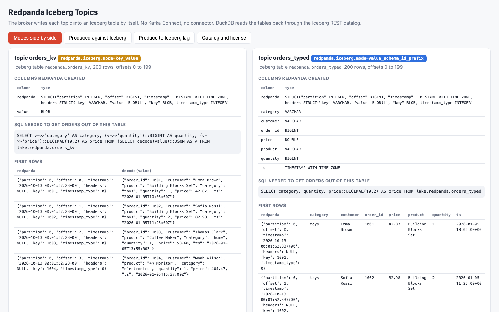
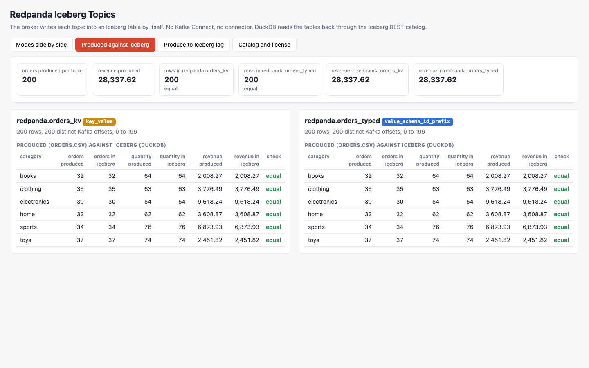
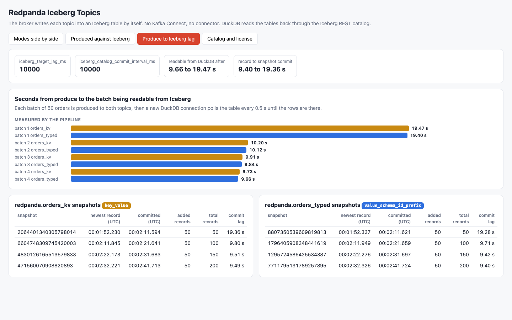
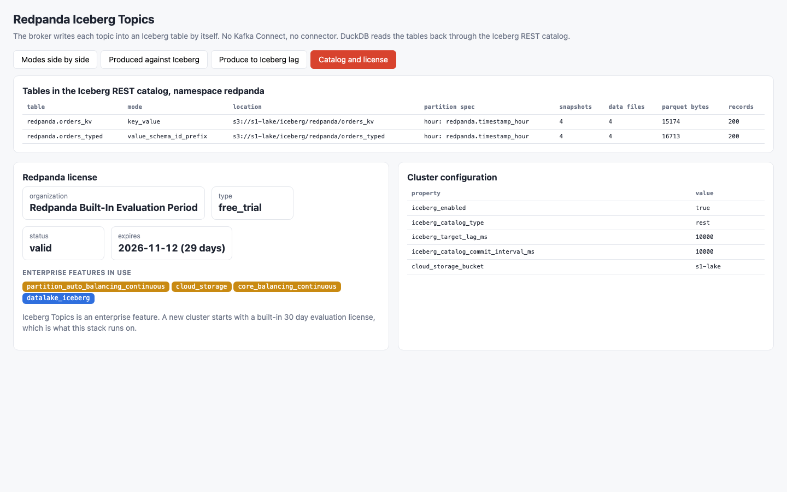

<p align="center"></p>

# kafka-iceberg-topics-redpanda

Redpanda Iceberg Topics: the broker itself writes a Kafka topic into an Apache Iceberg table, with no Kafka Connect and no connector. Redpanda v26.2.3 commits to an Iceberg REST catalog and writes Parquet to MinIO. The same 200 orders are produced to two topics with different `redpanda.iceberg.mode` values, `key_value` and `value_schema_id_prefix`, and DuckDB 1.5.5 reads both tables back through the REST catalog to prove that row counts and aggregates equal what was produced. A small Python 3.14 UI shows the two table shapes side by side, the proof, and the lag between produce and Iceberg commit.

## License: what actually happens

Iceberg Topics is a Redpanda enterprise feature. With `docker.io/redpandadata/redpanda:v26.2.3` and no license file, a new cluster reports this from `rpk cluster license info`:

```
License status:              valid
License violation:           false
Enterprise features in use:  [datalake_iceberg partition_auto_balancing_continuous cloud_storage core_balancing_continuous]
Organization:                Redpanda Built-In Evaluation Period
Type:                        free_trial
Expires:                     Nov 11 2026
```

That cluster was created on Oct 12 2026, so the built-in evaluation license lasts 30 days and Iceberg Topics works on it without any key. This POC runs on that evaluation license. What happens after the 30 days was not tested here; running Iceberg Topics beyond the evaluation needs a Redpanda Enterprise license. `start-all.sh` always creates a new cluster, because the REST catalog used here keeps its state in memory and the three stores must start empty together.

## How it Works

1. `start-all.sh` starts `s1-minio`, creates the bucket `s1-lake`, then starts `s1-rest` (Iceberg REST catalog) and `s1-redpanda`.
2. `redpanda/bootstrap.yaml` turns on Tiered Storage against MinIO, `iceberg_enabled`, and points `iceberg_rest_catalog_endpoint` at `s1-rest`.
3. `rpk topic create` creates `orders_kv` with `redpanda.iceberg.mode=key_value` and `orders_typed` with `redpanda.iceberg.mode=value_schema_id_prefix`. Redpanda creates the Iceberg tables `redpanda.orders_kv` and `redpanda.orders_typed` in the catalog.
4. `app/pipeline.py` registers a JSON Schema for an order in the Redpanda schema registry and gets schema id 1.
5. It produces `data/orders.csv` in 4 batches of 50 through the Redpanda HTTP proxy: plain JSON to `orders_kv`, and the same JSON behind the 5 byte schema registry prefix (magic byte + schema id) to `orders_typed`.
6. Inside the broker, the Iceberg translator writes Parquet files to `s3://s1-lake/iceberg/redpanda/<topic>/data/` and commits a snapshot to the REST catalog.
7. After each batch the pipeline opens a new DuckDB connection every 0.5 s until the rows are readable, and records the seconds it took.
8. `app/server.py` attaches the REST catalog with the DuckDB `iceberg` extension, reads both tables, time travels to each snapshot to compute the commit lag and serves JSON to `index.html`.
9. `test-all.sh` compares both tables against an awk calculation over `orders.csv`, and against `rpk`, the REST catalog and MinIO directly.

## Architecture



## Features

* Topic to Iceberg with no connector: the only containers are Redpanda, the REST catalog and MinIO.
* `key_value` mode: the table has a `redpanda` struct (partition, offset, timestamp, headers, key) and one opaque `value BLOB`; every query has to decode JSON.
* `value_schema_id_prefix` mode: the JSON Schema in the schema registry becomes typed columns (`order_id BIGINT`, `price DOUBLE`, `ts TIMESTAMP WITH TIME ZONE`, ...) next to the same `redpanda` struct.
* Independent reader: DuckDB loads the tables from the REST catalog and reads Parquet from MinIO, it never talks to Redpanda.
* Exactly-once check: every Kafka offset 0 to 199 appears in each table exactly once.
* Lag measured two ways: seconds until a batch is readable from DuckDB, and Iceberg snapshot commit time minus the newest record timestamp in that snapshot.
* UI with four tabs: modes side by side, produced against Iceberg, lag, catalog and license.

## Stack

* Redpanda v26.2.3 (`docker.io/redpandadata/redpanda:v26.2.3`): broker, schema registry, HTTP proxy and the Iceberg translator, on the built-in evaluation license.
* Apache Iceberg REST catalog fixture 1.10.1 (`docker.io/apache/iceberg-rest-fixture:1.10.1`): in-memory REST catalog.
* MinIO community fork `docker.io/pgsty/minio:RELEASE.2026-08-04T00-00-00Z`: S3 storage for Redpanda Tiered Storage and the Iceberg files.
* DuckDB 1.5.5 (Python package) with the `iceberg` and `httpfs` extensions: the reader.
* Python 3.14.7: pipeline and HTTP server, standard library only besides `duckdb`; no Kafka client library.
* podman 5.7.1 + podman-compose: runs the three containers with memory limits of 1536m, 512m and 384m.
* awk, rpk, mc, curl: independent verification.

## API

| Method | Path | Returns |
|---|---|---|
| GET | `/api/tables` | for each topic: mode, Iceberg table, location, partition spec, columns, first rows, row count, offset range, per-category orders, quantity and revenue, and every snapshot with its commit lag |
| GET | `/api/produced` | per-category orders, quantity and revenue computed from `data/orders.csv` |
| GET | `/api/batches` | schema id and, per batch and topic, the produce time and seconds until readable from Iceberg |
| GET | `/api/license` | Redpanda license and enterprise features in use, from the admin API |
| GET | `/api/settings` | Iceberg cluster properties read from the admin API |

The UI accepts `?tab=modes`, `?tab=proof`, `?tab=lag` and `?tab=catalog`.

## Key Design Decisions

* JSON Schema with `value_schema_id_prefix` keeps the producer to the standard library: the wire format is one zero byte, the 4 byte schema id and the JSON document. Avro or Protobuf would give the same typed table but need an encoder.
* Records are produced through the Redpanda HTTP proxy with base64 payloads, so there is no Kafka client dependency.
* `iceberg_target_lag_ms` and `iceberg_catalog_commit_interval_ms` are both 10000. Redpanda rejects lower values: `too small, must be at least 10000ms`.
* The REST catalog warehouse is `s3://s1-lake/iceberg/`, inside the same bucket Redpanda uses for Tiered Storage, because Redpanda writes the data files with its own Tiered Storage credentials.
* JSON Schema `number` becomes `DOUBLE`; revenue is computed with `price::DECIMAL(10,2)` so sums match awk to the cent.
* DuckDB caches the table metadata of an attached Iceberg catalog, so the pipeline and the server open a new connection for every read to see new snapshots.
* One partition per topic, so offsets 0 to 199 map one to one to the 200 orders.
* Every start is a new cluster and `stop-all.sh` removes the volumes: the REST catalog fixture is in memory, so keeping MinIO or Redpanda data would leave them out of sync.
* No Avro, no compaction, no DLQ, no schema evolution: out of scope.

## Verification

`./scripts/test-all.sh` output (23 passed, 0 failed):

```
PASS no kafka connect: the stack is only redpanda, iceberg rest catalog and minio
PASS rest catalog lists the two tables redpanda created
PASS orders_kv: topic high watermark equals the 200 orders in the csv
PASS orders_kv: iceberg row count equals the topic high watermark
PASS orders_kv: every kafka offset is in iceberg exactly once
PASS orders_kv: orders, quantity and revenue per category match awk
PASS orders_kv: iceberg snapshots add up to 200 records
PASS orders_kv: parquet files on minio equal data files in the snapshots
PASS orders_kv: every snapshot committed within 60s of its newest record
PASS orders_typed: topic high watermark equals the 200 orders in the csv
PASS orders_typed: iceberg row count equals the topic high watermark
PASS orders_typed: every kafka offset is in iceberg exactly once
PASS orders_typed: orders, quantity and revenue per category match awk
PASS orders_typed: iceberg snapshots add up to 200 records
PASS orders_typed: parquet files on minio equal data files in the snapshots
PASS orders_typed: every snapshot committed within 60s of its newest record
PASS orders_kv: topic property redpanda.iceberg.mode
PASS orders_typed: topic property redpanda.iceberg.mode
PASS orders_kv: table is only the redpanda struct and an opaque value
PASS orders_typed: schema registry json schema became typed columns
PASS schema registry holds the json schema used by orders_typed
PASS every produced batch became readable from iceberg within 60s
PASS a second duckdb process reading the rest catalog sees the same aggregates
produce to readable lag per batch (batch topic records seconds):
1 orders_kv 50 19.47
1 orders_typed 50 19.4
2 orders_kv 50 10.2
2 orders_typed 50 10.12
3 orders_kv 50 9.91
3 orders_typed 50 9.84
4 orders_kv 50 9.73
4 orders_typed 50 9.66
newest record to iceberg commit lag per snapshot (topic added_records seconds):
orders_kv 50 19.36
orders_kv 50 9.80
orders_kv 50 9.51
orders_kv 50 9.49
orders_typed 50 19.28
orders_typed 50 9.71
orders_typed 50 9.42
orders_typed 50 9.40
license: Redpanda Built-In Evaluation Period, type free_trial, license_status valid, expires in 29 days
per category from awk (category orders quantity revenue):
books 32 64 2008.27
clothing 35 63 3776.49
electronics 30 54 9618.24
home 32 62 3608.87
sports 34 76 6873.93
toys 37 74 2451.82
all tests passed
```

Measured numbers from that run:

* 200 orders produced per topic, 200 rows in each Iceberg table, 4 snapshots and 4 Parquet files per table, total revenue 28,337.62 in the CSV and in both tables.
* Produce to readable from DuckDB: 19.4 to 19.47 s for the first batch, 9.66 to 10.2 s for the next three.
* Newest record to Iceberg snapshot commit: 19.28 to 19.36 s for the first snapshot, 9.40 to 9.80 s for the next three, with both lag properties at their 10 s minimum.
* The first batch took about twice as long as the others in all three runs made while building this; the two modes never differed by more than 0.1 s.
* Changing one quantity in `orders.csv` after the load makes `test-all.sh` fail on the awk comparison, so the test can fail.
* Memory with the stack loaded: Redpanda 187 MB, REST catalog 189 MB, MinIO 139 MB.

## Printscreens

Modes side by side: `orders_kv` is a `redpanda` struct plus a `value BLOB` and needs JSON decoding in SQL, `orders_typed` has one typed column per schema field and a plain `SELECT`. First rows of each table are shown below the columns.



Produced against Iceberg: orders, quantity and revenue per category from `orders.csv` next to what DuckDB reads from each Iceberg table, with 200 rows and 28,337.62 revenue in both.



Produce to Iceberg lag: seconds until each batch was readable from DuckDB for both topics, and each Iceberg snapshot with the newest record timestamp, the commit timestamp and the difference.



Catalog and license: the two tables in the REST catalog with location, partition spec, snapshots, data files and Parquet bytes; the built-in evaluation license with its expiry and the enterprise features in use; the Iceberg cluster properties.



## Scripts

All scripts live in `scripts/` and run from any directory of the repository.

| Script | What it does |
|---|---|
| `./scripts/setup.sh` | Creates the Python 3.14 venv, installs DuckDB and its extensions, pulls images |
| `./scripts/start-all.sh` | Starts MinIO, the REST catalog and Redpanda, creates the two topics, produces the orders, starts the UI and prints the full link of each service |
| `./scripts/status.sh` | Shows every service port as UP or DOWN |
| `./scripts/test-all.sh` | Verifies both Iceberg tables against awk, rpk, the REST catalog and MinIO, and prints the measured lag |
| `./scripts/ui.sh` | Opens the UI in the browser |
| `./scripts/stop-all.sh` | Stops every service and removes the volumes |
| `./scripts/sql-console.sh` | Runs SQL with DuckDB on `lake.redpanda.orders_kv` and `lake.redpanda.orders_typed`, from arguments or one statement per line |

Ports are declared in `scripts/ports.env`: kafka 30000, http proxy 30001, schema registry 30002, redpanda admin 30003, minio 30004, minio console 30005, iceberg rest 30006, ui 30007.

```bash
./scripts/setup.sh
./scripts/start-all.sh
./scripts/status.sh
./scripts/test-all.sh
./scripts/ui.sh
./scripts/stop-all.sh
```
