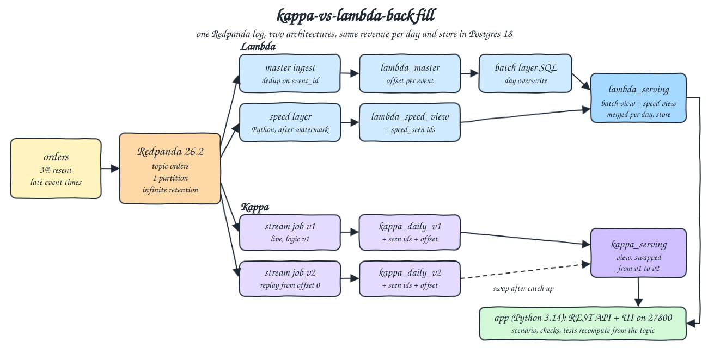
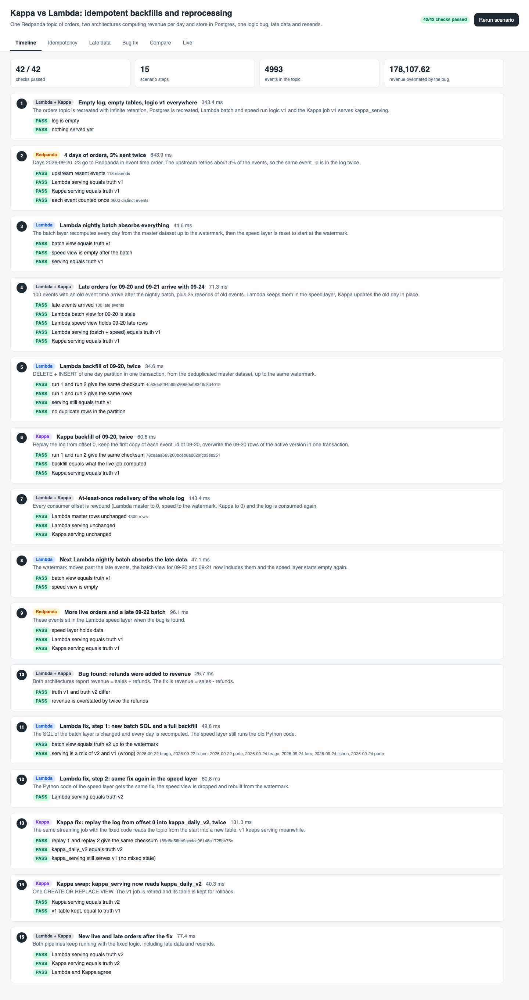
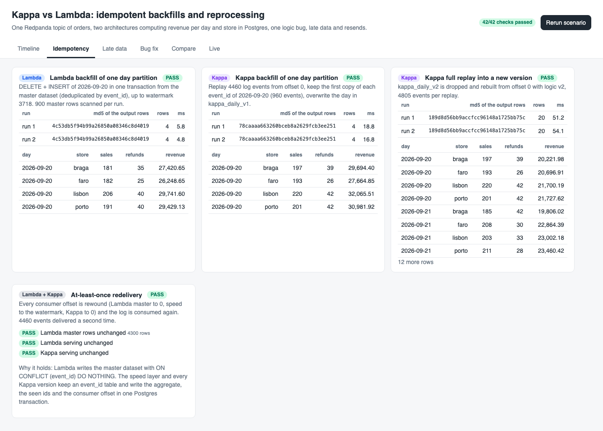
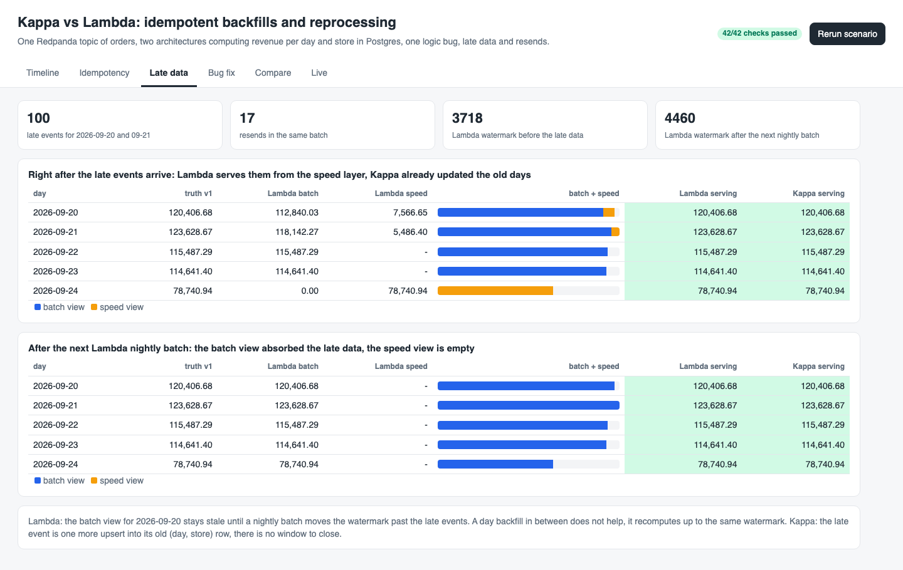
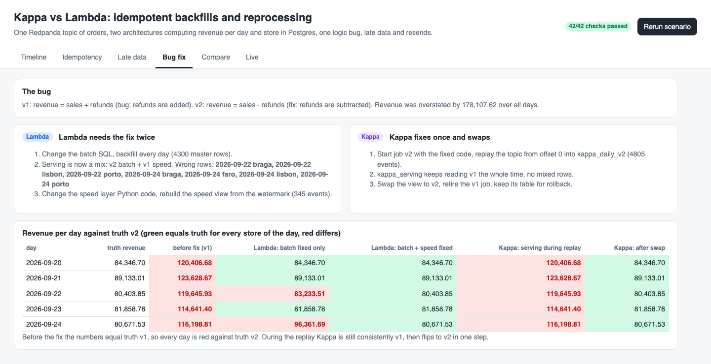
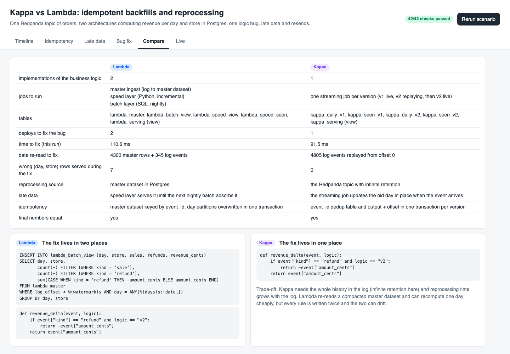
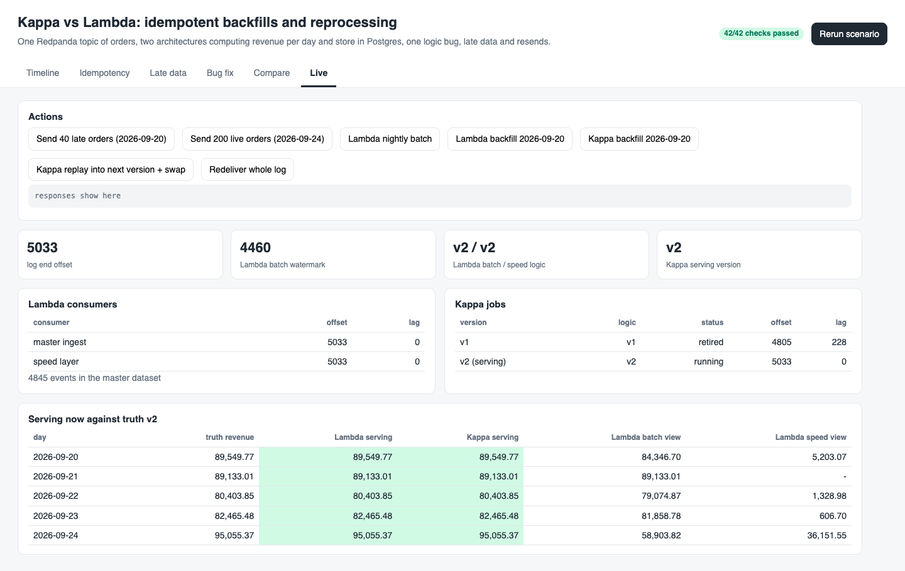

<p align="center"></p>

# kappa-vs-lambda-backfill

Idempotent backfills and reprocessing in the two classic streaming architectures, side by side on the same data. One Redpanda 26.2.3 topic receives orders (with 3% upstream resends and late events). A Lambda pipeline (master dataset + nightly SQL batch layer + Python speed layer + merged serving view) and a Kappa pipeline (one Python streaming job per version, reprocess by replaying the topic from offset 0 into a new versioned table, then swap a view) both compute revenue per day and store in Postgres 18.6. A scripted scenario runs 15 steps: late data, backfilling one day twice, redelivering the whole log, finding a logic bug (refunds added instead of subtracted), fixing it in each architecture, and comparing results and complexity. A small web UI shows every step and a REST API drives both pipelines live.

## How it Works

1. `app/gen.py` produces seeded orders in phases: 4 on time days, then late orders for old days mixed with new days, plus resends of the same `event_id`.
2. Lambda: `master ingest` copies the log into `lambda_master` (`ON CONFLICT (event_id) DO NOTHING`, log offset kept). The batch layer (SQL) overwrites day partitions of `lambda_batch_view` from the master up to a watermark offset. The speed layer (Python) aggregates only events after the watermark into `lambda_speed_view`. `lambda_serving` is a view that sums both.
3. Kappa: job `vN` reads the topic, keeps an `event_id` table, and upserts `kappa_daily_vN`. Output rows, seen ids and the consumer offset commit in one Postgres transaction. `kappa_serving` is a view on the active version.
4. Reprocessing in Kappa = start a new job version from offset 0 into a new table while the old one keeps serving, then `CREATE OR REPLACE VIEW` (swap). Reprocessing in Lambda = change the batch SQL and backfill, then change the speed layer code and rebuild it.
5. Every step snapshots all tables and a truth recomputed straight from the topic, and records pass/fail checks. The tests recompute everything again with their own code from the topic.

## Architecture



## Features

* Idempotent day backfill in both architectures: running it twice gives the same md5 over the output rows and no duplicate rows.
* At-least-once redelivery: all consumer offsets rewound to 0 and the full log consumed again changes nothing, because dedup and offset commit are transactional.
* Late data: Lambda serves late events from the speed layer until the next nightly batch moves the watermark, Kappa updates the old day in place.
* Logic bug fix: Lambda needs two code changes (SQL and Python) and serves 7 wrong (day, store) rows between them; Kappa needs one change, replays into `kappa_daily_v2` while v1 serves, then swaps.
* Rollback ready: the retired Kappa v1 table stays, a swap back resumes the job and catches it up first.
* Guard rails: rebuilding the version that is currently serving is refused (HTTP 400), a swap always catches the new version up before it flips.
* Live controls in the UI: send late or live orders, run a Lambda nightly batch or day backfill, backfill a day in Kappa, replay into the next version and swap, redeliver the whole log.

## Stack

* Redpanda 26.2.3 (`docker.io/redpandadata/redpanda:v26.2.3`): Kafka API log, single binary, one core and 512 MB, infinite retention so Kappa can replay from 0.
* Postgres 18.6 (`docker.io/library/postgres:18.6`): master dataset, views, versioned tables and transactional offsets.
* Python 3.14.7 (`docker.io/library/python:3.14.7-slim`): the app, both pipelines, the UI server and the tests.
* confluent-kafka 2.15.1: librdkafka client, idempotent producer, manual partition assignment for replays.
* psycopg 3.3.6 (binary): Postgres driver.
* Python stdlib `http.server` + plain HTML, CSS and JS: REST API and UI, no framework.
* podman + podman-compose: runs the three containers.

## Contracts / APIs

| Method | Path | Description |
|---|---|---|
| GET | `/` | UI (tabs: Timeline, Idempotency, Late data, Bug fix, Compare, Live) |
| POST | `/api/scenario` | Recreates topic and tables, runs the 15 step scenario, returns the report |
| GET | `/api/scenario` | Last report: steps, checks, snapshots, comparison |
| GET | `/api/state` | Log end offset, Lambda offsets, watermark and logic, Kappa jobs with lag and the active version |
| GET | `/api/views` | Rows of every serving table plus truth v1 and v2 recomputed from the topic |
| GET | `/api/lambda/serving`, `/api/kappa/serving` | Rows `[day, store, sales, refunds, revenue_cents]` |
| GET | `/api/kappa/table?version=v1` | Rows of one Kappa version table |
| GET | `/api/truth?logic=v2` | Truth recomputed from the topic |
| POST | `/api/produce?kind=late\|live&count=N` | Sends new orders (late ones go to 2026-09-20) with resends |
| POST | `/api/lambda/nightly` | Moves the watermark, recomputes every day, resets the speed layer |
| POST | `/api/lambda/backfill?day=YYYY-MM-DD` | Overwrites one day partition (all days without `day`) |
| POST | `/api/lambda/deploy?layer=batch\|speed&logic=v1\|v2` | Switches the logic of one layer (speed rebuilds from the watermark) |
| POST | `/api/kappa/backfill?day=YYYY-MM-DD` | Replays the log for one day into the active version |
| POST | `/api/kappa/replay?version=v3&logic=v2` | New version table from offset 0 |
| POST | `/api/kappa/swap?version=v3` | Catches the version up and points `kappa_serving` to it |
| POST | `/api/rewind` | Rewinds every consumer and consumes the log again |

```json
{"days": ["2026-09-20", "..."], "checksum": {"md5": "4c53db5f94b99a26850a08346c8d4019", "rows": 4},
 "logic": "v1", "watermark": 3718, "master_rows_scanned": 900, "rows": [["2026-09-20", "braga", 181, 35, 2742065]], "ms": 5.8}
```

## Key data structures and design decisions

* Event: `{event_id, ts, store, kind: sale|refund, amount_cents}`. Metrics per `(day, store)`: `sales`, `refunds`, `revenue_cents`. v1 adds refunds to revenue (the bug), v2 subtracts them.
* One partition: offsets are a single number, so the Lambda watermark and Kappa job positions are one integer. More partitions would need an offset per partition.
* The Lambda speed layer skips events whose `event_id` is already in the master before the watermark, so a resend of an old event is not counted twice across the batch/speed boundary.
* A Lambda day backfill recomputes up to the current watermark, so it does not absorb late events that arrived after it; only a nightly batch that moves the watermark does. This is shown on purpose.
* Kappa dedup tables grow with the log. In production they would be bounded by a time window; here the log is small and the full table keeps the replay exact.
* Checksums are `md5(string_agg(day|store|sales|refunds|revenue ORDER BY day, store))`, computed in Postgres.
* Containers, network and image start with `r13-`. Memory limits: Redpanda 1 GB, Postgres 384 MB, app 384 MB (1.75 GB total, about 200 MB used in practice).

## How to run

Requirements: podman, podman-compose, curl and lsof. Everything else runs in containers.

```bash
./scripts/setup.sh
./scripts/start-all.sh
./scripts/test-all.sh
./scripts/ui.sh
./scripts/stop-all.sh
```

`test-all.sh` reruns the scenario from an empty topic (it fails if any of the 42 scenario checks fails) and then runs `tests/test_backfill.py` inside `r13-app`. The tests read the topic with their own consumer and recompute every expected number with their own code:

* The app's truth in every one of the 15 snapshots equals the independent recompute at that step's log offset.
* The log really has resends and at least 100 late events, and every serving table counts each `event_id` once.
* Late data: at the late step the Lambda batch view equals the recompute up to the watermark, the speed view equals the recompute after it (minus ids already in the batch), the merge equals the full recompute; after the next nightly batch the speed view is empty. Kappa already had the right numbers.
* Day backfills (scenario and live via REST) twice give identical checksums and equal the recompute for that day.
* Redelivery of the whole log leaves both serving tables and the master row count unchanged.
* After the batch only fix, the wrong Lambda rows are exactly the (day, store) keys where the speed layer holds refunds; after the speed fix it equals truth v2.
* Kappa replay twice gives identical checksums, equals truth v2, and v1 keeps serving truth v1 until the swap.
* The overstatement reported equals twice the refunds in the log, and the serving version cannot be rebuilt in place (HTTP 400).

The tests were also run against two broken builds: the v2 fix disabled (7 tests failed) and the speed layer dedup disabled (6 tests failed).

```
rerunning the scenario from an empty log
scenario passed every check
test_live_late_events_reach_both_serving_tables ... ok
test_rest_backfills_twice_are_identical ... ok
test_serving_version_cannot_be_rebuilt_in_place ... ok
test_ui_has_every_tab ... ok
test_app_truth_in_every_step_matches_an_independent_recompute_of_the_log ... ok
test_both_architectures_end_with_the_fixed_numbers ... ok
test_compare_counts_one_logic_for_kappa_and_two_for_lambda ... ok
test_kappa_day_backfill_twice_is_identical_and_equals_the_log ... ok
test_kappa_replay_twice_is_identical_and_v1_serves_until_the_swap ... ok
test_lambda_batch_only_fix_is_wrong_exactly_where_the_speed_layer_saw_refunds ... ok
test_lambda_day_backfill_twice_is_identical_and_equals_the_master_up_to_the_watermark ... ok
test_lambda_is_right_only_after_the_second_fix ... ok
test_late_data_is_served_by_lambda_speed_layer_until_the_next_batch ... ok
test_late_data_updates_the_old_day_in_place_in_kappa ... ok
test_log_really_contains_resends_and_late_events ... ok
test_redelivering_the_whole_log_changes_nothing ... ok
test_resends_are_counted_once ... ok

----------------------------------------------------------------------
Ran 17 tests in 0.233s

OK
all tests passed
```

## Results

| | Lambda | Kappa |
|---|---|---|
| Implementations of the business rule | 2 (batch SQL + speed Python) | 1 (Python) |
| Jobs | master ingest, speed layer, batch layer | one streaming job per version |
| Deploys to fix the bug | 2 | 1 |
| Data re-read to fix | 4,300 master rows + 345 log events | 4,805 log events from offset 0 |
| Wrong (day, store) rows served during the fix | 7 | 0 |
| Late data | speed layer until the next nightly batch | old day updated in place |
| Reprocessing source | master dataset in Postgres | the topic (needs full retention) |

* Both end with identical numbers, equal to the independent recompute.
* The bug overstated revenue by 178,107.62 across the 5 days (twice the refunds).
* At this size both fixes take around 100 ms. Kappa's replay cost grows with the whole log; Lambda can recompute one day from the compacted master, at the price of writing every rule twice.

## Printscreens

Timeline: the 15 scenario steps with the architecture badge, what happened, time taken and each check (42 of 42 passed).



Idempotency: the Lambda day backfill, the Kappa day backfill and the Kappa full replay each ran twice with the same md5 and row count, plus the full log redelivery that changed nothing.



Late data: right after the late events, the Lambda batch view for 09-20 and 09-21 is short and the speed view (orange) fills the gap so the serving view is right; Kappa is already right. After the next nightly batch the batch view holds everything.



Bug fix: revenue per day against truth v2. Lambda after the batch only fix is red on 09-22 and 09-24 (the speed layer still runs v1), green after the second fix. Kappa stays consistently v1 during the replay, then flips to v2 at the swap.



Compare: the complexity table and the fix code, twice for Lambda and once for Kappa.



Live: action buttons, log end offset, Lambda watermark and consumer lag, Kappa jobs (v1 retired, v2 serving), and both serving tables against truth v2 after 40 extra late orders; the Lambda batch and speed columns show how the merge is split.



## Scripts

All scripts live in `scripts/` and run from any directory of the repository.

| Script | What it does |
|---|---|
| `./scripts/setup.sh` | Pulls the Redpanda, Postgres and Python images and builds the app image |
| `./scripts/start-all.sh` | Starts Redpanda, Postgres and the app, runs the scenario once, prints every link |
| `./scripts/status.sh` | Shows every service port as UP or DOWN |
| `./scripts/test-all.sh` | Reruns the scenario and runs the tests |
| `./scripts/ui.sh` | Opens the UI in the browser |
| `./scripts/sql-console.sh` | Opens psql on the Postgres database |
| `./scripts/stop-all.sh` | Stops every container and waits until the ports are free |

Ports are declared in `scripts/ports.env`: UI 27800 (`http://localhost:27800`), Redpanda Kafka 27801 (`localhost:27801`), Postgres 27802 (`postgresql://localhost:27802/backfill`).

```bash
./scripts/setup.sh
./scripts/start-all.sh
./scripts/status.sh
./scripts/ui.sh
./scripts/stop-all.sh
```
