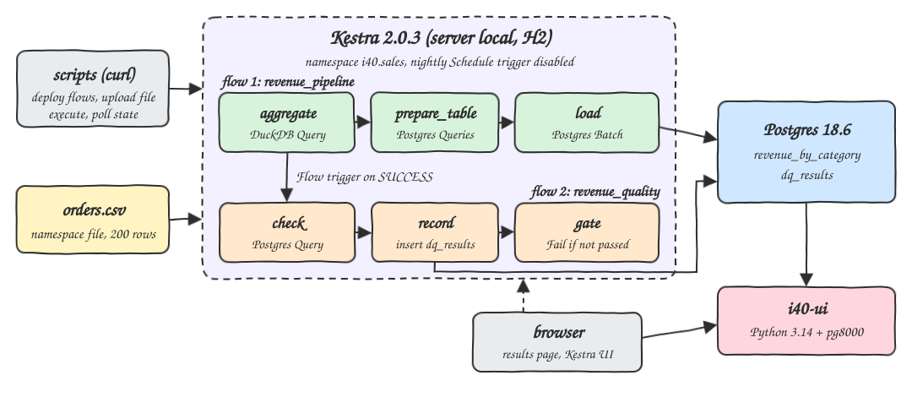
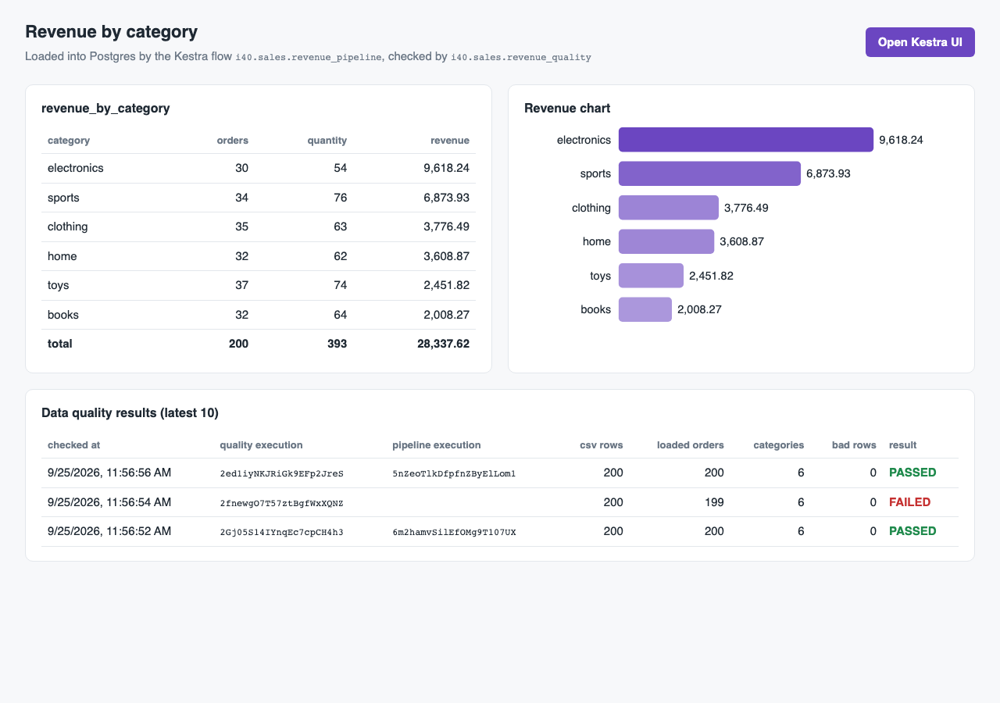
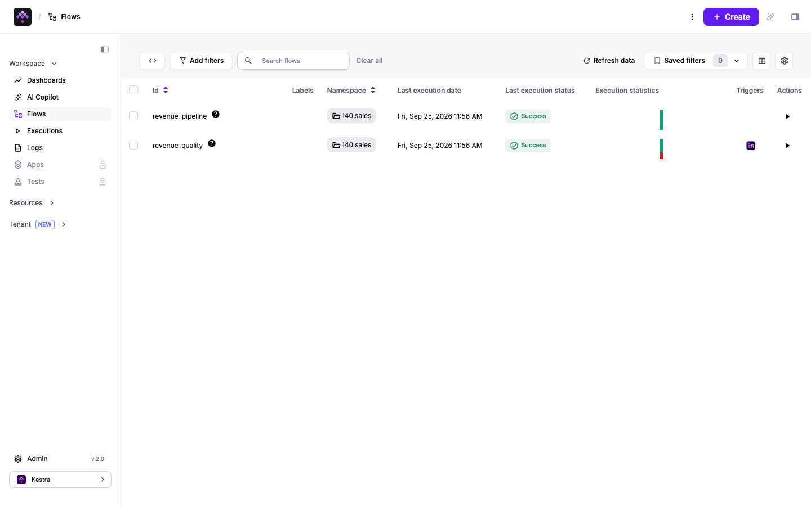
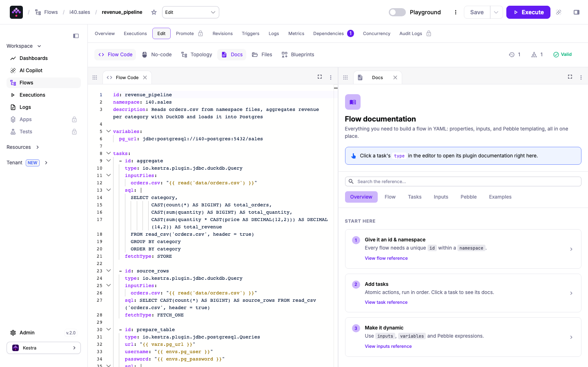
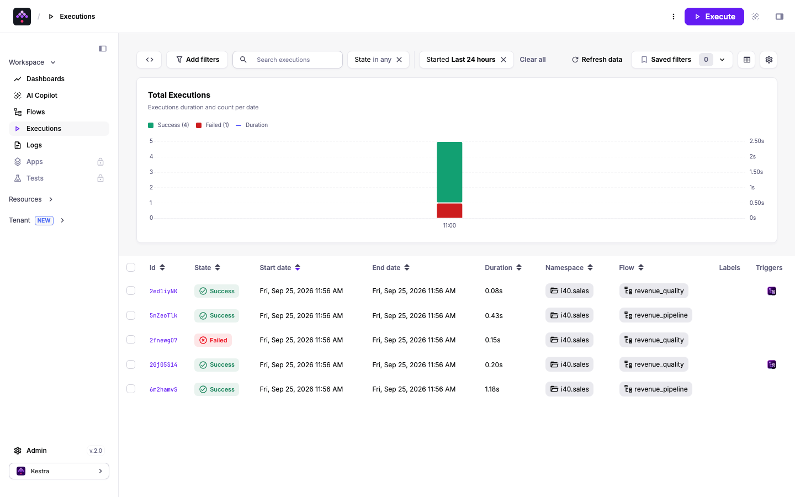
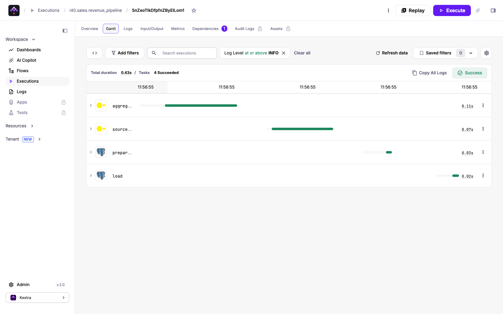
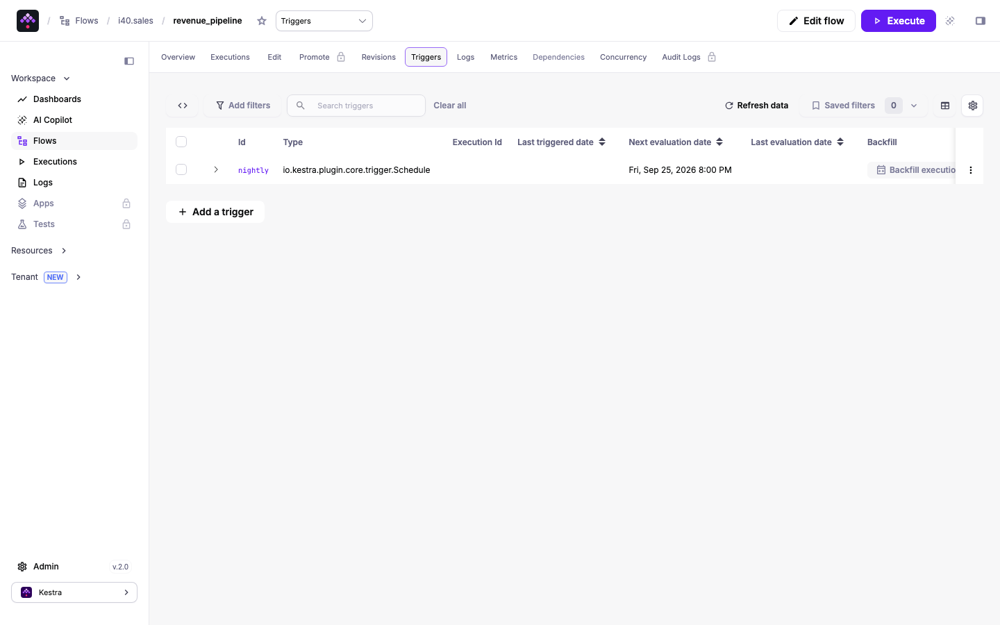

# kestra-yaml-pipelines

A data pipeline defined only in Kestra YAML flows. Flow 1 reads `orders.csv`, aggregates orders, units and revenue per category with DuckDB and loads the result into Postgres. Flow 2 starts automatically when flow 1 succeeds and runs a data quality check against the loaded table. Flows are deployed, executed and polled from shell scripts through the Kestra REST API. A small Python page shows the Postgres results and links to the Kestra UI.

## How it Works

1. `podman-compose` starts `i40-postgres`, `i40-kestra` (`server local`, embedded H2, 512M heap) and `i40-ui` on the `i40-net` network.
2. `setup.sh` installs only the two Kestra plugins the flows use (`plugin-jdbc-duckdb`, `plugin-jdbc-postgres` 2.0.4) into the `i40-kestra-plugins` volume, so the slim image is enough.
3. `deploy-flows.sh` uploads `data/orders.csv` as a namespace file of `i40.sales` and creates or updates both flows with `curl` (`PUT`, falling back to `POST`, `Content-Type: application/x-yaml`).
4. `run-pipeline.sh` starts `revenue_pipeline` with `POST /executions/i40.sales/revenue_pipeline` and polls until the state is `SUCCESS`.
5. `revenue_pipeline`: `aggregate` (DuckDB `read_csv` + `GROUP BY`, stored as Ion), `source_rows` (row count exposed as a flow output), `prepare_table` (create + truncate), `load` (JDBC batch insert).
6. The `Flow` trigger of `revenue_quality` fires on `SUCCESS` and passes `source_rows`. It checks row counts and value ranges, writes one row into `dq_results` and fails the execution when the check does not pass.
7. `revenue_pipeline` also has a `Schedule` trigger (`0 3 * * *`) that is present but `disabled: true`.
8. `test-all.sh` compares the Postgres table with an `awk` aggregation of the CSV and proves the quality gate fails on corrupted data.

## Architecture



## Features

* **Pipeline as YAML only**: both flows live in `flows/*.yml`, no custom code runs inside Kestra.
* **In-JVM transform with DuckDB**: no Docker socket, no nested containers and no Python in the Kestra image are needed.
* **Exact money math**: prices are cast to `DECIMAL(12,2)` before the sum and stored as `NUMERIC(14,2)`, so no float rounding drift.
* **Flow trigger chaining**: `revenue_quality` depends on `revenue_pipeline` `SUCCESS` and receives its `source_rows` output as input.
* **Quality gate that can fail**: the `Fail` task turns bad data into a `FAILED` execution, and the result is also kept in `dq_results`.
* **Idempotent load**: truncate plus reload, so rerunning always leaves exactly one row per category.
* **API-driven operations**: deploy, upload, execute and poll are plain `curl` calls against `/api/v1/main`.
* **Small footprint**: slim image plus two plugins, H2 instead of a second database, 512M heap.

## Stack

* **Kestra 2.0.3** (`kestra/kestra:v2.0.3-slim`): orchestrator, latest stable. The image ships its own Java 25 runtime.
* **plugin-jdbc-duckdb 2.0.4**: runs the aggregation SQL on the CSV inside the worker.
* **plugin-jdbc-postgres 2.0.4**: `Queries`, `Batch` and `Query` tasks for load and quality check.
* **PostgreSQL 18.6** (`postgres:18.6-alpine`): target database, latest stable release.
* **Python 3.14.7** (`python:3.14.7-slim`) + **pg8000 1.31.5**: tiny UI server, pure Python Postgres driver.
* **podman / podman-compose**: runs every container.

The transform uses the DuckDB plugin instead of a Python script task: the Kestra image has no Python interpreter, and the Process runner would need one inside the Kestra container, while the Docker runner would need a nested container runtime.

## Contracts/APIs

Results page (`i40-ui`):

| Method | Path | Response |
|---|---|---|
| GET | `/` | the `index.html` page |
| GET | `/api/revenue` | rows of `revenue_by_category` sorted by revenue, 503 with `{"error": ...}` when Postgres is not reachable |
| GET | `/api/quality` | last 10 rows of `dq_results` |
| GET | `/api/config` | `{"kestra_url": ...}` used for the Kestra UI link |

```json
[{"category": "electronics", "total_orders": 30, "total_quantity": 54, "total_revenue": 9618.24}]
```

Kestra API calls used by the scripts (basic auth, tenant `main`):

| Method | Path | Used for |
|---|---|---|
| POST | `/api/v1/main/namespaces/i40.sales/files?path=/data/orders.csv` | upload the CSV as a namespace file |
| PUT / POST | `/api/v1/main/flows/i40.sales/{id}` / `/api/v1/main/flows` | update or create a flow from YAML |
| POST | `/api/v1/main/executions/i40.sales/{id}` | start an execution (multipart form for inputs) |
| GET | `/api/v1/main/executions/{executionId}` | poll `state.current` |
| GET | `/api/v1/main/executions/search?namespace=i40.sales&flowId=revenue_quality` | find the execution started by the Flow trigger |

Postgres schema:

```sql
CREATE TABLE revenue_by_category (
  category TEXT PRIMARY KEY,
  total_orders BIGINT NOT NULL,
  total_quantity BIGINT NOT NULL,
  total_revenue NUMERIC(14,2) NOT NULL
);
CREATE TABLE dq_results (
  execution_id TEXT PRIMARY KEY,
  upstream_execution_id TEXT,
  checked_at TIMESTAMPTZ NOT NULL DEFAULT now(),
  source_rows INT NOT NULL,
  loaded_orders INT NOT NULL,
  categories INT NOT NULL,
  bad_rows INT NOT NULL,
  passed BOOLEAN NOT NULL
);
```

## Design decisions

* **Data between tasks travels as Ion files in Kestra internal storage**: `aggregate` stores its result (`fetchType: STORE`) and `load` reads it with `from: "{{ outputs.aggregate.uri }}"`.
* **The pass/fail rule is computed in SQL**, not in Pebble, so `check`, `dq_results.passed` and the `Fail` gate all use the same boolean.
* **The quality rule**: at least one category, no empty category or non-positive numbers, and the sum of `total_orders` equals the CSV row count coming from flow 1.
* **Credentials reach flows as `envs`**: `ENV_PG_USER` / `ENV_PG_PASSWORD` on the container become `{{ envs.pg_user }}` / `{{ envs.pg_password }}`.
* **Plugin auto-install is off**: plugins are pinned and installed once by `setup.sh`, so the runtime does not download anything.

## How to run

```bash
./scripts/setup.sh
./scripts/start-all.sh
./scripts/test-all.sh
./scripts/ui.sh
./scripts/stop-all.sh
```

Kestra UI login: `admin@kestra.io` / `Kestra2026` (local only, set in `kestra/application.yml`).

`test-all.sh` output:

```
test 1: pipeline execution via API, flow trigger runs the quality check
execution 6m2hamvSilEfOMg9T107UX SUCCESS
flow trigger started revenue_quality execution 2Gj05S14IYnqEc7cpCH4h3
execution 2Gj05S14IYnqEc7cpCH4h3 SUCCESS
expected from csv (awk)            actual from /api/revenue (postgres)
books 32 64 2008.27                books 32 64 2008.27
clothing 35 63 3776.49             clothing 35 63 3776.49
electronics 30 54 9618.24          electronics 30 54 9618.24
home 32 62 3608.87                 home 32 62 3608.87
sports 34 76 6873.93               sports 34 76 6873.93
toys 37 74 2451.82                 toys 37 74 2451.82
dq_results for 2Gj05S14IYnqEc7cpCH4h3: 200 200 6 0 t
test 2: quality gate fails when loaded data no longer matches the source
quality execution 2fnewgO7T57ztBgfWxXQNZ on corrupted table ended FAILED
dq_results for 2fnewgO7T57ztBgfWxXQNZ: 200 199 6 0 f
test 3: rerunning the pipeline repairs the table (truncate and reload is idempotent)
tests passed
```

## Printscreens

Results page: the `revenue_by_category` table with totals (200 orders, 28,337.62 revenue), a bar chart per category, and the data quality history. The `FAILED` row is the negative test from `test-all.sh`, which corrupts one row on purpose; the rerun after it passes again.



Kestra flows list for namespace `i40.sales`: both flows with their last status. The trigger icon on `revenue_quality` is the Flow trigger.



Flow editor with the deployed `revenue_pipeline` YAML, marked valid by Kestra.



Executions list: two pipeline runs, each followed by a quality run started by the Flow trigger, plus the manual quality run that failed on corrupted data.



Gantt view of one `revenue_pipeline` execution: `aggregate`, `source_rows`, `prepare_table` and `load` all succeeded in under half a second.



Triggers tab of `revenue_pipeline`: the `nightly` Schedule trigger is declared in the flow, disabled in source, so it never fires.



## Scripts

All scripts live in `scripts/` and run from any directory of the repository.

| Script | What it does |
|---|---|
| `./scripts/setup.sh` | Pulls images, installs the two Kestra plugins, builds the UI image |
| `./scripts/start-all.sh` | Starts every service, deploys the flows and prints the full link of each one |
| `./scripts/status.sh` | Shows every service port as UP or DOWN |
| `./scripts/test-all.sh` | Runs the pipeline, checks it against awk and tests the quality gate |
| `./scripts/deploy-flows.sh` | Uploads the CSV namespace file and creates or updates both flows via the API |
| `./scripts/run-pipeline.sh` | Executes `revenue_pipeline` via the API and waits for both flows to succeed |
| `./scripts/ui.sh` | Opens the UI in the browser |
| `./scripts/stop-all.sh` | Stops every service |
| `./scripts/sql-console.sh` | Opens a psql console on the `sales` database |

Ports are declared in `scripts/ports.env`: Postgres 24032, Kestra 24080, UI 24081.

```bash
./scripts/setup.sh
./scripts/start-all.sh
./scripts/status.sh
./scripts/ui.sh
./scripts/stop-all.sh
```
