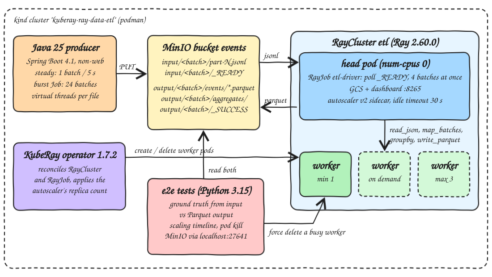
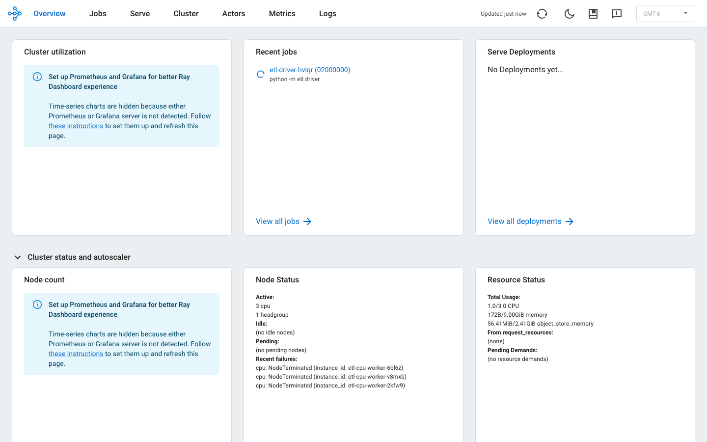
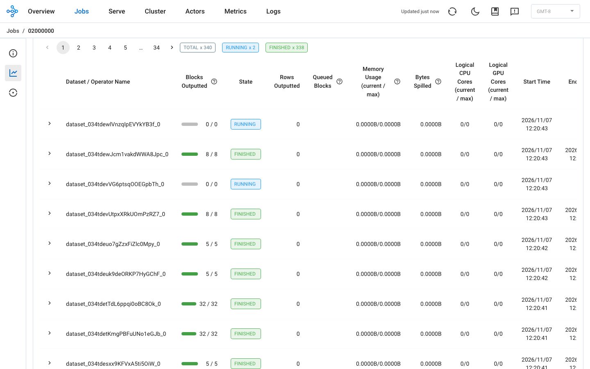

<p align="center"></p>

# kuberay-ray-data-etl

The KubeRay operator 1.7.2 on a local kind cluster, running a long-lived `RayCluster` with the in-tree autoscaler v2 (1 to 3 workers) and a `RayJob` driver that runs Ray Data microbatch ETL on Ray 2.60.0. A Java 25 producer (Spring Boot 4.1, non-web) writes JSON Lines microbatches into MinIO. The driver reads each batch with Ray Data, cleans it with `map_batches`, aggregates it with `groupby().aggregate()` and writes Parquet back to MinIO. End-to-end tests prove three things against the real cluster: every microbatch is committed exactly once and matches a ground truth computed from the input, a burst of work makes the autoscaler add worker pods and remove them after 30 s idle, and force-deleting a busy worker pod mid-burst neither loses nor duplicates a single event.

## How it Works

1. `scripts/setup.sh` creates the kind cluster, builds the producer jar and both images (producer on the Temurin 25 JRE, ETL on `rayproject/ray:2.60.0-py314`), loads them into kind and installs the KubeRay operator Helm chart 1.7.2.
2. `scripts/start-all.sh` starts MinIO, the `RayCluster etl`, the `RayJob etl-driver` (bound to the existing cluster with `clusterSelector`) and the steady producer, then port-forwards the Ray dashboard and MinIO.
3. The producer writes one batch every 5 s: 4 files `input/<batch>/part-N.jsonl` in parallel on virtual threads, then the `input/<batch>/_READY` marker listing the files.
4. The driver (on the head pod, which has `num-cpus 0`) lists `_READY` markers every second, skips batches that already have `output/<batch>/_SUCCESS`, and runs up to 4 batches at the same time, each as its own Ray Data pipeline in a thread.
5. Per batch: delete anything under `output/<batch>/`, `read_json` -> `map_batches(clean_events)` -> `materialize`, `write_parquet` the cleaned events, `groupby(batch_id, category).aggregate(Count, Sum, Max)` -> `write_parquet`, then write `_SUCCESS` with the timestamps.
6. Ray Data tasks need CPUs, which only workers have. When more tasks wait than the workers can run, autoscaler v2 raises the worker group replicas, KubeRay creates the pods, and new raylets join. A worker idle for 30 s is removed again, down to `minReplicas: 1`.
7. When a worker dies, Ray retries its tasks and rebuilds lost blocks from lineage on the remaining workers; the output file names are fixed per write task, so a retry overwrites instead of adding a file.
8. The e2e tests read input and output from MinIO, recompute the aggregates in plain Python, follow the pods and Ray nodes every second, and read task attempts and the driver log from the Ray dashboard API through the Kubernetes API server proxy.

## Architecture



## Features

* Commit marker per batch: `_READY` is written after the input files and `_SUCCESS` after the output files, so the ETL never reads half-written input and never treats half-written output as done.
* Idempotent batch processing: the output prefix is cleared before writing and Ray Data names files by write task, so reprocessing a batch replaces its output instead of duplicating it.
* Microbatch concurrency: up to 4 batches run at once, which is what turns a backlog into enough pending tasks for the autoscaler to react.
* Autoscaler v2 with `idleTimeoutSeconds: 30`, `minReplicas: 1`, `maxReplicas: 3`: scale-up and scale-down are measured on every test run.
* Exactly-once proof per event: every valid input `event_id` appears once in the Parquet output, and the per-category count, sum and max equal the ground truth.
* Fault proof: the kill test only passes if a batch was in flight when the worker died and Ray reports retried task attempts, so a kill that hit an idle worker cannot pass silently.
* Burst producer as a Kubernetes Job from the same image, so the tests create bursts of any size without touching the steady producer.

## Stack

* Kubernetes v1.35.0 (`kindest/node`, kind v0.31 on podman): single node cluster.
* KubeRay operator 1.7.2 (Helm chart `kuberay-operator` 1.7.2, image `quay.io/kuberay/operator:v1.7.2`): latest stable release, manages `RayCluster` and `RayJob`.
* Ray 2.60.0 with Ray Data (`rayproject/ray:2.60.0-py314`, Python 3.14.10, pyarrow 23.0.1): newest Ray release, runs the driver, the autoscaler v2 sidecar and the workers.
* MinIO `pgsty/minio:RELEASE.2026-08-04T00-00-00Z`: S3 storage for input and output; the community build because upstream stopped publishing images.
* Producer: Java 25 (Amazon Corretto 25.0.4 to build, Temurin 25.0.4 JRE to run), Spring Boot 4.1.2 non-web, only `spring-boot-starter`; S3 PUT with SigV4 on `java.net.http`, no AWS SDK.
* ETL: Python 3.14, uv, `ray[data]` 2.60.0, pytest 9.2.0, ty 0.0.99.
* e2e tests: Python 3.15, pytest 9.2.0, pyarrow 26.0.1, ty 0.0.99, `kubectl` underneath (no Kubernetes client library).

## Version deviations

* Python 3.15: Ray 2.60.0 publishes wheels for CPython 3.10 to 3.14 only (no `cp315` on PyPI) and its images stop at `-py314`. The ETL project and its image therefore use Python 3.14 (3.14.10 in the image, uv pins `==3.14.*` locally so `ty` checks against the real Ray API). The producer is on Java 25 and the e2e project is on Python 3.15.
* `ray[data]` 2.60.0 imports `typing_extensions` without declaring it; the ETL project pins `typing_extensions==4.16.0`, the version in the Ray image.

## Contracts

Input marker `input/<batch>/_READY` (written by the producer after all parts):

```json
{"batch_id":"s1794081557-000007","files":["input/s1794081557-000007/part-0.jsonl"],"events":1000,"ready_at_ms":1794081587312}
```

Input event (one JSON per line):

```json
{"event_id":"s1794081557-000007-0-3","batch_id":"s1794081557-000007","user_id":"user-17","category":" games","amount_cents":-12,"ts":1794081587311}
```

Output:

| Path | Content |
|---|---|
| `output/<batch>/events/*.parquet` | events with `amount_cents > 0`, `category` trimmed and lowercased |
| `output/<batch>/aggregates/*.parquet` | `batch_id, category, events, amount_cents, max_amount_cents` |
| `output/<batch>/_SUCCESS` | `{"batch_id", "ready_at_ms", "started_at_ms", "committed_at_ms", "rows"}` |

Driver log line per batch (the tests count these): `COMMIT batch=<batch> rows=<n> latency_ms=<ms>`.

Producer settings (env): `PRODUCER_MODE` (`steady` or `burst`), `RUN_ID` (blank means a fresh one), `PRODUCER_INTERVAL` (5s), `PRODUCER_BATCHES`, `FILES_PER_BATCH`, `EVENTS_PER_FILE`. Batch id is `<runId>-<seq:06>`.

`RayCluster etl` autoscaling fields:

```yaml
enableInTreeAutoscaling: true
autoscalerOptions: {version: v2, idleTimeoutSeconds: 30}
headGroupSpec.rayStartParams: {num-cpus: "0"}
workerGroupSpecs: [{groupName: cpu, minReplicas: 1, maxReplicas: 3, rayStartParams: {num-cpus: "1"}}]
```

## Design decisions

* The driver is a `RayJob` with `clusterSelector` and `submissionMode: HTTPMode` against a long-lived `RayCluster`, so the cluster keeps running and autoscaling between jobs, and no submitter pod is needed.
* The head has `num-cpus: 0`, so every Ray Data task runs on a worker and the worker count is the only thing that limits throughput.
* Done-ness is the `_SUCCESS` marker in the output, not driver memory. A restarted driver starts over from what is in MinIO.
* The driver runs `gc.collect()` after a batch finishes. Without it, reference cycles in finished Ray Data datasets kept their blocks pinned in worker object stores, the autoscaler saw `object_store_memory currently in use` on every worker, and idle workers were never removed.
* `shuffle_strategy` is `sort_shuffle_pull_based`: the aggregates are a few rows per batch and this strategy needs no long-lived aggregator actors that would hold worker CPUs.
* The e2e ground truth is a separate plain Python implementation of the cleaning rules, not an import of the ETL code, so a bug in `clean_events` cannot hide itself.
* The kill test force-deletes the pod (`--grace-period=0`), the closest thing to a node crash on kind; the replacement pod comes from KubeRay because the worker group is below its desired replicas.
* Cluster-side timestamps (pod conditions, Ray node start and end, batch markers) are used for the timeline; the one host-side measurement (first pending task) is shifted by the measured host to cluster clock offset.
* The burst is 24 batches x 200,000 events. A first try with 12 batches x 40,000 events finished on one worker in 3.7 s, before new workers had even joined; at 4.8 M events the burst lasts long enough for new workers to take tasks.

## How to run

Requirements: podman, kind, kubectl, helm, uv, Maven, Java 25 at `~/.sdkman/candidates/java/25.0.4-amzn`, lsof.

```bash
./scripts/setup.sh
./scripts/start-all.sh
./scripts/test-all.sh
./scripts/ui.sh
./scripts/stop-all.sh
./scripts/teardown.sh
```

`test-all.sh` runs:

* `producer` JUnit on JDK 25: `_READY` is written after every part; the marker lists every part and the event count; batch ids sort in production order; the same batch always generates the same events and includes dirty values; SigV4 header equals an independent computation; env binding, fresh run id on restart, bad run id rejected.
* `etl` pytest (with a local Ray) and `ty check`: refunds dropped, category variants merged, only contract columns kept; batches without `_READY` and with `_SUCCESS` are not pending; at most 4 batches in flight; a real Ray Data run produces the right aggregates; reprocessing a batch replaces its output instead of duplicating it.
* `e2e` `ty check` and pytest: ground-truth unit tests (a replayed, lost or double-counted event is caught), then on kind:
  * every steady microbatch is committed exactly once and matches the ground truth;
  * a burst scales workers up and idle workers are removed;
  * killing a worker mid-burst neither loses nor duplicates output.

```
Tests run: 3, Failures: 0   producer.BatchWriterTest  (JDK 25)
Tests run: 3, Failures: 0   producer.EventGeneratorTest
Tests run: 3, Failures: 0   producer.ProducerSettingsBindingTest
Tests run: 1, Failures: 0   producer.S3ObjectStoreTest
13 passed                   etl pytest (Python 3.14, local Ray 2.60.0)
All checks passed!          ty etl, ty e2e
test_every_steady_microbatch_is_processed_exactly_once_and_matches_ground_truth PASSED
test_a_burst_scales_workers_up_and_idle_workers_are_removed PASSED
test_killing_a_worker_mid_burst_neither_loses_nor_duplicates_output PASSED
tests/test_truth.py ..... 5 PASSED
8 passed in 227.93s
all tests passed
```

## Results

Measured by `./scripts/test-all.sh` on a fresh single node kind cluster (podman machine, 12 CPUs, shared with other kind clusters), workers with `num-cpus 1` and a 1 CPU / 2 GiB limit. One run, numbers from `.run/results.md`.

Steady microbatches (1 batch every 5 s, 4 files x 250 events, 1 worker):

| batches | rows out | READY -> `_SUCCESS` p50 | p95 | max | processing p50 | processing max |
|---|---|---|---|---|---|---|
| 6 | 5,701 | 0.5 s | 2.0 s | 2.0 s | 0.3 s | 1.2 s |

Autoscaling timeline for a burst of 24 batches x 200,000 events (4.8 M events, about 480 MB of JSON), seconds after the first burst batch was READY:

| new worker | first pending task | pod created | pod scheduled | ray node joined | pod Ready | tasks run on it | burst last commit | node removed | removed after last commit |
|---|---|---|---|---|---|---|---|---|---|
| etl-cpu-worker-9vc5s | 1.8 | 3.1 | 3.1 | 14.0 | 23.1 | 1,082 | 30.6 | 64.2 | 33.6 |
| etl-cpu-worker-bmwc9 | 1.8 | 3.1 | 3.1 | 13.9 | 23.1 | 1,115 | 30.6 | 64.2 | 33.6 |

Worker pod force-deleted mid burst (same burst size, starting at 1 worker):

| killed after first READY | batches in flight at kill | task attempts retried after kill | Ray marked node dead after kill | kill -> last commit | burst total | lost or duplicated events |
|---|---|---|---|---|---|---|
| 5.7 s | 4 | 163 | 31.8 s | 84.5 s | 90.2 s | 0 |

* Timeline columns: "first pending task" is the first 1 s poll that saw a `PENDING_NODE_ASSIGNMENT` task; pod times are the Kubernetes `creationTimestamp`, `PodScheduled` and `Ready` conditions (1 s resolution); "ray node joined" and "node removed" are the Ray node `start_time_ms` and `end_time_ms`.
* Scale-up: pending task to new pods took 1.3 s (one autoscaler v2 reconcile plus KubeRay creating the pods), and the raylets joined about 11 s after the pods were created (image already on the node, so this is container start plus `ray start`). Kubernetes marked the pods Ready 9 s after Ray already used them; the KubeRay readiness probe timing is the likely reason, not checked further.
* The two new workers ran 1,082 and 1,115 tasks of the burst; it finished 30.6 s after the first batch.
* Scale-down: both nodes went 33.6 s after the last commit, which fits the 30 s `idleTimeoutSeconds` plus up to one 5 s autoscaler update interval; the exact split was not measured. The `minReplicas: 1` worker stayed.
* Steady latency is dominated by the driver's 1 s poll; Ray Data needs 0.3 s at p50 for its three executions per batch (read and clean, write events, aggregate and write).
* Worker kill: 4 batches were in the middle of processing. Ray retried 163 task attempts, and every batch was still committed once with output equal to the ground truth. The driver on the head kept running. Ray took 31.8 s to mark the deleted node dead (the GCS health check timeout is the likely cause), and the burst took 90.2 s against 30.6 s without the kill, because the only worker was gone and the work waited for the replacement and the autoscaled workers.
* In an earlier run of the same test the kill came at 4.5 s and the burst took 54.7 s; how long recovery takes depends on which tasks were on the node when it died. Only the "0 lost or duplicated" result is the same in every run.

## Printscreens

Ray dashboard overview (`localhost:27640`) during a burst: autoscaler v2 shows 3 active `cpu` workers plus the head, no pending demand, and under "Recent failures" the workers it removed as `NodeTerminated` after they went idle in the earlier burst (and the one the kill test deleted). Time-series charts are off because there is no Prometheus in this POC.



Cluster view during a burst: head plus three `etl-cpu-worker` pods ALIVE and busy, and the workers from the previous burst DEAD with "Terminated due to idle". IPs are masked.


Job page of `etl-driver`, Ray Data overview: one dataset per pipeline step per batch (340 so far), several RUNNING at once because the driver runs 4 batches in parallel. The row and memory columns stay at 0 because they come from Prometheus metrics, which this POC does not run.



## Scripts

All scripts live in `scripts/` and run from any directory of the repository.

| Script | What it does |
|---|---|
| `./scripts/setup.sh` | Creates the kind cluster, builds the jar and both images, loads images, installs the KubeRay operator |
| `./scripts/start-all.sh` | Starts MinIO, the RayCluster, the RayJob driver and the steady producer, port-forwards and prints the URLs |
| `./scripts/status.sh` | Shows the cluster, operator, MinIO, producer, RayCluster worker counts, RayJob status and every port as UP or DOWN |
| `./scripts/test-all.sh` | Runs Java and Python unit tests, ty, the end-to-end exactly-once, autoscaling and worker kill tests, and prints the measured results |
| `./scripts/ui.sh` | Opens the Ray dashboard and the MinIO console in the browser |
| `./scripts/stop-all.sh` | Stops the port-forwards and deletes the producer, burst jobs, RayJob, RayCluster and MinIO (with its data) |
| `./scripts/teardown.sh` | Runs stop-all, deletes the kind cluster and removes the two local images |

Ports are declared in `scripts/ports.env`: `ray-dashboard=27640` (`http://localhost:27640`), `minio-api=27641` (`http://localhost:27641`), `minio-console=27642` (`http://localhost:27642`, user and password `minioadmin`).

```bash
./scripts/setup.sh
./scripts/start-all.sh
./scripts/status.sh
./scripts/ui.sh
./scripts/stop-all.sh
```
