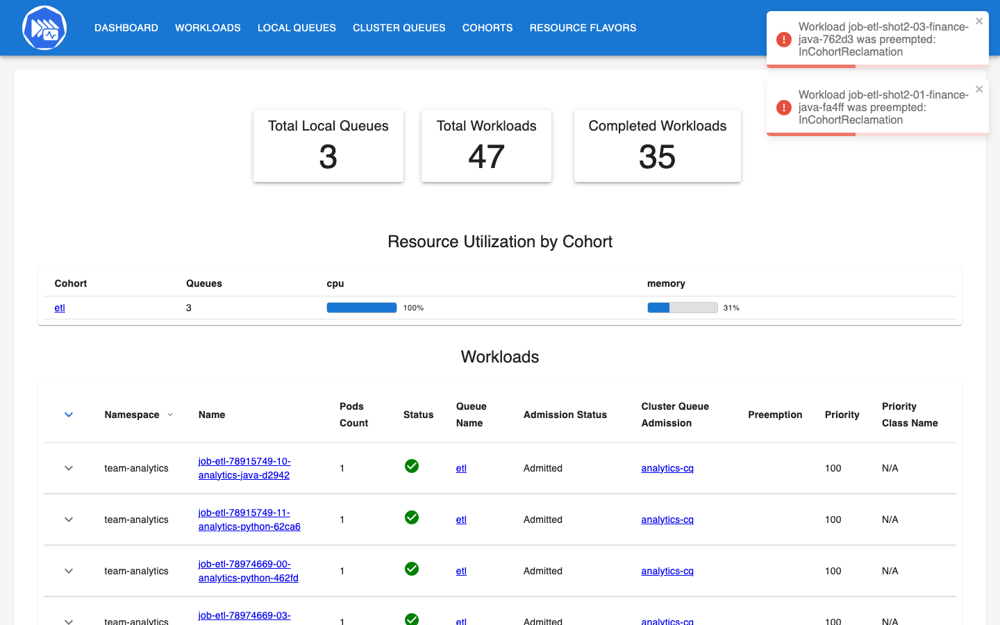
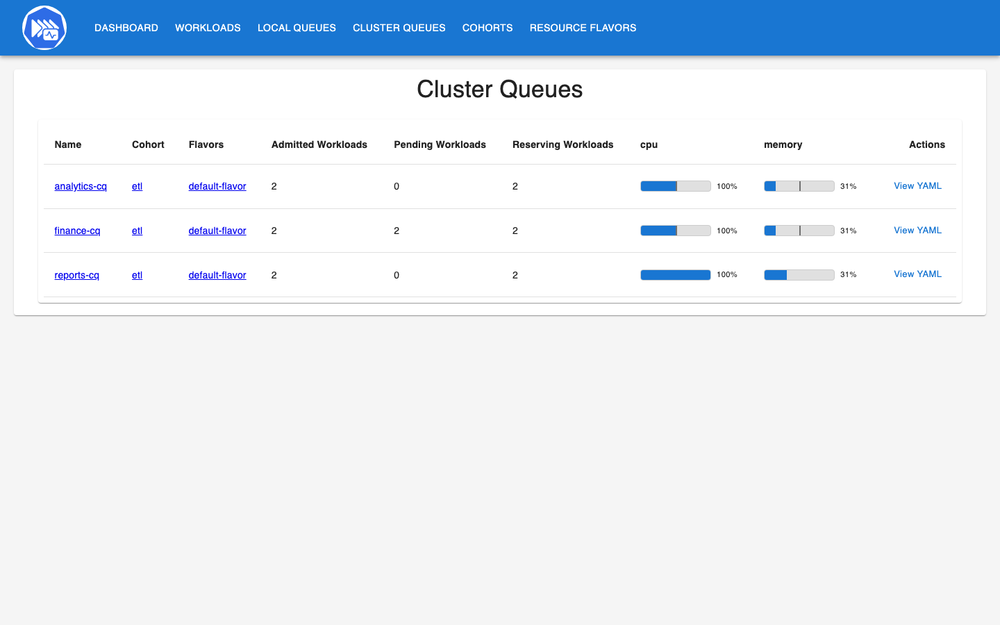
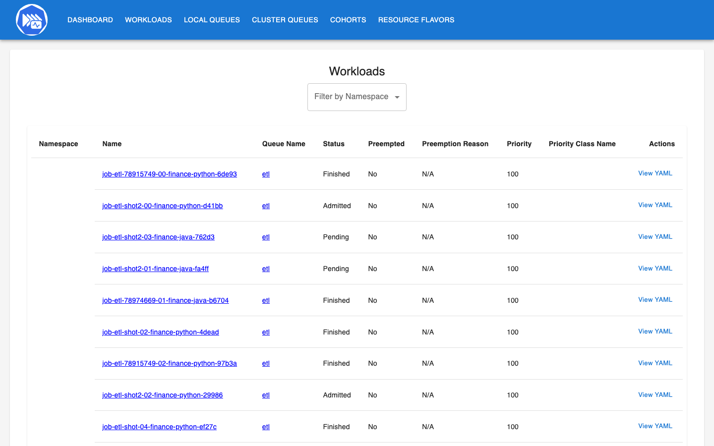

<p align="center"></p>

# kueue-batch-quotas

Kueue v0.20.5 on a local kind cluster, sharing batch capacity between three teams. Each team (`team-analytics`, `team-finance`, `team-reports`) has a namespace with a LocalQueue, and the three ClusterQueues are in one cohort with nominal quotas, borrowing limits, fair sharing and a single ResourceFlavor. The work is plain `batch/v1` Jobs that run a small CPU-bound ETL transform, written twice: a Python 3.15 worker and a Java 25 / Spring Boot 4.1 worker. Two WorkloadPriorityClasses let urgent Jobs preempt scheduled ones. End-to-end tests prove queueing, borrowing, preemption and exactly-once completion, and record the admission timeline.

## How it Works

1. `scripts/setup.sh` creates the kind cluster with `.run/results` on the host mounted as `/results` in the node, builds both worker images, loads them and the Kueue images into kind, installs Kueue `v0.20.5` from the release `manifests.yaml`, and replaces the manager config to turn on fair sharing.
2. `scripts/start-all.sh` applies `k8s/queues.yaml` (ResourceFlavor, 2 WorkloadPriorityClasses, 3 namespaces, 3 ClusterQueues, 3 LocalQueues), deploys KueueViz and port-forwards it.
3. A team submits a Job with `kueue.x-k8s.io/queue-name: etl` and `kueue.x-k8s.io/priority-class`. The Job is created suspended, Kueue turns it into a Workload and keeps it suspended until its ClusterQueue has quota. Waiting Jobs have no pods at all.
4. Admission unsuspends the Job. The pod writes `/results/<job>/<pod>.started`, generates 20000 sales rows from a seed (splitmix64), sums the amount per region and runs a chained SHA-256 (3000 rounds per row), then writes `/results/<job>/<pod>.json` with a write-then-rename.
5. When quota is needed by its owner (cohort reclaim) or by a higher-priority Workload (in-queue preemption), Kueue evicts the Workload: the Job is suspended again, its pod is deleted and the Workload goes back in the queue. It runs from scratch when admitted again.
6. The e2e tests submit Jobs, poll Jobs, Pods, Workloads and ClusterQueues every 0.5 s, record when each Job is submitted, admitted, evicted and finished, and check every result file against a digest computed locally with the same Python code.

## Architecture


## Features

* Queueing without Pending pods: a Job over quota stays a suspended Job, so the scheduler, autoscaler and node never see it until Kueue admits it.
* Nominal quota per team: each ClusterQueue owns 500m CPU (2 Jobs of 250m), which is what the team always gets back.
* Borrowing inside a cohort: `analytics-cq` and `finance-cq` can each borrow up to 500m of idle cohort quota, so idle capacity is used instead of wasted.
* Reclaim: `reclaimWithinCohort: Any` lets a team take its lent quota back at once by preempting the borrower, so lending never costs the owner.
* Fair sharing (`fairSharing.preemptionStrategies` in the manager config, weight 1 per queue): borrowers above their fair share are the ones preempted, and `status.fairSharing.weightedShare` shows who is over.
* Isolated queue: `reports-cq` never borrows or lends (`borrowingLimit: 0`, `lendingLimit: 0`) and uses `StrictFIFO`, so its order and capacity do not depend on the other teams.
* Priority preemption: `etl-high` (1000) preempts `etl-low` (100) inside a ClusterQueue (`withinClusterQueue: LowerPriority`); the low Job is requeued and runs again later.
* Exactly-once evidence: every attempt writes a `.started` marker, only a finished attempt writes a `.json`, so a preempted attempt is visible and a duplicate result would be too.
* Same transform in two languages: Python and Java produce byte-identical digests (shared golden values in both unit test suites), so a rerun on either worker gives the same answer.
* KueueViz: the Kueue dashboard shows queues, cohort usage, workloads and preemption events live.

## Stack

* Kubernetes v1.35.0 (`kindest/node`, kind v0.31 on podman): one node keeps the setup small next to other clusters.
* Kueue v0.20.5 (`registry.k8s.io/kueue/kueue:v0.20.5`, released 2026-11-05, latest stable), API `kueue.x-k8s.io/v1beta2`.
* KueueViz v0.20.5 (`kueueviz-backend`, `kueueviz-frontend`, release `kueueviz-single-host.yaml`): the Kueue UI.
* Python 3.15.2 (`python:3.15.2-slim`), uv 0.10.4, standard library only for the worker (`hashlib`, `json`).
* Java 25 (Amazon Corretto 25.0.4 for the build, `eclipse-temurin:25.0.4.1_1-jre-noble` at runtime), Spring Boot 4.1.2 non-web (`spring-boot-starter`, `ApplicationRunner`, `@ConfigurationProperties` record).
* pytest 9.2.0 and ty 0.0.99 for Python tests and type checks, JUnit via `spring-boot-starter-test` for Java.
* Playwright 1.64.0 (only to take the screenshots).

## Contracts

Job template (`k8s/etl-job.yaml`, rendered with Python `string.Template` by `e2e/kueue_e2e/jobs.py`):

| Field | Value |
|---|---|
| `metadata.labels.kueue.x-k8s.io/queue-name` | `etl` (the LocalQueue in each team namespace) |
| `metadata.labels.kueue.x-k8s.io/priority-class` | `etl-low` (100) or `etl-high` (1000) |
| `spec.suspend` | `true`, Kueue unsuspends on admission |
| `spec.backoffLimit` | `0`, so a real failure fails the Job instead of hiding behind a retry || resources | requests `cpu: 250m`, `memory: 320Mi`, limit `memory: 320Mi` |
| volume | hostPath `/results`, which is `.run/results` on the host |

Worker env (same names for Python and Java): `JOB_NAME`, `POD_NAME` (downward API), `TEAM`, `ETL_ROWS`, `ETL_SEED`, `ETL_ROUNDS`, `RESULTS_DIR`.

Result row, `/results/<job>/<pod>.json` (same keys and values from both workers):

```
{"job","team","worker","pod","rows","seed","rounds","digest",
 "totals":{"AMER","APAC","EMEA","LATAM"},"started_at_ms","finished_at_ms"}
```

Transform (unit tested against the same golden digest in Python and Java):

```
z      = splitmix64(seed + i)                      i = 0 .. rows-1
region = ["AMER","APAC","EMEA","LATAM"][z mod 4]
amount = (z >> 8) mod 100000                       cents
state  = sha256(state || "i,region,amount")        state starts as 32 zero bytes
state  = sha256(state), rounds-1 more times
digest = hex(state) after the last row, totals = sum(amount) per region
```

Queues (`k8s/queues.yaml`):

| ClusterQueue | cohort | cpu nominal | borrowing limit | lending limit | queueing | preemption |
|---|---|---|---|---|---|---|
| `analytics-cq` | `etl` | 500m | 500m | all | BestEffortFIFO | reclaimWithinCohort Any, withinClusterQueue LowerPriority |
| `finance-cq` | `etl` | 500m | 500m | all | BestEffortFIFO | reclaimWithinCohort Any, withinClusterQueue LowerPriority |
| `reports-cq` | `etl` | 500m | 0 | 0 | StrictFIFO | reclaimWithinCohort Never, withinClusterQueue LowerPriority |

Memory has 2Gi nominal per queue and is never the limit. Quota is in requests, so 500m is exactly 2 running Jobs per team.

## Design decisions

* Plain `batch/v1` Jobs, no JobSet or custom CRD: Kueue's built-in Job integration is the smallest thing that shows suspend, admit, evict and requeue.
* Fair sharing is turned on in the manager `Configuration` (`k8s/kueue-config.yaml`); in the `v1beta2` config the presence of `fairSharing` enables it. The rest of the config is the upstream default trimmed to the `batch/job` integration.
* `reports-cq` is isolated on purpose. A queue that can borrow would admit an urgent Job on borrowed quota instead of preempting, and a queue that lends would hand its slots to the other teams in the middle of the ordering test.
* Results go to a hostPath mount backed by the host folder, not a database. One file per attempt (`<pod>.json`) makes duplicates countable, the `.started` marker makes killed attempts countable, and the host test can read both without `kubectl exec`.
* The test reads admission and eviction from Workload conditions (`Admitted`, `Finished`, `Preempted` with its reason) and `status.schedulingStats.evictions`, and quota from ClusterQueue `status.flavorsReservation`. ClusterQueue status is updated a little after the Workload, so quota checks wait up to 30 s for the status to settle.
* Timeline times are host-side poll times (0.5 s resolution) relative to the start of each scenario, because Kubernetes condition timestamps only have 1 s resolution.
* The transform is deterministic per seed, so a Job that is preempted and run again must produce the exact same digest as a Job that ran once. Three seeds are used so the test computes the expected results only three times (in parallel processes).
* With `backoffLimit: 0` any failed pod fails its Job, and the e2e test fails at once when any Job ends without success instead of waiting for it. A preempted pod is not a failure: Kueue suspends the Job and the Job controller removes the pod without counting it.
* The Java worker runs without `-XX:TieredStopAtLevel=1`: with C1 only the SHA-256 intrinsics are not used and the same work took about 3 times longer.

## How to run

Requirements: podman, kind, kubectl, uv, Maven, curl, lsof, Java 25 at `~/.sdkman/candidates/java/25.0.4-amzn`.

```bash
./scripts/setup.sh
./scripts/start-all.sh
./scripts/test-all.sh
./scripts/ui.sh
./scripts/stop-all.sh
./scripts/teardown.sh
```

`test-all.sh` runs:

* `etl-python/tests`: golden digest shared with Java, same result on rerun, seed changes the data, rounds change only the CPU work, totals add up, splitmix64 reference value, config validation, one file per attempt, killed attempt leaves only a marker, atomic result write.
* `uv run ty check` for `etl-python` and `e2e`.
* `etl-java` JUnit on Java 25: the same transform and sink rules, plus Spring binding of the Job env to `EtlSettings`.
* `e2e/tests/test_kueue.py` against the kind cluster:
  * a: 5 Jobs for `team-reports` (quota 2): the first 2 run, the other 3 stay suspended Jobs with no pods (`WaitingForQuota`), and they are admitted in submit order, each only after a running Job finished; never more than 2 admitted.
  * b: 4 finance Jobs run at once on 2 own plus 2 borrowed slots (`borrowed: 500m`, `weightedShare > 0`); 2 analytics Jobs arrive, Kueue preempts exactly 2 finance Jobs with `InCohortReclamation`, borrowed goes back to 0, and the 2 finance Jobs are requeued, restarted and finish.
  * c: 2 low Jobs fill `reports-cq`; a high Job arrives, exactly one low Job is preempted with `InClusterQueue`, goes back to the queue suspended, is admitted again after the high Job and finishes.
  * d: a burst of 9 Jobs over all 3 teams, both workers, mixed priorities; then every Job of the session (23) is checked: `Complete`, `succeeded=1`, `failed=0`, exactly one result file, the correct digest and totals for its seed, and at most one `.started` per attempt that Kueue evicted.

## Results

Measured with `./scripts/test-all.sh` on a single node kind cluster (podman machine, 12 CPUs, 48 GB, macOS arm64 laptop, other kind clusters running at the same time). One run, all 4 scenarios passed in 137.6 s, 23 Jobs, 23 correct results, 0 duplicates, 0 failed pods. Copied from `.run/admission-report.md`, the full event list is in `.run/admission-timeline.json`.

Times are seconds since the scenario started, seen by the test polling every 0.5 s. `admitted` lists every admission (a second value means the Job was preempted and admitted again), `first wait` is first admission minus submit. A Python Job ran for about 16 s, a Java Job about 6 s (JVM and Spring Boot start included).

**a. Quota exhausted, Jobs wait suspended and are admitted in order** (`reports-cq`, 2 slots, StrictFIFO, one Job submitted every 1.3 s)

| job | worker | priority | submitted | admitted | first wait | evicted | finished |
|---|---|---|---|---|---|---|---|
| 00 | python | etl-low | 0.1 | 0.1 | 0.0 | - | 17.3 |
| 01 | python | etl-low | 1.3 | 1.3 | 0.0 | - | 18.0 |
| 02 | java | etl-low | 2.6 | 17.3 | 14.7 | - | 23.2 |
| 03 | java | etl-low | 3.9 | 18.0 | 14.1 | - | 24.6 |
| 04 | python | etl-low | 5.2 | 23.2 | 18.0 | - | 40.4 |

Jobs 02-04 stayed suspended with 0 pods (`WaitingForQuota`). Each one was admitted in the same 0.5 s poll as a running Job finished (02 at 17.3 when 00 finished, 03 at 18.0 when 01 finished, 04 at 23.2 when 02 finished). Never more than 2 admitted.

**b. Borrowing and giving it back** (finance borrows idle analytics quota, then analytics needs it)

| job | worker | submitted | admitted | first wait | evicted | finished |
|---|---|---|---|---|---|---|
| finance 00 | python | 0.0 | 0.2 | 0.1 | - | 16.5 |
| finance 01 | python | 0.1 | 0.2 / 8.7 | 0.1 | 1.6 | 24.4 |
| finance 02 | python | 0.1 | 0.2 / 17.8 | 0.0 | 2.2 | 33.7 |
| finance 03 | python | 0.2 | 0.2 | 0.0 | - | 16.5 |
| analytics 10 | java | 1.5 | 1.6 | 0.1 | - | 7.3 |
| analytics 11 | python | 1.6 | 2.2 | 0.7 | - | 18.5 |

All 4 finance Jobs were admitted within 0.2 s, 2 of them on borrowed quota (`finance-cq` borrowed 500m, `weightedShare` 500). The analytics Jobs got their quota back in 0.1 s and 0.7 s: Kueue preempted exactly the 2 borrowing finance Jobs with reason `InCohortReclamation`. They went back to the queue, were admitted again as soon as finance had room (8.7 s, 17.8 s; the first one on analytics quota that freed up at 7.3 s) and finished. At the end no quota was borrowed.

**c. Priority preemption** (`reports-cq` full with 2 `etl-low` Jobs, then one `etl-high` Job)

| job | worker | priority | submitted | admitted | first wait | evicted | finished |
|---|---|---|---|---|---|---|---|
| 00 | python | etl-low | 0.1 | 0.1 / 7.0 | 0.0 | 0.9 | 22.9 |
| 01 | python | etl-low | 0.1 | 0.1 | 0.0 | - | 17.0 |
| 05 | java | etl-high | 0.9 | 1.6 | 0.7 | - | 7.0 |

The high-priority Job waited 0.7 s instead of about 16 s. Job 00 was preempted (`InClusterQueue`) 0.8 s after it started, was readmitted when the high Job finished at 7.0 s, ran again from scratch and produced the same digest as an uninterrupted run.

**d. Burst over all teams** (9 Jobs at once, mixed workers and priorities)

| job | team | worker | priority | submitted | admitted | first wait | evicted | finished |
|---|---|---|---|---|---|---|---|---|
| 00 | analytics | python | etl-low | 0.1 | 0.4 | 0.4 | - | 16.8 |
| 01 | finance | java | etl-low | 0.1 | 0.4 / 8.0 | 0.3 | 1.1 | 14.1 |
| 02 | reports | python | etl-low | 0.1 | 0.4 | 0.3 | - | 18.1 |
| 03 | analytics | java | etl-high | 0.2 | 0.4 | 0.2 | - | 6.6 |
| 04 | finance | python | etl-low | 0.2 | 0.4 | 0.2 | - | 18.1 |
| 05 | reports | java | etl-low | 0.3 | 0.4 | 0.1 | - | 6.6 |
| 06 | analytics | python | etl-low | 0.3 | 8.0 | 7.6 | - | 24.1 |
| 07 | finance | java | etl-high | 0.4 | 1.1 | 0.7 | - | 8.0 |
| 08 | reports | python | etl-low | 0.4 | 6.6 | 6.2 | - | 22.8 |

Each team got its 2 slots; nothing was idle, so nothing could be borrowed. The `etl-high` finance Job 07 arrived after both finance slots were taken and preempted the low finance Job 01, which reran and finished. Then every Job of the session (23) was checked: `succeeded=1`, `failed=0`, one result file, correct digest and totals.

Admission wait summary over the 23 Jobs: Jobs that found free quota waited 0.0-0.7 s (one or two polls). Jobs that waited for quota waited until a running Job finished (6.2-18.0 s here). A `etl-high` Job never waited more than 0.7 s, because it preempted instead of waiting. Reclaim of lent quota took 0.1-0.7 s.

What this does not show: one node, 250m Jobs and tens of Jobs. It says nothing about Kueue throughput with thousands of Workloads, about multi-flavor or topology-aware placement, or about real cluster autoscaling.

## Printscreens

KueueViz at `http://localhost:27650`, taken while 12 Jobs from the three teams were queued and running.



The dashboard: 3 LocalQueues, cohort `etl` at 100% CPU, and the live preemption events (`InCohortReclamation`) Kueue raised when analytics took its quota back from finance.



The three ClusterQueues in cohort `etl`: each at 100% of its CPU quota with 2 admitted Workloads, and `finance-cq` with 2 pending Workloads that were preempted and requeued.



The Workloads of `team-finance`: finished ones from the tests, admitted ones running, and the two reclaimed ones back in `Pending`.

## Scripts

All scripts live in `scripts/` and run from any directory of the repository.

| Script | What it does |
|---|---|
| `./scripts/setup.sh` | Creates the kind cluster with the results mount, builds the jar and both worker images, loads them and the Kueue images into kind, installs Kueue v0.20.5 with fair sharing on |
| `./scripts/start-all.sh` | Applies the flavor, priority classes, team namespaces and queues, deploys KueueViz, port-forwards it and prints the URLs |
| `./scripts/status.sh` | Shows the cluster, Kueue, KueueViz, every ClusterQueue with its pending and admitted count, and every port as UP or DOWN |
| `./scripts/test-all.sh` | Runs Python and Java unit tests, ty, and the end-to-end Kueue tests on kind, then prints the admission report |
| `./scripts/ui.sh` | Opens KueueViz in the browser |
| `./scripts/stop-all.sh` | Stops the port-forwards and deletes the ETL Jobs, the queues, the team namespaces and KueueViz (Kueue stays installed) |
| `./scripts/teardown.sh` | Runs stop-all, deletes the kind cluster and removes the worker and Kueue images |

Ports are declared in `scripts/ports.env`: `kueueviz=27650` (`http://localhost:27650`), `kueueviz-backend=27651` (`ws://localhost:27651`, the websocket the KueueViz frontend connects to).

```bash
./scripts/setup.sh
./scripts/start-all.sh
./scripts/status.sh
./scripts/ui.sh
./scripts/stop-all.sh
```
