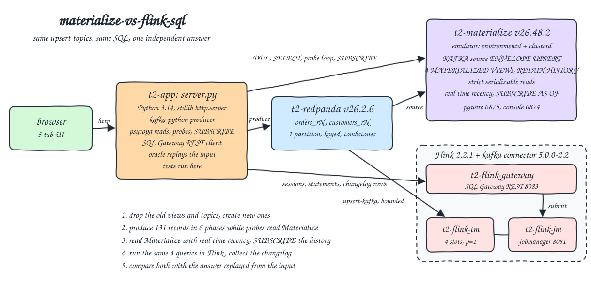
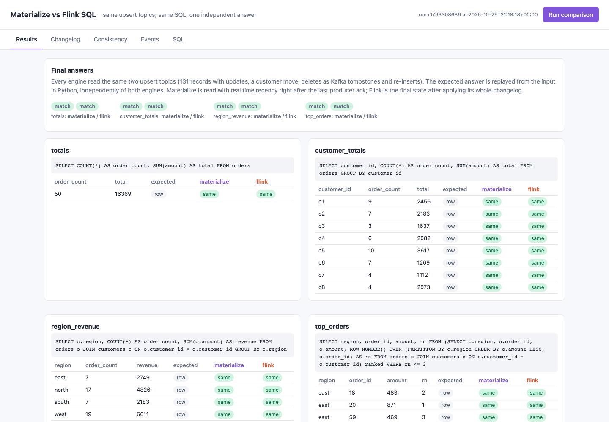
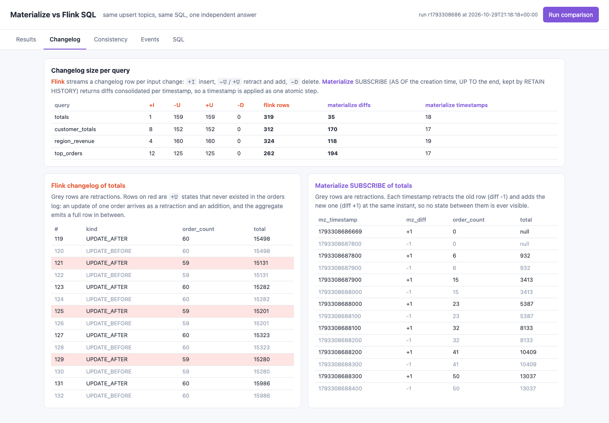
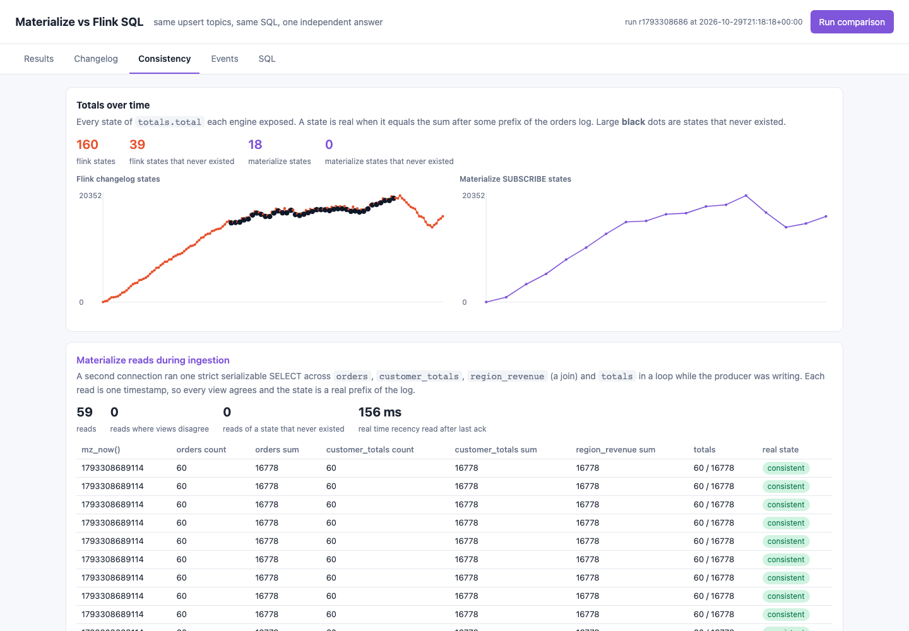
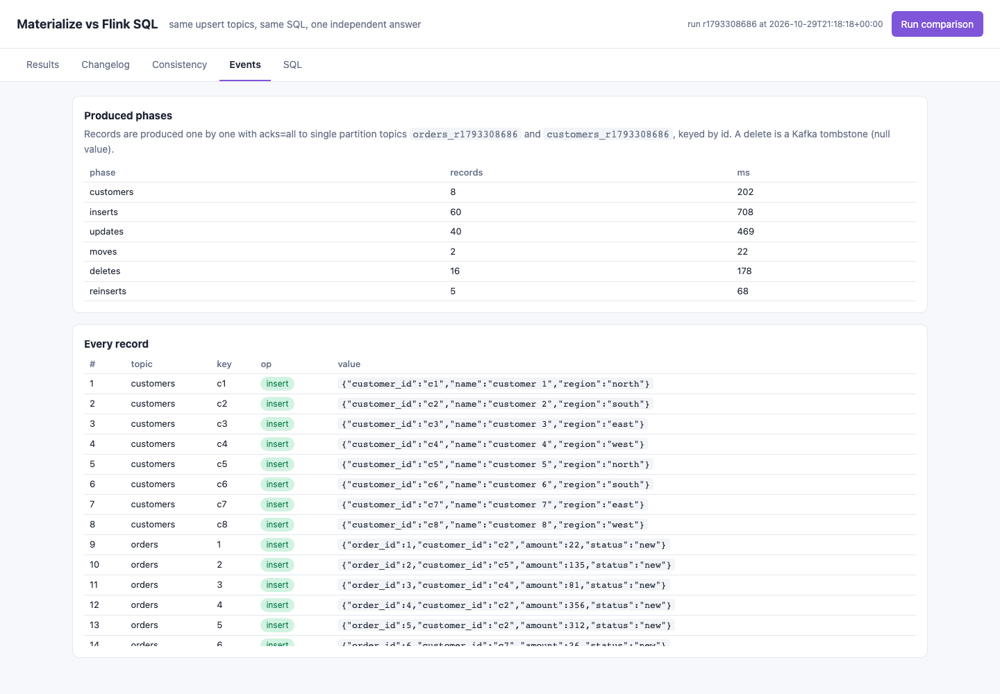
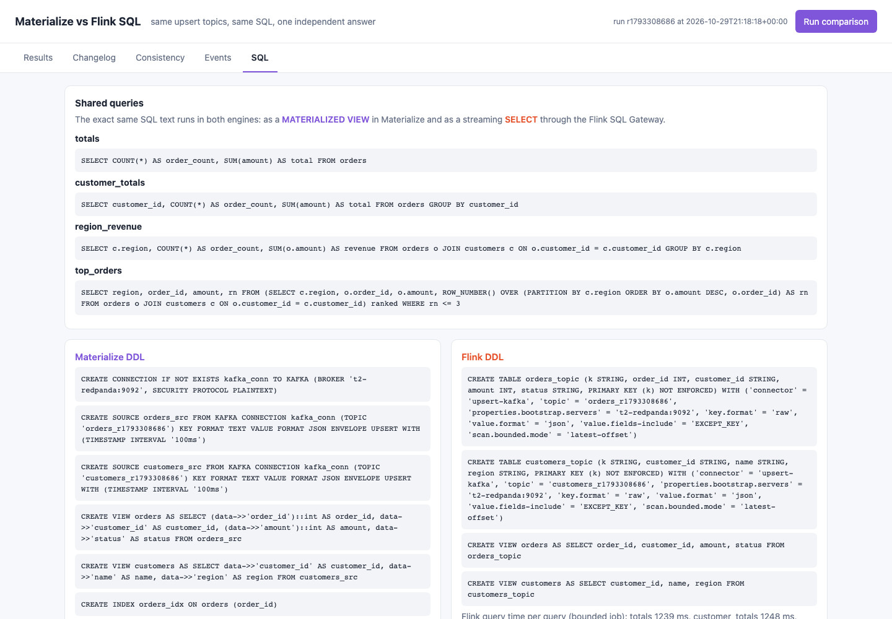

<p align="center">&nbsp;&nbsp;&nbsp;&nbsp;</p>

# materialize-vs-flink-sql

Materialize and Flink SQL side by side on the same Kafka compatible topics. A Python app produces seeded orders and customers to Redpanda with inserts, updates, a customer region move, deletes as Kafka tombstones and re-inserts (upsert / CDC style). The same four SQL queries (a global aggregate, an aggregate per key, a join and a top-N) run as materialized views in Materialize (v26.48.2, the self-managed emulator image) and as streaming queries in Flink 2.2.1 (one jobmanager, one taskmanager and the SQL Gateway). Both final answers are compared with an answer replayed from the input, and the run shows how the two engines expose change: Materialize gives strict serializable reads where every view agrees at one timestamp and every state is a real prefix of the log, Flink streams a `+I / -U / +U / -D` changelog that reaches the same final answer but exposes intermediate rows that never existed in the input.

## How it Works

1. `POST /api/run` drops the Materialize sources of the previous run, deletes the old topics and creates `orders_r<epoch>` and `customers_r<epoch>` (1 partition each).
2. Materialize gets a Kafka connection, two `ENVELOPE UPSERT` sources (`KEY FORMAT TEXT VALUE FORMAT JSON`), the `orders` and `customers` views over the JSON, two indexes and one `MATERIALIZED VIEW ... WITH (RETAIN HISTORY FOR '10m')` per query. `mz_now()` is recorded as the start of history.
3. The producer (kafka-python, `acks=all`, one record at a time) writes 131 records from `app/data.py` in 6 phases: customers, inserts, updates, moves, deletes, reinserts. A tombstone is a null value.
4. While it writes, a probe thread runs one SELECT in a loop that reads `orders`, `customer_totals`, `region_revenue` (a join) and `totals` at the same timestamp.
5. Right after the last ack the app reads all four views in one read-only transaction with `real_time_recency = true`, then runs `SUBSCRIBE ... AS OF <start> UP TO <now>` per view to get the full consolidated history of diffs.
6. Flink gets a new SQL Gateway session, two `upsert-kafka` tables with `scan.bounded.mode = latest-offset` and the same `orders` / `customers` views, and runs the same four SELECT statements. Each one is a bounded streaming job, so the gateway returns the whole changelog with its row kinds and then ends.
7. `app/oracle.py` replays the input for the UI badges, and `tests/test_engines.py` recomputes everything on its own, from the same input, to verify the run.

## Architecture



## Features

* The same SQL text in both engines (`app/queries.py`): a global aggregate, an aggregate per customer, a join with a `GROUP BY` and a top-3 per region with `ROW_NUMBER() OVER (PARTITION BY ...)`.
* Upsert input on both sides: Materialize `ENVELOPE UPSERT` and Flink `upsert-kafka` both turn a new value for a key into a retraction plus an addition, and a tombstone into a delete.
* An unknown key tombstone (`999`) is ignored by both engines, nothing is retracted that never existed.
* A customer moving region retracts every joined order from the old region and adds it to the new one in both engines.
* Materialize strict serializable reads during ingestion: 67 probe reads, 0 where the views disagree, 0 that returned a state that is not a prefix of the orders log.
* Materialize real time recency: the read issued right after the last producer ack waits for the source to reach the upstream offsets (about 180 ms) and is already complete. No polling.
* Materialize SUBSCRIBE AS OF / UP TO: the history kept by `RETAIN HISTORY` replays into exactly the final answer, with diffs consolidated per timestamp (35 diff rows for `totals`).
* Flink changelog: 319 rows for `totals` (`+I` 1, `-U` 159, `+U` 159), 39 of the 160 `+U` states never existed in the input. The final state after applying the changelog is correct.
* Independent tests: expected answers are computed from `app/data.py` in the test file. Breaking the delete handling in the test oracle makes 5 of 10 tests fail.
* Lean: 1 Redpanda core, Flink with `parallelism 1`, every container has a `mem_limit`. Real use after a run is about 2.5 GB (Materialize 1.3 GB, Flink 1.1 GB for 3 JVMs, Redpanda 70 MB, app 45 MB).

## Stack

* Materialize v26.48.2 (`docker.io/materialize/materialized:v26.48.2`): latest self-managed emulator release, one container with environmentd, a cluster replica and the console.
* Apache Flink 2.2.1 (`docker.io/library/flink:2.2.1-java21`): the newest Flink with a matching Kafka SQL connector; jobmanager, taskmanager and SQL Gateway from one image.
* flink-sql-connector-kafka 5.0.0-2.2: the `upsert-kafka` connector, baked into `t2-flink:2.2.1-kafka-5.0.0` by `flink/Containerfile`.
* Redpanda v26.2.6 (`docker.io/redpandadata/redpanda:v26.2.6`): Kafka API compatible broker in one small container, no ZooKeeper or KRaft quorum to run.
* Python 3.14.10 (`docker.io/library/python:3.14.10-slim`) with stdlib `http.server`, `urllib`, `unittest` and plain HTML, CSS and JS for the UI.
* kafka-python 3.0.12: producer and admin client, needed to write real tombstones (null values).
* psycopg 3.3.6: pgwire client for Materialize, needed for `SUBSCRIBE` and session variables.
* podman + podman-compose: 6 containers on the network `t2-net`, no volumes.

## Contracts / APIs

| Method | Path / endpoint | Description |
|---|---|---|
| GET | `http://localhost:31100/` | UI with the Results, Changelog, Consistency, Events and SQL tabs |
| POST | `http://localhost:31100/api/run` | Runs a full comparison (new topics, views, ingestion with probes, Materialize reads and SUBSCRIBE, Flink queries) and returns the result |
| GET | `http://localhost:31100/api/result` | Last result, `{}` when nothing ran |
| pgwire | `postgresql://materialize@localhost:31101/materialize` | Materialize SQL |
| HTTP | `http://localhost:31102/api/sql` | Materialize HTTP SQL API |
| HTTP | `http://localhost:31103` | Materialize console |
| Kafka | `localhost:31104` | Redpanda Kafka API (external listener) |
| HTTP | `http://localhost:31105` | Flink web UI (jobs and their plans) |
| HTTP | `http://localhost:31106/v1/...` | Flink SQL Gateway REST |

```json
{"run_id": "r1793308686", "topics": {"orders": "orders_r1793308686", "customers": "customers_r1793308686"},
 "phases": [{"name": "customers", "events": 8, "ms": 202}, {"name": "inserts", "events": 60, "ms": 708}, "..."],
 "expected": {"totals": [[50, 16369]], "customer_totals": [["c1", 9, 2456], "..."], "region_revenue": [["east", 7, 2749], "..."], "top_orders": [["east", 18, 483, 2], "..."]},
 "materialize": {"final": {"timestamp": 1793308690100, "ms": 179, "results": {"totals": [[50, 16369]], "...": "..."}},
                 "offsets": {"orders_r1793308686": {"produced": 121, "ingested": 121}, "customers_r1793308686": {"produced": 10, "ingested": 10}},
                 "probes": [[1793308687800, 6, 932, 6, 932, 932, 6, 932], "..."],
                 "changelog": {"totals": [[1793308686669, 1, 0, null], [1793308687800, -1, 0, null], [1793308687800, 1, 6, 932], "..."]}},
 "flink": {"results": {"totals": [[50, 16369]], "...": "..."}, "kinds": {"totals": {"INSERT": 1, "UPDATE_BEFORE": 159, "UPDATE_AFTER": 159}},
           "changelog": {"totals": [["INSERT", 1, 22], ["UPDATE_BEFORE", 1, 22], ["UPDATE_AFTER", 2, 157], "..."]}},
 "checks": {"probe_invariant_breaks": 0, "probe_phantoms": 0, "mz_states": 18, "mz_phantoms": 0, "flink_states": 160, "flink_phantoms": 39}}
```

A probe row is `[mz_now, orders count, orders sum, customer_totals count, customer_totals sum, region_revenue sum, totals.order_count, totals.total]`. A Materialize changelog row is `[mz_timestamp, mz_diff, ...columns]`, a Flink changelog row is `[row kind, ...columns]`.

## Key data structures and design decisions

* Input: `app/data.py` builds the records from `random.Random(42)`: 8 customers in 4 regions, 60 orders, 40 updates (new amount, status, sometimes a new customer), 2 region moves, 15 deletes plus a tombstone for the unknown key `999`, then 5 deleted orders inserted again.
* Topic key is the id as text, value is JSON. Materialize reads it as `key text, data jsonb` and the `orders` / `customers` views cast the JSON fields. Flink reads the key as `raw` into a `k` primary key column with `value.fields-include = EXCEPT_KEY`. The four queries see the same `orders(order_id, customer_id, amount, status)` and `customers(customer_id, name, region)` in both engines.
* A state "never existed" when its `(count, sum)` is not the result of any prefix of the orders log. Flink processes `-U` and `+U` of an updated order as two records, so the global aggregate emits a full `+U` row without the updated order (such as `59, 15131` between two `60` rows). These states are only counted after a `+U`, never after a `-U`, so treating a `-U / +U` pair as one step does not hide them. Materialize applies all the diffs of a timestamp at once, so a reader never sees the gap.
* Materialize timestamps per source are every 100 ms (`TIMESTAMP INTERVAL '100ms'`), which gives 17 to 19 distinct timestamps in the history. The emulator default minimum is 1 s, so `start-all.sh` sets `min_timestamp_interval = '100ms'` as `mz_system`.
* `RETAIN HISTORY` and `real_time_recency` are behind feature flags in the emulator (`RETAIN HISTORY is not available ... private preview`), so `start-all.sh` turns on `enable_logical_compaction_window` and `allow_real_time_recency` with `ALTER SYSTEM` on the internal port 6877. The app never needs `mz_system`.
* The first plan used the Redpanda HTTP proxy to produce (no Kafka library). It writes an empty value, not a null, for a missing value, and Materialize then fails with `Failed to decode JSON: EOF while parsing a value`. A tombstone must be a real null, so the app uses kafka-python.
* The first plan used the Materialize HTTP SQL API (no driver). It refuses `SUBSCRIBE` and `DECLARE ... CURSOR FOR SUBSCRIBE` (`unsupported via this API`), so the app uses psycopg on pgwire.
* Flink reads the topics after ingestion with `scan.bounded.mode = latest-offset`. That makes each query a finite job whose full changelog can be collected and compared, at the cost of not racing ingestion. Flink 2.3.0 is out, but there is no `flink-sql-connector-kafka` build for 2.3 yet (latest is 5.0.0-2.2), so Flink is pinned to 2.2.1.
* The number of Flink changelog rows for the join queries changes between runs (`region_revenue` had 78 and 160 `-U` rows in two runs) because the order in which the two source topics are read is not fixed. The final answer is the same every time. Mini-batch is off, the Flink default, so every record produces its own output.
* A transaction that starts with `SELECT mz_now()` is routed to the `mz_catalog_server` cluster and can not read user views, so `mz_now()` is read last inside the final read transaction.
* Memory: the first run had Materialize at `mem_limit: 1g` and it was OOM killed 6 times without any error reaching the app except a closed connection. It runs at `1536m` now with about 1.3 GB in use. Flink jobmanager `640m` process size, taskmanager `800m` with 4 slots, gateway `-Xmx256m`. The limits add up to about 4.1 GB, real use is about 2.5 GB, over the 2 GB target because Materialize alone needs more than 1 GB.
* No volumes: `stop-all.sh` removes every container, every run creates new topics, so results never depend on an earlier run. Every container and the network start with `t2-`.

## How to run

Requirements: podman, podman-compose, curl and lsof. Everything else runs in containers.

```bash
./scripts/setup.sh
./scripts/start-all.sh
./scripts/test-all.sh
./scripts/ui.sh
./scripts/stop-all.sh
```

`tests/test_engines.py` (10 tests, inside `t2-app`, after a fresh `POST /api/run`) checks:

* The input really has updates of live keys, at least 10 tombstones, a tombstone for a key that never existed, and that ignoring deletes or ignoring the customer moves would give a different answer, so a missed retraction can not pass.
* Every produced record was ingested by both Materialize sources (progress offsets equal produced counts).
* The Materialize real time recency read taken right after the last ack equals the independent answer for all four queries.
* A new strict serializable read of the four views from the test still equals the answer.
* Flink's final state, and its changelog replayed from the start, equal the answer for all four queries.
* Every Materialize probe read during ingestion has the same count and sum in `orders`, `customer_totals`, `region_revenue` and `totals`, and that `(count, sum)` is a real prefix of the orders log; the probes saw more than 3 distinct states.
* The Materialize SUBSCRIBE history replays to the answer for all four queries and every `totals` state in it is a real prefix of the log.
* Flink retracts rows in every query and emits at least one `totals` state that never existed, and no more than the number of updates of live keys.
* Flink emits more changelog rows than input records, Materialize fewer diffs than Flink.

```
running a fresh comparison: new topics, materialize views, ingestion with probes, flink queries
test_every_event_was_produced_and_ingested_by_materialize ... ok
test_every_materialize_read_during_ingestion_was_a_consistent_snapshot ... ok
test_flink_changelog_has_retractions_and_intermediate_totals_that_never_existed ... ok
test_flink_final_state_after_applying_its_changelog_is_correct ... ok
test_input_has_updates_deletes_moves_and_a_tombstone_for_an_unknown_key ... ok
test_materialize_consolidates_its_changelog_and_flink_does_not ... ok
test_materialize_real_time_recency_read_after_the_last_ack_is_complete ... ok
test_materialize_subscribe_changelog_replays_to_the_answer_with_only_real_states ... ok
test_materialize_views_still_answer_correctly_on_a_new_strict_serializable_read ... ok
test_ui_page_has_every_tab ... ok

----------------------------------------------------------------------
Ran 10 tests in 0.067s

OK
all tests passed
```

## Printscreens

Results tab: the four queries with their SQL, every expected row and whether Materialize and Flink have it. All four match in both engines.



Changelog tab: changelog size per query (Flink `+I / -U / +U / -D` against Materialize diffs and timestamps), then the Flink changelog of `totals` scrolled to the update phase, where every other `+U` (on red) is a total without the order being updated, next to the Materialize SUBSCRIBE of `totals` where each timestamp retracts and adds at the same instant.



Consistency tab: every state of `totals.total` each engine exposed. The large black dots on the Flink line are the 39 states that never existed; the Materialize line has none. Below, the probe reads taken during ingestion: all of them consistent across the four views, and the real time recency read time after the last ack.



Events tab: the 6 produced phases with record counts and produce time, and every record with its topic, key, operation (insert, update, delete) and value.



SQL tab: the shared query text, the Materialize DDL (connection, upsert sources, views, indexes, materialized views) and the Flink DDL (upsert-kafka tables and views) with the Flink time per bounded query.



## Scripts

All scripts live in `scripts/` and run from any directory of the repository.

| Script | What it does |
|---|---|
| `./scripts/setup.sh` | Pulls the Materialize, Redpanda, Flink and Python images and builds the Flink and app images |
| `./scripts/start-all.sh` | Starts Redpanda, Materialize and Flink, waits until each is ready, sets the Materialize system parameters, starts the app, runs one comparison when there is none, prints every link |
| `./scripts/status.sh` | Shows every service port as UP or DOWN |
| `./scripts/test-all.sh` | Runs a fresh comparison and the tests |
| `./scripts/ui.sh` | Opens the UI in the browser |
| `./scripts/sql-console.sh` | Opens psql on Materialize |
| `./scripts/stop-all.sh` | Stops every container and waits until the ports are free |

Ports are declared in `scripts/ports.env`: UI 31100 (`http://localhost:31100`), Materialize SQL 31101 (`postgresql://materialize@localhost:31101/materialize`), Materialize HTTP 31102, Materialize console 31103, Kafka 31104, Flink UI 31105, Flink SQL Gateway 31106.

```bash
./scripts/setup.sh
./scripts/start-all.sh
./scripts/status.sh
./scripts/ui.sh
./scripts/stop-all.sh
```
