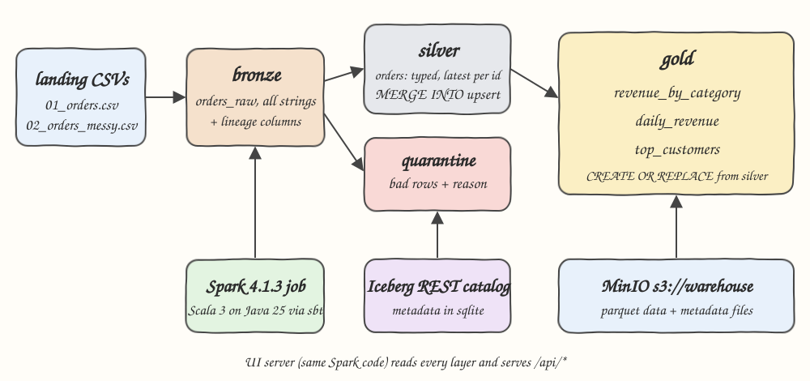
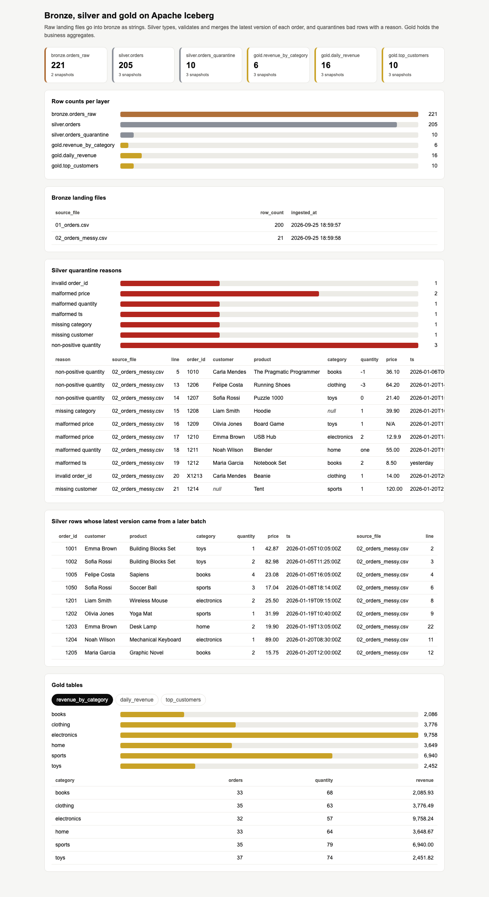
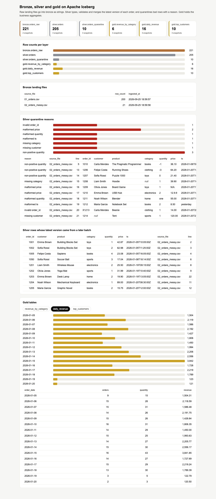
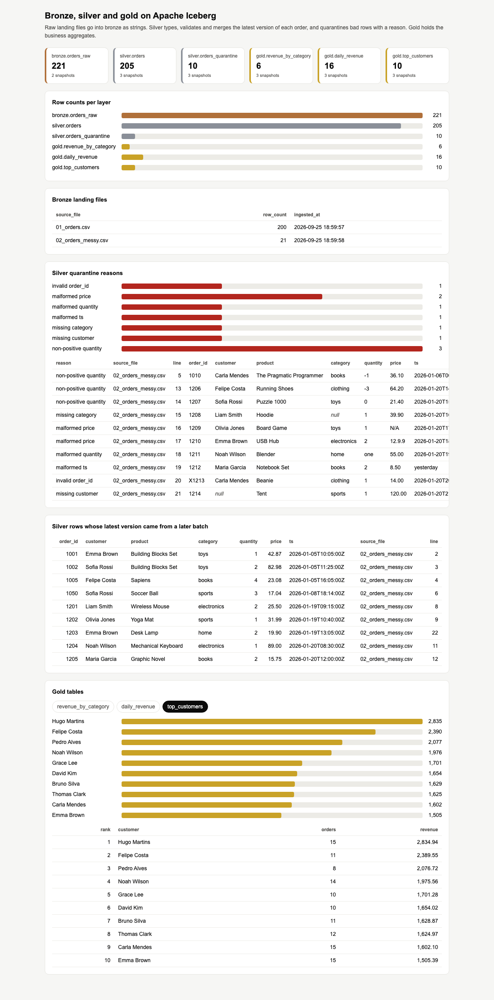

# medallion-bronze-silver-gold

A bronze, silver and gold medallion lakehouse on Apache Iceberg, built with Spark 4.1.3 and Scala 3 on Java 25. Raw order files land in bronze as strings, silver types, validates, deduplicates and upserts them with `MERGE INTO` while bad rows go to a quarantine table with a reason, and gold holds the business aggregates. The pipeline is idempotent and a small UI shows every layer.

## How it Works

1. `data/landing/` holds `01_orders.csv` (200 clean orders) and `02_orders_messy.csv` (21 messy rows).
2. Bronze appends every landing file not ingested yet into `bronze.orders_raw`, all columns as strings, plus `_source_file`, `_line` and `_ingested_at`. Files already in bronze are skipped.
3. Silver trims every field and checks each bronze row against the rules below. The first rule that fails becomes the `reason` and the row goes to `silver.orders_quarantine` through a `MERGE INTO` keyed on `(_source_file, _line)`.
4. Valid rows are typed (`INT`, `DECIMAL(10,2)`, `TIMESTAMP`), the category is lowercased, and the latest version of each `order_id` wins (latest `_ingested_at`, then `_source_file`, then `_line`).
5. `MERGE INTO silver.orders` inserts new orders and updates an existing order only when the incoming version is newer.
6. Gold rebuilds `revenue_by_category`, `daily_revenue` and `top_customers` from silver with `CREATE OR REPLACE TABLE ... AS SELECT`.
7. Re-running changes nothing: bronze skips known files, both merges match existing rows, and gold is recomputed from an unchanged silver.

Validation rules, in order:

| Rule | Reason |
|---|---|
| `order_id` is not all digits | `invalid order_id` |
| `customer` empty | `missing customer` |
| `category` empty | `missing category` |
| `quantity` is not an integer | `malformed quantity` |
| `quantity <= 0` | `non-positive quantity` |
| `price` is not `digits[.d[d]]` | `malformed price` |
| `price <= 0` | `non-positive price` |
| `ts` is not `yyyy-MM-ddTHH:mm:ssZ` | `malformed ts` |

An invalid late update never overwrites a valid order: order 1010 arrives again with quantity `-1`, it is quarantined and silver keeps the original.

## Architecture



## Features

* Bronze keeps raw strings and lineage columns, so any silver rule can be replayed from the original input.
* File level idempotent ingestion, a landing file is appended to bronze only once.
* Quarantine table with a reason per row, bad data is kept and explained instead of dropped.
* Latest wins deduplication handles exact duplicates, duplicates within a batch and late arriving updates.
* `MERGE INTO` upserts, silver only changes when a newer version of an order arrives.
* Gold tables are fully derived from silver, so a rebuild always matches the incremental result.
* `LakeJob reset` drops every table and rebuilds all layers from the landing files.
* UI with row counts per layer, landing files, quarantine reasons and rows, late updates and the three gold tables.
* Independent python check applies the same rules to the CSV files and must match the lake.

## Stack

* Apache Spark 4.1.3: newest Spark line that Iceberg 1.11.0 ships a runtime for.
* Apache Iceberg 1.11.0 (`iceberg-spark-runtime-4.1_2.13`): table format with `MERGE INTO`, snapshots and atomic replaces.
* Hadoop client 3.5.0: 3.4.x crashes on Java 25 (`getSubject is not supported`).
* Scala 3.7.4 with sbt 2.0.9: Scala 3 build using the `_2.13` Spark artifacts.
* Java 25: runtime for the job and the UI server.
* Iceberg REST catalog (`apache/iceberg-rest-fixture:1.10.1`): catalog service, works with 1.11 clients.
* MinIO (`pgsty/minio`): S3 compatible warehouse bucket.
* Python 3.14.7 standard library only: independent verification script.
* JDK `HttpServer` plus a single `index.html`: UI with no web framework.

## Contracts/APIs

UI server on port 25080, JSON responses.

| Method | Path | Returns |
|---|---|---|
| GET | `/api/layers` | per table: `layer`, `table_name`, `row_count`, `snapshots`, `current_snapshot` (string) |
| GET | `/api/bronze` | per landing file: `source_file`, `row_count`, `ingested_at` |
| GET | `/api/quarantine` | `{reasons:[{reason,row_count}], rows:[{reason,source_file,line,order_id,...}]}` |
| GET | `/api/silver/late` | silver rows whose latest version came from a later batch |
| GET | `/api/gold?table=revenue_by_category\|daily_revenue\|top_customers` | `{table, rows:[...]}` |

## Key data structures and design decisions

* `bronze.orders_raw`: every column `STRING` plus `_source_file STRING, _line INT, _ingested_at TIMESTAMP`.
* `silver.orders`: typed order partitioned by `category`, keeps the lineage columns of the version it holds.
* `silver.orders_quarantine`: raw strings plus `reason` and lineage, unique on `(_source_file, _line)`.
* `gold.revenue_by_category`, `gold.daily_revenue`: `orders`, `quantity`, `revenue DECIMAL(14,2)`.
* `gold.top_customers`: top 10 by revenue, ties broken by customer name.
* Validation runs before deduplication, so a bad late row is quarantined instead of hiding a valid order.
* The silver merge sources are inline subqueries: Spark 4.1.3 fails planning (`No plan for TableReference`) when a DataFrame temp view over an Iceberg table is used as a `MERGE INTO` source.
* Spark runs locally through sbt, no custom image is built, only stock MinIO and REST catalog containers run.

## How to run

```bash
./scripts/setup.sh
./scripts/start-all.sh
./scripts/test-all.sh
./scripts/ui.sh
./scripts/stop-all.sh
```

`test-all.sh` does three things against the running stack:

1. Re-runs the pipeline and checks that no file is ingested again and every layer and gold row is unchanged.
2. Runs `LakeJob reset` to rebuild every layer from scratch and checks the result equals the incremental run.
3. Runs `check/medallion_check.py` over the landing CSVs and checks it matches the lake.

```
PASS re-run skipped already ingested files
PASS re-run leaves bronze, silver, quarantine and gold unchanged
PASS full rebuild gives the same layers as the incremental runs
PASS lake matches independent python cleaning rules
```

Expected values: bronze 221 rows, silver 205, quarantine 10, revenue by category books 2085.93, clothing 3776.49, electronics 9758.24, home 3648.67, sports 6940.00, toys 2451.82.

## Printscreens

Layer counts, landing files, quarantine and the `revenue_by_category` gold table. The tiles and bars show 221 bronze rows, 205 silver orders and 10 quarantined rows, each quarantined row with its reason, source file and line. The late batch table shows that 1005 was updated to quantity 4, 1050 was cleaned (trimmed customer, `Sports` lowercased) and 1203 took its last version from line 22.



Same page with the `daily_revenue` tab, revenue per day, including the two new days from the messy batch.



Same page with the `top_customers` tab, top 10 customers by revenue.



## Scripts

All scripts live in `scripts/` and run from any directory of the repository.

| Script | What it does |
|---|---|
| `./scripts/setup.sh` | Pulls the images, installs Java 25 through sdkman when missing and compiles the job |
| `./scripts/start-all.sh` | Starts MinIO and the REST catalog, runs the pipeline, starts the UI and prints the full link of each service |
| `./scripts/status.sh` | Shows every service port as UP or DOWN |
| `./scripts/test-all.sh` | Checks idempotency, full rebuild and the independent python computation |
| `./scripts/ui.sh` | Opens the UI in the browser |
| `./scripts/stop-all.sh` | Stops every service |

Ports are declared in `scripts/ports.env`: MinIO 25000, MinIO console 25001, REST catalog 25002, UI 25080.

```bash
./scripts/setup.sh
./scripts/start-all.sh
./scripts/status.sh
./scripts/ui.sh
./scripts/stop-all.sh
```
