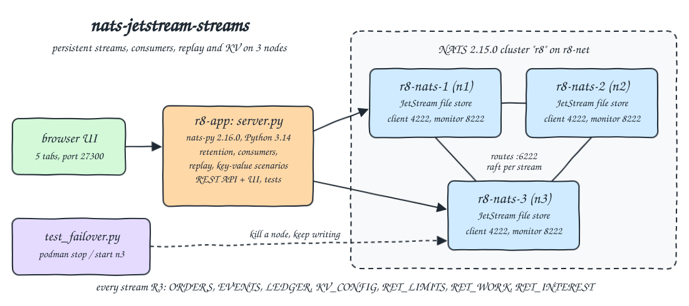
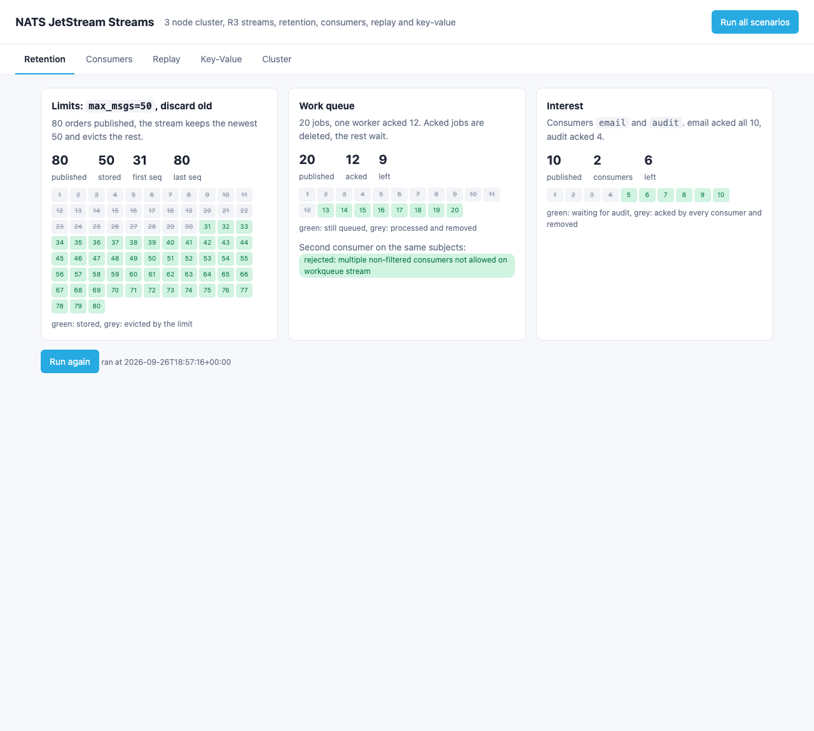
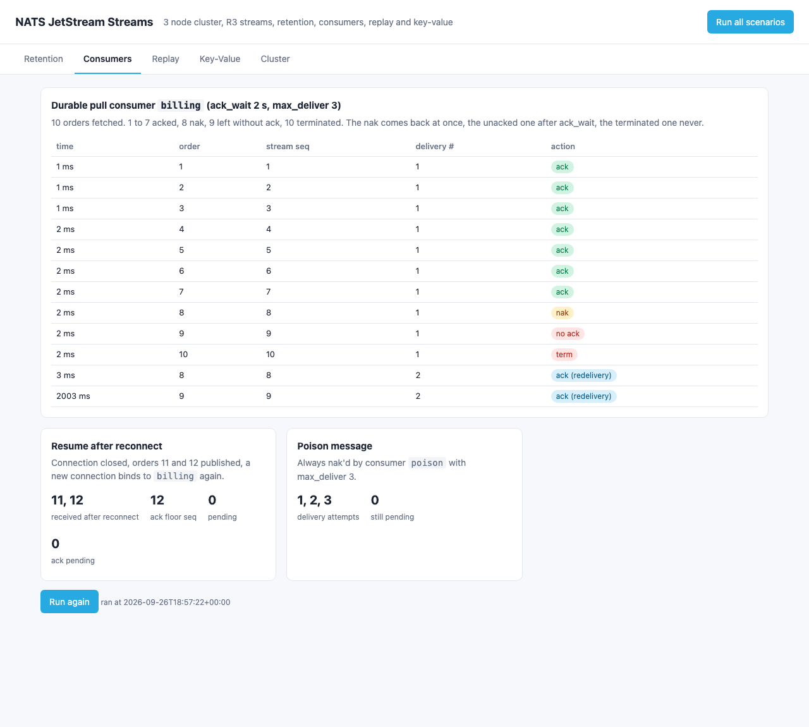
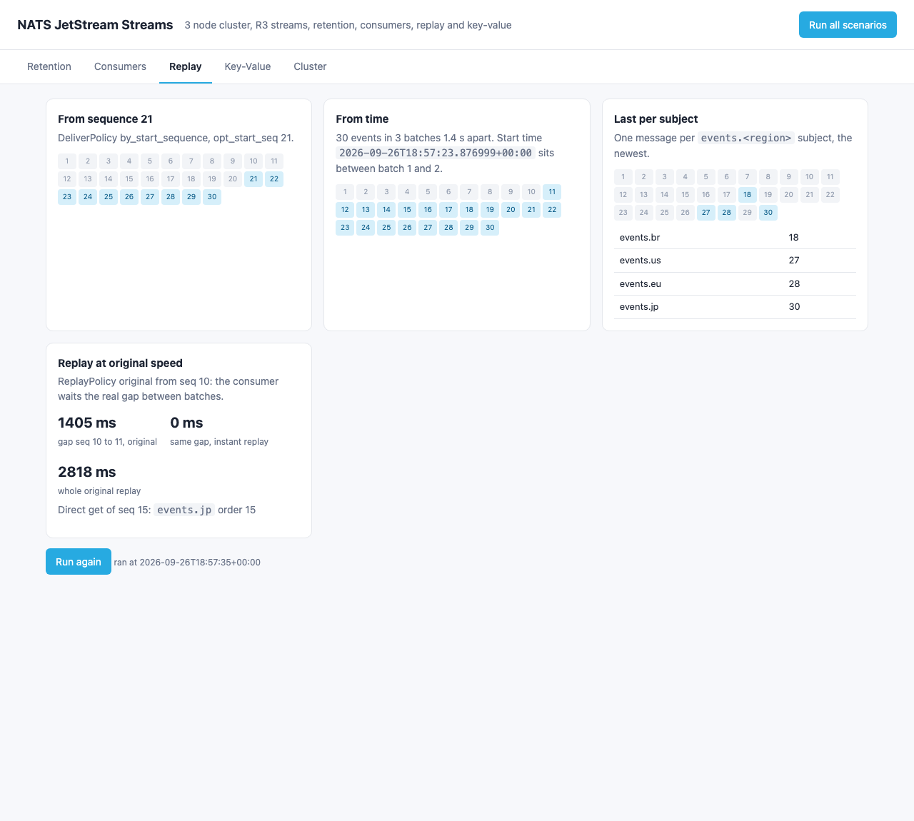
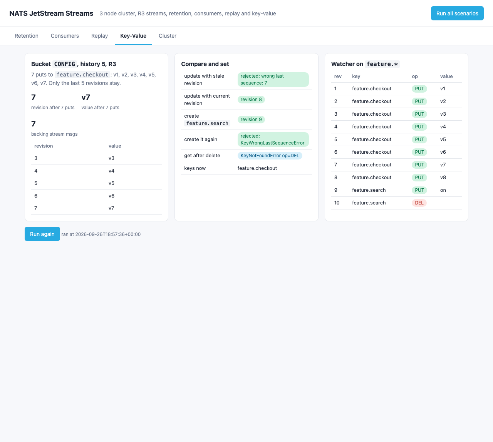
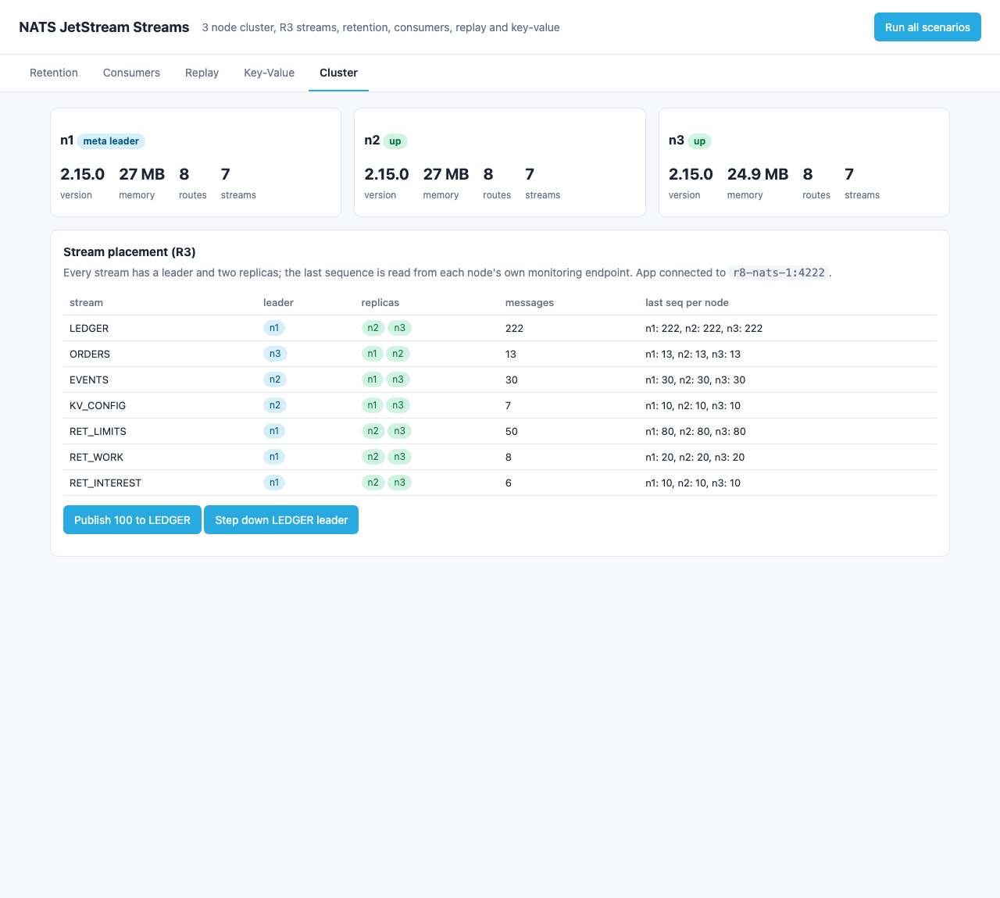
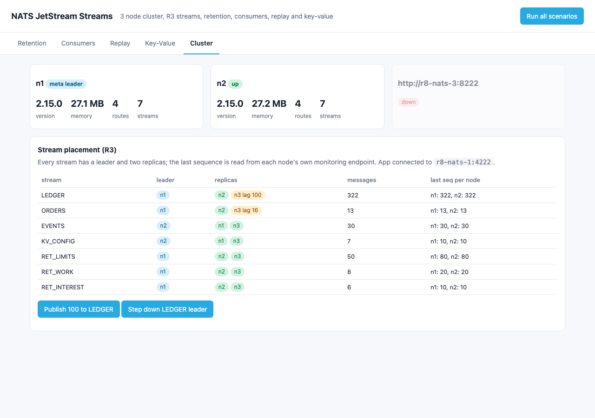

<p align="center"></p>

# nats-jetstream-streams

NATS JetStream as a lightweight persistent log. This POC runs a 3 node NATS 2.15.0 cluster with every stream replicated 3 times (R3) and proves, with a small Python app (nats-py 2.16.0 on Python 3.14) and a web UI: the three retention policies (limits, work queue, interest), durable pull consumers with ack, nak, term, ack_wait redelivery, max_deliver and resume after reconnect, replay from a sequence, from a point in time, last per subject and at the original publish speed, the key-value store (history, compare and set, create, delete, watch), and that an R3 stream keeps accepting writes with a node down and the node catches up when it comes back.

## How it Works

1. `r8-nats-1`, `r8-nats-2`, `r8-nats-3` run `nats:2.15.0` with the same `conf/nats.conf` (JetStream file store on a named volume, cluster `r8`, routes on 6222, monitoring on 8222). The server name comes from `$SERVER_NAME`.
2. `r8-app` runs `app/server.py` (stdlib `http.server`) and connects to all 3 nodes with nats-py. Each scenario in `app/scenarios.py` deletes and recreates its streams, so every run starts from zero.
3. Input is `app/data.py`: seeded orders (`id`, `region`, `cents`), so the tests can recompute every expected answer from the same input.
4. `POST /api/run/<scenario>` runs one scenario and keeps its JSON result in memory, `GET /api/results` returns them, `GET /api/cluster` reads stream placement from JetStream and `/varz` plus `/jsz` from every node's monitoring port.
5. `app/index.html` renders five tabs: Retention, Consumers, Replay, Key-Value, Cluster.
6. `scripts/test-all.sh` reruns every scenario, runs `tests/test_streams.py` inside `r8-app`, then runs `tests/test_failover.py` on the host, which stops `r8-nats-3` with podman, writes 100 messages, starts it again and waits for it to catch up.

## Architecture



## Features

* 3 node JetStream cluster, all streams R3: one leader and two followers per stream, placed by the meta leader, so a single node loss loses nothing.
* Limits retention (`max_msgs=50`, discard old): 80 orders in, the oldest 30 evicted, the log behaves like a bounded ring.
* Work queue retention: an acked job is deleted, and a second unfiltered consumer is rejected by the server, so a job can not be processed twice.
* Interest retention: a message stays until every consumer (`email`, `audit`) acked it, then it is removed.
* Durable pull consumer with explicit ack: nak redelivers at once, a missing ack redelivers after `ack_wait` (2 s), term never redelivers.
* Durable position lives on the server: a new connection bound to `billing` gets only the orders published after it left.
* `max_deliver=3` stops a poison message after 3 attempts instead of looping forever.
* Replay by sequence, by start time, last per subject and `ReplayPolicy.ORIGINAL`, which waits the real 1.4 s gap between batches.
* Direct get of a message by stream sequence, no consumer needed.
* Key-value bucket with `history=5`: old revisions trimmed, compare and set by revision, `create` fails on an existing key, delete leaves a `DEL` marker, a watcher sees every change in revision order.
* Leader step down: the LEDGER leader is moved on request and the next write still succeeds.
* Node failover: with `r8-nats-3` stopped the LEDGER stream still acks all 100 writes (quorum 2 of 3), and n3 has the same last sequence after restart.
* Lean: 3 x 256 MB for NATS and 256 MB for the app, each NATS node uses about 25 MB.

## Stack

* NATS Server 2.15.0 (`docker.io/library/nats:2.15.0`): latest stable NATS release, one static Go binary with JetStream built in.
* nats-py 2.16.0: the official Python client, covers JetStream, pull consumers and key-value.
* Python 3.14.7 (`docker.io/library/python:3.14.7-slim`): one image runs the app, the UI and the stream tests.
* Python stdlib `http.server`, `urllib`, `unittest` + plain HTML, CSS and JS: no web framework, no test framework.
* podman + podman-compose: runs the 4 containers, the network `r8-net` and the volumes `r8-nats-1-data`, `r8-nats-2-data`, `r8-nats-3-data`.

## Contracts / APIs

| Method | Path / endpoint | Description |
|---|---|---|
| NATS | `nats://localhost:27301`, `27302`, `27303` | Client port of n1, n2, n3 |
| GET | `http://localhost:27304`, `27305`, `27306` | Monitoring of n1, n2, n3 (`/varz`, `/jsz`, `/routez`, `/healthz`) |
| GET | `/` | UI |
| GET | `/api/results` | Last result of every scenario that ran, `{}` when none |
| POST | `/api/run/{retention,consumers,replay,kv}` | Runs one scenario and returns its result |
| POST | `/api/run-all` | Runs the four scenarios in order |
| GET | `/api/cluster` | Nodes (version, memory, routes, meta leader, per stream last seq) and stream placement (leader, replicas, current, lag) |
| POST | `/api/ledger?n=100` | Publishes n messages to the R3 `LEDGER` stream, returns acked count and last seq before and after |
| POST | `/api/stepdown` | Asks the `LEDGER` leader to step down, waits for the new one, publishes once |

```json
{"retention": {"limits": {"messages": 50, "first_seq": 31, "last_seq": 80, "published": 80, "max_msgs": 50, "kept_ids": [31, 32, "..."]},
               "workqueue": {"messages": 8, "acked_ids": [1, "...", 12], "left_ids": [13, "...", 20], "second_consumer": "rejected: multiple non-filtered consumers not allowed on workqueue stream"},
               "interest": {"messages": 6, "audit_acked_ids": [1, 2, 3, 4], "left_ids": [5, 6, 7, 8, 9, 10]}},
 "consumers": {"log": [{"id": 8, "seq": 8, "delivered": 2, "action": "ack (redelivery)", "ms": 2}, {"id": 9, "seq": 9, "delivered": 2, "action": "ack (redelivery)", "ms": 2003}],
               "resumed_ids": [11, 12], "poison": {"max_deliver": 3, "attempts": [1, 2, 3]}},
 "replay": {"from_seq_21": [21, "...", 30], "from_time_batch2": [11, "...", 30], "last_per_subject": {"events.br": 18, "events.us": 27, "events.eu": 28, "events.jp": 30},
            "original_pace": {"gap_between_seq10_and_seq11_ms": 1404, "instant_gap_ms": 0}},
 "kv": {"history": [{"revision": 3, "value": "v3"}, "..."], "stale_update": "rejected: wrong last sequence: 7", "cas_update_revision": 8, "after_delete": "KeyNotFoundError op=DEL"}}
```

## Key data structures and design decisions

* Streams: `RET_LIMITS` (`limits.orders`), `RET_WORK` (`work.jobs`), `RET_INTEREST` (`interest.orders`), `ORDERS` (`orders.<region>`), `EVENTS` (`events.<region>`), `LEDGER` (`ledger.>`), and `KV_CONFIG`, the stream behind the `CONFIG` bucket. All R3, file storage.
* Consumers are pull consumers with explicit ack. Replay readers are ephemeral with `inactive_threshold=10` so they clean themselves up; `billing`, `workers`, `email`, `audit`, `poison` are durable.
* Every scenario recreates its streams, so results never depend on an earlier run. `LEDGER` is the only stream that grows across runs, on purpose, for the failover check.
* The replay-by-time mark is taken on the client between batch 1 and batch 2, with 0.7 s of margin on each side, so clock skew between the app and the servers inside one podman VM can not move it into a batch.
* Removal after an ack is applied through the stream's raft log, so right after the last `ack_sync` the stream state can still count one more message (seen once: 9 instead of 8). The work queue and interest scenarios poll until the stream message count agrees with the messages that can actually be read back, for at most 3 s, and report the wait as `settle_ms` (usually 0 to 110 ms).
* On a podman VM shared with other stacks, JetStream API calls right after a restart or a failover sometimes timed out or returned 503 (no stream or consumer leader elected yet). Stream and bucket create/delete and every fetch retry on timeout or 503 (JetStream context timeout 20 s, up to 60 s per call). `bucket.keys()` in nats-py 2.16.0 sometimes returned `NoKeysError` for a non-empty bucket (its watcher saw the end marker first), so it is retried up to 10 times. With these, `test-all.sh` passed 8 runs in a row.
* The tests read stored payloads with direct get by sequence instead of creating a consumer, so the check does not depend on consumer placement right after a failover.
* The UI and the API only report what NATS returned (stream state, consumer info, redelivery counts). All expected values live in the tests, computed from `app/data.py`.
* Readiness is not "port open": `start-all.sh` waits until `/healthz?js-enabled-only=true` answers on all 3 nodes and `/jsz` shows a meta leader with 2 current followers. The first version only waited for the ports and the first JetStream API call timed out before the meta leader was elected.
* A stream replica's `current` flag is about recent activity: in the failover printscreen the streams that had no writes while n3 was down still show n3 as current. The LEDGER and ORDERS rows, which had writes, show `n3 lag 100` and `n3 lag 16`.
* Memory limits: 256 MB per NATS node (`GOMEMLIMIT=200MiB`, `max_memory_store: 64MB`) and 256 MB for the app, 1 GB in total.
* Every container, the network and the volumes start with `r8-`.

## How to run

Requirements: podman, podman-compose, curl, lsof and python3 (stdlib only, for the failover test and the scripts). Everything else runs in containers.

```bash
./scripts/setup.sh
./scripts/start-all.sh
./scripts/test-all.sh
./scripts/ui.sh
./scripts/stop-all.sh
```

`tests/test_streams.py` (17 tests, inside `r8-app`) checks:

* Limits keeps exactly the newest 50 of the 80 generated orders (`first_seq` 31), and the payloads read back directly from NATS equal the generated orders.
* The work queue handed jobs out in order, kept only the 8 unacked ones, and rejected a second consumer.
* The interest stream kept exactly the messages that not every consumer acked.
* nak comes back in under 1 s, the unacked message only after at least 1.9 s (ack_wait 2 s), acked and terminated messages never come back.
* After reconnect the durable gets only orders 11 and 12, ack floor equals the published count, nothing pending.
* The poison message is delivered exactly 1, 2, 3 times.
* Every order in `ORDERS` sits on `orders.<its region>`.
* Replay from seq 21 and from the batch 2 time return exactly the expected ids, last per subject equals the last order per region computed from the input, original replay waits at least 1 s at the batch gap while instant replay does not.
* KV history is the last 5 puts, stale update and duplicate create fail, CAS gives revision + 1, delete leaves a `DEL`, the watcher saw every change with revisions 1..10.
* Every stream lives on n1, n2 and n3, replicas are current and all 3 nodes report the same last sequence.
* Leader step down elects a different leader and the next write succeeds.

`tests/test_failover.py` (host) stops `r8-nats-3`, checks all 100 writes are acked with 2 of 3 nodes and that n3 is not a current replica, restarts it and waits until n1, n2 and n3 report the same LEDGER last sequence.

```
running every scenario against the cluster
test_durable_consumer_resumes_after_reconnect_with_only_new_messages ... ok
test_every_stream_has_a_leader_and_two_current_replicas_on_distinct_nodes ... ok
test_get_message_by_sequence ... ok
test_interest_stream_keeps_a_message_until_every_consumer_acked_it ... ok
test_kv_keeps_history_and_enforces_compare_and_set ... ok
test_kv_watch_sees_every_change_in_order ... ok
test_last_per_subject_is_the_last_order_of_each_region ... ok
test_leader_stepdown_elects_a_new_leader_and_writes_continue ... ok
test_limits_stream_bytes_are_the_published_orders ... ok
test_limits_stream_keeps_only_the_newest_max_msgs_and_drops_the_oldest ... ok
test_max_deliver_stops_redelivering_a_poison_message ... ok
test_nak_redelivers_at_once_and_a_missing_ack_redelivers_after_ack_wait ... ok
test_orders_stream_routes_each_order_to_its_region_subject ... ok
test_original_replay_keeps_the_publish_gap ... ok
test_replay_from_sequence_and_from_time ... ok
test_ui_page_has_every_tab ... ok
test_workqueue_removes_acked_jobs_and_keeps_only_unprocessed_ones ... ok

Ran 17 tests in 0.336s
OK
stopping r8-nats-3 to test failover
test_r3_stream_accepts_writes_with_a_node_down_and_the_node_catches_up ... ok

Ran 1 test in 3.295s
OK
all tests passed
```

## Printscreens

Retention tab: the limits stream stored 50 of 80 (grey crossed cells were evicted), the work queue removed the 12 acked jobs and rejected a second consumer, the interest stream removed the 4 orders both consumers acked and kept 6 for `audit`.



Consumers tab: every delivery of the `billing` consumer with time, stream sequence and delivery count. Order 8 (nak) is back after 2 ms, order 9 (no ack) after 2003 ms, order 10 (term) never. Below, the durable resumed with only 11 and 12 after a reconnect, and the poison message stopped after 3 deliveries.



Replay tab: highlighted cells are the events each consumer received. From sequence 21, from the time between batch 1 and 2, last per subject, and replay at original speed with a 1405 ms gap at the batch boundary against 0 ms for an instant replay.



Key-Value tab: the `CONFIG` bucket kept revisions 3 to 7 of 7 puts, the stale update and the duplicate create were rejected, delete left a `DEL` marker, and the watcher on `feature.*` saw all 10 changes in order.



Cluster tab: the 3 nodes with version, memory and routes, the meta leader, and for every stream the leader, the two replicas and the last sequence read from each node's own monitoring port (all equal). The buttons publish 100 messages to LEDGER and step down its leader.



Cluster tab with `r8-nats-3` stopped: n3 is down, 100 writes to LEDGER were still acked by n1 and n2 (last seq 322 on both), and LEDGER shows `n3 lag 100`. After `podman start r8-nats-3` it caught up.



## Scripts

All scripts live in `scripts/` and run from any directory of the repository.

| Script | What it does |
|---|---|
| `./scripts/setup.sh` | Pulls the NATS and Python images and builds the app image |
| `./scripts/start-all.sh` | Starts the 3 NATS nodes, waits for a JetStream meta leader with 2 current followers, starts the app, runs every scenario when there are no results, prints every link |
| `./scripts/status.sh` | Shows every service port as UP or DOWN |
| `./scripts/test-all.sh` | Reruns every scenario, runs the stream tests and the node failover test |
| `./scripts/ui.sh` | Opens the UI in the browser |
| `./scripts/stop-all.sh` | Stops every container and waits until the ports are free, the volumes are kept |

Ports are declared in `scripts/ports.env`: UI 27300 (`http://localhost:27300`), NATS client n1 27301, n2 27302, n3 27303 (`nats://localhost:27301`), monitoring n1 27304, n2 27305, n3 27306 (`http://localhost:27304`).

```bash
./scripts/setup.sh
./scripts/start-all.sh
./scripts/status.sh
./scripts/ui.sh
./scripts/stop-all.sh
```
