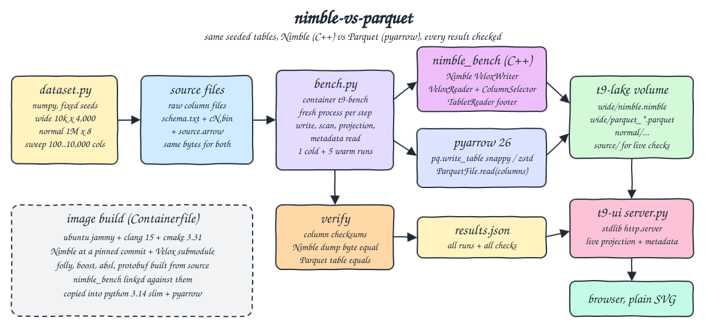
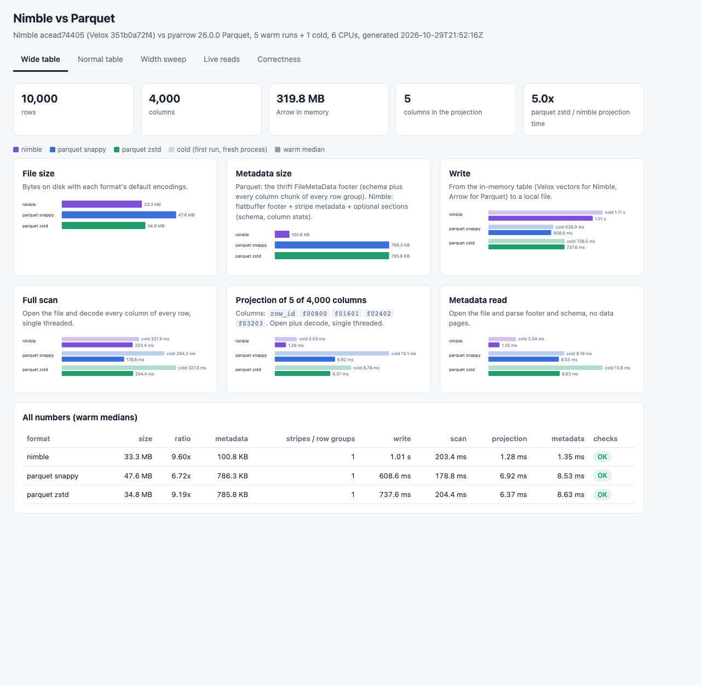
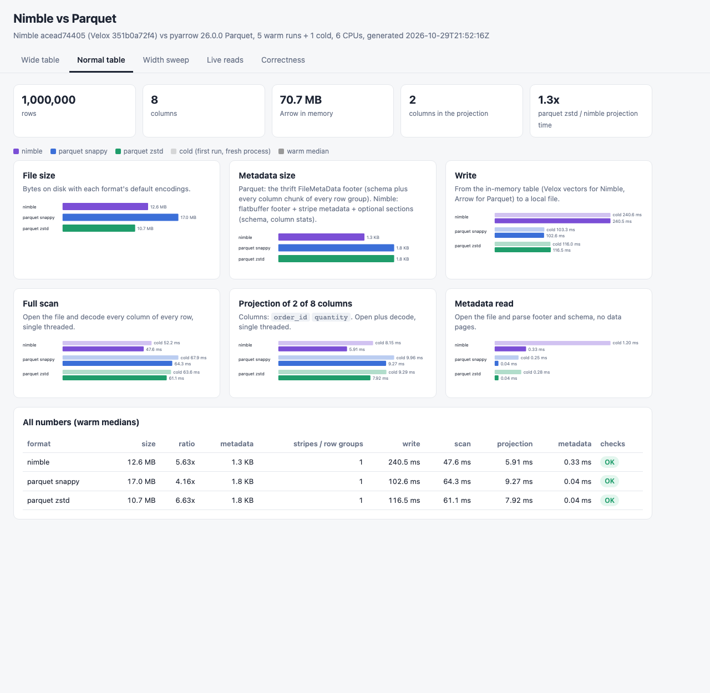
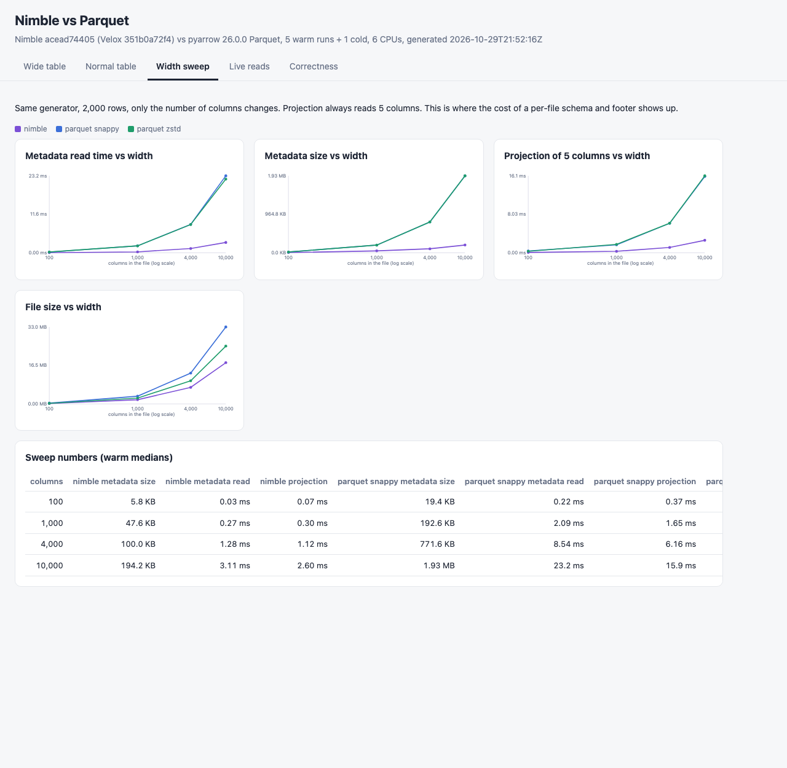
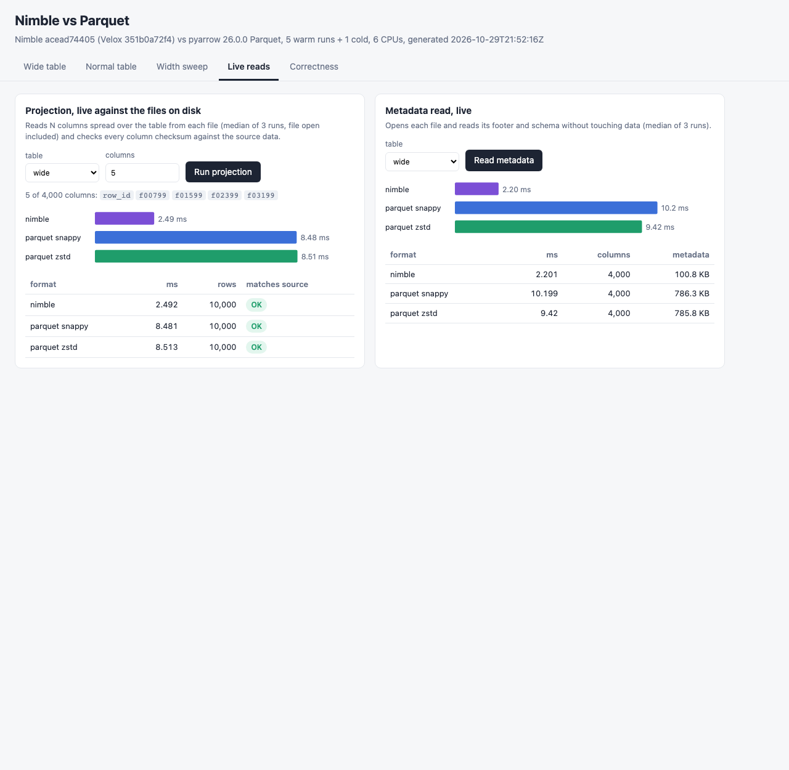
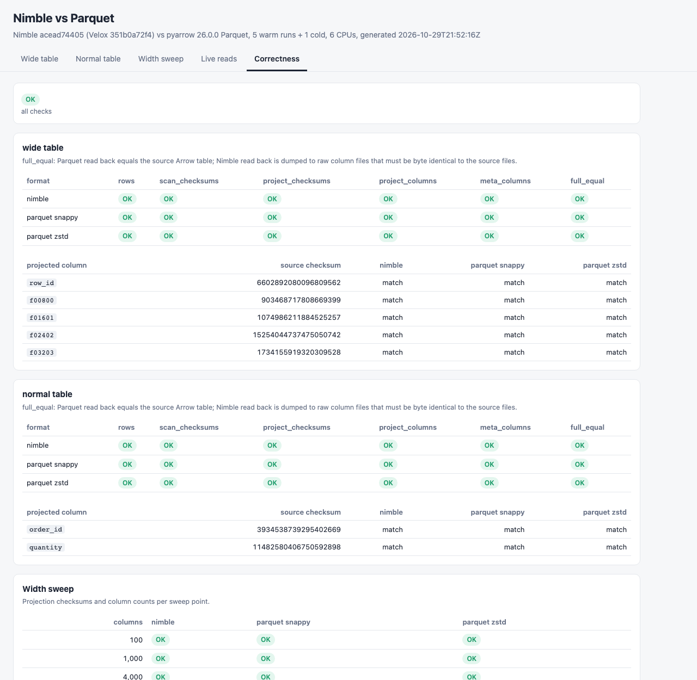

<p>
  
  &nbsp;&nbsp;&nbsp;
  
</p>

# nimble-vs-parquet

Benchmark of Meta's Nimble columnar file format ([facebookincubator/nimble](https://github.com/facebookincubator/nimble), the C++ library, built from source at a pinned commit together with its Velox submodule) against Apache Parquet (pyarrow 26.0.0, snappy and zstd) on the same seeded data. There are two tables: a wide feature table with 10,000 rows and 4,000 columns (the case Nimble was designed for) and a normal orders table with 1,000,000 rows and 8 columns. A width sweep from 100 to 10,000 columns shows how metadata cost grows with the number of columns. For each format the benchmark measures file size, write time, full scan, projection of a few columns, metadata/footer size and metadata read time, as one cold run plus the median of 5 warm runs. Every format must read back exactly the source data or the run fails. A small UI shows the results and runs projections and metadata reads live against the files.

## How it Works

1. `app/dataset.py` generates the tables with numpy and fixed seeds. The wide table has `row_id` plus 3,999 feature columns (`double` features with 70% zeros, `bigint` counters with 60% zeros, and every 20th column a low cardinality `varchar` label). The normal table has ids, user ids, product, category, country, quantity, price and timestamp.
2. Each table is written once to the `t9-lake` volume in two forms with the same bytes: raw column files (`schema.txt`, `cN.bin`, plus `cN.off` offsets for strings) and an Arrow IPC file `source.arrow`.
3. `native/nimble_bench.cpp` is a small C++ tool linked against Nimble and Velox. It loads the raw column files into Velox vectors and writes them with Nimble's `VeloxWriter`. It reads with `VeloxReader` (a `ColumnSelector` does the projection), opens footers with `TabletReader`, and dumps a file back to raw column files.
4. `app/formats.py` runs Parquet with pyarrow (`pq.write_table`, `ParquetFile.read(columns=..., use_threads=False)`), from the Arrow table loaded from `source.arrow`.
5. `app/bench.py` runs every step (write, scan, projection, metadata) of every format in a fresh process, so the first iteration is a real cold run of that process. Only the work itself is timed: process start and data loading are not.
6. Verification after the timings: per column checksums (an order sensitive splitmix64 sum, computed in C++ for Nimble and in numpy for Parquet and the source) must match the source. Nimble read back is dumped to raw column files that must be byte identical to the source files, and Parquet read back must `equals()` the source Arrow table.
7. Results go to `results/results.json`. The UI container mounts the same volume and runs live projections and metadata reads.

## Architecture



## Features

* Real Nimble: the official C++ library at commit `acead744`, built from source inside the image. No reimplementation and no reverse engineered reader.
* Same bytes in: Nimble and Parquet are written from the same raw column data, so differences come from the format and its library.
* Wide and normal tables: Nimble's main claim is about thousands of columns, so the POC measures that case and a normal narrow table side by side.
* Width sweep (100, 1,000, 4,000, 10,000 columns): shows how metadata size, metadata read time and projection grow with width.
* Metadata measured two ways: bytes of metadata in the file and time to open and parse it without reading data pages.
* Cold and warm numbers, with every raw run kept in `results.json`.
* Correctness first: checksums, a byte identical dump and Arrow equality. A fast wrong answer fails the run.
* Live UI: pick a table and a column count, and both formats read it from disk and are checked against the source.

## Stack

* Nimble at commit `acead744054eb006da753390ba80d3b6a29212ce` (Nimble has no releases or tags), with Velox submodule commit `351b0a72f446c75e0bd0ad179063a7a02f8894fc`: the format under test.
* `docker.io/library/ubuntu:jammy-20261020` + clang 15 + cmake 3.31.10 + ninja 1.13.2: the build environment of Nimble's own CI (Ubuntu 22.04, clang 15).
* folly, boost, abseil, protobuf, ICU, simdjson, xsimd: bundled and built from source by Nimble/Velox CMake (`VELOX_BUILD_MINIMAL_WITH_DWIO`, Parquet off).
* `docker.io/library/python:3.14.10-slim-trixie`: runtime. The `nimble_bench` binary and the shared libraries it links against are copied in from the build stage.
* pyarrow 26.0.0: the Parquet writer and reader.
* numpy 2.5.4: data generation and vectorized checksums.
* Python stdlib `http.server`, plain HTML, CSS, JS and SVG: the UI, with no framework and no chart library.
* podman + podman-compose.

## Contracts / APIs

| Method | Path | Description |
|---|---|---|
| GET | `/` | UI |
| GET | `/api/health` | `{"status": "UP"}` |
| GET | `/api/results` | `results.json`: versions, `tables[]` (wide, normal) with `formats[]`, `sweep[]`, `all_ok` |
| GET | `/api/project?table=wide&count=5` | Live projection of `count` (1 to 500) columns spread over the table, median of 3 runs per format, and `matches_source` per format |
| GET | `/api/meta?table=wide` | Live metadata read per format: ms, column count, footer and metadata bytes |

```json
{"table": "wide", "count": 5, "of_columns": 4000,
 "columns": ["row_id", "f00799", "f01599", "f02399", "f03199"],
 "results": [{"name": "nimble", "ms": 2.492, "rows": 10000, "matches_source": true},
             {"name": "parquet_snappy", "ms": 8.481, "rows": 10000, "matches_source": true},
             {"name": "parquet_zstd", "ms": 8.513, "rows": 10000, "matches_source": true}]}
```

Each entry in `formats[]` has `name`, `size_bytes`, `footer_bytes`, `metadata_bytes`, `schema_bytes` (Nimble), `parts` (stripes or row groups), `write_ms`, `scan_ms`, `project_ms`, `meta_ms` (each `{cold, median, runs}`), `project_checksums`, `checks` (`rows`, `scan_checksums`, `project_checksums`, `project_columns`, `meta_columns`, `full_equal`) and `ok`.

`nimble_bench` CLI (in the image at `/opt/nimble/nimble_bench`, prints one JSON line): `write SRC OUT N`, `scan SRC FILE N [col,col]`, `meta FILE N`, `dump FILE OUT`, `version`.

## Key data structures and design decisions

* Why a C++ tool: Nimble has no Python bindings, no packages and no releases, and its README asks people not to reimplement the spec. The only honest path is the C++ library itself, so `nimble_bench` uses Nimble's public `VeloxWriter`, `VeloxReader` and `TabletReader` APIs with their default options (`VeloxWriterOptions{}`, default encoding selection and compression).
* What was built and how: the Containerfile is multi-stage. `libs` configures Nimble's CMake (which pulls Velox as a submodule and builds folly, boost, abseil, protobuf and ICU from source) and builds only `velox`, `nimble_velox_writer`, `nimble_velox_reader` and `nimble_tablet_reader`, not Nimble's tests, tools or benchmarks. That is 1,714 ninja steps, about 45 minutes with 3 jobs on 6 arm64 cores, and a 3.2 GB build image. The final image is 438 MB. The ccache build cache mount makes rebuilds after a code change take seconds.
* Nimble's own CI head (`acead744`) fails on a unit test (`SharedDictionaryEncodingTest`), not on the library. This POC does not build or run Nimble's tests.
* Different readers on each side: Nimble decodes into Velox vectors (C++), and Parquet decodes into Arrow tables (pyarrow C++ under a thin Python call). Both are single threaded (`use_threads=False` for Parquet, the default `VeloxReader` with no executor). Velox's own Parquet reader is not used, because Nimble's CMake turns `VELOX_ENABLE_PARQUET` off and enabling it pulls Arrow and Thrift into the build. So this compares the two formats with their reference libraries, not one engine reading both formats.
* Projection: Nimble gets the table type from the caller (`ColumnSelector(rowType, names)`), like an engine that knows the table schema from a catalog. Parquet gets the column names. Both include opening the file and reading its metadata in the timed region.
* Metadata size: Parquet has one thrift `FileMetaData` footer that holds the schema and every column chunk of every row group, and pyarrow parses all of it on open. Nimble's flatbuffer footer is tiny (264 bytes here) and points to separate sections: the schema, stripe metadata and optional sections such as column stats. `metadata_bytes` for Nimble is footer + stripe metadata + all optional sections, so the comparison does not just show 264 bytes against 786 KB.
* Row groups and stripes: with defaults both formats put each table in a single row group / stripe (pyarrow's default is up to 1,048,576 rows per row group).
* Cold means the first run in a fresh process. The OS page cache is not dropped (that needs a privileged container), so cold is not a disk read.
* No nulls in the data: the raw column interchange format has no validity bitmaps. Sparse features are zeros, not nulls.
* Generation and Parquet equality run in child processes, so the 320 MB wide table never sits twice in the bench process. The first version did keep it twice and was OOM killed at the 1.5 GB limit.
* Names: containers `t9-bench` and `t9-ui`, volume `t9-lake`, compose project `t9-nimble-vs-parquet`. The only host port is 31800.

## How to run

Requirements: podman, podman-compose, curl, lsof and python3 (the host tests use only the standard library). The first `setup.sh` builds Nimble and Velox from source: about 45 minutes, a 7 GB memory cap on the build and around 15 GB of free disk in the podman machine. `JOBS` and `BUILD_MEMORY` are read from the environment.

```bash
./scripts/setup.sh
./scripts/start-all.sh
./scripts/test-all.sh
./scripts/ui.sh
./scripts/stop-all.sh
```

`start-all.sh` runs the benchmark only when `results/results.json` or the `t9-lake` volume is missing. Run it again with `RERUN=1 ./scripts/start-all.sh` or `./scripts/bench.sh`. `ITERATIONS`, `WIDE_ROWS`, `WIDE_COLS`, `NORMAL_ROWS`, `SWEEP_ROWS` and `SWEEP_COLS` are read from the environment.

`test-all.sh` runs two suites:

* Inside `t9-bench`: the numpy checksum equals a plain Python reimplementation, the checksum catches a changed value and a row swap, Nimble's C++ checksums agree with Python's on the same bytes, the byte comparison catches one flipped bit, the wide and normal tables round trip in every format (checksums, byte identical Nimble dump, Arrow equality), a projection returns exactly the requested columns, a truncated Nimble file is rejected, `results.json` has every format and check passing with 1 + 5 runs, the reported sizes are the real files in the lake, a 5 column projection of the wide table is at least 5x cheaper than a full scan in every format, and the files in the lake have the configured width.
* On the host against the UI: health, results for both tables in every format verified, a live projection of 7 columns matches the source in every format, live metadata reports the right width for each table, and bad input returns 400.

A mutation check changes one checksum constant in Python and drops the last projected column in the Parquet reader. The in-container suite then fails 9 assertions in 6 tests.

```
format, dataset and results tests inside t9-bench
test_checksum_catches_a_changed_value_and_a_row_swap (test_formats.ChecksumTest.test_checksum_catches_a_changed_value_and_a_row_swap) ... ok
test_nimble_cpp_checksums_agree_with_python_on_the_same_bytes (test_formats.ChecksumTest.test_nimble_cpp_checksums_agree_with_python_on_the_same_bytes) ... ok
test_same_bytes_detects_a_single_flipped_byte (test_formats.ChecksumTest.test_same_bytes_detects_a_single_flipped_byte) ... ok
test_vectorized_checksum_equals_a_plain_python_reimplementation (test_formats.ChecksumTest.test_vectorized_checksum_equals_a_plain_python_reimplementation) ... ok
test_reported_sizes_are_the_real_files_in_the_lake (test_formats.ResultsTest.test_reported_sizes_are_the_real_files_in_the_lake) ... ok
test_results_cover_both_tables_every_format_and_every_check_passed (test_formats.ResultsTest.test_results_cover_both_tables_every_format_and_every_check_passed) ... ok
test_sweep_files_had_the_configured_number_of_columns (test_formats.ResultsTest.test_sweep_files_had_the_configured_number_of_columns) ... ok
test_wide_projection_is_cheaper_than_a_full_scan_in_every_format (test_formats.ResultsTest.test_wide_projection_is_cheaper_than_a_full_scan_in_every_format) ... ok
test_a_corrupted_nimble_file_is_rejected (test_formats.RoundTripTest.test_a_corrupted_nimble_file_is_rejected) ... ok
test_normal_table_round_trips_in_every_format (test_formats.RoundTripTest.test_normal_table_round_trips_in_every_format) ... ok
test_projection_returns_only_the_requested_columns (test_formats.RoundTripTest.test_projection_returns_only_the_requested_columns) ... ok
test_wide_table_round_trips_in_every_format (test_formats.RoundTripTest.test_wide_table_round_trips_in_every_format) ... ok

----------------------------------------------------------------------
Ran 12 tests in 2.092s

OK
api tests against http://localhost:31800
test_bad_input_is_a_client_error (tests.test_api.LiveReadsTest.test_bad_input_is_a_client_error) ... ok
test_live_metadata_reports_the_table_width (tests.test_api.LiveReadsTest.test_live_metadata_reports_the_table_width) ... ok
test_live_projection_matches_the_source_in_every_format (tests.test_api.LiveReadsTest.test_live_projection_matches_the_source_in_every_format) ... ok
test_health (tests.test_api.ResultsApiTest.test_health) ... ok
test_results_show_both_tables_in_every_format_all_verified (tests.test_api.ResultsApiTest.test_results_show_both_tables_in_every_format_all_verified) ... ok

----------------------------------------------------------------------
Ran 5 tests in 0.573s

OK
all tests passed
```

## Results

1 cold run and the median of 5 warm runs, one process per step, single threaded readers, 6 arm64 CPUs in the podman VM, warm OS page cache. Nimble `acead744` (Velox `351b0a72`) vs pyarrow 26.0.0. Times are cold / warm median. The whole benchmark takes about 52 s.

Wide table, 10,000 rows x 4,000 columns, 319.8 MB in Arrow. The projection is `row_id f00800 f01601 f02402 f03203`.

| format | size | ratio | metadata | write | full scan | projection 5 of 4,000 | metadata read | checks |
|---|---|---|---|---|---|---|---|---|
| nimble | 33.32 MB | 9.60x | 100.8 KB | 1108 / 1011 ms | 222 / 203 ms | 2.53 / 1.29 ms | 3.34 / 1.35 ms | OK |
| parquet snappy | 47.55 MB | 6.72x | 786.3 KB | 629 / 609 ms | 294 / 179 ms | 13.1 / 6.92 ms | 9.18 / 8.53 ms | OK |
| parquet zstd | 34.78 MB | 9.19x | 785.8 KB | 738 / 738 ms | 328 / 204 ms | 8.78 / 6.37 ms | 13.8 / 8.63 ms | OK |

Normal table, 1,000,000 rows x 8 columns, 70.7 MB in Arrow. The projection is `order_id quantity`.

| format | size | ratio | metadata | write | full scan | projection 2 of 8 | metadata read | checks |
|---|---|---|---|---|---|---|---|---|
| nimble | 12.56 MB | 5.63x | 1.3 KB | 241 / 241 ms | 52 / 48 ms | 8.15 / 5.91 ms | 1.20 / 0.33 ms | OK |
| parquet snappy | 17.01 MB | 4.16x | 1.8 KB | 103 / 103 ms | 68 / 64 ms | 9.96 / 9.27 ms | 0.25 / 0.04 ms | OK |
| parquet zstd | 10.66 MB | 6.63x | 1.8 KB | 116 / 117 ms | 64 / 61 ms | 9.29 / 7.92 ms | 0.28 / 0.04 ms | OK |

Width sweep, 2,000 rows, warm medians (metadata size, metadata read, projection of 5 columns):

| columns | nimble | parquet snappy | parquet zstd |
|---|---|---|---|
| 100 | 5.8 KB, 0.03 ms, 0.07 ms | 19.4 KB, 0.22 ms, 0.37 ms | 19.3 KB, 0.23 ms, 0.31 ms |
| 1,000 | 47.6 KB, 0.27 ms, 0.31 ms | 192.6 KB, 2.09 ms, 1.65 ms | 192.3 KB, 2.08 ms, 1.75 ms |
| 4,000 | 100.0 KB, 1.28 ms, 1.12 ms | 771.6 KB, 8.54 ms, 6.16 ms | 771.3 KB, 8.52 ms, 6.18 ms |
| 10,000 | 194.2 KB, 3.11 ms, 2.61 ms | 1.93 MB, 23.2 ms, 15.9 ms | 1.93 MB, 22.2 ms, 16.1 ms |

Every format returns the same checksums for every column, the Nimble dump is byte identical to the source, and Parquet equals the source table (`all_ok: true`).

Takeaways:
* Wide tables are where Nimble wins: opening a 4,000 column file and reading 5 columns takes 1.3 ms against 6.4 to 6.9 ms for Parquet (5x), and metadata read is 6x faster. The sweep shows why: Parquet's footer grows by about 190 bytes per column (1.93 MB at 10,000 columns, all parsed on open), while Nimble keeps 8 to 10x less metadata and parses only the flatbuffer footer and schema.
* Nimble's default encodings produce files about the size of Parquet zstd on the wide table (33.3 MB vs 34.8 MB) and between snappy and zstd on the normal table.
* Nimble writes slowest: 1.4x Parquet zstd and 1.7x snappy on the wide table, and about 2x on the normal table. The likely cause, not profiled here, is the default encoding selection choosing an encoding for every stream.
* Full scans are close: Nimble is the fastest warm scan on the normal table (48 ms vs 61 to 64 ms) and in the middle on the wide table (203 ms vs 179 to 204 ms).
* On a narrow file Nimble's metadata read is slower (0.33 ms vs 0.04 ms). The likely cause, not verified here, is the default speculative 8 MB tail read of `TabletReader` (`maxFooterIoBytes`) on a 12.6 MB file.
* Numbers come from one machine inside a podman VM with a warm page cache, and from two different reader libraries. They show relative behaviour, not absolute throughput.

## Printscreens

Wide table (10,000 x 4,000). The stat tiles show the table shape and that Parquet zstd needs 5x Nimble's time for the 5 column projection. The cards show file size, metadata size (100.8 KB for Nimble, about 786 KB for Parquet), and write, full scan, projection and metadata read times, cold (light bar) and warm median (solid bar), plus a table with every warm median.



Normal table (1,000,000 x 8). The same cards for a narrow table. Here metadata is tiny in every format, Nimble has the fastest scan and projection, and Parquet writes about 2x faster and opens its footer faster.



Width sweep. Metadata read time, metadata size, projection of 5 columns and file size as the column count goes from 100 to 10,000. The Parquet snappy and zstd lines overlap because their footers are almost the same size, and they grow far faster than Nimble's.



Live reads. A live projection of 5 of the 4,000 columns of the wide table, read from the files on disk: Nimble 2.5 ms, Parquet about 8.5 ms, and every format matches the source checksums. On the right, a live metadata read of the wide table with the column count and metadata size of each file.



Correctness. Every check for each format on both tables (rows, scan checksums, projection checksums and columns, metadata column count, full equality), the source checksum of each projected column next to each format's result, and the per format result of every sweep point.



## Scripts

All scripts live in `scripts/` and run from any directory of the repository.

| Script | What it does |
|---|---|
| `./scripts/setup.sh` | Pulls the base images and builds `t9-nimble-vs-parquet` (Nimble and Velox from source on the first run) |
| `./scripts/start-all.sh` | Runs the benchmark when results or the lake volume are missing, starts the UI and prints the full link of each endpoint |
| `./scripts/bench.sh` | Runs the benchmark in the one-shot `t9-bench` container and writes `results/results.json` |
| `./scripts/status.sh` | Shows every service port as UP or DOWN |
| `./scripts/test-all.sh` | Runs the format tests inside `t9-bench` and the API tests against the UI |
| `./scripts/ui.sh` | Opens the UI in the browser |
| `./scripts/stop-all.sh` | Stops every service |

Ports are declared in `scripts/ports.env` (UI on 31800).

```bash
./scripts/setup.sh
./scripts/start-all.sh
./scripts/status.sh
./scripts/ui.sh
./scripts/stop-all.sh
```
