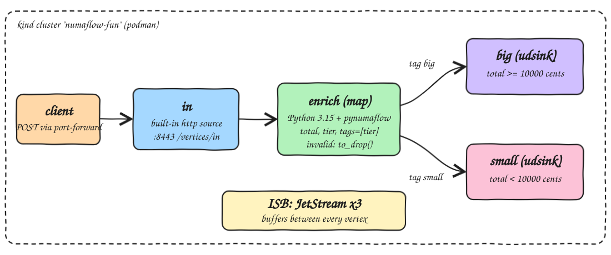
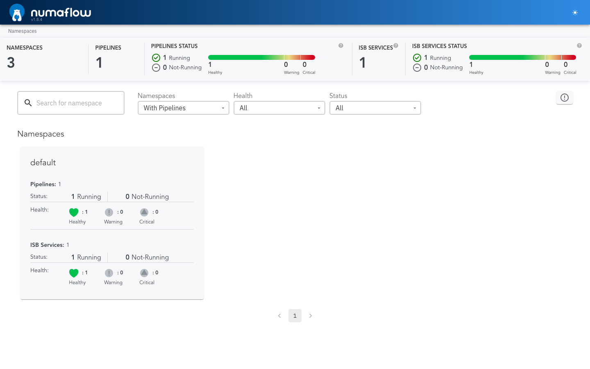
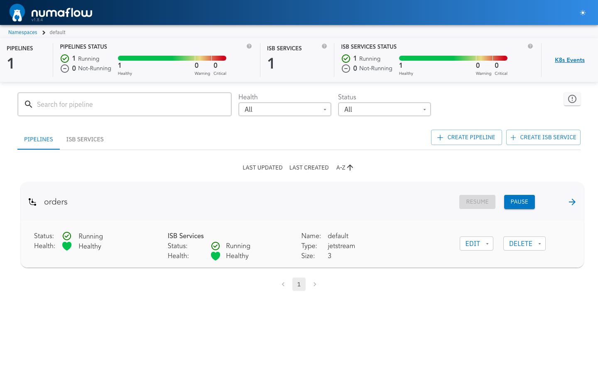
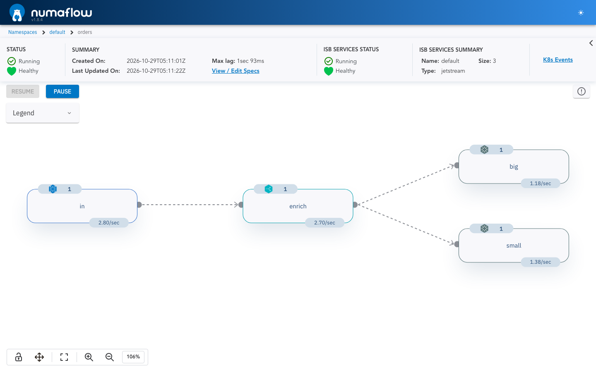
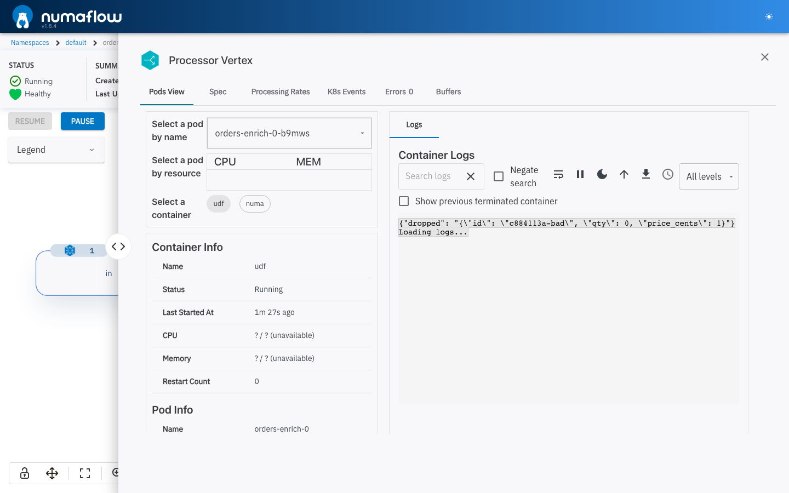

<p align="center"></p>

# numaflow-fun

A Numaflow v1.8.4 streaming pipeline on a local kind cluster, with every user-defined step written in Python 3.15.2 using pynumaflow 0.14.0. HTTP orders come in, a Python map vertex validates and enriches them and tags each one `big` or `small`, and Numaflow conditional forwarding sends each order to one of two Python user-defined sinks. Bad orders are dropped.

## What is Numaflow

[Numaflow](https://numaflow.numaproj.io/) is an open source, Kubernetes-native stream processing framework from the numaproj project.

* A `Pipeline` is a Kubernetes custom resource: a graph of vertices (sources, user-defined functions, sinks) joined by edges.
* Every vertex runs as its own pods and autoscales on its own from pending messages and processing rate, down to zero.
* Between vertices sits an Inter-Step Buffer (ISB), here NATS JetStream, so a slow or crashed step does not lose data and messages are retried until acked.
* User code runs in a separate container next to Numaflow's own container in the same pod, and the two talk over gRPC. Numaflow does the reading, writing, acking, retries and scaling; the user code only handles each message, in any language with an SDK (Python, Go, Java, Rust).
* Steps can be map (transform, filter, fan-out), reduce (aggregate over time windows with event time and watermarks) or sink, plus built-in sources and sinks such as HTTP, Kafka and log.
* A web UI shows the pipeline graph, per-vertex rates, lag, pod logs and K8s events.

It plays the same role as Flink or Kafka Streams, but runs on Kubernetes and works with any language, with no separate cluster to operate.

## Numaflow main features

| Feature | What it gives you | Used here |
|---|---|---|
| Kubernetes-native | Pipelines are CRDs applied with `kubectl`, every vertex is a set of pods | yes |
| Language agnostic UDFs | SDKs for Python, Go, Java, Rust; user code is a gRPC server in its own container | yes, Python 3.15 |
| Map UDF | Transform, filter (drop) or fan-out one message into many | yes, `enrich` |
| User-defined sink | Write to any system with your own code, with per-message ack | yes, `big` and `small` |
| Conditional forwarding | Route messages to different vertices by tags set in the UDF | yes, `big` / `small` |
| Inter-Step Buffer | JetStream buffers between vertices, so a step can fail or slow down without losing data | yes, 3 replicas |
| Built-in sources | HTTP, Kafka, NATS, JetStream, Pulsar, generator and more, no code needed | yes, HTTP |
| Built-in sinks | Log, Kafka, blackhole and more | no |
| Autoscaling | Each vertex scales on its own from pending messages and processing rate, down to zero | default settings |
| Backpressure | Buffer limits slow the upstream vertices instead of dropping data | default settings |
| Reduce and windowing | Aggregations over fixed, sliding and session windows | no |
| Event time and watermarks | Windows close on event time, not arrival time, so late data is handled correctly | no |
| Source transformer | Fix event time or filter right at the source, before data enters the ISB | no |
| Side inputs | Slow-changing data (config, models) broadcast to all UDF pods | no |
| Fallback sink | Messages a sink can not write go to a second sink instead of retrying forever | no |
| Pause and resume | Stop a pipeline without losing in-flight data, then continue | available in the UI |
| Web UI | Pipeline graph, rates, lag, pod logs, specs and K8s events | yes |

## How it Works

1. `scripts/setup.sh` creates the kind cluster `numaflow-fun` on podman, installs Numaflow v1.8.4 into `numaflow-system`, creates a 3 node JetStream InterStepBufferService (`k8s/isbsvc.yaml`), builds `localhost/numaflow-fun-udf:v1` from `Containerfile` and loads it into kind.
2. `scripts/start-all.sh` applies `k8s/pipeline.yaml` (pipeline `orders`) and port-forwards the Numaflow UI and the HTTP source.
3. Vertex `in` is Numaflow's built-in HTTP source. It accepts `POST /vertices/in` with a JSON order.
4. Vertex `enrich` runs `app/udf.py map`. `app/orders.py` parses the order, rejects bad input, computes `total_cents = qty * price_cents` and sets `tier`. The map returns the order with `tags=[tier]`, or `Message.to_drop()` for bad input.
5. The edges from `enrich` have `conditions.tags`, so `big` orders go to vertex `big` and `small` orders go to vertex `small`.
6. Both sinks run `app/udf.py sink`, a pynumaflow `SinkServer` that writes each order as a JSON line and acks it.
7. JetStream buffers sit between every vertex, so each step scales and retries on its own.

## Architecture



## Features

* Python 3.15 UDFs: one image with two roles (`map`, `sink`), chosen by container args.
* Validation in the map: non-JSON, non-object, missing `id`, non-integer or non-positive `qty`, and negative `price_cents` are dropped, so one bad event never crashes the vertex.
* Conditional forwarding by tag: routing is declared in the pipeline spec, not hard-coded in the UDF.
* Threshold is inclusive: an order of exactly 10000 cents (100.00) is `big`.
* Built-in HTTP source with `X-Numaflow-Id` header for dedup.
* JetStream ISB with 3 replicas, so buffered data survives the loss of one ISB pod.
* Numaflow UI to watch processing rates per vertex, lag, pod logs and K8s events.

## Stack

* Python 3.15.2 (`python:3.15.2-slim`): runtime for the UDF container.
* pynumaflow 0.14.0: Numaflow Python SDK for the map and sink gRPC servers.
* Numaflow v1.8.4: Kubernetes-native stream processing (controller, UI server, pipelines).
* JetStream: Numaflow's inter-step buffer.
* kind v0.31 on podman: local Kubernetes cluster.
* Python stdlib `unittest`: tests with no extra test libraries.

## Python 3.15 note

pynumaflow 0.14.0 declares `Requires-Python <3.15`, and its `grpcio-tools` dependency only ships cp315 wheels for versions that need protobuf 7, while pynumaflow pins protobuf below 7. pynumaflow never imports `grpc_tools`, `uvloop`, `psutil` or `google.api_core` at runtime. So the `Containerfile` installs only the runtime deps it does import (`requirements.txt`: grpcio, grpcio-status, protobuf 6.33.6, googleapis-common-protos, aiorun), then installs pynumaflow with `--no-deps --ignore-requires-python`. Nothing is compiled, and the integration test shows it runs.

## Contracts

HTTP source, port-forwarded to `https://localhost:27411/vertices/in` (self-signed TLS):

```bash
curl -k -X POST https://localhost:27411/vertices/in \
  -H "X-Numaflow-Id: order-1" \
  -d '{"id":"order-1","qty":2,"price_cents":7500}'
```

Returns `200`. The endpoint only accepts `POST`; opening it in a browser sends a `GET` and returns `405 Method Not Allowed`. Use `./scripts/ui.sh` for the browser. Input order:

| Field | Type | Rule |
|---|---|---|
| `id` | string | required, non-empty |
| `qty` | int | > 0 |
| `price_cents` | int | >= 0 |

Message out of `enrich` (key = `id`, tag = `tier`):

```json
{"id":"order-1","qty":2,"price_cents":7500,"total_cents":15000,"tier":"big"}
```

Sink output (stdout of the `udsink` container):

```json
{"sink": {"id":"order-1","qty":2,"price_cents":7500,"total_cents":15000,"tier":"big"}}
```

Dropped input (stdout of the `udf` container of `enrich`):

```json
{"dropped": "{\"id\": \"x\", \"qty\": 0, \"price_cents\": 1}"}
```

## Design decisions

* Business logic lives in `app/orders.py` with no pynumaflow import, so it is unit tested on the host and inside the image.
* Routing is a tag on the message plus `conditions.tags` on the edges. Adding a third tier only needs a new edge and sink.
* `type(x) is int` is used instead of `isinstance`, because `True` is an `int` in Python and would otherwise pass as `qty=1`.
* The UDF runs as PID 1 in its container, and Linux ignores SIGTERM for PID 1 unless the process installs a handler. `app/udf.py` installs one, so the `enrich` pod stops in about 3 seconds instead of waiting out the 30 second grace period.
* Images are loaded into kind with `kind load image-archive` and run with `imagePullPolicy: Never`, so no registry is needed.

## How to run

Requirements: podman, kind, kubectl, python3.15, curl, lsof.

```bash
./scripts/setup.sh
./scripts/start-all.sh
./scripts/test-all.sh
./scripts/ui.sh
./scripts/stop-all.sh
./scripts/stop-all.sh --cluster
```

`stop-all.sh` removes the pipeline and the port-forwards. `stop-all.sh --cluster` also deletes the kind cluster.

`test-all.sh` runs:

* `tests/test_orders.py` on host Python 3.15 and again inside the image on Python 3.15.2: totals, the inclusive 10000 cent threshold, field pass-through, and every rejected payload.
* A curl smoke test: posts one order with a unique `X-Numaflow-Id`, expects `{"message":"Data received successfully","id":"<id>"}` and waits until the order shows up in the `big` sink logs.
* `tests/test_pipeline.py` against the running pipeline: posts 5 big, 5 small and 1 invalid order with a unique run id, then reads the sink pod logs and checks that each order landed only in its tier's sink and that the invalid one was dropped by `enrich`.

```
unit tests on host python3.15
Ran 5 tests ... OK
unit tests inside localhost/numaflow-fun-udf:v1
Ran 5 tests ... OK
curl smoke test
{"message":"Data received successfully","id":"curl-1793251401-6594"}
curl-1793251401-6594 reached the big sink
pipeline integration test
test_orders_are_routed_by_tier_and_bad_ones_never_reach_a_sink ... ok
all tests passed
```

## Printscreens

Numaflow UI home: one namespace with one running, healthy pipeline and one healthy ISB service.



Namespace `default`: the `orders` pipeline and the `default` JetStream ISB service, both running.



Pipeline `orders` under load: `in` -> `enrich` -> `big` / `small`, with live rates per vertex. Rates into `big` and `small` add up to the rate out of `enrich`, which shows the tag routing splits the stream.



Vertex `enrich`, Pods View: the logs of the Python `udf` container show an invalid order (`qty: 0`) that was dropped.



## Scripts

All scripts live in `scripts/` and run from any directory of the repository.

| Script | What it does |
|---|---|
| `./scripts/setup.sh` | Creates the kind cluster, installs Numaflow and the JetStream ISB, builds and loads the UDF image |
| `./scripts/start-all.sh` | Deploys the pipeline, port-forwards the UI and the HTTP source and prints the full link of each one |
| `./scripts/status.sh` | Shows the cluster, the pipeline phase and every port as UP or DOWN |
| `./scripts/test-all.sh` | Runs the unit tests and the pipeline integration test |
| `./scripts/ui.sh` | Opens the Numaflow UI on the `orders` pipeline |
| `./scripts/stop-all.sh` | Stops the port-forwards and deletes the pipeline (`--cluster` also deletes the cluster) |

Ports are declared in `scripts/ports.env`: `ui=27410` (`https://localhost:27410`), `orders_in=27411` (`https://localhost:27411/vertices/in`).

```bash
./scripts/setup.sh
./scripts/start-all.sh
./scripts/status.sh
./scripts/ui.sh
./scripts/stop-all.sh
```
