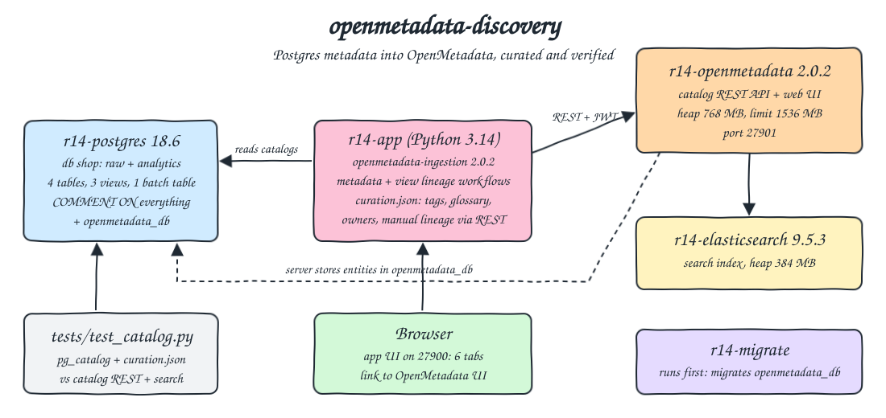
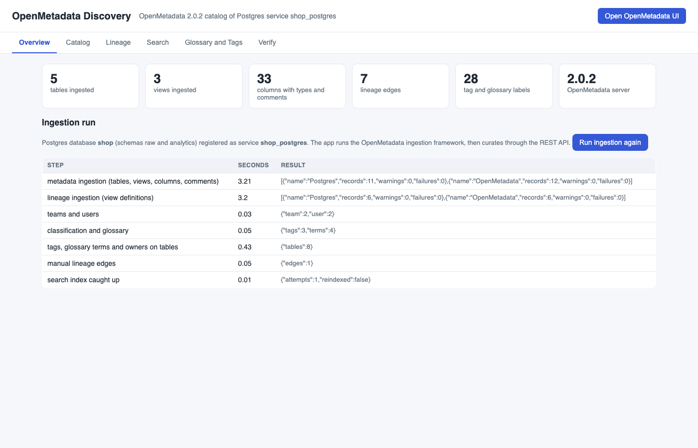
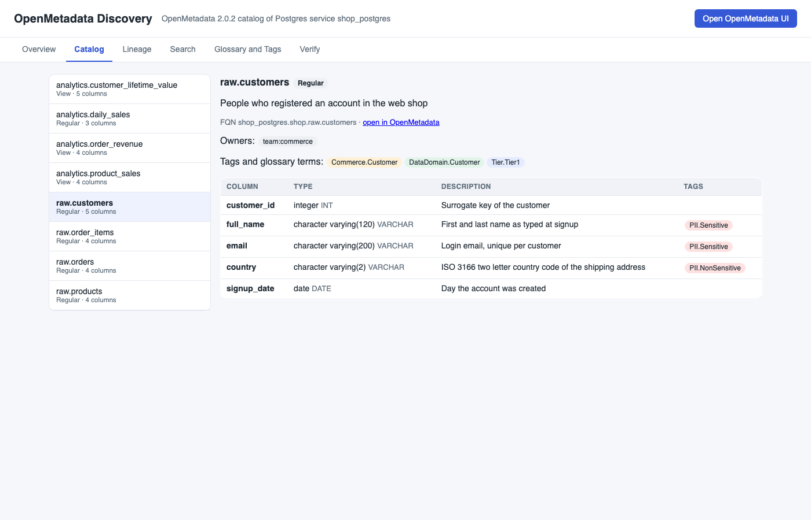
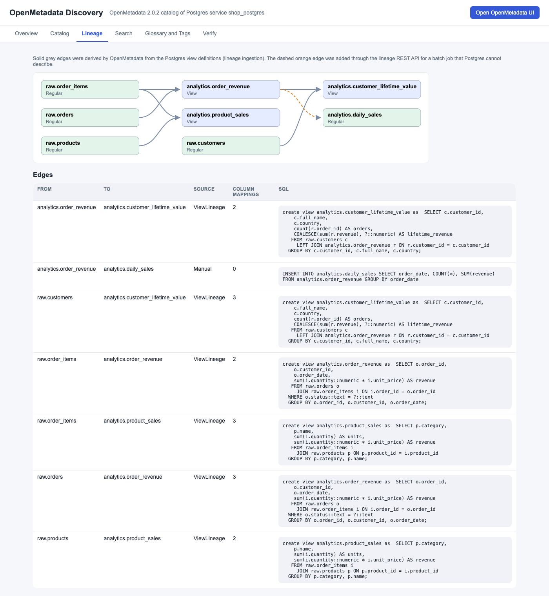
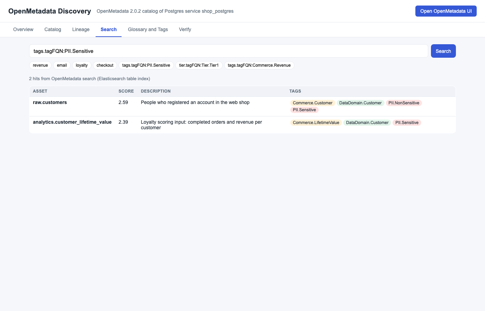
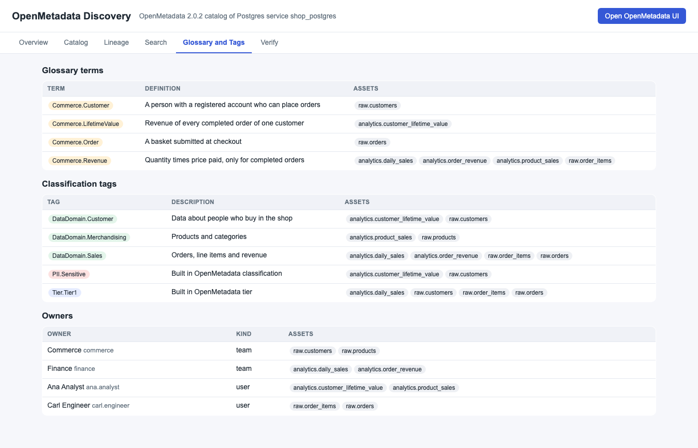
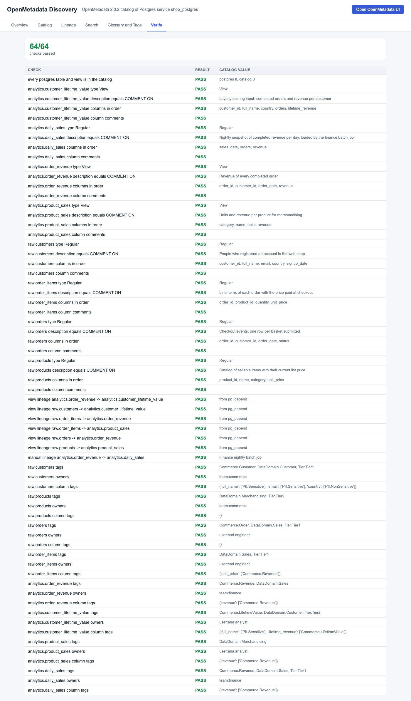
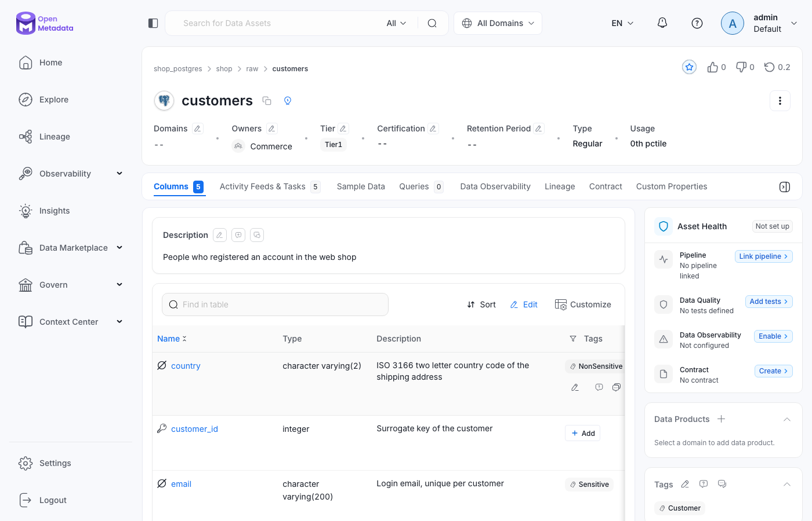
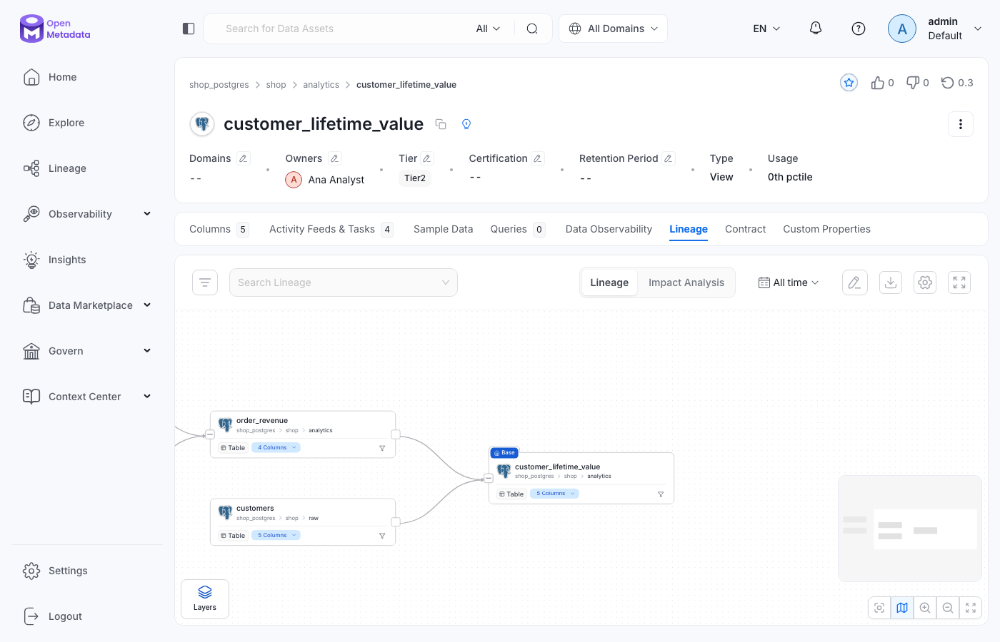

<p align="center"></p>

# openmetadata-discovery

A data discovery and metadata catalog POC with OpenMetadata 2.0.2. A small Postgres 18 database (`shop`, schemas `raw` and `analytics`) with `COMMENT ON` descriptions is ingested with the official OpenMetadata ingestion framework (tables, views, columns, types, comments, and lineage parsed from view SQL). Then the app curates the catalog through the OpenMetadata REST API: teams, users, a classification, a glossary, tags and glossary terms on tables and columns, owners, and one manual lineage edge for a batch job. A plain HTML UI reads everything back from the catalog REST API (catalog, lineage graph, search, glossary, owners) and shows a live check of the catalog against the Postgres system catalogs. It links to the OpenMetadata UI.

## How it Works

1. `r14-postgres` starts from `sql/`: `01-openmetadata.sql` creates the OpenMetadata metadata database and a read only `om_reader`, `02-shop.sql` creates 4 tables, 3 views and the `analytics.daily_sales` table, with a comment on every table, view and column.
2. `r14-migrate` (the server image, `openmetadata-ops.sh migrate`) creates the OpenMetadata schema, then `r14-openmetadata` starts with Elasticsearch as its search engine. Airflow is not deployed (`PIPELINE_SERVICE_CLIENT_ENABLED=false`).
3. `start-all.sh` asks the app for `/api/verify`. When the catalog does not match Postgres and `app/curation.json` yet, it calls `POST /api/ingest`.
4. The app reads the `ingestion-bot` JWT from the REST API and runs two ingestion workflows (`openmetadata-ingestion` 2.0.2): `postgres` metadata (with `overrideMetadata`, so a changed comment in Postgres reaches the catalog), then `postgres-lineage` with view lineage only.
5. It then applies `app/curation.json` through the REST API: teams and users (`PUT /teams`, `POST /users`), classification `DataDomain` and glossary `Commerce` (`PUT /classifications`, `/tags`, `/glossaries`, `/glossaryTerms`), a JSON Patch per table for tags, column tags and owners, and `PUT /lineage` for the batch job edge.
6. It waits until the search index shows every curated tag. If the index is still stale after 15 tries it runs the `SearchIndexingApplication` once, then checks again.
7. The UI (`app/index.html`) and the tests only read the catalog REST API and the search API. The tests compare it with `pg_class`, `pg_attribute`, `pg_description` and `pg_depend`, and with `app/curation.json`.

## Architecture



## Features

* Real ingestion framework: the same `metadata` workflows OpenMetadata runs from Airflow, started from the app process, so there is no Airflow container to pay for.
* Descriptions come from the source: every table, view and column description is a Postgres `COMMENT ON`, and re-ingestion overrides stale copies.
* Lineage from SQL: the lineage workflow parses the view definitions and records table and column level edges (`ViewLineage`).
* Manual lineage: `analytics.daily_sales` is a table loaded by a batch job that Postgres cannot describe, so the edge and its SQL are added with `PUT /v1/lineage`.
* Governance: a custom classification, built in `PII` and `Tier` tags, a glossary with 4 terms, team and user owners, all declared in one `curation.json`.
* Idempotent: every call is create or replace (`PUT`, JSON Patch `add` on whole arrays), so the pipeline can run any number of times without duplicates.
* Search: keyword and tag queries go through the OpenMetadata search API (`table_search_index` in Elasticsearch).
* Verify tab: 64 live checks of the catalog against the Postgres system catalogs and the curation file.
* Lean: Elasticsearch heap 384 MB, OpenMetadata heap 768 MB, one Postgres serves the source and the OpenMetadata database, memory limits on every container.

## Stack

* OpenMetadata 2.0.2 (`docker.getcollate.io/openmetadata/server:2.0.2`): latest stable release, it is the catalog, the REST API and the web UI.
* openmetadata-ingestion 2.0.2.0 (`[postgres]` extra, PyPI): the official connectors and workflows, installs and runs on Python 3.14.
* Elasticsearch 9.5.3 (`docker.io/library/elasticsearch:9.5.3`): latest 9.x image, the search engine OpenMetadata indexes into. The official 2.0.2 compose pins 9.3.0, 9.5.3 worked with every test here.
* PostgreSQL 18.6 (`docker.io/library/postgres:18.6`): the source database and the OpenMetadata metadata database, with `pg_stat_statements` loaded for the lineage connector.
* Python 3.14.7 (`docker.io/library/python:3.14.7-slim`): the app, the ingestion workflows and the tests, stdlib `http.server` and `urllib` only, `psycopg2` comes with the ingestion extra.
* Plain HTML, CSS and JS: the UI, no framework.
* podman + podman-compose: runs the containers.

## Contracts / APIs

App (`http://localhost:27900`):

| Method | Path | Description |
|---|---|---|
| GET | `/` | UI with 6 tabs |
| GET | `/api/status` | OpenMetadata version, public UI URL, service, table count, last ingestion report |
| POST | `/api/ingest` | Runs both ingestion workflows and the curation, returns the step report, 409 when one is already running |
| GET | `/api/catalog` | Every table and view of the service with type, description, owners, tags, columns, column tags and the OpenMetadata UI link |
| GET | `/api/lineage` | Nodes and edges (`from`, `to`, `source`, `sql`, number of column mappings) |
| GET | `/api/search?q=` | OpenMetadata search on `table_search_index`, such as `revenue` or `tags.tagFQN:PII.Sensitive` |
| GET | `/api/vocabulary` | Classification tags, glossary terms, teams and users |
| GET | `/api/verify` | Live checks of the catalog against Postgres and `curation.json` |

OpenMetadata REST calls used (`http://localhost:27901/api/v1`, login `admin@open-metadata.org` / `admin`): `POST /users/login`, `GET /bots/name/ingestion-bot`, `GET /users/auth-mechanism/{id}`, `GET /tables`, `GET /tables/name/{fqn}`, `PATCH /tables/{id}`, `PUT /teams`, `POST /users`, `PUT /classifications`, `PUT /tags`, `PUT /glossaries`, `PUT /glossaryTerms`, `PUT /lineage`, `GET /lineage/table/name/{fqn}`, `GET /search/query`, `POST /apps/trigger/SearchIndexingApplication`.

```json
{"key": "analytics.customer_lifetime_value", "fqn": "shop_postgres.shop.analytics.customer_lifetime_value", "type": "View",
 "description": "Loyalty scoring input: completed orders and revenue per customer",
 "tags": ["Commerce.LifetimeValue", "DataDomain.Customer", "Tier.Tier2"], "owners": ["user:ana.analyst"],
 "columns": [{"name": "full_name", "dataType": "VARCHAR", "dataTypeDisplay": "character varying(120)", "description": "Customer name", "tags": ["PII.Sensitive"]}, "..."],
 "url": "http://localhost:27901/table/shop_postgres.shop.analytics.customer_lifetime_value"}
```

## Key data structures and design decisions

* `app/curation.json` is the single declaration of what humans add on top of the source: teams, users, classification, glossary, per table owners, tags and column tags, and manual lineage. A label whose first part is the glossary name is sent with `source: Glossary`, every other one with `source: Classification`.
* Service `shop_postgres`, so every FQN is `shop_postgres.shop.<schema>.<table>`. Only schemas `raw` and `analytics` are ingested.
* Ingestion workflows run in a child Python process. The ingestion framework keeps its topology context per thread and failed when run from an HTTP handler thread, so the app starts `python app/pipeline.py` and reads the step summary from stdout.
* Tables are patched with JSON Patch `add` on `/tags`, `/owners` and `/columns/{i}/tags`, which replaces the whole array, so a rerun changes nothing.
* After a re-ingestion the search document of some upstream tables lost their table level tags while the entity in the database kept them. The pipeline checks the index against `curation.json` and runs the built in `SearchIndexingApplication` (about 10 s here) only when it is stale.
* OpenMetadata stores `Tier.*` in the `tier` field of the search document, not in `tags`, so tier search is `tier.tagFQN:Tier.Tier1`. Column descriptions are not matched by plain keyword search, table names, table descriptions and column names are.
* Memory limits: Postgres 384 MB, Elasticsearch 1 GB (heap 384 MB, ML off), OpenMetadata 1536 MB (heap 768 MB), migrate 1 GB (one shot), app 768 MB. About 3.7 GB while running. Only port 27900 (app), 27901 (OpenMetadata) and 27902 (Postgres) are published, Elasticsearch stays on `r14-net`.
* Every container, volume and network starts with `r14-`: `r14-postgres`, `r14-elasticsearch`, `r14-migrate`, `r14-openmetadata`, `r14-app`, `r14-pg-data`, `r14-es-data`, `r14-net`.

## How to run

Requirements: podman, podman-compose, curl, python3 and lsof. Everything else runs in containers.

```bash
./scripts/setup.sh
./scripts/start-all.sh
./scripts/test-all.sh
./scripts/ui.sh
./scripts/stop-all.sh
```

`test-all.sh` runs `tests/test_catalog.py` inside `r14-app`. It reads Postgres with its own SQL and OpenMetadata with its own login, and checks:

* The catalog lists exactly the relations of `raw` and `analytics` in `pg_class`, views as `View` and tables as `Regular`.
* Every table and column description equals the Postgres `COMMENT ON` text.
* Columns keep the Postgres order and `dataTypeDisplay` equals `format_type()` from `pg_attribute`.
* View lineage edges are exactly the view dependencies in `pg_depend`, and every column level mapping points at a column the view really reads.
* The manual edge carries the batch job SQL, and Postgres itself has no such dependency.
* Tags, glossary terms (with the right source), owners, classification tags and glossary terms equal `curation.json`.
* Keyword search returns exactly the tables whose name, comment or column names contain the word (computed from Postgres), and a word that is nowhere returns nothing. Tag and tier search return exactly the tables that `curation.json` tags.
* The app API returns what OpenMetadata holds, and `/api/verify` passes.
* A second ingestion run changes nothing, and a comment changed in Postgres reaches the catalog on the next run (the test restores it).

The tests were also run after changing one Postgres column comment without re-ingesting, and the description tests failed, as they should.

```
test_app_api_serves_what_openmetadata_holds ... ok
test_column_lineage_only_points_at_columns_the_view_really_reads ... ok
test_columns_keep_postgres_order_and_declared_types ... ok
test_every_postgres_table_and_view_is_cataloged_with_its_kind ... ok
test_glossary_and_classification_hold_every_curated_term ... ok
test_keyword_search_finds_exactly_the_tables_whose_name_comment_or_columns_mention_the_word ... ok
test_manual_lineage_edge_carries_the_batch_job_sql ... ok
test_owners_match_the_curation_file ... ok
test_table_and_column_descriptions_equal_postgres_comments ... ok
test_tag_search_finds_exactly_the_tables_carrying_the_tag ... ok
test_tags_and_glossary_terms_match_the_curation_file ... ok
test_ui_page_has_every_tab_and_links_to_openmetadata ... ok
test_view_lineage_is_exactly_the_postgres_dependency_graph ... ok
test_a_changed_postgres_comment_reaches_the_catalog_on_the_next_run ... ok
test_running_the_pipeline_again_changes_nothing ... ok
----------------------------------------------------------------------
Ran 15 tests in 76.194s

OK
all tests passed
```

## Printscreens

Overview: counts read back from the catalog (5 tables, 3 views, 33 columns, 7 lineage edges, 28 labels) and the step report of the last ingestion run.



Catalog: every table and view with its description, owners, tags, glossary terms and columns with Postgres types, comments and column tags, plus a link to the same table in OpenMetadata.



Lineage: the graph built from the lineage API. Grey edges were derived from view SQL by the lineage workflow, the dashed orange edge is the manual batch job edge. The table lists the SQL behind each edge and the number of column mappings.



Search: OpenMetadata search results for `tags.tagFQN:PII.Sensitive`, the two tables with a sensitive column.



Glossary and Tags: glossary terms, classification tags and owners, with the assets that use each one.



Verify: 64 live checks of the catalog against Postgres and `curation.json`, all passing.



The OpenMetadata UI shows the same data: `raw.customers` with its owner, tier, tags and column comments, and the lineage of `customer_lifetime_value`.





## Scripts

All scripts live in `scripts/` and run from any directory of the repository.

| Script | What it does |
|---|---|
| `./scripts/setup.sh` | Pulls the images that are missing and builds the app image |
| `./scripts/start-all.sh` | Starts every container, ingests and curates when needed, prints the full link of each service |
| `./scripts/status.sh` | Shows every service port and container as UP or DOWN |
| `./scripts/test-all.sh` | Runs the catalog tests inside `r14-app` |
| `./scripts/ui.sh` | Opens the UI in the browser |
| `./scripts/stop-all.sh` | Stops every container, keeps the volumes |
| `./scripts/sql-console.sh` | Opens `psql` on the `shop` database |

Ports are declared in `scripts/ports.env`: app UI `http://localhost:27900`, OpenMetadata `http://localhost:27901`, Postgres `postgresql://localhost:27902/shop`.
