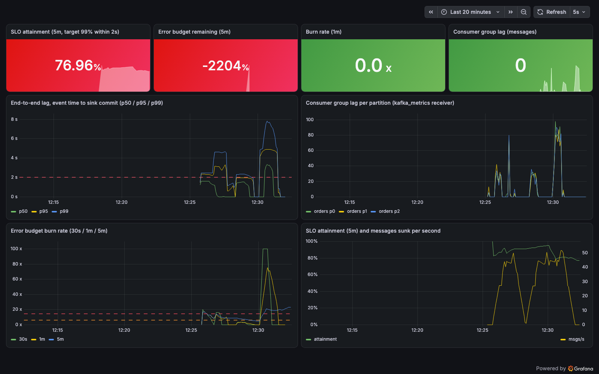
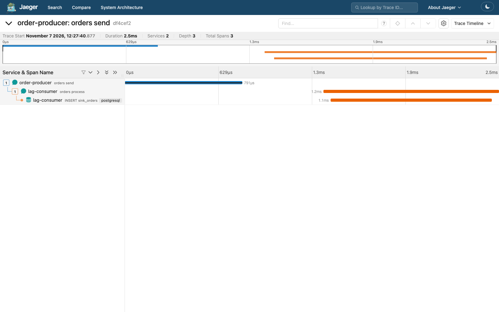
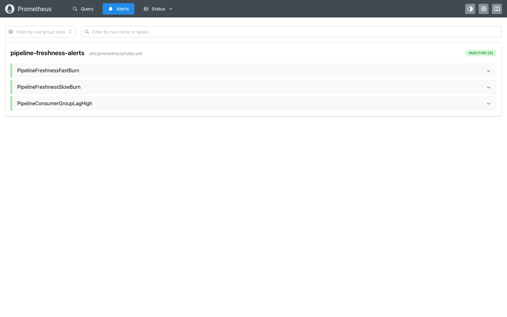

<p align="center"></p>

# otel-end-to-end-pipeline-lag

End-to-end OpenTelemetry tracing and freshness measurement for a small streaming pipeline on a local kind cluster. A Java 25 Spring Boot 4.1 producer writes orders to Kafka 4.4.0 (single-node KRaft StatefulSet), a Python 3.15 consumer enriches each order and inserts it into Postgres. One W3C trace covers produce, consume and the sink insert for every message, because the `traceparent` travels in the Kafka record headers. The consumer records the lag from event time to sink commit as an OpenTelemetry histogram. Prometheus turns it into a freshness SLO (99% of messages land within 2 s, 5 minute window) with error budget and burn rate recording rules and multi-window alerts. Grafana shows it all on a provisioned dashboard.

Three end-to-end tests prove it:

* A given message id has one trace in Jaeger, with the producer span from `order-producer` as the parent of the consumer span from `lag-consumer`, and the Postgres insert span under it.
* The lag histogram in Prometheus matches the lag computed again from the Postgres rows (`sink_time - event_time`), bucket by bucket within 2 percentage points, and the means within 50 ms.
* Adding a 2.5 s delay per poll batch to the consumer (env flag `SLOWDOWN_MS`) drives the burn rate up and fires `PipelineFreshnessFastBurn`. Setting it back to 0 resolves the alert, and no message is lost.

## How it Works

1. `scripts/setup.sh` creates the kind cluster (1 control plane, 1 worker), loads the pinned images, creates a random Postgres password Secret and the ConfigMaps from the files in `k8s/`, and deploys Kafka, Postgres, Jaeger, the OpenTelemetry Collector, Prometheus and Grafana into namespace `pipeline`. It creates topic `orders` (3 partitions) and builds the producer and consumer images.
2. `scripts/start-all.sh` deploys the producer and the consumer and port-forwards Grafana, Jaeger, Prometheus and the producer.
3. `POST /runs/{runId}?rate=N` makes the producer send N orders per second. Each order carries `eventTimeMs`, taken when the order is created. Spring Kafka observation creates a `orders send` PRODUCER span and writes its context into the `traceparent` record header.
4. The consumer extracts that context with the OTel propagator, opens an `orders process` CONSUMER span as its child, enriches the order (total, tier), and runs the insert inside an `INSERT sink_orders` CLIENT span. The row keeps the trace id.
5. After the insert returns, the consumer records `now - eventTimeMs` in the histogram `pipeline.e2e.lag` (unit `s`, explicit buckets with one bound at exactly 2 s). Postgres stamps `sink_time` with `clock_timestamp()` on its own, so the test can compute the lag a second, independent way.
6. Both services send OTLP over HTTP to the collector. The collector sends traces to Jaeger, exposes metrics on `:8889` for Prometheus, and its `kafka_metrics` receiver reads the consumer group lag from Kafka.
7. Prometheus (5 s scrape and rule evaluation) records attainment, error budget, burn rates for 30 s, 1 m and 5 m, and evaluates the alerts. Grafana reads Prometheus and Jaeger.

## Architecture


## Features

* One trace per message across two languages: Spring Kafka observation injects `traceparent`, the Python consumer extracts it, so Jaeger shows producer, consumer and sink in one tree.
* Trace id stored in the sink row: from any row in Postgres you can open its exact trace.
* Lag measured where it matters: from event creation in the producer to the sink insert, not just Kafka consumer lag.
* Independent check of the metric: Postgres stamps its own `sink_time`, so the histogram is compared with numbers it did not produce.
* Exactly one lag sample per stored row: `INSERT ... ON CONFLICT DO NOTHING RETURNING id`, and a redelivered message is not recorded twice.
* A bucket bound at exactly 2 s: the SLO is a ratio of two counters (`le="2.0"` over `count`), no quantile estimation involved.
* Multi-window burn rate alerts: a single short blip does not page, a real slowdown pages in about 30 s.
* Consumer group lag without an extra exporter: the collector's `kafka_metrics` receiver reads it from the broker.
* Rules are unit tested with `promtool test rules`, including a blip case that only the multi-window rule ignores.
* Slowdown as a plain config flag: `kubectl set env deploy/lag-consumer SLOWDOWN_MS=2500`.

## Stack

* Java 25 (Temurin 25.0.5 JRE image, JDK 25.0.4 to build): producer runtime, virtual thread per send.
* Spring Boot 4.1.2 with `spring-boot-starter-opentelemetry` (OpenTelemetry Java SDK 1.62.0, Micrometer Tracing 1.7.2) and Spring Kafka 4.1.2 (kafka-clients 4.2.2): traces through the Micrometer OTel bridge, no Java agent.
* Python 3.15.2 (`python:3.15.2-slim`) with uv 0.10.4: consumer runtime.
* OpenTelemetry Python SDK 1.45.2 and `opentelemetry-exporter-otlp-proto-http` 1.45.2: pure Python, works on 3.15. The HTTP exporter keeps grpcio out of the image.
* kafka-python 3.0.13: pure Python Kafka client (confluent-kafka has no cp315 wheels).
* pg8000 1.31.6: pure Python Postgres driver, no libpq in the image.
* Apache Kafka 4.4.0 (`apache/kafka`): single node, KRaft combined mode, StatefulSet.
* Postgres 18.6 (`postgres:18.6-alpine`): sink.
* OpenTelemetry Collector contrib 0.164.0: OTLP in, `kafka_metrics` receiver, `transform` processor, `otlp_grpc` and `prometheus` exporters.
* Jaeger 2.22.0: lightest trace backend with its own UI, in-memory storage, API v3.
* Prometheus v3.15.1: SLO recording rules and alerts.
* Grafana 13.2.5: provisioned datasources and dashboard, anonymous admin for local use.
* pytest 9.2.0 and ty 0.0.99: tests and type checks. JUnit 5 through `spring-boot-starter-test`.
* Playwright 1.64.1 (`bunx`): screenshots.
* kind 0.31 on podman: local Kubernetes 1.35.

## Contracts

Producer API, port-forwarded to `http://localhost:27703`:

| Method | Path | What it does |
|---|---|---|
| `GET` | `/runs` | All runs with their counters |
| `POST` | `/runs/{runId}?rate=50` | Starts sending `rate` orders per second. `201`, `409` if the run id was used, `400` for a bad id or rate |
| `GET` | `/runs/{runId}` | Current counters |
| `DELETE` | `/runs/{runId}` | Stops the run, waits for all in-flight sends, returns the final counters |

Kafka record on topic `orders`, key `id`, header `traceparent: 00-<trace id>-<span id>-01`:

```json
{"id":"run-9-3","runId":"run-9","seq":3,"sku":"sku-3","qty":4,"priceCents":211,"eventTimeMs":1700000000123}
```

Sink table `sink_orders`:

| Column | Meaning |
|---|---|
| `id` | message id `runId-seq`, primary key |
| `run_id`, `seq`, `sku`, `qty`, `price_cents` | from the payload |
| `total_cents`, `tier` | enrichment, `big` when total >= 20000 cents |
| `event_time` | `eventTimeMs` from the producer |
| `sink_time` | `clock_timestamp()` in Postgres at insert |
| `trace_id` | trace of this message |

Metrics in Prometheus:

| Series | Meaning |
|---|---|
| `pipeline_e2e_lag_seconds_bucket/_sum/_count` | lag histogram from the consumer |
| `kafka_consumer_group_lag{group,topic,partition}` | consumer group lag from the collector |
| `pipeline:lag_seconds:p50_1m`, `p95_1m`, `p99_1m` | lag quantiles |
| `pipeline:slo_errors:ratio_rate30s`, `1m`, `5m` | share of messages slower than 2 s |
| `pipeline:slo_attainment:ratio_rate5m` | share within 2 s over 5 minutes (target 0.99) |
| `pipeline:slo_error_budget_remaining:ratio_rate5m` | `1 - errors / 0.01`, negative when the budget is overspent |
| `pipeline:slo_burn_rate:30s`, `1m`, `5m` | `errors / 0.01` |
| `pipeline:consumer_group_lag:sum` | total lag of group `lag-consumer` |

Alerts:

| Alert | Condition | Meaning |
|---|---|---|
| `PipelineFreshnessFastBurn` | burn 1m > 14.4 and burn 30s > 14.4, for 10 s | the 5 minute budget is gone in under 21 s, page |
| `PipelineFreshnessSlowBurn` | burn 5m > 6 and burn 1m > 6, for 30 s | sustained overspend, ticket |
| `PipelineConsumerGroupLagHigh` | group lag > 200, for 15 s | consumer falling behind, ticket |

## Design decisions

* Spring Boot's own OpenTelemetry starter instead of the Java agent: `spring.kafka.template.observation-enabled=true` is the only switch needed for the Kafka header, and the image stays a plain jar.
* Manual context extraction in Python: a 10 line `Getter` over kafka-python headers. The `opentelemetry-instrumentation-kafka-python` package would wrap the client, but the consumer also needs the extracted context to parent its sink span and to store the trace id.
* Postgres over a second topic: the lag check needs rows it can query with SQL, and Postgres can stamp its own time.
* The lag histogram is recorded after the insert returns, and only for new rows, so `histogram count == sink rows` for a run.
* The SLO window is 5 minutes, so burn rate windows are scaled down (30 s, 1 m, 5 m) and the classic 14.4x and 6x thresholds keep their meaning: at 14.4x the 5 minute budget lasts 21 s.
* Consumer slowdown is a sleep per poll batch, not per message: lag rises above 2 s for nearly every message but throughput stays, so the backlog does not grow without bound and recovery is quick.
* The kafka_metrics receiver reports lag with unit `1`, which the Prometheus exporter would turn into `_ratio`. A `transform` processor sets the unit to `{message}` so the series is `kafka_consumer_group_lag`.
* Jaeger 2.22 serves its query API only under `/api/v3`, so the e2e harness reads OTLP JSON from `/api/v3/traces/{id}`.
* The lag test runs with a 1 s consumer slowdown on purpose. With no delay every lag is a few milliseconds and the comparison only exercises one bucket; with 1 s the lags land between 1 s and 2.5 s, around the 2 s SLO bound.
* All clocks are the same: kind nodes are containers on the same podman VM, so producer, consumer and Postgres read the same kernel clock.

## How to run

```bash
./scripts/setup.sh
./scripts/start-all.sh
./scripts/test-all.sh
./scripts/screenshots.sh
./scripts/stop-all.sh
./scripts/teardown.sh
```

`test-all.sh` runs the producer unit tests (`mvn test`), the consumer unit tests and `ty check`, the e2e harness unit tests and `ty check`, `promtool test rules` for the SLO rules, then the three cluster tests (about 3.5 minutes).

Inject the slowdown by hand:

```bash
kubectl --context kind-otel-end-to-end-pipeline-lag -n pipeline set env deploy/lag-consumer SLOWDOWN_MS=2500
kubectl --context kind-otel-end-to-end-pipeline-lag -n pipeline set env deploy/lag-consumer SLOWDOWN_MS=0
```

## Results

Measured with `./scripts/test-all.sh` on a fresh cluster (podman, 1 control plane, 1 worker) on an arm64 laptop. The three e2e tests took 207 s. Unit tests: producer 9, consumer 13, e2e harness 8, promtool 2 test groups, all passed, `ty check` clean.

### Trace for one message

Message `trace-1794083257-30`, trace `777b29c5a78747c83c6db4a5447c6e96`, 3 spans, 2 services:

```
order-producer  producer  orders send          span=598dd07cafec61d4 parent=None
lag-consumer    consumer  orders process       span=d336a8ec0d5142e0 parent=598dd07cafec61d4
lag-consumer    client    INSERT sink_orders   span=f389a1a2bd552678 parent=d336a8ec0d5142e0
```

All 61 messages of that run had 61 distinct trace ids in `sink_orders`.

### Lag histogram vs sink rows

1501 messages at 50/s with the consumer slowed by 1 s per poll batch. Share of messages with lag at or below each bound:

| le (s) | Prometheus histogram | Postgres rows |
|---|---|---|
| 1.0 | 0.0000 | 0.0000 |
| 1.5 | 0.4710 | 0.4710 |
| 2.0 | 0.9680 | 0.9680 |
| 2.5 | 1.0000 | 1.0000 |

| | Prometheus | Postgres |
|---|---|---|
| count | 1501 | 1501 |
| mean | 1.5279 s | 1.5278 s |
| p50 | 1.5292 s (interpolated) | 1.5307 s (exact) |
| p95 | 1.9819 s (interpolated) | 1.9824 s (exact) |
| p99 | 2.3436 s (interpolated) | 2.0219 s (exact) |

Counts match exactly and every bucket matches to 4 decimals. The p99 gap is bucket interpolation (the 2.0 to 2.5 bucket is linear), not a measurement error. Without a slowdown, in an earlier run of 1001 messages, the exact lag from Postgres was p50 3.4 ms, p95 5.3 ms, p99 7.0 ms.

### Slowdown, fast burn, recovery

Producer at 50 orders/s the whole time, consumer slowed by 2.5 s per poll batch, then set back to 0:

| Metric | Value |
|---|---|
| Burn rate 1m before the slowdown | 0.00x |
| `PipelineFreshnessFastBurn` firing after the flag was set (includes the consumer restart) | 39 s |
| Peak burn rate 1m | 55.4x |
| Peak consumer group lag | 252 messages |
| p99 lag while slowed | 6.85 s |
| 5m attainment while slowed | 0.8203 (target 0.99) |
| 5m error budget left while slowed | -16.97 (spent 18 times) |
| Fast burn alert resolved after the flag was removed | 35 s |
| Messages produced / stored / lost | 6719 / 6719 / 0 |
| Messages later than 2 s | 1923 |

`PipelineFreshnessSlowBurn` keeps firing for a few more minutes after the fast burn alert resolved, because its 5 minute window still holds the slow messages. That is the expected split: the page stops when the damage stops, the ticket stays until the budget window is clean.

## Printscreens

Grafana dashboard `Pipeline Lag and Freshness SLO` after `test-all.sh`. Top row: 5 minute attainment and error budget still red from the slowdown, 1 minute burn rate already back to 0. The lag panel shows the 1 s slowdown of the lag test around 12:27 (p99 near 4.5 s while the pod restarted, then around 2 s) and the 2.5 s slowdown around 12:30 (p99 up to 8 s), with the dashed line at the 2 s SLO bound. Consumer group lag per partition spikes at each consumer restart. The burn rate panel shows the 30 s and 1 m burn hitting 100x and 75x, above the dashed 14.4x and 6x thresholds.



Jaeger trace view of one message: the `order-producer` `orders send` span, its child `lag-consumer` `orders process`, and the `INSERT sink_orders` span with the `postgresql` tag. The consumer span starts after the producer span, linked only by the `traceparent` header in Kafka.



Prometheus alerts right after the test: fast burn back to inactive, slow burn still firing on its 5 minute window.



## Scripts

All scripts live in `scripts/` and run from any directory of the repository. Ports are only in `scripts/ports.env`.

| Script | What it does |
|---|---|
| `./scripts/setup.sh` | Creates the kind cluster, loads images, deploys Kafka, Postgres, Jaeger, the collector, Prometheus and Grafana, creates the topic, builds and loads the producer and consumer images |
| `./scripts/start-all.sh` | Deploys producer and consumer, port-forwards the UIs and the producer and prints the full link of each one |
| `./scripts/status.sh` | Shows the cluster, every component as READY or NOT READY and every port as UP or DOWN |
| `./scripts/test-all.sh` | Unit tests, type checks, promtool rule tests and the three end-to-end tests on kind, results in `.run/results.txt` |
| `./scripts/screenshots.sh` | Captures the Grafana dashboard, a Jaeger trace and the Prometheus alerts into `printscreens/` and strips PNG metadata |
| `./scripts/ui.sh` | Opens Grafana and Jaeger in the browser |
| `./scripts/sql-console.sh` | Opens `psql` on the `pipeline` database |
| `./scripts/stop-all.sh` | Stops the port-forwards and deletes the producer and consumer |
| `./scripts/teardown.sh` | Stops everything, deletes the kind cluster and the local producer and consumer images |

| Service | URL |
|---|---|
| Grafana | http://localhost:27700/d/pipeline-lag |
| Jaeger | http://localhost:27701/search?service=lag-consumer |
| Prometheus | http://localhost:27702/alerts |
| Producer | http://localhost:27703/runs |
