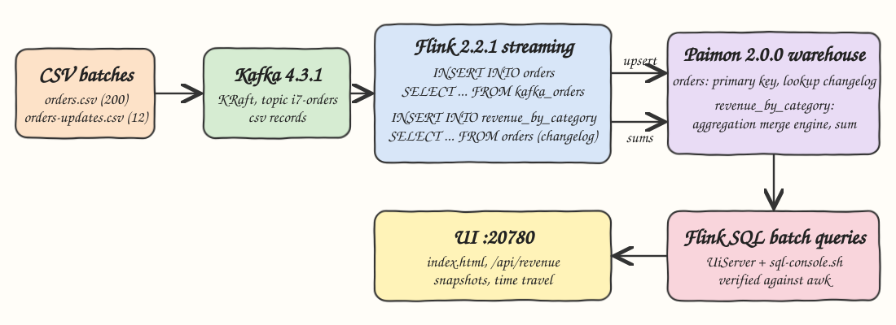
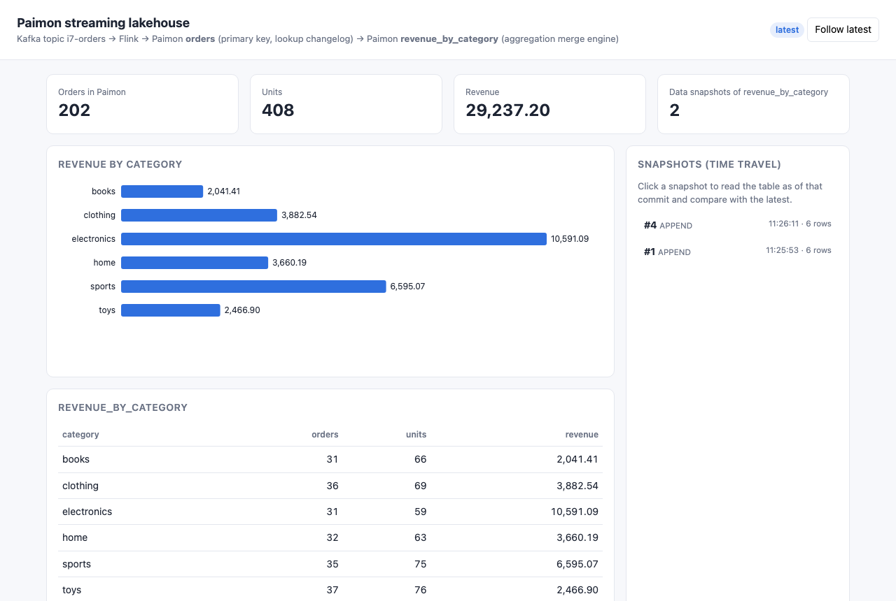
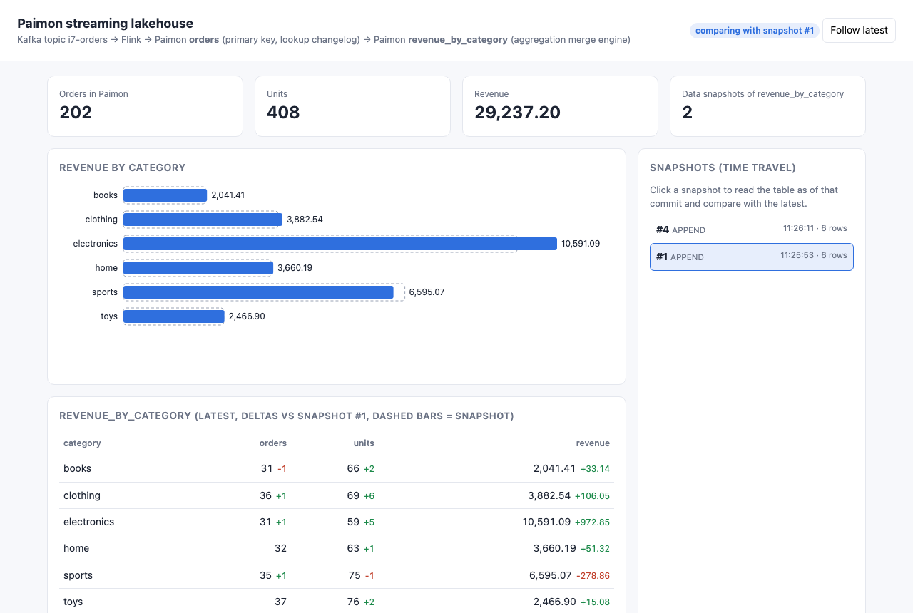

# paimon-flink-lakehouse

A streaming lakehouse built on Apache Paimon 2.0.0 and Apache Flink 2.2.1 (Java 25). Orders are streamed from a Kafka 4.3.1 (KRaft) topic into a Paimon primary-key table `orders` with a `lookup` changelog producer, and a second streaming job folds that changelog into a Paimon aggregation table `revenue_by_category` (`merge-engine = aggregation`, `sum` fields). A second batch of orders updates existing rows and the aggregation table changes live, including revenue that moves from one category to another. Results are read back with Flink SQL batch queries and shown in a small UI.

## How it Works

1. `data/orders.csv` (200 orders) is produced as CSV records into the Kafka topic `i7-orders`.
2. A single Flink streaming job (MiniCluster, parallelism 1, checkpoint every 3 s) runs two `INSERT` statements.
3. `kafka_orders -> orders`: upserts by `order_id` into a Paimon primary-key table. The `lookup` changelog producer compares each write with the previous version and emits `+I`, `-U`, `+U` changelog rows.
4. `orders -> revenue_by_category`: streaming-reads the `orders` changelog (Paimon `consumer-id` so restarts resume) and writes `category, 1, quantity, quantity * price`.
5. The aggregation merge engine sums rows with the same `category`. `-U` rows are retractions, so an updated order first subtracts its old values and then adds its new ones.
6. `data/orders-updates.csv` (12 rows: 10 updates, 1 category move, 2 new orders) is produced as a second batch and the table converges to the new totals.
7. `UiServer` and `sql-console.sh` read the tables with Flink SQL in batch mode. The UI also reads `revenue_by_category$snapshots` and uses `scan.snapshot-id` for time travel.

## Architecture



## Features

- Kafka to Paimon streaming ingest with exactly-once commits on Flink checkpoints.
- Primary-key table with `lookup` changelog producer, so downstream readers get proper `-U/+U` pairs for updates.
- Aggregation table (`merge-engine = aggregation`, `sum`) that retracts old values, so updates never double count.
- Category moves are handled: order 1006 moves from `toys` to `sports` and both categories change.
- Flink SQL batch queries for reading results, from the UI and from `sql-console.sh`.
- Time travel on the aggregation table: pick a snapshot and compare it with the latest state.
- Independent verification: `test-all.sh` recomputes the aggregation with awk and compares it with Paimon after each batch.

## Stack

- Java 25 (Amazon Corretto 25.0.4): runtime for the Flink job and the UI server.
- Apache Flink 2.2.1: newest Flink supported by Paimon 2.0.0 (the `paimon-flink-2.2` artifact); runs in a local MiniCluster on Java 25.
- Apache Paimon 2.0.0: lakehouse table format with primary keys, changelog producers and merge engines.
- flink-sql-connector-kafka 5.0.0-2.2: Kafka source for Flink 2.2.
- Hadoop client 3.5.0 (api + runtime): Paimon's Flink sink serializes classes that reference Hadoop `Configuration`, so it must be on the classpath even for a local warehouse.
- Apache Kafka 4.3.1 (`apache/kafka` image, KRaft, no ZooKeeper): the order stream.
- Local filesystem warehouse (`warehouse/`): simplest Paimon storage, no object store needed.
- JDK `HttpServer` + plain HTML/SVG: the UI, no web framework.
- podman / podman-compose: runs Kafka.

## Contracts / APIs

| Method | Path | Returns |
|---|---|---|
| GET | `/` | the UI |
| GET | `/api/revenue` | `[{"category","orders","units","revenue"}]` from `revenue_by_category` |
| GET | `/api/revenue?snapshot=N` | the same table as of Paimon snapshot `N` |
| GET | `/api/summary` | `{"orders","units","revenue"}` computed from `orders` |
| GET | `/api/snapshots` | `[{"id","kind","time","delta"}]` data snapshots of `revenue_by_category` |

Errors come back as HTTP 500 with `{"error": "..."}`.

## Key data structures and design decisions

```sql
CREATE TABLE orders (
  order_id INT, customer STRING, product STRING, category STRING,
  quantity INT, price DECIMAL(10, 2), ts STRING,
  PRIMARY KEY (order_id) NOT ENFORCED
) WITH ('bucket' = '1', 'changelog-producer' = 'lookup', 'consumer.expiration-time' = '1 d');

CREATE TABLE revenue_by_category (
  category STRING, orders BIGINT, units BIGINT, revenue DECIMAL(14, 2),
  PRIMARY KEY (category) NOT ENFORCED
) WITH ('bucket' = '1', 'merge-engine' = 'aggregation',
  'fields.orders.aggregate-function' = 'sum',
  'fields.units.aggregate-function' = 'sum',
  'fields.revenue.aggregate-function' = 'sum');
```

- `changelog-producer = lookup`: Kafka delivers plain inserts; `input` would forward them as `+I` and the aggregation would double count updates. `lookup` produces the `-U` of the previous version.
- `table.exec.sink.upsert-materialize = NONE`: the sink key (`category`) differs from the source key (`order_id`); Flink's upsert materializer would otherwise rewrite the retraction stream.
- `DECIMAL` for money so sums and retractions are exact.
- `consumer-id = i7-revenue` on the changelog read and `group-offsets` on Kafka, so a pipeline restart resumes instead of re-summing everything.
- The UI server runs every Flink query on one dedicated thread: Flink's Calcite planner keeps thread-local state and fails with `metadataHandlerProvider` when a `TableEnvironment` is used from HTTP worker threads.
- `test-all.sh` wipes the warehouse and recreates the topic first, so the expected numbers are deterministic.

## How to run

Requirements: podman + podman-compose, Java 25, Maven 3.9.

```bash
./scripts/setup.sh
./scripts/start-all.sh
./scripts/test-all.sh
./scripts/sql-console.sh
./scripts/sql-console.sh "SELECT * FROM orders WHERE order_id = 1006"
./scripts/ui.sh
./scripts/stop-all.sh
```

`test-all.sh` output (verified run):

```
produced 200 records from orders.csv into i7-orders
books,32,64,2008.27
clothing,35,63,3776.49
electronics,30,54,9618.24
home,32,62,3608.87
sports,34,76,6873.93
toys,37,74,2451.82
PASS batch 1: 200 orders, aggregation matches awk
produced 12 records from orders-updates.csv into i7-orders
books,31,66,2041.41
clothing,36,69,3882.54
electronics,31,59,10591.09
home,32,63,3660.19
sports,35,75,6595.07
toys,37,76,2466.90
PASS batch 2: 202 orders, aggregation matches awk
PASS 1006,sports,1,12.32
PASS api
all tests passed
```

## Printscreens

Latest state of `revenue_by_category` after both batches. The tiles come from the `orders` table, the chart and table from the aggregation table, and the right panel lists the data snapshots Paimon committed.



Time travel: snapshot #1 (after the first batch) is selected. Dashed bars are the snapshot, solid bars are the latest state, and the table shows the deltas the second batch produced: `books` lost an order (1010 moved to `clothing`), `sports` gained an order but lost revenue (1009 went from 3 to 1 rackets while 1006 moved in from `toys`), and `electronics` grew by 972.85.



## Scripts

All scripts live in `scripts/` and run from any directory of the repository.

| Script | What it does |
|---|---|
| `./scripts/setup.sh` | Checks Java 25, pulls the Kafka image and builds the app |
| `./scripts/start-all.sh` | Starts Kafka, creates the topic, starts the Flink pipeline and the UI, prints every link |
| `./scripts/status.sh` | Shows Kafka, UI and pipeline as UP or DOWN |
| `./scripts/test-all.sh` | Resets the lakehouse, streams both batches and checks Paimon against awk |
| `./scripts/ui.sh` | Opens the UI in the browser |
| `./scripts/sql-console.sh` | Runs Flink SQL batch queries against the Paimon warehouse |
| `./scripts/stop-all.sh` | Stops every service |

Ports are declared in `scripts/ports.env` (Kafka 20792, UI 20780).

```bash
./scripts/setup.sh
./scripts/start-all.sh
./scripts/status.sh
./scripts/ui.sh
./scripts/stop-all.sh
```
