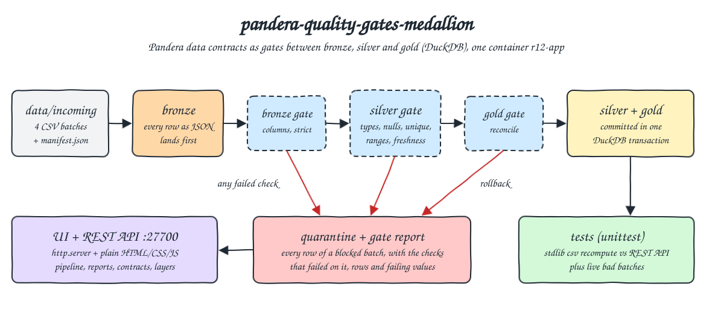
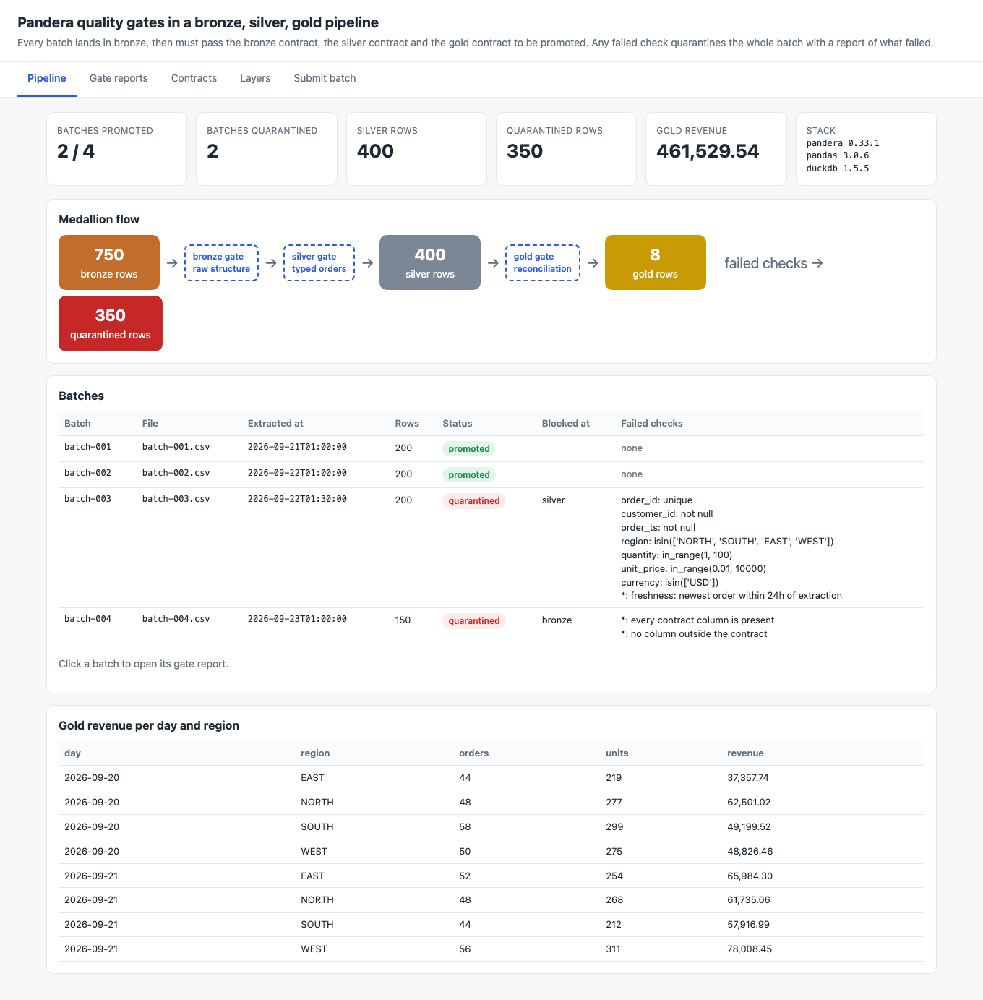
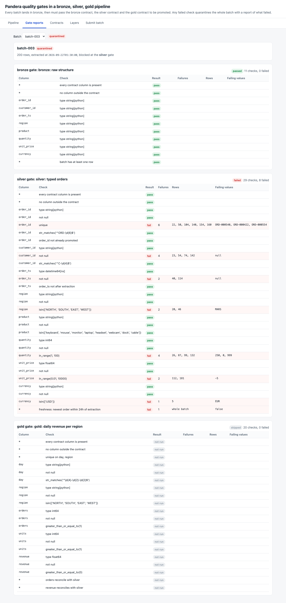
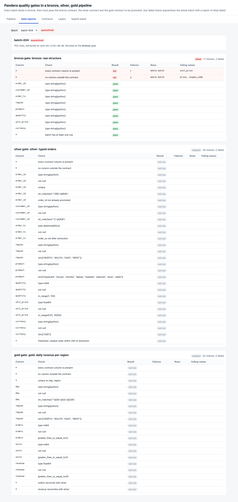
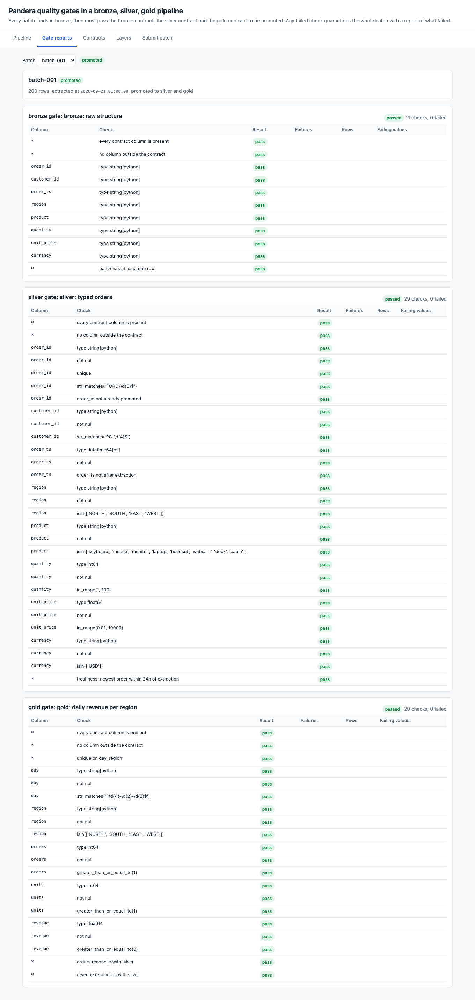
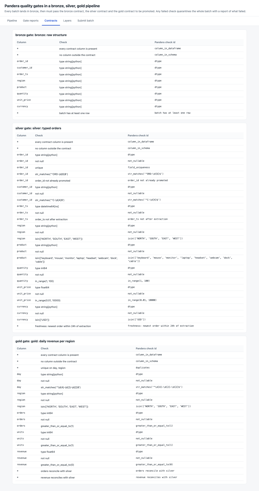
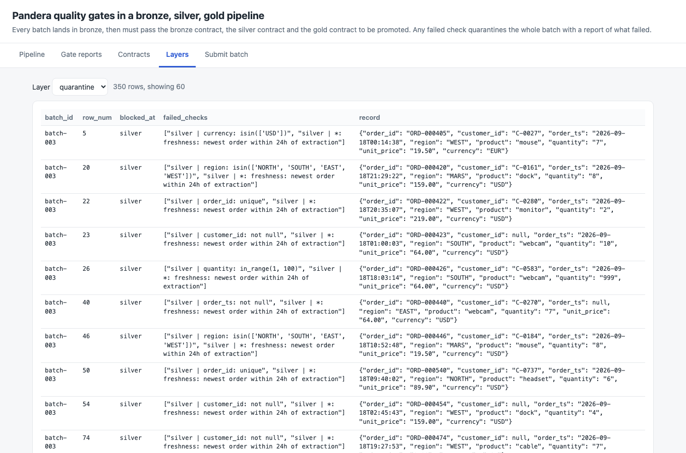
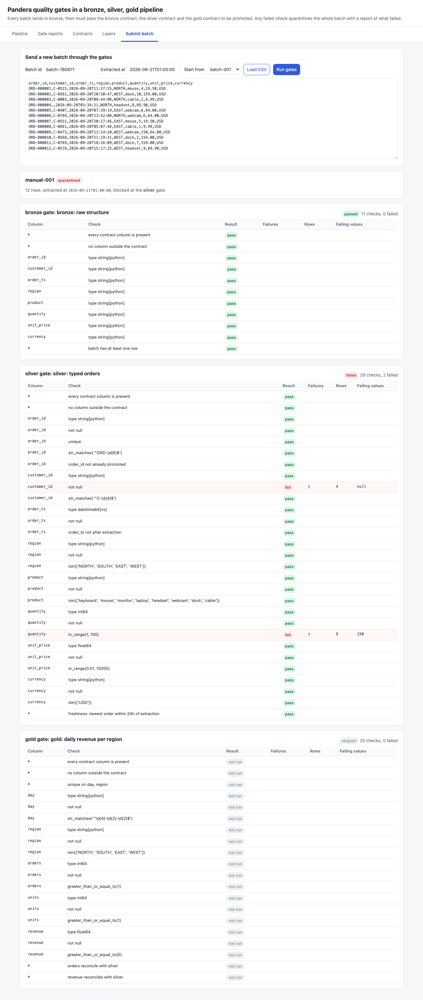

<p align="center"></p>

# pandera-quality-gates-medallion

Data quality and data contracts as quality gates inside a bronze, silver, gold medallion pipeline. Every incoming CSV batch lands in bronze as raw JSON, then has to pass three Pandera 0.33.1 contracts (bronze: raw structure, silver: typed orders, gold: daily revenue reconciliation) before it reaches silver and gold in DuckDB 1.5.5. Clean batches are promoted. A batch with nulls, duplicates, out of range values, schema drift or stale data is blocked and quarantined as a whole, with a report of every check, the rows that broke it and the failing values. A small web UI and a REST API show the flow, the gate reports, the contracts and every layer, and let you send new batches through the gates.

## How it Works

1. `app/gen.py` writes 4 batches into `data/incoming/` from a seeded `random.Random(2026)` plus `manifest.json` with each batch's `extracted_at`: `batch-001` and `batch-002` are clean, `batch-003` has 4 null customers, 2 null timestamps, 3 duplicated order ids, 4 quantities outside 1..100, 2 negative prices, 2 unknown regions, 1 EUR order and is 3 days stale, `batch-004` renamed `unit_price` to `price` and added `coupon_code`.
2. `app/server.py` starts, resets the DuckDB file and runs every batch from the manifest through `app/pipeline.py`.
3. Bronze: every row is stored as JSON in `bronze` whatever its shape, so nothing is lost before a gate runs.
4. Bronze gate (`bronze_contract`): exact column set (`strict=True`), every value read as text, at least one row. Drift stops here and the later gates are marked not run.
5. Silver gate (`silver_contract`): coerces types and checks not null, unique `order_id`, id formats, `order_id` not already promoted, regions, products, `quantity` 1..100, `unit_price` 0.01..10000, currency USD, no order after the extraction time, and freshness (newest order within 24 h of `extracted_at`). Validation is lazy, so every failure is collected, not only the first.
6. Gold gate (`gold_contract`): inside one DuckDB transaction the typed rows go to silver, gold is recomputed, and gold is checked (unique day and region, non negative values, orders and revenue reconcile with silver). A failure rolls back silver too.
7. A failed gate writes every row of the batch to `quarantine` with the checks that failed on that row plus the batch level failures, and the report is stored in `batches`.
8. The same `ingest` runs for `POST /api/batches`, so the UI and the tests can send new batches through the same gates.

## Architecture



## Features

* Whole batch gating: a single bad row blocks the batch, so silver and gold never hold half of a delivery.
* Three contracts, one per layer boundary: structure first, then types and rules, then aggregate reconciliation, each with its own report.
* Row level evidence: each failed check lists the row numbers of the source file and the failing values, and each quarantined row lists its failed checks.
* Batch level checks: freshness, schema drift and emptiness are reported against the whole batch.
* Schema drift detection: missing and unexpected columns are both reported, and later gates are not run on a drifted batch.
* Replay protection: an `order_id` already in silver fails the silver gate, so a re-sent file cannot double count revenue.
* Atomic promotion: silver insert, gold rebuild and the gold gate run in one transaction, rolled back when gold fails.
* Contracts as data: `/api/contracts` lists every check of every gate from the Pandera schema objects, so the UI can not show a rule that does not run.
* Live gate: paste or edit a CSV in the UI and see its full report in place.

## Stack

* Pandera 0.33.1: declarative dataframe contracts with lazy validation and a `failure_cases` table that gives check, column, value and row index.
* pandas 3.0.6: the dataframe backend Pandera validates, reads the CSVs as text.
* DuckDB 1.5.5: embedded storage for bronze, silver, quarantine, gold and the reports, with transactions for atomic promotion.
* Python 3.14.7 (`docker.io/library/python:3.14.7-slim`): one image runs the generator, the pipeline, the UI and the tests.
* Python stdlib `http.server` + plain HTML, CSS and JS: the REST API and the UI, no framework.
* podman + podman-compose: one container, `r12-app`, 512 MB memory limit and 1 CPU.

Soda Core 4.25.0 and Great Expectations 1.23.2 were considered. Great Expectations 1.23.2 declares `requires_python <3.14`, and Pandera gives row level failure cases in plain Python with no extra service, so Pandera was the simplest fit.

## Contracts / APIs

| Method | Path | Description |
|---|---|---|
| GET | `/` | UI |
| GET | `/api/health` | `{"status": "ok"}` |
| GET | `/api/summary` | Row count per layer, gold revenue, batch statuses with failed checks, stack versions |
| GET | `/api/batches` | Full gate report of every batch |
| GET | `/api/batches/{batch_id}` | Gate report of one batch, 404 when unknown |
| GET | `/api/contracts` | Every check of the bronze, silver and gold contracts |
| GET | `/api/layers/{bronze,silver,quarantine,gold}?limit=100` | Columns, rows and total of a layer |
| GET | `/api/incoming` | The manifest of generated batches |
| GET | `/api/incoming/{batch_id}` | The raw CSV of a generated batch |
| POST | `/api/batches` | Body `{"batch_id", "extracted_at", "csv"}`, runs the gates, 201 with the report, 409 when the batch id was already processed |
| POST | `/api/pipeline/run` | Resets the warehouse and reruns every generated batch |

Report of `batch-003` (trimmed):

```json
{"batch_id": "batch-003", "file": "batch-003.csv", "extracted_at": "2026-09-22T01:30:00", "rows": 200,
 "status": "quarantined", "blocked_at": "silver",
 "failed_checks": ["order_id: unique", "customer_id: not null", "order_ts: not null", "region: isin(['NORTH', 'SOUTH', 'EAST', 'WEST'])",
                   "quantity: in_range(1, 100)", "unit_price: in_range(0.01, 10000)", "currency: isin(['USD'])",
                   "*: freshness: newest order within 24h of extraction"],
 "gates": [{"gate": "bronze", "contract": "bronze: raw structure", "passed": true, "skipped": false, "checks": ["..."]},
           {"gate": "silver", "contract": "silver: typed orders", "passed": false, "skipped": false,
            "checks": [{"column": "quantity", "check": "in_range(1, 100)", "label": "in_range(1, 100)", "passed": false,
                        "failures": 4, "rows": [26, 87, 99, 132], "samples": [250, 0, 999]}, "..."]},
           {"gate": "gold", "contract": "gold: daily revenue per region", "passed": null, "skipped": true, "checks": ["..."]}]}
```

## Key data structures and design decisions

* Tables: `bronze(batch_id, row_num, record JSON, landed_at)`, `silver(batch_id, order_id, customer_id, order_ts, region, product, quantity, unit_price, currency)`, `quarantine(batch_id, row_num, blocked_at, failed_checks JSON, record JSON)`, `gold(day, region, orders, units, revenue)`, `batches(batch_id, file, extracted_at, rows, status, blocked_at, report JSON, processed_at)`.
* Bronze stores JSON, not typed columns, so a drifted file still lands and can be inspected or replayed after the contract is fixed.
* `row_num` is the 1 based data row of the source file and is the pandas index during validation, so Pandera's `failure_cases.index` maps straight to the file.
* Freshness is measured against the batch's `extracted_at` from the manifest (or the POST body), not the wall clock, so the result is reproducible on any day.
* The silver contract is built per batch because two checks need batch context: the extraction time and the order ids already promoted.
* A report lists every check of every gate with pass, fail or not run, built from the schema objects (`contracts.catalog`), not only the failures, so a report shows what was checked too.
* Every container and the network use the `r12-` prefix (`r12-app`, `r12-net`). The DuckDB file lives inside the container and is rebuilt on each start.

## How to run

Requirements: podman, podman-compose, curl and lsof. Python and every library run inside the container.

```bash
./scripts/setup.sh
./scripts/start-all.sh
./scripts/test-all.sh
./scripts/ui.sh
./scripts/stop-all.sh
```

`test-all.sh` runs `tests/test_gates.py` inside `r12-app` against the live API. The tests recompute the truth from the CSV files with the stdlib `csv` module and `Decimal`, without pandas, Pandera or DuckDB:

* Only batches that meet every business rule (contract columns, no nulls, unique ids, ranges, known regions, USD, fresh) are promoted, and exactly those are.
* Silver holds exactly the order ids of promoted batches, bronze holds every row of every batch, quarantine holds every row of every blocked batch.
* For `batch-003` each check flags exactly the rows that break the rule, rules with no broken rows do not fail, and the freshness failure is reported.
* Every quarantined row carries its own failed checks and the batch level freshness failure.
* `batch-004` is blocked at bronze, the missing and unexpected columns equal the header difference, and the later gates did not run.
* Gold equals a `Decimal` aggregate per day and region of the promoted rows.
* Live batches: a new clean batch is promoted and gold revenue grows by exactly its revenue, one null plus one out of range quantity blocks the batch at the right rows and leaves silver and gold unchanged, replayed orders are blocked, an order after extraction and a stale batch are blocked, and a reused batch id gets 409.

The tests were also run against a tampered contract (quantity range widened to 0..1000) and 3 tests failed, as they should.

```
starting the pipeline and ui
batch-001 promoted  failed=0
batch-002 promoted  failed=0
batch-003 quarantined silver failed=8
batch-004 quarantined bronze failed=2
layers {'bronze': 750, 'silver': 400, 'quarantine': 350, 'gold': 8} ui on port 8080
test_a_new_clean_batch_is_promoted_and_gold_grows_by_its_revenue ... ok
test_a_reused_batch_id_is_rejected ... ok
test_an_order_after_the_extraction_time_and_a_stale_batch_are_blocked ... ok
test_one_null_and_one_out_of_range_value_block_the_whole_batch ... ok
test_replaying_already_promoted_orders_is_blocked ... ok
test_bad_batch_report_names_exactly_the_rows_that_break_each_rule ... ok
test_bronze_lands_every_row_of_every_batch_before_any_gate ... ok
test_gold_equals_an_independent_aggregate_of_promoted_batches ... ok
test_only_batches_that_meet_every_rule_are_promoted ... ok
test_quarantine_holds_every_row_of_every_blocked_batch ... ok
test_quarantined_rows_carry_the_checks_that_failed_on_them ... ok
test_schema_drift_is_blocked_at_bronze_with_missing_and_extra_columns ... ok
test_silver_holds_exactly_the_rows_of_promoted_batches ... ok
test_ui_serves_every_tab ... ok

----------------------------------------------------------------------
Ran 14 tests in 2.013s

OK
all tests passed
```

## Printscreens

Pipeline tab: 2 of 4 batches promoted, 400 silver rows, 350 quarantined rows, the gold revenue and the stack versions. The flow shows the row count per layer between the three gates, the batch table has each status, where it was blocked and the failed checks, and the gold table is the daily revenue per region built only from promoted batches.



Gate reports tab on `batch-003`: the bronze gate passed, the silver gate failed 8 of 29 checks, each with the failing row numbers of the file and the failing values (duplicated ids, nulls, `MARS`, `250, 0, 999`, `-5`, `EUR`) plus the batch level freshness failure. The gold gate was not run.



Gate reports tab on `batch-004`: the bronze gate reports `unit_price` missing and `price`, `coupon_code` outside the contract, and the silver and gold gates are not run.



Gate reports tab on `batch-001`: every check of the three gates passed, including the gold reconciliation with silver.



Contracts tab: every check of the bronze, silver and gold contracts with its Pandera check id, read from the schema objects the pipeline runs.



Layers tab on quarantine: each quarantined row with the gate that blocked it, the checks that failed on that row and the raw record as it landed in bronze. Rows with a row level failure come first.



Submit batch tab: 12 rows of `batch-001` with new order ids, one customer id removed on row 4 and quantity 150 on row 9. The batch is quarantined at the silver gate with exactly those two checks and rows.



## Scripts

All scripts live in `scripts/` and run from any directory of the repository.

| Script | What it does |
|---|---|
| `./scripts/setup.sh` | Pulls the Python image, builds the app image, generates the batches when missing |
| `./scripts/start-all.sh` | Starts `r12-app`, waits for the API, prints the batch outcomes and every link |
| `./scripts/status.sh` | Shows every service port as UP or DOWN |
| `./scripts/test-all.sh` | Runs the tests inside `r12-app` |
| `./scripts/ui.sh` | Opens the UI in the browser |
| `./scripts/stop-all.sh` | Stops the container and waits until the port is free |

Ports are declared in `scripts/ports.env`: UI and REST API 27700 (`http://localhost:27700`).

```bash
./scripts/setup.sh
./scripts/start-all.sh
./scripts/status.sh
./scripts/ui.sh
./scripts/stop-all.sh
```
