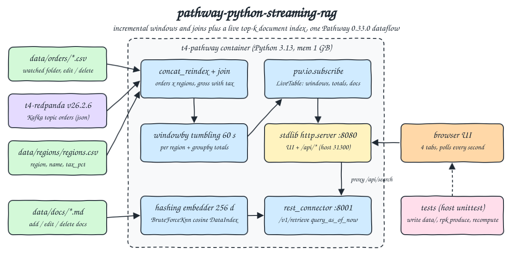
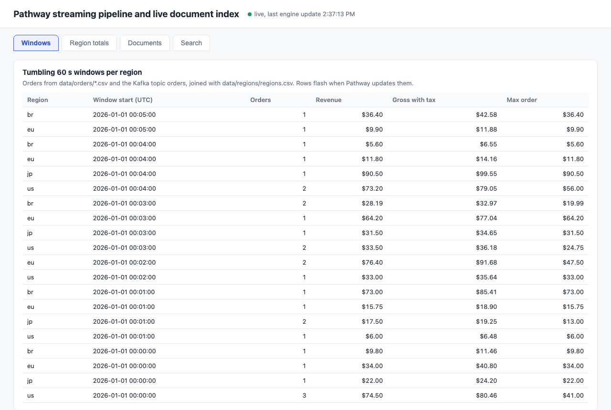
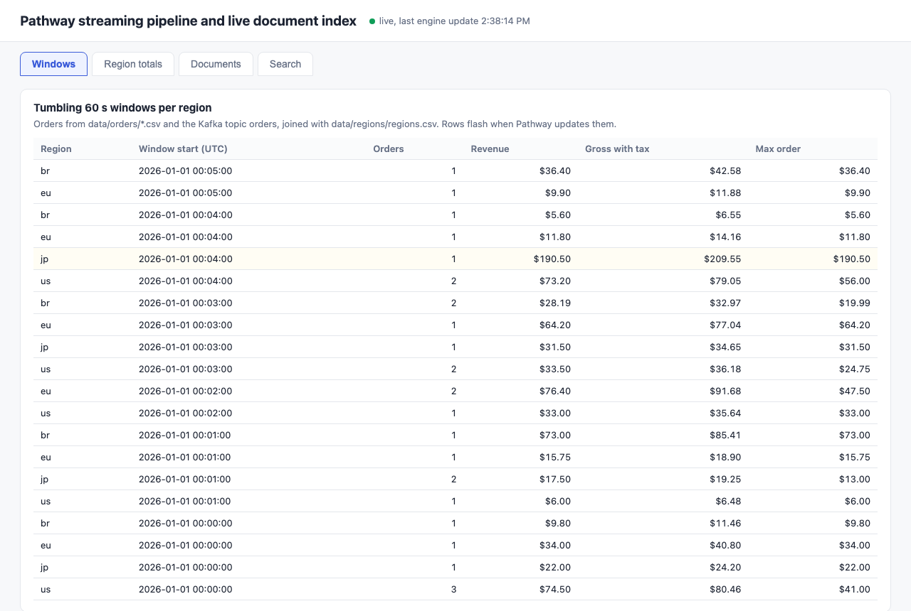
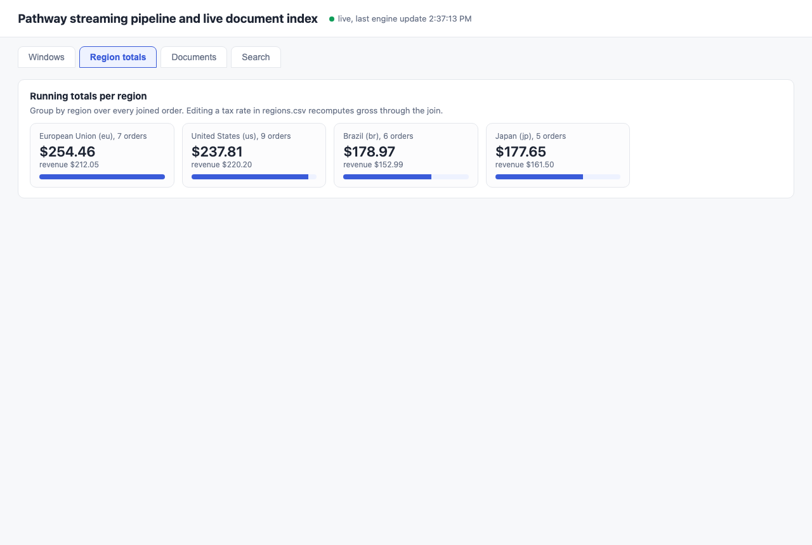
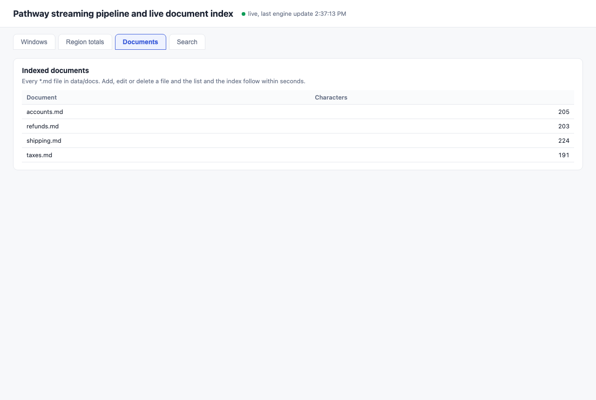
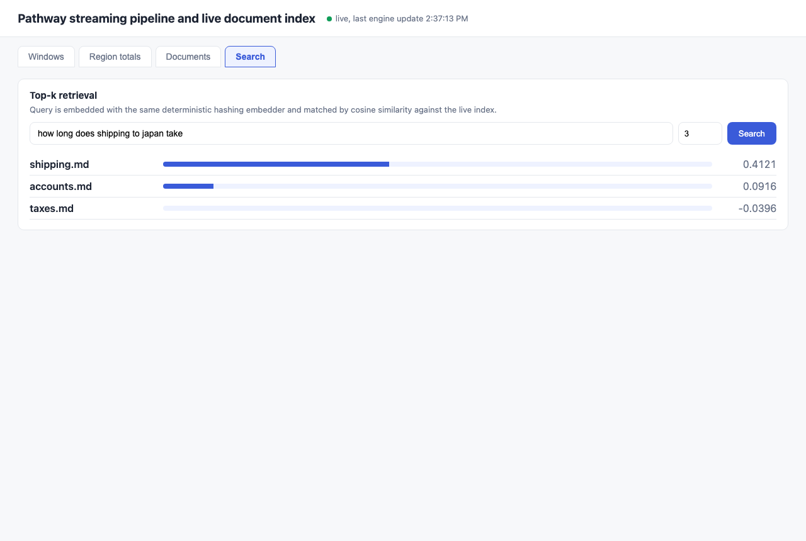
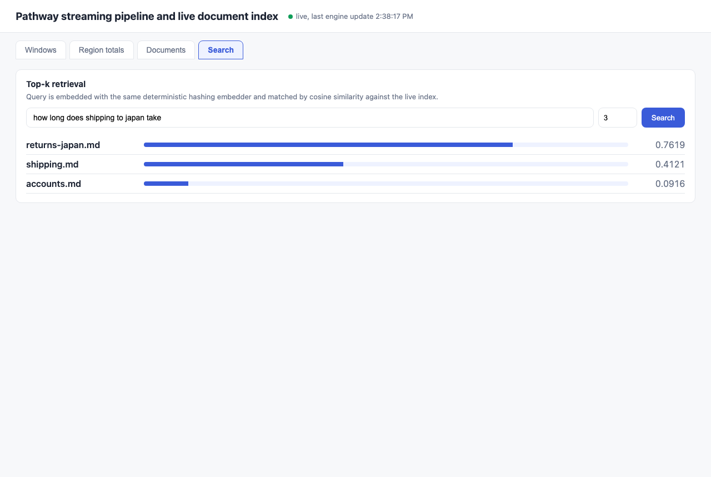

<p align="center"></p>

# pathway-python-streaming-rag

Pathway, the Python streaming engine with a Rust dataflow core, running two things in one dataflow. First, a streaming pipeline: orders arrive from CSV files dropped into a watched folder and from a Kafka topic on Redpanda, are joined with a region table read from another watched folder, and are aggregated into 60 second tumbling windows and running totals per region. Editing or deleting a CSV row updates only the affected aggregates, incrementally. Second, a live document index for retrieval: every Markdown file in a folder is embedded and kept in a cosine nearest neighbor index, and a query endpoint returns the top-k matches, reflecting an added, edited or deleted document within about a second. No API keys and no model download: the embedder is a deterministic feature hashing embedder (bag of words hashed with MD5 into 256 signed buckets, L2 normalized), written in plain Python in `app/embedder.py`.

## How it Works

1. `t4-redpanda` runs Redpanda v26.2.6 (Kafka API). `start-all.sh` creates the topic `orders` and, only when it creates it, publishes `data/kafka-orders.jsonl` to it.
2. `t4-pathway` runs `app/server.py`, which builds one Pathway 0.33.0 graph and calls `pw.run()`. `./data` is bind mounted at `/data`.
3. `app/pipeline.py`: `pw.io.csv.read` (streaming) on `data/orders` and `pw.io.kafka.read` (json) on `orders`, merged with `concat_reindex`, inner joined with `data/regions/regions.csv` (primary key `region`), then `windowby(tumbling(60))` per region and a `groupby(region)`.
4. `app/docindex.py`: `pw.io.fs.read(format="plaintext_by_file")` on `data/docs/*.md`, a `BruteForceKnn` index with metric `COS` and the hashing embedder as a Pathway UDF, wrapped in a `DataIndex`. `pw.io.http.rest_connector` takes queries on `/v1/retrieve` and answers them with `query_as_of_now`, so each answer uses the index as it is at that moment.
5. `app/live.py` subscribes to the window, totals and docs tables with `pw.io.subscribe` and keeps the current rows in memory, applying retractions before insertions at the end of each engine time.
6. A stdlib `http.server` thread serves the UI, `GET /api/{windows,totals,docs}` and proxies `POST /api/search` to the Pathway REST connector.
7. `scripts/test-all.sh` runs the host tests: they change files in `data/`, publish to the topic with `rpk`, recompute every expected aggregate and every cosine score themselves from the raw inputs, and compare with the API.

## Architecture



## Features

* Two sources, one table: file orders and Kafka orders are merged with `concat_reindex` and aggregated together, so the windows do not care where a row came from.
* Incremental updates on file edits: Pathway's file connector re-reads a changed file and emits retractions for the old rows, so an edited amount changes only its window and a moved timestamp leaves its old window.
* Deleting a file retracts every row it contributed; windows that become empty disappear.
* Streaming join with a dimension table: changing a tax rate in `regions.csv` recomputes the gross of every past order of that region, no reprocessing job.
* Inner join semantics: an order for an unknown region (`xx`) is dropped, and the tests prove it.
* Tumbling 60 s windows per region with count, revenue, gross with tax and max order, plus running totals per region.
* Live document index: add, edit or delete a `.md` file and the next query sees it, measured under 10 s by the tests.
* `query_as_of_now`: a query is answered against the index as it is now, and is not recomputed later when documents change.
* Local deterministic embedder: no model, no GPU, no key, reproducible scores that the tests recompute exactly.
* Lean: Redpanda 640 MB limit (`--memory=400M --smp=1`), Pathway 1 GB limit, about 200 MB and 175 MB used.

## Stack

* Pathway 0.33.0 (`pathway==0.33.0` on PyPI): latest release, incremental dataflow engine with Python API, Kafka, file and HTTP connectors and KNN indexes built in.
* Redpanda v26.2.6 (`docker.io/redpandadata/redpanda:v26.2.6`): Kafka compatible broker in one container, no ZooKeeper, small memory footprint.
* Python 3.13.18 (`docker.io/library/python:3.13.18-slim`): Pathway wheels are `cp310-abi3` for Linux arm64 and x86_64.
* Python stdlib `http.server`, `urllib`, `hashlib`, `unittest` + plain HTML, CSS and JS: no web framework, no test framework, no embedding library.
* podman + podman-compose: runs the 2 containers, the network `t4-net` and the volume `t4-redpanda-data`.

## Contracts / APIs

| Method | Path / endpoint | Description |
|---|---|---|
| GET | `http://localhost:31300/` | UI |
| GET | `/api/windows` | Current tumbling windows: `region`, `window_start` (epoch s), `orders`, `revenue`, `gross`, `max_amount` (cents) |
| GET | `/api/totals` | Running totals per region: `region`, `name`, `orders`, `revenue`, `gross` |
| GET | `/api/docs` | Indexed documents: `doc`, `chars` |
| POST | `/api/search` | Body `{"query": "...", "k": 3}`, proxied to the Pathway REST connector |
| POST | `http://localhost:31301/v1/retrieve` | Pathway `rest_connector`, same body and answer |
| Kafka | `localhost:31302`, topic `orders` | JSON value `{"order_id": "k-001", "region": "us", "amount": 2100, "ts": 1767225606}` |

Every `/api/{windows,totals,docs}` answer is `{"rows": [...], "updated_at": <epoch s>, "batches": <engine times seen>}`.

```json
POST /api/search {"query": "how long does shipping to japan take", "k": 3}
[{"doc": "shipping.md", "score": -0.587918, "similarity": 0.412082},
 {"doc": "accounts.md", "score": -0.908426, "similarity": 0.091574},
 {"doc": "taxes.md", "score": -1.039559, "similarity": -0.039559}]
```

Input files: `data/orders/*.csv` with `order_id,region,amount,ts`, `data/regions/regions.csv` with `region,name,tax_pct`, `data/docs/*.md` free text.

## Key data structures and design decisions

* `gross = amount * (100 + tax_pct) // 100` per order, in integer cents, then summed. The tests use the same integer formula, so there is no float rounding to argue about.
* Windows use `tumbling(duration=60, origin=0)` on the integer `ts`, so `window_start = ts // 60 * 60`, which is what the tests recompute.
* Kafka is read with a fresh `group.id` on every start and `auto.offset.reset=earliest`, so after a restart Pathway rebuilds the aggregates from the whole topic plus the files. No Pathway persistence is configured; the state is rebuilt from the sources.
* `LiveTable` buffers the changes of one engine time and applies deletions first, then insertions: an updated window arrives as a retraction plus an insertion with the same key, and the order inside a batch is not something to rely on.
* The Pathway index score for `COS` is `cosine - 1` (0 for an identical direction). The API returns it as `score` and `similarity = 1 + score`; the tests check `similarity` against a cosine they compute themselves, to 5 decimals.
* Empty documents are filtered out before indexing, a zero vector has no cosine.
* Pathway bug worked around: with `delete_completed_queries=True` on the REST connector, deleting a document after any query panicked the engine (`TryFromIntError(NegOverflow)` in `dataflow.rs`) and killed the process. Reproduced in isolation: one query, then `rm` of one doc. With `delete_completed_queries=False` it does not happen, at the cost of keeping one row per answered query in memory, which is fine for a POC but would need a periodic restart or a fixed Pathway release for long running use.
* Pathway limitation found by the tests: the file connector notices a change by file size and modification time with one second resolution. Rewriting a file within the same second with the same size (`1000` to `4000`) was not picked up within the 10 s a probe waited. The tests' `write_atomic` waits until the clock has passed the file's current mtime second before writing, and every write goes through a temp file plus `os.replace`, so Pathway never reads a half written CSV (the `.tmp` name does not match `*.csv`).
* Test data is isolated by time: each pipeline test picks a free block of four 60 s windows in 2030 that no order uses yet, and Kafka orders from earlier runs stay in the topic, so the expected values are always computed from everything in the folders and the topic at that moment.
* The UI and API only report what Pathway emitted. All expected values live in the tests.
* Every container, the network and the volume start with `t4-`, every port is in 31300-31302.

## How to run

Requirements: podman, podman-compose, curl, lsof and python3 (stdlib only, for the tests and the scripts). Everything else runs in containers.

```bash
./scripts/setup.sh
./scripts/start-all.sh
./scripts/test-all.sh
./scripts/ui.sh
./scripts/stop-all.sh
```

`tests/test_pipeline.py` (9 tests) checks:

* Windows and totals equal an independent computation over every CSV row and every message read back from the topic with `rpk`.
* Orders with an unknown region are not counted anywhere.
* A new file lands in the right windows (two orders in one window, one in the next, exact count, revenue, max and gross).
* Editing one amount changes its window by exactly the delta and leaves the other window untouched.
* Moving a row's timestamp removes the old window and creates the new one.
* Deleting a file brings every aggregate back to the state before the file existed.
* Kafka and file orders in the same window are aggregated together.
* Raising Japan's tax rate to 50 recomputes Japan's gross from all its orders and does not touch the other regions.
* The UI page has every tab.

`tests/test_retrieval.py` (6 tests) checks:

* The embedder is deterministic, unit length, and shared words score higher than unrelated text.
* For 4 queries the top-k similarities equal a brute force cosine ranking over the files in `data/docs`.
* A new doc becomes the top match, an edited doc moves from the volcano query to the glacier query, a deleted doc disappears from the results, each within 10 s, and the results again equal the brute force ranking.

```
running tests/test_pipeline.py
test_a_new_file_lands_in_the_right_windows ... ok
test_aggregates_equal_an_independent_computation_over_files_and_topic ... ok
test_changing_a_tax_rate_recomputes_gross_through_the_join ... ok
test_deleting_a_file_retracts_all_its_rows ... ok
test_editing_a_row_updates_only_its_window ... ok
test_moving_a_row_to_another_window_retracts_it_from_the_old_one ... ok
test_orders_published_to_the_topic_are_aggregated_with_the_file_orders ... ok
test_orders_with_an_unknown_region_are_dropped_by_the_join ... ok
test_ui_page_has_every_tab ... ok

Ran 9 tests in 14.874s
OK
running tests/test_retrieval.py
test_shared_words_score_higher_than_unrelated_text ... ok
test_vectors_are_deterministic_and_unit_length ... ok
test_a_new_doc_becomes_the_top_match_within_seconds ... ok
test_deleting_a_doc_removes_it_from_results ... ok
test_editing_a_doc_moves_it_between_queries ... ok
test_top_k_equals_a_brute_force_cosine_ranking_over_the_folder ... ok

Ran 6 tests in 7.946s
OK
all tests passed
```

## Printscreens

Windows tab: every 60 s window per region over the 22 file orders and the 6 Kafka orders. Order `f-009` (region `xx`) is missing because the join drops it.



Windows tab right after `f-020` in `batch-002.csv` was edited from 9050 to 19050 cents: only the `jp 00:04` window changed (revenue $190.50, flashed in yellow), every other row stayed the same.



Region totals tab: orders, revenue and gross with tax per region, from the `groupby` over the joined orders.



Documents tab: the 4 Markdown files currently in the index with their size.



Search tab: "how long does shipping to japan take" returns `shipping.md` first with cosine similarity 0.41.



Search tab after `returns-japan.md` was dropped into `data/docs`: the same query now returns it first (0.76), seconds later, without any rebuild.



Search tab after `returns-japan.md` was deleted: it is gone and the ranking is back to the original.


## Scripts

All scripts live in `scripts/` and run from any directory of the repository.

| Script | What it does |
|---|---|
| `./scripts/setup.sh` | Pulls the Redpanda and Python images and builds the app image with Pathway |
| `./scripts/start-all.sh` | Starts Redpanda, creates and seeds the `orders` topic when missing, starts Pathway, waits for the first engine batch, prints every link |
| `./scripts/status.sh` | Shows every service port as UP or DOWN |
| `./scripts/test-all.sh` | Runs the pipeline tests and the retrieval tests |
| `./scripts/ui.sh` | Opens the UI in the browser |
| `./scripts/stop-all.sh` | Stops every container and waits until the ports are free, the volume is kept |

Ports are declared in `scripts/ports.env`: UI 31300 (`http://localhost:31300`), Pathway REST connector 31301 (`http://localhost:31301/v1/retrieve`), Kafka 31302 (`kafka://localhost:31302`).

```bash
./scripts/setup.sh
./scripts/start-all.sh
./scripts/status.sh
./scripts/ui.sh
./scripts/stop-all.sh
```
