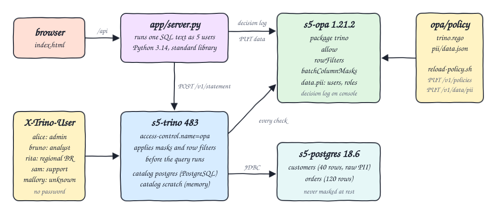
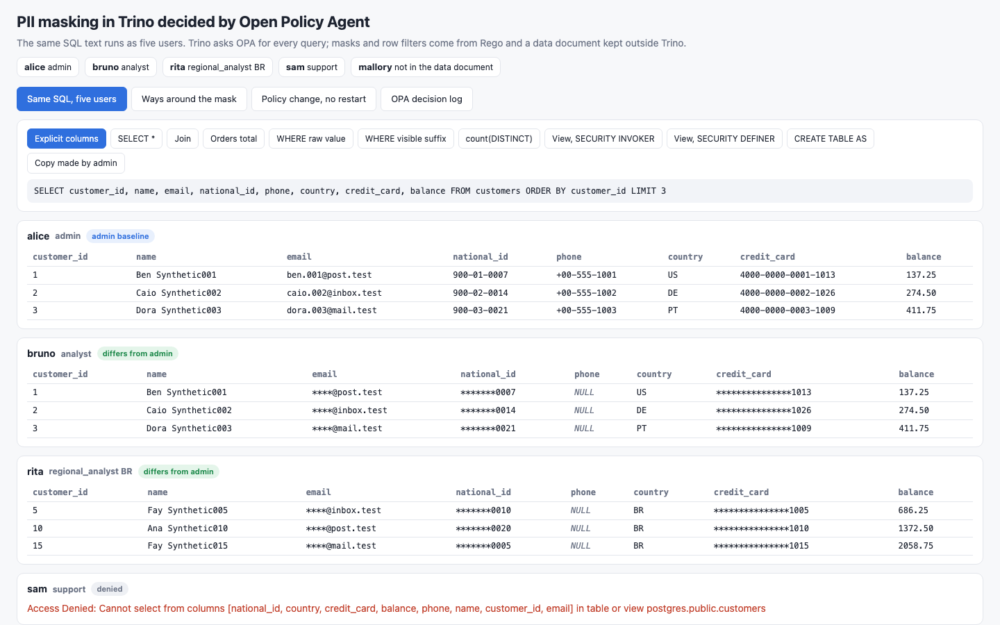
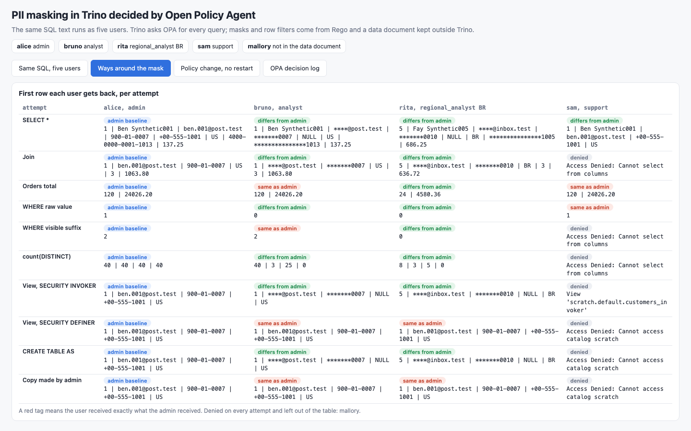
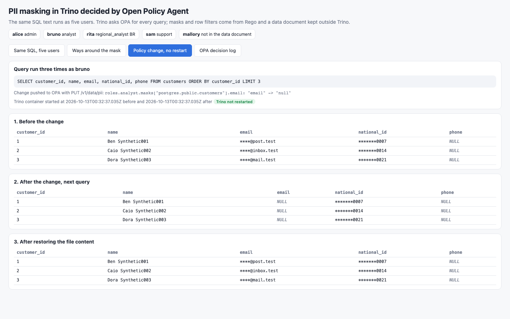
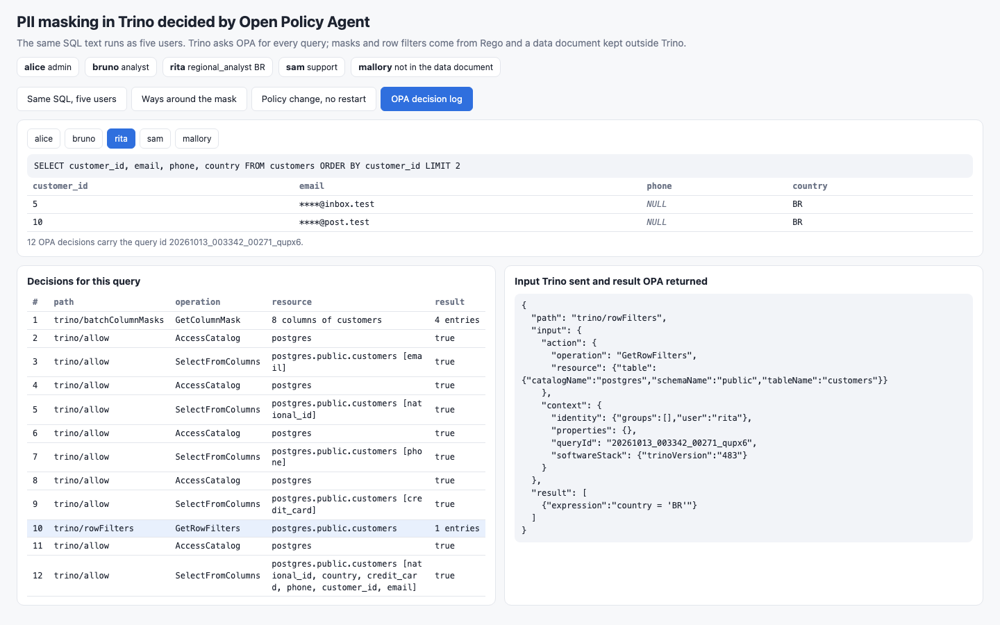

<p align="center"></p>

# pii-masking-trino-opa

PII protection in Trino 483 decided by Open Policy Agent 1.21.2. Trino runs with the OPA access control plugin and asks OPA, for every query, whether the user may run it, which rows they may see and how each column must be masked. The policy is one Rego file plus one JSON data document that live outside Trino. A PostgreSQL 18.6 catalog holds a `customers` table full of synthetic PII and an `orders` table. The same SQL text is run as five users and returns five different answers, and a Python 3.14 UI shows them side by side together with every way of getting around the mask that was tried.

Users are identified only by the `X-Trino-User` header, with no password. That is not authentication: anyone who can reach Trino can claim to be `alice`. This POC is about authorization and masking; a real deployment must put password, OAuth2, Kerberos or certificate authentication in front of it.

## How it Works

1. `start-all.sh` starts `s5-postgres`, loads `data/customers.csv` (40 rows) and `data/orders.csv` (120 rows), then starts `s5-opa` and `s5-trino`.
2. OPA loads `opa/policy/trino.rego` (package `trino`) and `opa/policy/pii/data.json` (document `data.pii`: users, roles, masks, hidden columns, row filter columns).
3. `trino/access-control.properties` sets `access-control.name=opa` with `opa.policy.uri`, `opa.policy.row-filters-uri`, `opa.policy.column-masking-uri` and `opa.policy.batch-column-masking-uri`.
4. For each query Trino sends OPA the user, the operation and the resource. `allow` answers true or false, `rowFilters` answers SQL predicates, `batchColumnMasks` answers one SQL expression per masked column.
5. Trino rewrites the query plan with those expressions before it runs, so the masked value is the only value the rest of the query can see.
6. `app/bootstrap.py` creates, as `alice`, two views and one copy of `customers` in the in-memory `scratch` catalog for the bypass attempts.
7. `app/server.py` runs each named SQL text as `alice`, `bruno`, `rita`, `sam` and `mallory` and serves the results to `index.html`.
8. `reload-policy.sh` pushes the Rego and the data document to the running OPA over its REST API; the next Trino query uses the new policy.
9. `test-all.sh` recomputes every expected result with awk from the CSV files and compares it with what Trino returned.

## Architecture



## Features

* Column masking from Rego: email keeps only the domain, national id and credit card keep the last 4 characters, phone becomes `NULL`.
* Row filter from Rego: the regional analyst only gets rows of the country stored in the data document, on `customers` and on `orders`.
* Column restriction: support cannot select `national_id`, `credit_card` or `balance`; with `hide-inaccessible-columns=true` a `SELECT *` silently drops them.
* Deny by default: a user missing from the data document cannot even start a query.
* Batch column masking: Trino 483 sends all 8 columns of `customers` in one request to `batchColumnMasks`; the single column rule `columnMask` is also defined and unit tested.
* Bypass attempts measured: `SELECT *`, join, `WHERE` on a masked column, `count(DISTINCT)`, invoker view, definer view, `CREATE TABLE AS`, copy made by the admin.
* Policy change without restarting Trino, for both the data document and the Rego text.
* OPA decision log on the console, read back per Trino query id.
* 19 `opa test` unit tests for the Rego.

### The same SQL as five users

```sql
SELECT customer_id, name, email, national_id, phone, country, credit_card, balance
FROM customers ORDER BY customer_id LIMIT 3
```

| User | Role | First row returned |
|---|---|---|
| alice | admin | `1, Ben Synthetic001, ben.001@post.test, 900-01-0007, +00-555-1001, US, 4000-0000-0001-1013, 137.25` |
| bruno | analyst | `1, Ben Synthetic001, ****@post.test, *******0007, NULL, US, ***************1013, 137.25` |
| rita | regional_analyst BR | `5, Fay Synthetic005, ****@inbox.test, *******0010, NULL, BR, ***************1005, 686.25` |
| sam | support | `Access Denied: Cannot select from columns [national_id, country, credit_card, balance, phone, name, customer_id, email] in table or view postgres.public.customers` |
| mallory | not in the data document | `Access Denied: Cannot execute query` |

With `SELECT * FROM customers ORDER BY customer_id LIMIT 3` sam is not denied: the result has only `customer_id, name, email, phone, country` and the first row is `1, Ben Synthetic001, ben.001@post.test, +00-555-1001, US`.

### Ways around the mask, as measured

| Attempt | bruno (analyst) | rita (regional BR) | Verdict |
|---|---|---|---|
| `SELECT *` | masked | masked, BR only | holds |
| Join `customers` with `orders`, selecting `email` and `national_id` | masked | masked, BR only on both sides | holds |
| `WHERE email = 'ben.001@post.test'` (alice gets 1) | 0 | 0 | holds: the predicate is evaluated on the masked value |
| `WHERE national_id LIKE '%0007'` (alice gets 2) | 2 | 0 | leaks by design: a partial mask can be filtered on the part it keeps, so the last 4 characters work as a search key and a quasi identifier |
| `count(*), count(DISTINCT email), count(DISTINCT national_id), count(DISTINCT phone)` (alice gets 40, 40, 40, 40) | 40, 3, 25, 0 | 8, 3, 5, 0 | holds: aggregates run on masked values; the row count is not hidden |
| View with `SECURITY INVOKER` | masked | masked, BR only | holds |
| View with `SECURITY DEFINER` owned by alice | raw PII | raw PII, every country | leaks: Trino asks OPA for masks and filters as the view owner |
| `CREATE TABLE scratch.default.copy_<user> AS SELECT ...` then read back by alice | masked values were stored | masked BR rows were stored | holds: the copy contains only what the user could see |
| Copy of `customers` made by alice in `scratch` | raw PII | raw PII, every country | leaks: masks and filters are keyed by table name, the copy has no entry |

## Stack

* Trino 483 (`docker.io/trinodb/trino:483`) with the bundled `opa` access control plugin, `postgresql` and `memory` connectors, JVM heap 1 GiB.
* Open Policy Agent 1.21.2 (`docker.io/openpolicyagent/opa:1.21.2`), Rego v1 syntax.
* PostgreSQL 18.6 (`docker.io/library/postgres:18.6`).
* Python 3.14.7: data generator, bootstrap and HTTP server, standard library only.
* podman 5.7.1 + podman-compose.
* awk: independent calculation of every expected result.

## API

| Method | Path | Returns |
|---|---|---|
| GET | `/api/users` | the five users with role, country and the role policy read from OPA `data.pii` |
| GET | `/api/cases` | the named SQL attempts |
| GET | `/api/compare?case=<case>` | the SQL text and, per user, columns and rows or the Trino error, plus `same_as_admin` |
| GET | `/api/policy-change` | one query as bruno before, after and after restoring a change of the OPA data document, with the Trino container start time before and after |
| GET | `/api/decisions?user=<user>` | one query as that user and every OPA decision that carries its Trino query id |

Cases: `columns`, `star`, `join`, `orders`, `where_raw`, `where_suffix`, `distinct`, `view_invoker`, `view_definer`, `ctas`, `admin_copy`. The UI accepts `?tab=compare|matrix|policy|decisions`, `&case=<case>` and `&user=<user>`.

One decision from the log, for bruno, as written by OPA (the first 3 of the 8 `filterResources` are shown):

```json
{"path": "trino/batchColumnMasks",
 "input": {"action": {"operation": "GetColumnMask", "filterResources": [
    {"column": {"catalogName": "postgres", "columnName": "customer_id", "columnType": "integer", "schemaName": "public", "tableName": "customers"}},
    {"column": {"catalogName": "postgres", "columnName": "name", "columnType": "varchar", "schemaName": "public", "tableName": "customers"}},
    {"column": {"catalogName": "postgres", "columnName": "email", "columnType": "varchar", "schemaName": "public", "tableName": "customers"}}]},
  "context": {"identity": {"groups": [], "user": "bruno"}, "properties": {}, "queryId": "20261013_003348_00272_qupx6", "softwareStack": {"trinoVersion": "483"}}},
 "result": [
    {"index": 2, "viewExpression": {"expression": "regexp_replace(email, '^[^@]+', '****')"}},
    {"index": 3, "viewExpression": {"expression": "lpad(substr(national_id, -4), length(national_id), '*')"}},
    {"index": 4, "viewExpression": {"expression": "CAST(NULL AS varchar)"}},
    {"index": 6, "viewExpression": {"expression": "lpad(substr(credit_card, -4), length(credit_card), '*')"}}]}
```

## Key Design Decisions

* Rego holds the logic, `pii/data.json` holds who has which role, which column gets which mask kind and which column filters rows. Changing a mask is a data change, not a code change.
* Mask expressions are built in Rego from the column name and type Trino sends (`CAST(NULL AS varchar)` uses `columnType`), so one `null` kind works for any column type.
* Masks and filters are keyed by `catalog.schema.table`. This is why the admin copy leaks; a policy keyed by column name or by tags would cover copies, at the cost of masking unrelated columns that share a name.
* The definer view leak is how Trino works: the view body is analysed as the owner. Views over PII tables must be `SECURITY INVOKER`, or the policy must refuse `CreateViewWithSelectFromColumns` on them.
* Both `opa.policy.column-masking-uri` and `opa.policy.batch-column-masking-uri` are set; Trino 483 used only the batch endpoint in every decision logged.
* OPA has no file watcher here. The files are loaded at start and `reload-policy.sh` replaces policy `s5/policy/trino.rego` and document `data.pii` over REST, which works the same on every host file system.
* The decision log goes to the OPA console (`decision_logs.console=true`); the server filters `podman logs s5-opa` by Trino query id. `ExecuteQuery` is checked before a query id exists, so it is not in the per query list.
* `hide-inaccessible-columns=true` makes `SELECT *` usable for support; an explicit hidden column is still an error, never a silent `NULL`.
* Non admin roles may write only in `scratch.default` and may not create views.
* All customer data is synthetic and generated by `app/generate.py`: names like `Ben Synthetic001`, `.test` mail domains, `900-` national ids, `4000-0000-` card numbers.

## Verification

`./scripts/test-all.sh` output:

```
PASS opa test: every rego unit test passes
opa test: PASS: 19/19
PASS explicit columns as alice (admin) are the raw csv rows
PASS explicit columns as bruno (analyst) match awk masks: email ****@domain, id and card last 4, phone NULL
PASS explicit columns as rita (regional analyst) are masked and only country BR
PASS explicit columns as sam (support) are denied because national_id, credit_card and balance are hidden
PASS explicit columns as mallory (unknown) are denied before the query starts
PASS select * as bruno returns the same masked rows
PASS select * as sam silently drops the 3 hidden columns and keeps contact data raw
PASS select * as mallory is denied
PASS join as alice matches an awk join over both csv files
PASS join as bruno keeps the masks on the joined columns
PASS join as rita is masked and both sides are filtered to BR
PASS join as sam is denied because it reads national_id
PASS orders total as alice is every order
PASS orders total as rita only counts BR orders (row filter on orders)
PASS where email = raw value as alice finds the customer
PASS where email = raw value as bruno finds nothing: the predicate runs on the masked value
PASS where national_id like visible suffix as bruno still matches as many rows as alice (partial mask leaks the suffix)
PASS where national_id like visible suffix as rita only counts BR
PASS count(distinct) as alice counts raw values
PASS count(distinct) as bruno counts masked values
PASS count(distinct) as rita counts masked values of BR
PASS security invoker view as bruno is masked
PASS security invoker view as rita is masked and filtered
PASS LEAK security definer view owned by admin returns raw rows to bruno
PASS LEAK security definer view owned by admin returns every country raw to rita
PASS views in the scratch catalog are denied to sam
PASS create table as by bruno persists the masked values, read back by alice
PASS create table as by rita persists masked BR rows only, read back by alice
PASS create table as by sam is denied
PASS LEAK copy made by admin has no policy entry and returns raw rows to bruno
opa reloaded rego and data, trino started at 2026-10-13T00:32:37.035Z and was not restarted
PASS data change: email mask kind null takes effect on the next query
opa reloaded rego and data, trino started at 2026-10-13T00:32:37.035Z and was not restarted
PASS rego change: email mask text hidden takes effect on the next query
opa reloaded rego and data, trino started at 2026-10-13T00:32:37.035Z and was not restarted
PASS policy restored from the repository files
PASS trino container start time did not change across 3 policy reloads
PASS decision log holds the row filter opa returned to trino for rita
PASS decision log shows trino asked for all 8 columns in one batch and opa masked the 4 pii ones
decision log: 12 opa decisions for one query
measured: customers|distinct emails|distinct national ids|distinct phones
  alice 40|40|40|40
  bruno 40|3|25|0
  rita  8|3|5|0
all 37 checks passed
```

The checks named `LEAK` assert the leak that was measured, so the run fails if Trino or the policy ever changes that behaviour. The suite was also run once against a policy with the `national_id` mask removed and failed on the first analyst check.

Measured on this run:

| What | Value |
|---|---|
| Checks in `test-all.sh` | 37 passed, 0 failed, 0 skipped |
| Rego unit tests | 19 of 19 passed |
| Orders total as alice / as rita | 120 orders, 24026.20 / 24 orders, 4580.36 |
| Distinct emails, national ids, phones as alice / bruno / rita | 40, 40, 40 / 3, 25, 0 / 3, 5, 0 |
| OPA decisions carrying the query id of one 4 column select | 12 as bruno or rita, 4 as alice or sam, 0 as mallory |
| One select through the API including reading the decision log | 283 to 297 ms, 6 ms for the denied user |
| Policy reloads without a Trino restart | 3 in the tests (data, Rego, restore) |
| Memory in use after the tests | Trino 912.6 MB of 2 GiB, OPA 17.6 MB, PostgreSQL 25.6 MB |
| `start-all.sh` with images already pulled | 9 s |
| `test-all.sh` | 10 s |

## Printscreens

Same SQL, five users: the explicit column list run as each user. alice gets raw rows, bruno gets the masks, rita gets the masks and only BR customers (ids 5, 10, 15), sam is denied because the list names hidden columns.



Ways around the mask: the first row each user gets for every attempt. Green means the answer differs from the admin answer, red means it is identical to it. The red cells for bruno and rita on the definer view and on the admin copy are the two real leaks; the red cell on `WHERE visible suffix` is the partial mask being searchable. `Orders total` is red for bruno and sam because `orders` has no mask and they have no row filter.



Policy change, no restart: the same query as bruno before the change, after the email mask kind is set to `null` in OPA, and after the file content is restored. The Trino container start time is the same before and after.



OPA decision log: one query as rita, the 12 decisions that carry its Trino query id, and the full input Trino sent for `GetRowFilters` with the `country = 'BR'` predicate OPA returned.



## Scripts

All scripts live in `scripts/` and run from any directory of the repository.

| Script | What it does |
|---|---|
| `./scripts/setup.sh` | Creates the Python 3.14 venv, generates the synthetic CSV files, pulls the three images |
| `./scripts/start-all.sh` | Starts PostgreSQL, OPA and Trino, loads the tables, pushes the policy, creates the views and the copy, starts the UI and prints the full link of each service |
| `./scripts/status.sh` | Shows every service port as UP or DOWN |
| `./scripts/test-all.sh` | Runs `opa test`, then verifies every user and every bypass attempt against awk, the policy reloads and the decision log |
| `./scripts/reload-policy.sh [dir]` | Pushes the Rego and the data document from `opa/policy` (or `dir`) to the running OPA, without touching Trino |
| `./scripts/ui.sh` | Opens the UI in the browser |
| `./scripts/stop-all.sh` | Stops every service |
| `./scripts/sql-console.sh [user]` | Opens the Trino CLI on `postgres.public` as that user (default `alice`) |

Ports are declared in `scripts/ports.env`: postgres 30400, opa 30401, trino 30402, ui 30403.

```bash
./scripts/setup.sh
./scripts/start-all.sh
./scripts/status.sh
./scripts/test-all.sh
./scripts/ui.sh
./scripts/stop-all.sh
```

To change the policy by hand: edit `opa/policy/pii/data.json` or `opa/policy/trino.rego`, run `./scripts/reload-policy.sh`, and run the query again.
