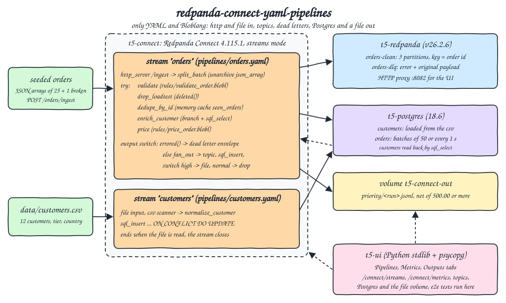
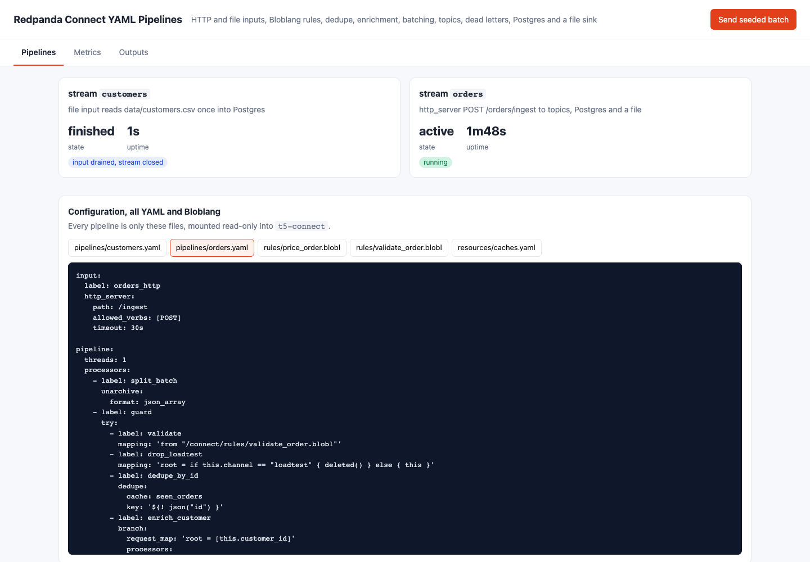
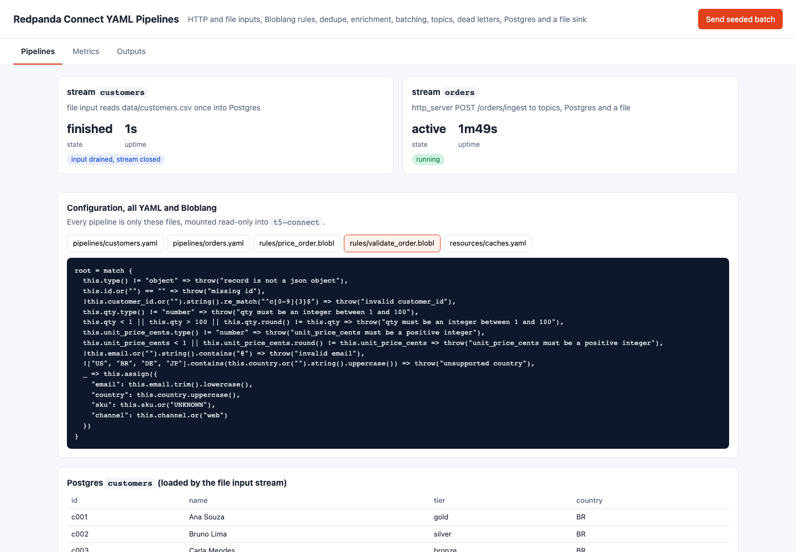
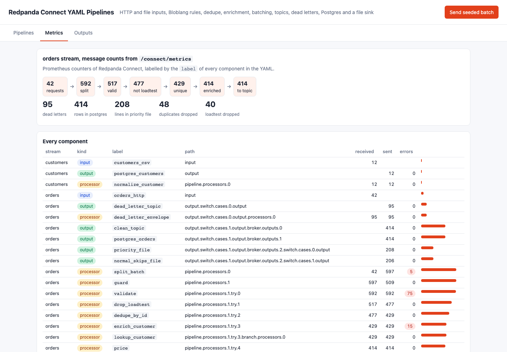
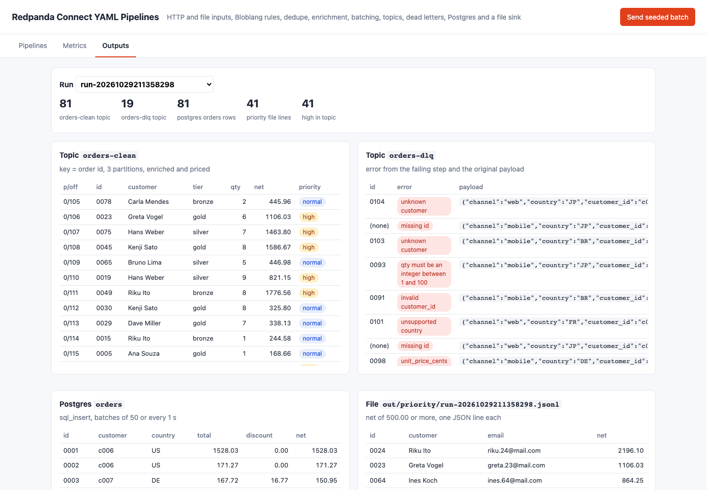

<p align="center"></p>

# redpanda-connect-yaml-pipelines

Redpanda Connect (formerly Benthos) pipelines written only in YAML and Bloblang, with no application code for the pipelines themselves. One Redpanda Connect 4.115.1 process in streams mode runs two streams: `orders` takes JSON orders over HTTP, splits, validates, filters, dedupes, enriches them from Postgres and prices them, then routes every record to a Redpanda topic, a dead-letter topic, a Postgres table and a file; `customers` reads a CSV file into Postgres. The pipelines are checked with Connect's own unit test runner (`rpk connect test`, here `redpanda-connect test`) and with end to end tests that send seeded input and compare every output with expectations computed independently in Python. A small UI shows the pipelines, the metrics and the outputs.

## How it Works

1. `t5-redpanda` (Redpanda v26.2.6, one node, dev-container mode) holds the topics `orders-clean` (3 partitions) and `orders-dlq` (1 partition) and serves its HTTP proxy for the UI. `t5-postgres` (Postgres 18.6) holds `customers` and `orders` from `conf/init.sql`.
2. `t5-connect` runs `redpanda-connect streams` with `conf/connect.yaml` (http, logger, Prometheus metrics), `resources/caches.yaml` (the shared `seen_orders` memory cache) and two stream files from `pipelines/`. The stream id is the file name.
3. `customers` reads `data/customers.csv` with the `file` input and the csv scanner, normalizes each row and upserts it with `sql_insert ... ON CONFLICT DO UPDATE`. When the file is read the input ends and the stream closes.
4. `orders` listens on `POST /orders/ingest` (`http_server`). `split_batch` unarchives the JSON array into messages, then a `try` block runs `validate` (`rules/validate_order.blobl`), `drop_loadtest`, `dedupe_by_id`, `enrich_customer` (`branch` + `sql_select` on `customers`) and `price` (`rules/price_order.blobl`). A failed message skips the rest of the `try` block and keeps its error flag.
5. The output is a `switch`: `errored()` goes to `orders-dlq` wrapped in an envelope with the error and the original payload; everything else is fanned out to `orders-clean` (key = order id), to Postgres `orders` (`sql_insert`, batches of 50 or every 1 s) and to a nested `switch` that writes high priority orders to `out/priority/<run>.jsonl` and drops the others.
6. The HTTP response only comes back once every output acked the request, so a 200 means the records are in the topic, in Postgres and in the file.
7. `t5-ui` (`app/server.py`, stdlib `http.server`) reads `/connect/streams` and `/connect/metrics` from Connect, the topics through the Redpanda HTTP proxy, Postgres with psycopg and the file from the shared volume. "Send seeded batch" posts a new seeded run (`app/data.py`).
8. `scripts/test-all.sh` runs the Connect unit tests in a throwaway `redpanda-connect test` container, then `tests/test_pipelines.py` inside `t5-ui` against the running stack.

## Architecture



## Features

* YAML only pipelines: the two streams are `pipelines/*.yaml`, two `.blobl` rule files and one resource file. Nothing else runs inside Connect.
* Streams mode: both streams run in one process, share the `seen_orders` cache and show up in `GET /connect/streams` with their state, so a finished file stream and a live HTTP stream can be seen side by side.
* HTTP input with a JSON array per request, split with `unarchive`, so 25 orders are one request and 25 messages.
* File input: `data/customers.csv` with the csv scanner, loaded once into Postgres and then used for enrichment.
* Bloblang validation in a separate file, `from "/connect/rules/validate_order.blobl"`, so the same file is unit tested with `target_mapping` and used by the pipeline. The first broken rule wins and its message becomes the dead-letter reason.
* Filtering: `channel = loadtest` orders are removed with `deleted()`, they are not errors and never reach any output.
* Dedupe on the order id with a 24 h memory cache across requests. It runs after validation, so a rejected record does not block a later valid record with the same id.
* Branching and enrichment: `branch` sends only the customer id to `sql_select`, maps the row back as `customer`, and throws `unknown customer` when the lookup is empty.
* Pricing: gold 10 %, silver 5 %, bronze 0 % off, rounded down to the cent, `priority = high` when the net is 500.00 or more.
* Dead-letter topic: invalid records, unknown customers and bodies that are not JSON at all land in `orders-dlq` with the error text and the exact original bytes.
* Batching: both Redpanda outputs flush at 50 messages or 500 ms, the Postgres insert at 50 rows or 1 s, and still ack per HTTP request.
* Three sinks from one fan out: the clean topic, Postgres and a file, plus a nested `switch` that only sends high priority orders to the file.
* Two test layers: Connect unit tests for the rules and the processor chain with the Postgres lookup mocked, and end to end tests on the real stack.
* Lean: 768 MB limit for Redpanda (`--memory=512M`), 256 MB each for Postgres, Connect and the UI. Measured use after the tests: Redpanda 111 MB, Connect 65 MB, UI 48 MB, Postgres 36 MB.

## Stack

* Redpanda Connect 4.115.1 (`docker.io/redpandadata/connect:4.115.1`): the latest stable release, one Go binary with 80+ outputs, Bloblang, streams mode and a unit test runner.
* Redpanda v26.2.6 (`docker.io/redpandadata/redpanda:v26.2.6`): Kafka API broker with a built in HTTP proxy, so the UI reads topics without a Kafka client library.
* Postgres 18.6 (`docker.io/library/postgres:18.6-alpine`): reference data for enrichment and the order sink.
* Python 3.14.10 (`docker.io/library/python:3.14.10-slim`) with stdlib `http.server`, `urllib`, `unittest` and psycopg 3.3.6 (the only library): UI, seeded data and end to end tests.
* Plain HTML, CSS and JS for the UI, no framework.
* podman + podman-compose: 4 containers, the network `t5-net` and the volumes `t5-redpanda-data`, `t5-postgres-data`, `t5-connect-out`.

## Contracts / APIs

| Method | Path / endpoint | Description |
|---|---|---|
| POST | `http://localhost:31401/orders/ingest` | Connect `http_server` input of the `orders` stream, body is a JSON array of orders, 200 after every output acked |
| GET | `http://localhost:31401/connect/streams` | Connect streams mode API: every stream with `active` and uptime |
| GET | `http://localhost:31401/connect/metrics` | Prometheus counters per component, labelled with `stream`, `label`, `path` |
| KAFKA | `localhost:31402` | Redpanda Kafka API, topics `orders-clean` and `orders-dlq` |
| GET | `http://localhost:31403/topics/{topic}/partitions/{p}/records?offset=0` | Redpanda HTTP proxy, used by the UI and the tests |
| SQL | `postgresql://localhost:31404/orders` | Postgres, tables `customers` and `orders` |
| GET | `http://localhost:31400/` | UI |
| POST | `/api/send` | Generates a seeded run, posts it in chunks of 25 plus one broken body, returns the run id and the HTTP statuses |
| GET | `/api/runs` | Last 20 runs found in Postgres |
| GET | `/api/outputs?run=<id>` | Records of one run in `orders-clean`, `orders-dlq`, Postgres `orders` and the priority file |
| GET | `/api/pipelines` | Stream states, every YAML and Bloblang file, the `customers` table |
| GET | `/api/metrics` | Connect counters grouped per component |

Input order:

```json
{"id": "run-1-0001", "run_id": "run-1", "customer_id": "c004", "sku": "SKU-07", "qty": 3, "unit_price_cents": 18519,
 "email": "  Dave.1@Mail.com ", "country": "us", "channel": "web"}
```

`orders-clean` value, also the Postgres row and, when `priority` is `high`, the line in the file:

```json
{"id": "run-1-0001", "run_id": "run-1", "customer_id": "c004", "sku": "SKU-07", "qty": 3, "unit_price_cents": 18519,
 "email": "dave.1@mail.com", "country": "US", "channel": "web", "customer_name": "Dave Miller", "tier": "gold",
 "total_cents": 55557, "discount_cents": 5555, "net_cents": 50002, "priority": "high"}
```

`orders-dlq` value:

```json
{"id": "run-1-0093", "run_id": "run-1", "error": "failed assignment (line 1): qty must be an integer between 1 and 100",
 "payload": "{\"channel\":\"mobile\",\"country\":\"JP\",\"customer_id\":\"c011\",\"id\":\"run-1-0093\",\"qty\":250,...}"}
```

## Key data structures and design decisions

* Validation rules, in order, first failure wins: `id` present and not empty, `customer_id` matches `c[0-9]{3}`, `qty` a whole number from 1 to 100, `unit_price_cents` a whole number of at least 1, `email` contains `@`, `country` one of US, BR, DE, JP. A valid order gets `email` trimmed and lowercased, `country` uppercased, `sku` defaulted to `UNKNOWN`, `channel` to `web`.
* Order of steps matters and the tests encode it: validate, then filter, then dedupe, then enrich. A loadtest order never fills the dedupe cache, an unknown customer does (a resend of it is dropped as a duplicate), and an invalid record does not.
* `split_batch` runs before the `try` block. The first version had it inside `try`, and messages that failed `validate` were still enriched and priced (the dead-letter payload showed `customer_name` and `net_cents`). With the split outside, `try` skips the remaining processors for a failed message as documented, and the dead-letter payload is the original record.
* `merge` was replaced by `assign` in both rule files: `merge` turns a key that exists on both sides into an array (`"country": ["br", "BR"]`), the unit tests caught it.
* The `branch` request is `[customer_id]`, a JSON array, because `sql_select` `args_mapping` needs an array and a bare string body is not structured JSON for the mock.
* A `switch` output needs at least 2 cases, so the priority router has an explicit second case to the `drop` output, which also makes the "normal orders skip the file" count visible in metrics.
* `kafka_franz` is not in this build of Redpanda Connect 4.115.1 (`redpanda-connect list outputs` has no `kafka*`), the `redpanda` output is used for both topics.
* Streams mode does not expose `GET /streams` unless started with `--bind-http`, and with the default `root_path` the API lives under `/connect`. `--bind-http` also allows creating and deleting streams over HTTP, so every published port is bound to `127.0.0.1` only.
* The file sink first failed with `permission denied`: the volume root is owned by root and Connect runs as uid 10001. The `:U` volume option fixed it once and then not on a fresh volume, so `start-all.sh` creates `priority/` inside the volume with a one-off root container and hands it to uid 10001, and the pipeline writes there.
* While the file output was failing, the HTTP requests timed out with 408 because `fan_out` waits for every output. A broken sink blocks ingestion instead of silently losing records.
* `rpk topic create a -p 3 b -p 1` gives both topics 1 partition (the last `-p` wins), so topics are created one by one.
* The Redpanda HTTP proxy rejects JSON format reads when the key is not JSON (`40801 Unable to serialize key`), so records are read in binary format and base64 decoded.
* Every test run uses its own `run_id`, and every check filters by it, so the tests can run again and again on the same topics and tables. They passed 3 runs in a row on the same stack.
* The UI only shows what Connect, Redpanda, Postgres and the file returned. All expected values live in `tests/test_pipelines.py`, which reimplements the rules and the pricing in plain Python from the seeded input.
* Every container, the network and the volumes start with `t5-`.

## How to run

Requirements: podman, podman-compose, curl and lsof. Everything else runs in containers.

```bash
./scripts/setup.sh
./scripts/start-all.sh
./scripts/test-all.sh
./scripts/ui.sh
./scripts/stop-all.sh
```

Connect unit tests (`tests/connect/`, run with `redpanda-connect test -r resources/caches.yaml ...`):

* `validate_order_test.yaml`: a valid order is normalized and defaulted, a record with every field broken reports `missing id` first, each rule rejects its own bad values, `qty = 100` passes.
* `price_order_test.yaml`: gold, silver and bronze discounts rounded down, 50002 is high, 49999 is normal, a gold discount can drop a 520.00 total to a normal 468.00.
* `orders_pipeline_test.yaml`: the whole processor chain with the `lookup_customer` processor mocked: one request of 6 orders gives 2 priced orders, 2 flagged errors (`qty`, `unknown customer`), the loadtest order and the duplicate are gone; a non JSON body stays as raw bytes and errored; the dead-letter envelope keeps id, run id and payload.

End to end tests (`tests/test_pipelines.py`, 13 tests inside `t5-ui`), one seeded run of 116 records (80 valid, 8 loadtest, 14 broken in 14 different ways, 3 unknown customers, 1 order without `sku` and `channel`, 10 resends) plus one broken body:

* The clean topic has every expected valid order exactly once, field by field equal to the Python computed enrichment and pricing, keyed by id, spread over more than one partition.
* The dead-letter topic has exactly the expected records with the expected first broken rule, and the broken body with its raw bytes.
* Postgres `orders` and the priority file equal the expectation (the file only the high ones).
* Metric deltas: `validate` errors = invalid records, `drop_loadtest` and `dedupe_by_id` dropped what was expected, every output sent what was expected.
* A rejected record does not block a later valid one with the same id, a resent order in a later request is dropped and the first version wins.
* The file stream loaded the CSV and is closed, the HTTP stream is active, the UI serves its 3 tabs.

The tests were checked against broken rules: changing the silver discount from 5 to 6 in `rules/price_order.blobl` made 3 end to end tests fail (clean topic, Postgres, priority file), changing gold from 10 to 11 made `price_order_test.yaml` and `orders_pipeline_test.yaml` fail.

```
redpanda connect unit tests (rpk connect test)
Test '/connect/tests/connect/orders_pipeline_test.yaml' succeeded
Test '/connect/tests/connect/price_order_test.yaml' succeeded
Test '/connect/tests/connect/validate_order_test.yaml' succeeded
end to end tests against the running pipelines
test_a_rejected_record_does_not_block_a_later_valid_record_with_the_same_id ... ok
test_a_resent_order_in_a_later_request_is_dropped_and_the_first_version_wins ... ok
test_both_streams_run_in_one_connect_process ... ok
test_file_input_loaded_every_customer_from_the_csv_normalized ... ok
test_ui_serves_every_tab_and_api ... ok
test_a_body_that_is_not_json_goes_to_the_dead_letter_topic_as_raw_bytes ... ok
test_clean_topic_has_each_valid_order_once_enriched_and_priced ... ok
test_clean_topic_is_keyed_by_order_id_so_an_order_always_lands_on_one_partition ... ok
test_dead_letter_topic_has_every_invalid_record_with_its_first_broken_rule ... ok
test_metrics_count_what_each_step_did ... ok
test_postgres_sink_has_the_same_rows_as_the_clean_topic ... ok
test_priority_file_has_exactly_the_high_value_orders ... ok
test_the_seeded_input_covers_every_path ... ok

Ran 13 tests in 28.043s
OK
all tests passed
```

## Printscreens

Pipelines tab: the two streams from `GET /connect/streams`. `customers` is finished because its file input drained, `orders` is active. Below, every file that defines the pipelines, here `pipelines/orders.yaml`.



Pipelines tab with `rules/validate_order.blobl` selected: the whole validation is one Bloblang `match`, the first failing rule throws its message, a valid record is normalized with `assign`. Below it, the `customers` table loaded by the file stream.



Metrics tab: Prometheus counters from `/connect/metrics` after 5 seeded runs. The flow line shows how 592 split records became 414 records on the clean topic (75 failed validation, 40 loadtest, 48 duplicates, 15 unknown customers), and the table lists every labelled input, processor and output with its path in the YAML.



Outputs tab for one seeded run: 81 orders in `orders-clean` with partition and offset, 19 in `orders-dlq` with the reason and the original payload, the same 81 rows in Postgres and 41 high priority lines in the file.



## Scripts

All scripts live in `scripts/` and run from any directory of the repository.

| Script | What it does |
|---|---|
| `./scripts/setup.sh` | Pulls the Redpanda, Postgres, Connect and Python images, lints the pipelines with `redpanda-connect lint`, builds the UI image |
| `./scripts/start-all.sh` | Starts Redpanda and Postgres, creates the topics, prepares the file volume, starts Connect and waits for both streams, starts the UI, sends a first seeded batch when there is none, prints every link |
| `./scripts/status.sh` | Shows every service port as UP or DOWN |
| `./scripts/test-all.sh` | Runs the Connect unit tests and the end to end tests |
| `./scripts/ui.sh` | Opens the UI in the browser |
| `./scripts/sql-console.sh` | Opens psql on the `orders` database |
| `./scripts/stop-all.sh` | Stops every container and waits until the ports are free, the volumes are kept |

Ports are declared in `scripts/ports.env`: UI 31400 (`http://localhost:31400`), Connect 31401 (`http://localhost:31401`), Kafka 31402, Redpanda HTTP proxy 31403 (`http://localhost:31403`), Postgres 31404 (`postgresql://localhost:31404/orders`).

```bash
./scripts/setup.sh
./scripts/start-all.sh
./scripts/status.sh
./scripts/ui.sh
./scripts/stop-all.sh
```
