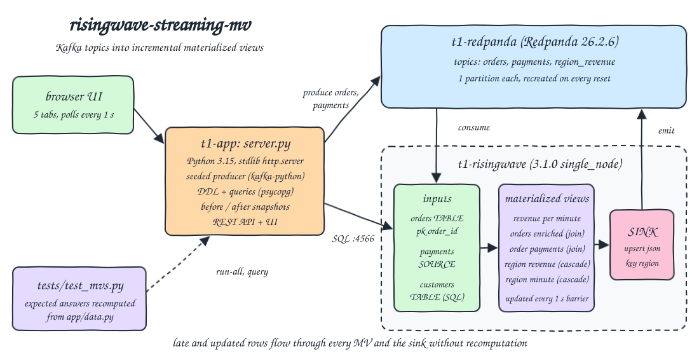
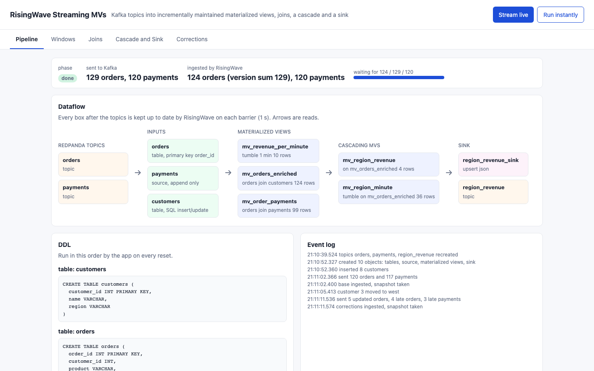
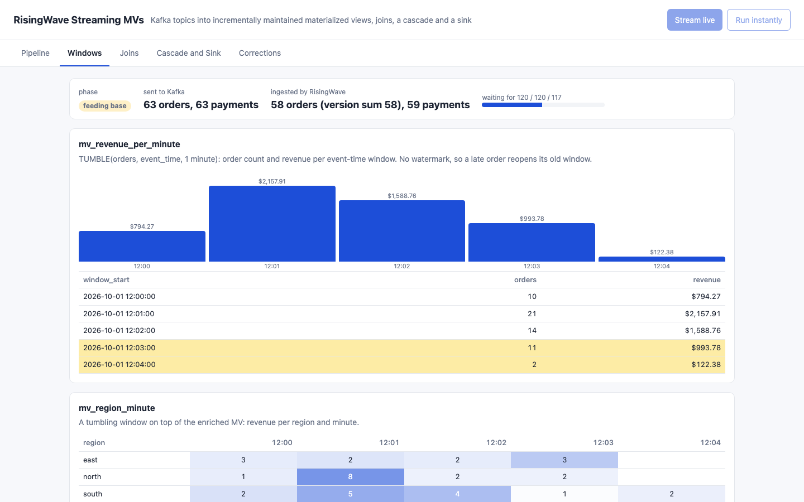
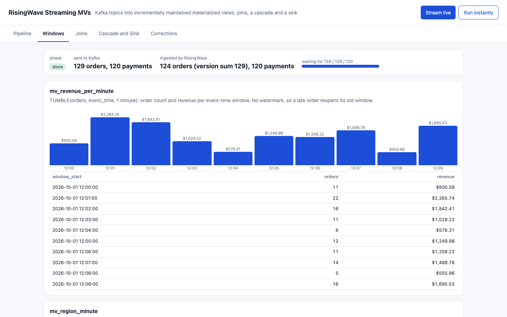
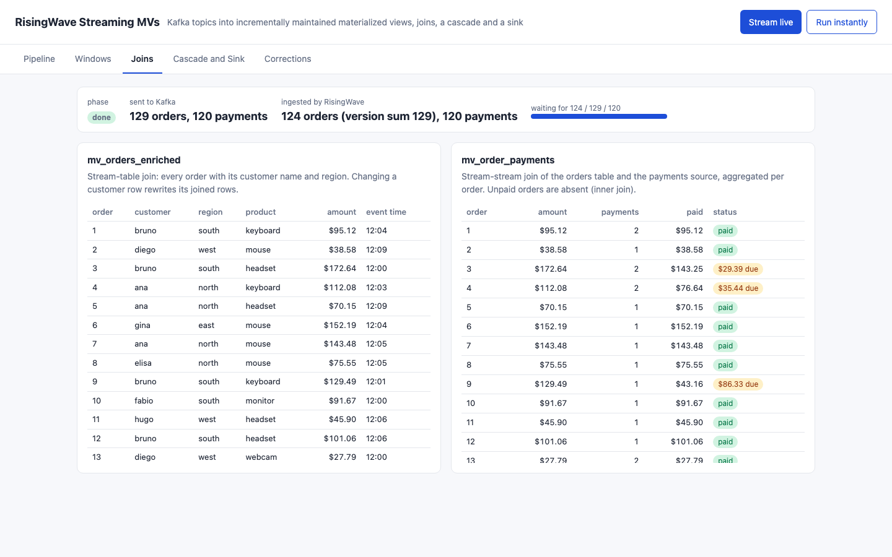
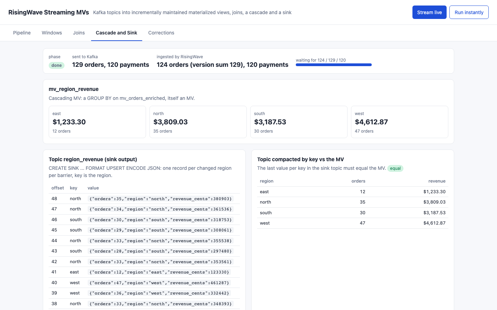
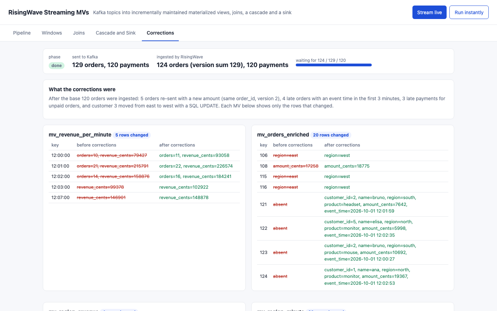

<p align="center"></p>

# risingwave-streaming-mv

RisingWave as a streaming database that keeps SQL materialized views up to date. This POC runs RisingWave 3.1.0 in `single_node` mode (Postgres wire compatible) next to a Redpanda 26.2.6 broker. RisingWave reads two Kafka topics, an `orders` table with a primary key and an append-only `payments` source, and maintains five materialized views on them: a tumbling window aggregate, a stream-table join with a `customers` table, a stream-stream join of orders and payments, and two cascading MVs built on top of another MV. One of them is written back to a Kafka topic with an upsert sink. A small Python app (Python 3.15, psycopg 3.3.6, kafka-python 3.0.12) feeds seeded orders, then sends late and updated rows, and a web UI shows every MV changing live. The tests check that each MV equals an answer computed independently from the same seeded input, before and after the corrections.

## How it Works

1. `t1-redpanda` runs Redpanda in dev-container mode with one core. `t1-risingwave` runs `risingwave single_node` with its meta store (SQLite) and Hummock state store on the volume `t1-risingwave-data`.
2. `t1-app` runs `app/server.py` (stdlib `http.server`). Every run first drops every RisingWave object, deletes and recreates the topics `orders`, `payments`, `region_revenue`, then runs the DDL in `app/pipeline.py` and inserts 8 customers.
3. Input is `app/data.py` (seed 42): 120 orders over 10 minutes of event time, 117 payments (full, split in two, partial or none), plus a set of corrections.
4. The base input is produced to Kafka in event-time order. The app waits until RisingWave has ingested every row (`count(*)`, `sum(version)` on `orders`, `mv_payment_count`) and takes a snapshot of every MV.
5. Corrections are then applied: customer 3 moves from `east` to `west` (SQL `UPDATE`), 5 orders are re-sent with a new amount and `version = 2`, 4 late orders arrive with an event time in the first 3 minutes, and 3 late payments arrive for unpaid orders. A second snapshot is taken once they are ingested.
6. `POST /api/start-live` does the same at 25 events per second so the UI can show the views change; `POST /api/run-all` does it as fast as possible for the tests.
7. `scripts/test-all.sh` reruns the scenario from empty topics and runs `tests/test_mvs.py` inside `t1-app`.

## Architecture



## Features

* Kafka table with a primary key (`orders`): a re-sent order with the same `order_id` overwrites the row, so it changes the aggregates once and is not counted twice.
* Kafka source (`payments`): append-only, never stored as a table, only read by the MVs.
* Tumbling window aggregate `mv_revenue_per_minute` with `TUMBLE(orders, event_time, INTERVAL '1 MINUTE')`: order count and revenue per event-time minute.
* No watermark: a late order lands in its old window and that window is corrected, the other windows do not change.
* Stream-table join `mv_orders_enriched`: orders joined to the `customers` table, a customer `UPDATE` rewrites all of that customer's joined rows.
* Stream-stream join `mv_order_payments`: orders joined to payments and aggregated per order (paid, due). A late payment adds a row for an order that had none.
* Cascading MVs `mv_region_revenue` and `mv_region_minute` built on `mv_orders_enriched`: one change in the join flows into both.
* Upsert sink `region_revenue_sink` to the topic `region_revenue`: one record per changed region per barrier, keyed by region, so the last value per key equals the MV.
* Snapshot consistency: a batch query reads every MV at the same committed epoch, so once the inputs are fully ingested every MV matches them.
* Live UI: five tabs refreshed every second, changed rows flash, the Corrections tab shows only the rows each correction changed.
* Lean: RisingWave about 140 MB RSS, Redpanda about 70 MB, app about 40 MB, with limits of 1280 MB, 400 MB and 192 MB.

## Stack

* RisingWave 3.1.0 (`docker.io/risingwavelabs/risingwave:v3.1.0`): latest stable release, `single_node` runs meta, compute, compactor and frontend in one process.
* Redpanda 26.2.6 (`docker.io/redpandadata/redpanda:v26.2.6`): Kafka API compatible broker in one small container, no ZooKeeper or KRaft setup.
* Python 3.15.2 (`docker.io/library/python:3.15.2-slim`): one image runs the producer, the UI server and the tests.
* psycopg 3.3.6: talks to RisingWave over the Postgres wire protocol.
* kafka-python 3.0.12: topic delete and create, producing the seeded rows, reading the sink topic.
* Python stdlib `http.server`, `urllib`, `unittest` + plain HTML, CSS and JS: no web framework and no test framework.
* PostgreSQL 18.6 client (`docker.io/library/postgres:18.6-alpine`): only for `psql` in `scripts/sql-console.sh`.
* podman + podman-compose: the 3 containers, the network `t1-net` and the volumes `t1-redpanda-data`, `t1-risingwave-data`.

## Contracts / APIs

| Method | Path / endpoint | Description |
|---|---|---|
| SQL | `postgresql://root@localhost:31001/dev` | RisingWave frontend, Postgres wire protocol |
| GET | `http://localhost:31002` | RisingWave dashboard |
| GET | `http://localhost:31003/v1/status/ready` | Redpanda admin API readiness |
| GET | `/` | UI |
| GET | `/api/live` | Phase, rows sent, rows ingested, the target counts, the event log and the current content of every MV |
| GET | `/api/pipeline` | Every object in creation order with its kind and its DDL |
| GET | `/api/snapshots` | The MV snapshots taken after the base input (`before`) and after the corrections (`after`) plus the key columns of each MV |
| GET | `/api/sink` | Every record of the `region_revenue` topic (offset, key, value) and the topic compacted by key |
| POST | `/api/run-all` | Reset, feed the base input, snapshot, apply the corrections, snapshot. Returns both snapshots |
| POST | `/api/start-live` | Same run in the background at 25 events per second, `202`, or `409` when a run is in progress |

Kafka records (JSON values, key is the id as a string):

```json
orders:   {"order_id": 1, "customer_id": 2, "product": "keyboard", "amount_cents": 9512, "event_time": "2026-10-01 12:04:10", "version": 1}
payments: {"payment_id": 1, "order_id": 1, "paid_cents": 4756, "paid_at": "2026-10-01 12:04:10"}
region_revenue key:   {"region": "west"}
region_revenue value: {"orders": 47, "region": "west", "revenue_cents": 461287}
```

## Key data structures and design decisions

* `orders` is a `TABLE ... WITH (connector = 'kafka')` with `PRIMARY KEY (order_id)` and `FORMAT PLAIN ENCODE JSON`: a new record with an existing key overwrites the old row, which turns a re-sent order into an update. Removing the primary key makes RisingWave count every version (129 rows instead of 124), and the run fails.
* `payments` is a `SOURCE`: no storage of its own, the state lives only in the join and in `mv_payment_count`.
* `customers` is a plain table filled with SQL `INSERT` and changed with `UPDATE` + `FLUSH`, the dimension side of the stream-table join.
* No watermark and no `EMIT ON WINDOW CLOSE` on purpose: RisingWave keeps every window open and corrects it when a late row arrives. With a watermark, rows older than the watermark would be dropped.
* Sums are cast to `BIGINT` in the MVs. Without the cast, `sum(bigint)` is `NUMERIC` and the JSON sink writes it as a string.
* Ingestion wait: `count(*)` and `sum(version)` on `orders` and the count in `mv_payment_count` must equal the counts sent. They are input counts, not MV results, so the tests do not compare a view with itself.
* Reset deletes and recreates the topics, so each run starts from offset 0 and the source does not replay an older run.
* Changed from the plan: Redpanda's HTTP proxy (pandaproxy) was meant to keep the app free of a Kafka client, but it can not create or delete topics (producing to a missing topic returns error code 3). kafka-python is used for admin, producing and reading instead.
* RisingWave `single_node` with less than about 1.4 GB of `--total-memory-bytes` panics at startup because the compactor share is smaller than its 128 MB meta cache. `conf/risingwave.toml` sets `compactor_memory_limit_mb = 700` (a cap, not an allocation) and smaller block and meta caches, so a 1 GB total budget works.
* Creating the 10 objects takes about 13 s, most of it in MV creation, so a full run takes about 20 s.

## How to run

```bash
./scripts/setup.sh
./scripts/start-all.sh
./scripts/test-all.sh
./scripts/ui.sh
./scripts/sql-console.sh
./scripts/stop-all.sh
```

In the UI press `Stream live` to replay the seeded input slowly, or `Run instantly`. In `sql-console.sh`, try `SELECT * FROM mv_region_revenue;`.

## Tests

`tests/test_mvs.py` runs inside `t1-app` after `POST /api/run-all`. It rebuilds the expected content of every MV in plain Python from `app/data.py`, without using RisingWave:

* Every MV after the base input equals the answer computed from the base input.
* Every MV after the corrections equals the answer computed from the corrected input, both in the `after` snapshot and in a fresh query.
* Late orders change only the windows of the late and updated orders, and each late window gains exactly as many orders as arrived late.
* An updated order overwrites its row: the windows hold 124 orders, not 129, and the enriched MV has the new amount.
* Moving customer 3 moves all of its orders to `west` in the join and in the cascading `mv_region_revenue`.
* Late payments add rows for orders that were absent from `mv_order_payments`, with nothing due.
* `mv_region_revenue` equals a GROUP BY of `mv_orders_enriched` read in the same run.
* The `region_revenue` topic compacted by key equals the final region revenue, and it also holds the base values of the regions that changed, so the sink streamed the change.
* The UI page has every tab.

The tests can fail: making the window 2 minutes fails 3 tests, removing the `orders` primary key makes the run fail on ingestion.

```
rerunning the seeded scenario from empty topics
test_a_late_payment_joins_an_order_that_was_unpaid ... ok
test_an_updated_order_overwrites_its_row_instead_of_adding_one ... ok
test_cascading_mv_equals_an_aggregation_of_its_parent_mv ... ok
test_every_mv_equals_the_answer_computed_after_late_and_updated_rows ... ok
test_every_mv_equals_the_answer_computed_from_the_base_input ... ok
test_late_orders_reopen_only_the_old_windows_they_belong_to ... ok
test_moving_a_customer_moves_its_revenue_through_the_join_and_the_cascade ... ok
test_sink_topic_streams_every_change_and_compacts_to_the_final_answer ... ok
test_ui_page_has_every_tab ... ok

Ran 9 tests in 0.148s
OK
all tests passed
```

## Printscreens

Pipeline tab: the dataflow from the Redpanda topics to the inputs, the MVs, the cascading MVs and the sink, with the current row count of each MV, every DDL statement, and the event log of the last run.



Windows tab while `Stream live` is running: 63 orders sent, 58 ingested, the windows up to 12:04 are filled and the rows that changed in the last second are highlighted.



Windows tab after the run: `mv_revenue_per_minute` as bars and a table for the 10 minutes, and `mv_region_minute` as a region by minute heat map (cell value is the order count).



Joins tab: `mv_orders_enriched` (each order with its customer name and region) and `mv_order_payments` (payments, paid and due per order).



Cascade and Sink tab: `mv_region_revenue`, every record the sink wrote to the `region_revenue` topic (newest first), and the topic compacted by key, equal to the MV.



Corrections tab: for every MV, only the rows that changed between the base snapshot and the corrected one, with the old and new values. The first 3 windows gained the late orders, the orders of customer 3 (106, 115, 116 and more below) moved from `east` to `west`, order 108 has its new amount, and orders 121 to 124 are the late ones.



## Scripts

All scripts live in `scripts/` and run from any directory of the repository.

| Script | What it does |
|---|---|
| `./scripts/setup.sh` | Pulls the RisingWave, Redpanda, Python and psql images and builds the app image |
| `./scripts/start-all.sh` | Starts Redpanda, waits until it is ready, starts RisingWave and the app, waits for SQL and the UI, runs the scenario once when nothing ran yet, prints every link |
| `./scripts/status.sh` | Shows every service port as UP or DOWN |
| `./scripts/test-all.sh` | Reruns the scenario from empty topics and runs the MV tests |
| `./scripts/ui.sh` | Opens the UI in the browser |
| `./scripts/sql-console.sh` | Opens `psql` on RisingWave |
| `./scripts/stop-all.sh` | Stops every container and waits until the ports are free, the volumes are kept |

Ports are declared in `scripts/ports.env`: UI 31000 (`http://localhost:31000`), RisingWave SQL 31001 (`postgresql://root@localhost:31001/dev`), RisingWave dashboard 31002 (`http://localhost:31002`), Redpanda admin 31003 (`http://localhost:31003`).

```bash
./scripts/setup.sh
./scripts/start-all.sh
./scripts/status.sh
./scripts/ui.sh
./scripts/stop-all.sh
```
