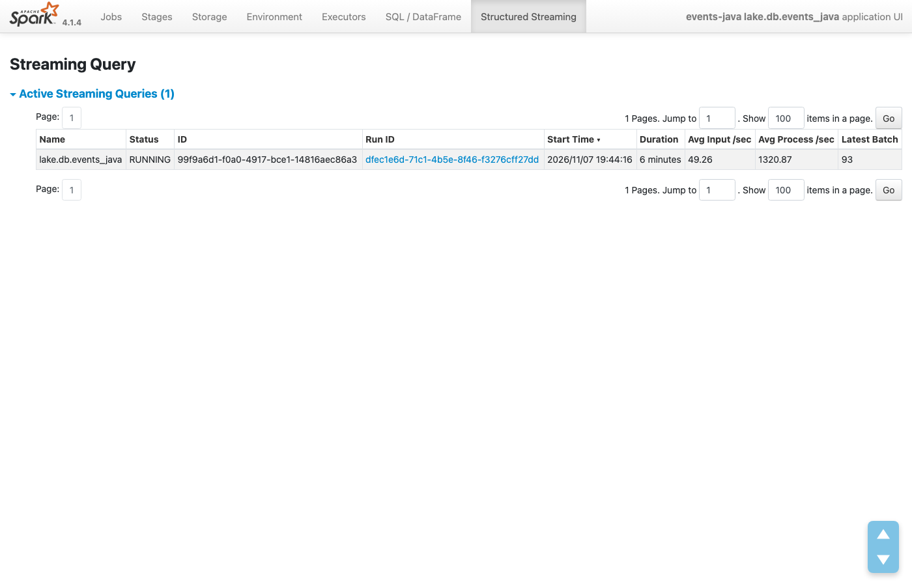
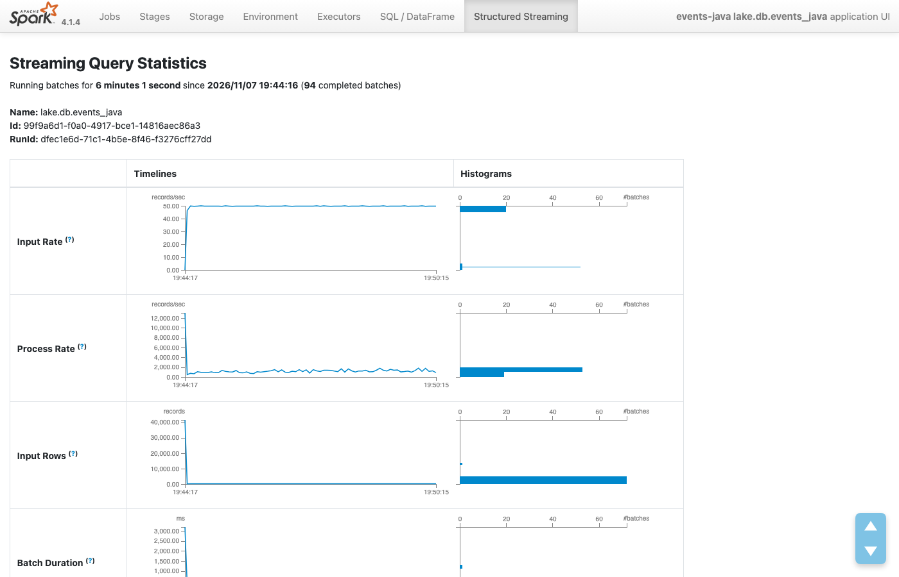
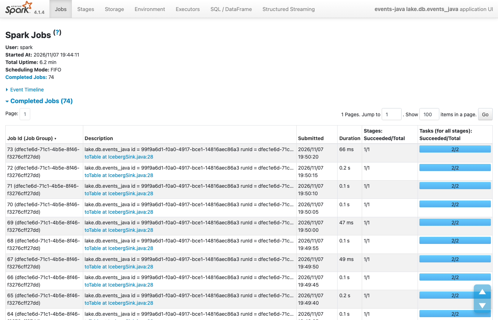
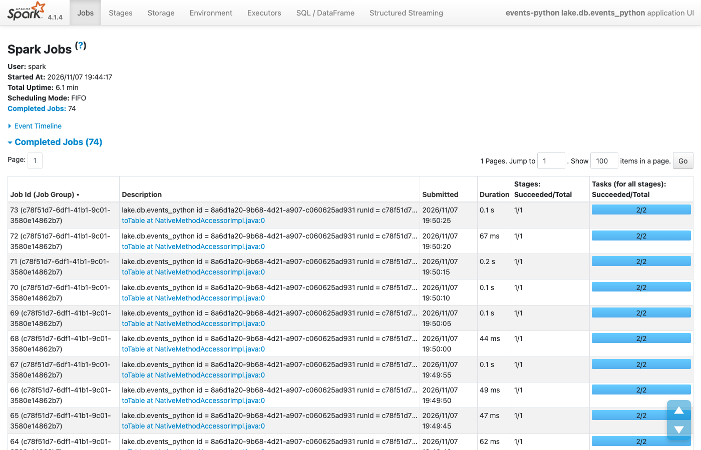

<p align="center"></p>

# spark-operator-structured-streaming

The Kubeflow Spark Operator 2.5.2 on a local kind cluster, running two `SparkApplication`s that do the same Spark Structured Streaming job: one Java (plain Maven jar) and one PySpark. Both read events from Kafka 4.4.0 in `trigger(processingTime)` microbatches and append them to Apache Iceberg 1.12.0 tables on MinIO, with streaming checkpoints on MinIO too and a JDBC Iceberg catalog on Postgres. A small Python producer writes 50 events per second, each with its event time. End-to-end tests prove two things against the real cluster: every produced event lands in Iceberg exactly once even when the driver pod is killed twice mid-stream and the operator restarts it, and a sweep over trigger intervals (1, 5, 15, 30 s) measures event-to-commit latency against the number of Iceberg snapshots and files per minute.

## How it Works

1. `scripts/setup.sh` creates the kind cluster, builds the Java jar, one Spark image (Spark 4.1.4 plus Iceberg, Kafka and S3A jars, the jar and the Python job) and the producer image, loads every image into kind and installs the Spark Operator Helm chart 2.5.2.
2. `scripts/start-all.sh` starts MinIO (buckets `lake` and `checkpoints`), Postgres, a single-broker KRaft Kafka with topic `events` (2 partitions), the producer and a `lake-query` pod, then applies `events-java` and `events-python` and port-forwards both Spark UIs.
3. The producer sends `{"id","seq","event_time_ms"}` JSON at 50 events per second with an idempotent Kafka producer.
4. The operator runs `spark-submit` for each `SparkApplication`: one driver pod and one executor pod per job, `restartPolicy: Always`.
5. Each job reads Kafka, parses the JSON, keeps `kafka_partition` and `kafka_offset`, and writes with `format("iceberg")`, `trigger(processingTime)` and `checkpointLocation` on `s3a://checkpoints/...`.
6. Each microbatch is one Iceberg snapshot. Iceberg stores the query id and the epoch (batch) id in the snapshot summary, and on commit it skips an epoch that is already in the table. That is what makes a replayed batch harmless.
7. When the driver dies, Spark has written the offsets of batch N to the checkpoint before running it. The restarted driver finds batch N without a commit entry and runs it again with the same offsets: if Iceberg already has epoch N it is skipped, otherwise it is written once.
8. Tests read the lake through `spark-submit` in the `lake-query` pod, Kafka offsets through `kafka-get-offsets.sh`, and driver pods and the `SparkApplication` status through `kubectl`.

## Architecture


## Features

* Two `SparkApplication`s, Java and PySpark, with the same table schema, the same sink and the same arguments, so one set of tests covers both.
* `restartPolicy: Always` with 5 s retry: the operator replaces a dead driver without any help, which is the recovery path the exactly-once test exercises.
* Idempotent Iceberg streaming commits keyed by query id and epoch id, plus Spark checkpoints on S3, give exactly-once into the table without any deduplication step.
* Kafka partition and offset are stored in every row, so the test can prove that each Kafka record is in the table exactly once, not only that the count matches.
* `trigger(processingTime)` is the only knob the sweep turns, so the latency and small-files numbers are caused by the trigger and nothing else.
* Unit tests reproduce the crash window (Iceberg committed, Spark commit log missing) deterministically in local mode for both languages, and show that a plain `foreachBatch` append duplicates the same replay.
* Results of every e2e run are written to `.run/results.tsv` and printed by `test-all.sh`.

## Stack

* Kubernetes v1.35.0 (`kindest/node`, kind v0.31 on podman): single node cluster.
* Kubeflow Spark Operator 2.5.2 (Helm chart `spark-operator` from `kubeflow.github.io/spark-operator`, image `ghcr.io/kubeflow/spark-operator/controller:2.5.2`): latest stable release, 2.6.0 is still a release candidate.
* Apache Spark 4.1.4 (`apache/spark:4.1.4-scala2.13-java21-python3-ubuntu`): newest Spark line Iceberg publishes a runtime for.
* Apache Iceberg 1.12.0 (`iceberg-spark-runtime-4.1_2.13`, `iceberg-aws-bundle`): table format, `S3FileIO` for data and metadata.
* Iceberg JDBC catalog on Postgres 18.6: simplest catalog that works, see design decisions.
* MinIO community build `pgsty/minio:RELEASE.2026-08-04T00-00-00Z`: S3 for the warehouse and the checkpoints, the official image is no longer published.
* Kafka 4.4.0 (`apache/kafka`, KRaft, one broker, StatefulSet): source topic.
* Hadoop S3A (`hadoop-aws` 3.4.2, `s3-transfer-manager` and `apache-client` 2.54.17): checkpoint file system on MinIO.
* Java job: built with JDK 25 (Amazon Corretto 25.0.4), Maven, `maven.compiler.release` 21, `spark-sql` 4.1.4 provided, JUnit 5.
* Python job: PySpark 4.1.4 on Python 3.14.7, uv, pytest 9.2.0, ty 0.0.99.
* Producer: Python 3.15.2, kafka-python 3.0.13, uv, pytest, ty.
* e2e tests: Python 3.15, pytest 9.2.0, ty 0.0.99, only `kubectl` underneath.

## Version deviations

* Java 25: Spark supports Java 25 officially from Spark 4.2 (SPARK-51167, `apache/spark:4.2.x-java25` images). Iceberg 1.12.0, the latest release, publishes Spark runtimes only up to 4.1 (`spark/v4.2` exists in its source tree but `iceberg-spark-runtime-4.2` is not on Maven Central), and Spark 4.1 supports Java 17 and 21. So the cluster runs Spark 4.1.4 on its Java 21 image. The Java job is compiled by JDK 25 with `--release 21`, and its unit tests run on JDK 25 itself.
* Running Spark 4.1.4 itself on JDK 25 does not work out of the box: its Hadoop 3.4.2 client fails with `UnsupportedOperationException: getSubject is not supported` as soon as a file system is touched. The Java unit tests override `hadoop-client-api` and `hadoop-client-runtime` to 3.5.0 in test scope only and add `--sun-misc-unsafe-memory-access=allow` (otherwise Iceberg's shaded Netty fails with a `ClassCastException` on JDK 25).
* Python 3.15: PySpark 4.1.4 declares Python 3.10 to 3.14. The Spark image ships Ubuntu's Python 3.10, so the image installs Python 3.14.7 with uv and points `PYSPARK_PYTHON` to it. `python-job` is a uv project pinned to 3.14 and its unit tests run on JDK 21, the runtime JDK. The producer and the e2e tests are on Python 3.15.

## Contracts

`SparkApplication` arguments (both jobs):

| Argument | Default | Meaning |
|---|---|---|
| `--table` | required | Iceberg table such as `lake.db.events_java` |
| `--checkpoint` | required | streaming checkpoint such as `s3a://checkpoints/events_java` |
| `--trigger-seconds` | `5` | `trigger(processingTime)` interval |
| `--starting-offsets` | `latest` | Kafka starting offsets for a new checkpoint |
| `--bootstrap`, `--topic` | `kafka-0.kafka:9092`, `events` | Kafka source |

Kafka record value (producer to jobs):

```json
{"id":"producer-7c9f-1f2e3d4c-4573","seq":4573,"event_time_ms":1794079995182}
```

Iceberg table (both jobs, format version 2):

```sql
id STRING, seq BIGINT, event_time TIMESTAMP, kafka_partition INT, kafka_offset BIGINT
```

Snapshot summary fields the tests read: `added-data-files`, `added-files-size`, `added-records`, `spark.sql.streaming.queryId`, `spark.sql.streaming.epochId`.

## Design decisions

* JDBC catalog on Postgres instead of a REST catalog: it is built into Iceberg core, needs only one Postgres pod and the JDBC driver jar, and commits by swapping the metadata location with a conditional `UPDATE`, which is the atomic step exactly-once needs. A REST catalog would add a server that, in the reference implementation, keeps its own JDBC catalog behind it anyway.
* The catalog and S3 settings live in `spec.sparkConf` of each `SparkApplication`. A `spark-defaults.conf` baked into the image is ignored, because the operator runs `spark-submit` in its own pod and the driver gets a generated properties file. The `lake-query` pod reads the same `sparkConf` from `k8s/events-java.yaml`, so there is one source.
* `iceberg-aws-bundle` covers Iceberg's `S3FileIO` but not S3A: S3A also needs the AWS SDK `s3-transfer-manager` and `apache-client` modules. Two jars at the bundle's SDK version (2.54.17) are added instead of the 600 MB SDK bundle.
* The test kills the driver with `kubectl delete pod --force --grace-period=0`, so nothing in the job gets to shut down cleanly; that is the crash case, not a graceful stop.
* Exactly-once is checked against Kafka itself: after the producer is stopped, the table must hold exactly `end offset - earliest offset` rows per partition, the same number of distinct ids and distinct offsets, one query id, and no epoch committed twice.
* The sweep starts each job at `latest`, waits for its first commit, skips 20 s of warmup and measures a 90 s window. Latency is `snapshot committed_at - event_time` per row; the row-to-snapshot link is the row's `_file` joined to the `entries` metadata table. All timestamps come from pods on the same node, so there is no clock skew between producer and drivers.
* Both jobs run at the same time in the sweep. Spark aligns processing-time triggers to multiples of the interval on the wall clock, so with the same input both drivers commit within about 1 ms of each other (85 of 144 snapshots at 1 s had the identical millisecond).
* Each e2e test deploys its own table and checkpoint, so tests do not depend on each other. At the end the jobs are redeployed with their default table and checkpoint, and they resume from that checkpoint.

## How to run

Requirements: podman, kind, kubectl, helm, uv, Maven, Java 25 at `~/.sdkman/candidates/java/25.0.4-amzn`, Java 21 at `~/.sdkman/candidates/java/21.0.9-amzn` (PySpark unit tests), lsof.

```bash
./scripts/setup.sh
./scripts/start-all.sh
./scripts/test-all.sh
./scripts/ui.sh
./scripts/stop-all.sh
./scripts/teardown.sh
```

`test-all.sh` runs:

* `java-job` JUnit on JDK 25: argument rules; event time and Kafka partition/offset survive parsing; a batch replayed after a crash between Iceberg commit and Spark commit log is not written twice (one snapshot, 50 rows); a plain `foreachBatch` append writes the same replay twice (100 rows).
* `python-job` pytest on Python 3.14 and `ty check`: the same rules and the same replay test for the PySpark code path, plus the query output encoding.
* `producer` pytest and `ty check`: unique ids per producer run, payload carries the event time, send schedule keeps the rate.
* `e2e` `ty check` and pytest: percentile, window and duplicate-epoch helpers, then on kind:
  * every produced event lands in Iceberg exactly once across two driver kills (Java and Python);
  * the trigger interval sets end-to-end latency and the number of Iceberg snapshots (1, 5, 15, 30 s, both jobs at once);
  * longer triggers trade latency for fewer snapshots and bigger files.

```
Tests run: 2, Failures: 0   events.IcebergSinkReplayTest  (JDK 25)
Tests run: 3, Failures: 0   events.JobArgsTest
Tests run: 2, Failures: 0   events.KafkaEventsTest
8 passed                    python-job pytest
3 passed                    producer pytest
All checks passed!          ty python-job, producer, e2e
test_every_produced_event_lands_in_iceberg_exactly_once_across_driver_kills[java] PASSED
test_every_produced_event_lands_in_iceberg_exactly_once_across_driver_kills[python] PASSED
tests/test_stats.py .... 4 PASSED
test_trigger_interval_sets_end_to_end_latency_and_the_number_of_iceberg_snapshots[1] PASSED
test_trigger_interval_sets_end_to_end_latency_and_the_number_of_iceberg_snapshots[5] PASSED
test_trigger_interval_sets_end_to_end_latency_and_the_number_of_iceberg_snapshots[15] PASSED
test_trigger_interval_sets_end_to_end_latency_and_the_number_of_iceberg_snapshots[30] PASSED
test_longer_triggers_trade_latency_for_fewer_snapshots_and_bigger_files PASSED
11 passed in 887.62s (0:14:47)
all tests passed
```

## Results

Measured by `./scripts/test-all.sh` on a single node kind cluster (podman machine, 12 CPUs), producer at 50 events per second into 2 partitions, each job with 1 driver and 1 executor (1 core each).

Exactly-once across driver kills (trigger 5 s, start from `earliest`, 2 forced driver kills per job):

| job | events in Kafka | rows in Iceberg | distinct ids | distinct offsets | snapshots | duplicate epochs | driver back after kill (s) |
|---|---|---|---|---|---|---|---|
| java | 30615 | 30615 | 30615 | 30615 | 13 | 0 | 3.2, 3.2 |
| python | 34359 | 34359 | 34359 | 34359 | 12 | 0 | 3.2, 3.2 |

Trigger sweep (90 s window after 20 s warmup, 4500 events per job per window; Java and PySpark gave the same numbers within 20 ms, Java shown):

| trigger | p50 latency | p95 latency | max latency | snapshots/min | data files/min | avg file size | rows per snapshot |
|---|---|---|---|---|---|---|---|
| 1 s | 0.66 s | 1.11 s | 1.36 s | 60 | 120 | 2.0 KB | 50 |
| 5 s | 2.70 s | 4.96 s | 5.32 s | 12 | 24 | 2.6 KB | 250 |
| 15 s | 7.83 s | 14.54 s | 15.42 s | 4 | 8 | 4.3 KB | 750 |
| 30 s | 15.19 s | 28.70 s | 30.24 s | 2 | 4 | 6.8 KB | 1500 |

* "driver back after kill": from `kubectl delete pod --force` until a new driver pod (new uid) is `Running`. The operator's `executionAttempts` went from 1 to 3.
* Latency is per event: Iceberg snapshot `committed_at` minus the event time the producer put in the payload.
* A second full run from a fresh cluster (setup, start, test) reproduced the table: exactly-once held for 4133 (Java) and 7531 (Python) events with 2 kills each, and the sweep p50 was 0.66 / 2.70 / 7.73 / 15.21 s with the same 60 / 12 / 4 / 2 snapshots per minute. The event counts are smaller because the topic was new.

What the numbers say:

* Exactly-once held: after two hard kills per job every Kafka record is in the table once, offsets are contiguous per partition, and no epoch was committed twice. The restarted drivers kept the same streaming query id, so they resumed from the S3 checkpoint, not from scratch.
* Latency follows the trigger almost exactly: p50 is about half the interval and p95 about the full interval, because an event waits on average half a trigger for the next batch and then about 0.1 to 0.2 s for the batch to run and commit. Below 5 s the fixed cost shows: at 1 s the p50 is 0.66 s, not 0.5 s.
* Snapshots and files per minute are exactly `60 / trigger` and `2 x 60 / trigger`: every batch is one snapshot and writes one file per Kafka partition, whatever the data volume. At 1 s that is 86,400 snapshots and 172,800 files of 2 KB a day per job, which is the small-files problem (planning cost, manifest growth, S3 requests) that later needs `rewrite_data_files` and `expire_snapshots`.
* File size grows slower than the trigger (2.0 KB to 6.8 KB for 30x the rows) because Parquet and dictionary encoding compress repeated values; the per-file fixed overhead dominates small batches.
* The 1 s trigger is not "free" for the cluster either: the driver plans and commits 60 batches a minute, while the processing per batch stays around 0.1 s. Spark would run batches back to back if a batch took longer than the trigger.
* Java and PySpark are indistinguishable here: the PySpark job only builds the plan in Python, every row is processed in the JVM, and processing-time triggers fire on the same wall-clock boundaries in both drivers.

## Printscreens

Spark UI of `events-java` (`localhost:27580`), Structured Streaming tab: one active query `lake.db.events_java`, about 50 input rows per second. The query id is the same as before the e2e run, because the job was redeployed on its default checkpoint and resumed it.



Statistics of the same query: input rate flat at 50 records per second. The single spike in Input Rows at the start is the backlog that built up while the e2e tests used other tables; the resumed query picked it up from its checkpoint in the first batch.



Jobs tab of `events-java`: one Spark job per 5 s microbatch, submitted on the 5 s boundaries, each with 2 tasks (one per Kafka partition) and finishing in 50 to 200 ms. Each of these jobs ends in one Iceberg snapshot.



Statistics of `lake.db.events_python` in the PySpark driver (`localhost:27581`): same input rate and the same shape as the Java job.


Jobs tab of `events-python`: the same 5 s microbatch jobs with 2 tasks; the call site is `toTable at NativeMethodAccessorImpl.java:0` because the plan was built from Python through Py4J.



## Scripts

All scripts live in `scripts/` and run from any directory of the repository.

| Script | What it does |
|---|---|
| `./scripts/setup.sh` | Creates the kind cluster, syncs the uv projects, builds the jar and both images, loads all images and installs the Spark Operator |
| `./scripts/start-all.sh` | Starts MinIO, Postgres, Kafka, the producer and `lake-query`, creates buckets and topic, applies both SparkApplications, waits for RUNNING and port-forwards both Spark UIs |
| `./scripts/status.sh` | Shows the cluster, the operator, every component, each application's state, attempts and arguments, and every port as UP or DOWN |
| `./scripts/test-all.sh` | Runs Java, PySpark and producer unit tests, ty, the end-to-end exactly-once and trigger sweep tests, and prints the measured results |
| `./scripts/ui.sh` | Opens the Structured Streaming tab of both Spark UIs |
| `./scripts/stop-all.sh` | Stops the port-forwards and deletes both SparkApplications, the producer, `lake-query`, Kafka (and its volume), MinIO and Postgres |
| `./scripts/teardown.sh` | Runs stop-all, deletes the kind cluster and removes the two local images |

Ports are declared in `scripts/ports.env`: `java-ui=27580` (`http://localhost:27580`), `python-ui=27581` (`http://localhost:27581`). After an application is redeployed, the first request on its port can fail while the port-forward loop reconnects to the new driver.

```bash
./scripts/setup.sh
./scripts/start-all.sh
./scripts/status.sh
./scripts/ui.sh
./scripts/stop-all.sh
```
