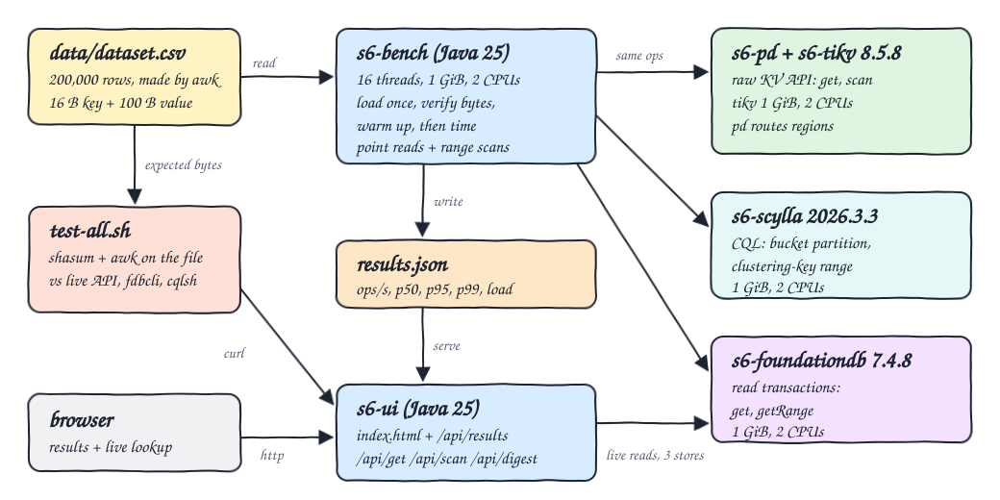
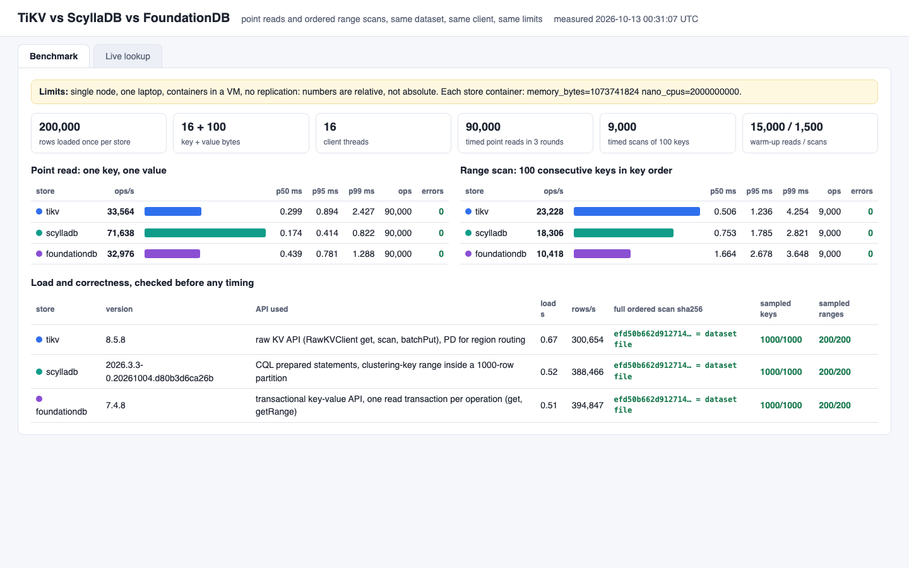
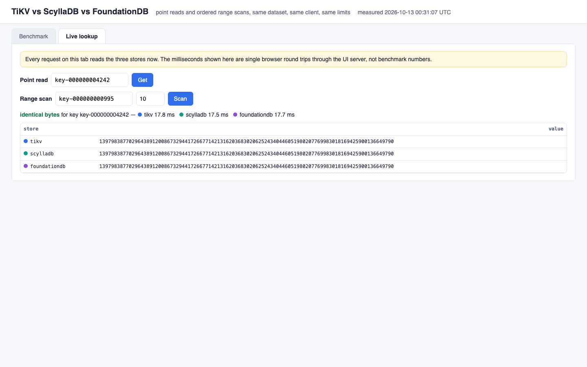
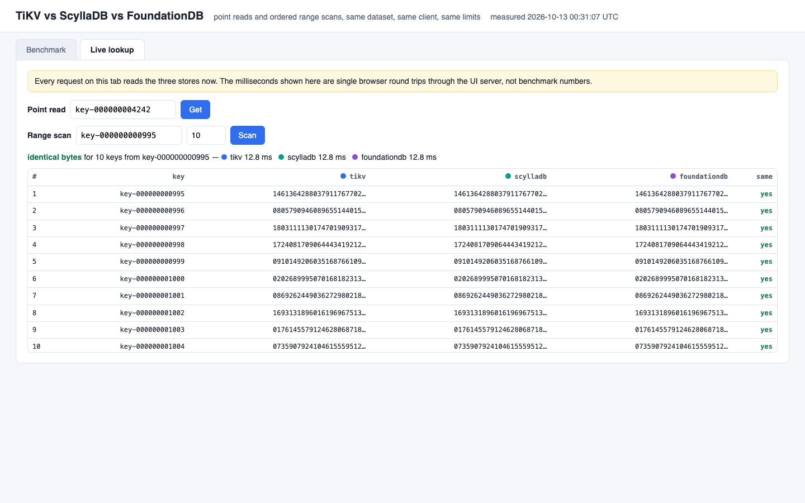

<p align="center"></p>

# tikv-vs-scylla-vs-foundationdb

A narrow benchmark of three ordered key-value stores on exactly two operations: point reads and ordered range scans. Single-node TiKV 8.5.8 (with PD, raw KV API), single-node ScyllaDB 2026.3.3 and single-node FoundationDB 7.4.8 receive the same 200,000 keys with the same 100-byte values, are read by the same Java 25 client with the same 16 threads, the same number of operations and the same warm-up, and each store runs in a container with the same 1 GiB memory and 2 CPU limit. Before anything is timed, every store must return the dataset byte for byte. A small UI shows throughput, p50/p95/p99 and load time, and reads the three stores live side by side.

**Limits, read first:** single node, one laptop, containers inside a podman VM, no replication, a client capped at 2 CPUs on the same machine, a 24 MB dataset that fits in every cache. The numbers are relative between the three stores on this machine, not absolute, and say nothing about clusters, durability settings, large datasets or write load. Other workloads were running in the same VM while these were measured, so run `BENCH_FORCE=1 ./scripts/start-all.sh` on an idle machine for final numbers.

## How it Works

1. `setup.sh` generates `data/dataset.csv` with awk (200,000 rows, `key-%012d` keys, 100 digit values from a fixed-seed generator), pulls the images and builds two local images.
2. `start-all.sh` starts `s6-pd`, `s6-tikv`, `s6-scylla` and `s6-foundationdb`, configures FoundationDB as `single ssd`, and refuses to continue unless the three store containers report the same memory and CPU limit.
3. `s6-bench` (Java 25 in a container on the same network) loads the dataset once per store in batches of 100 rows on 16 threads and records the load time.
4. Correctness gate: for each store a full ordered scan is hashed with SHA-256 and must equal the SHA-256 of the dataset file, 1,000 sampled keys must return identical bytes and 200 sampled ranges must return identical rows. Any mismatch exits before timing.
5. Three rounds, stores interleaved inside each round: 5,000 warm-up point reads, 30,000 timed point reads, 500 warm-up scans, 3,000 timed scans of 100 consecutive keys. Every store gets the same key sequence.
6. Each timed operation checks its own answer (value bytes for point reads; row count, first and last key for scans) and counts an error otherwise.
7. `results.json` is written and `s6-ui` serves it together with live `get`, `scan` and `digest` endpoints over the three stores.
8. `test-all.sh` recomputes everything from the file with `shasum` and `awk` and compares it with the live stores.

## Architecture



## Features

* Same dataset, same client, same concurrency, same operation count, same warm-up, same container limits for three stores.
* Point reads and ordered range scans only, reported as throughput plus p50, p95 and p99 latency, with load time.
* Correctness before speed: full ordered scan SHA-256, sampled keys and sampled ranges must match the dataset file on every store.
* Rounds interleave the stores so a noisy moment on the laptop does not land on one store only.
* Live lookup tab: one key or one range read from the three stores now, with an identical-bytes verdict.
* Benchmark client runs in a container, so the host needs no JDK, no maven and no FoundationDB native library.

## Stack

* TiKV 8.5.8 with PD 8.5.8 (`docker.io/pingcap/tikv:v8.5.8`, `docker.io/pingcap/pd:v8.5.8`), **raw KV API**, client `org.tikv:tikv-client-java:3.3.5`.
* ScyllaDB 2026.3.3 (`docker.io/scylladb/scylla:2026.3.3`), CQL, driver `org.apache.cassandra:java-driver-core:4.19.3`.
* FoundationDB 7.4.8 (`docker.io/foundationdb/foundationdb:7.4.8`), transactional API version 740, client `org.foundationdb:fdb-java:7.4.8` with `libfdb_c` 7.4.8.
* Java 25.0.4 (`docker.io/library/eclipse-temurin:25.0.4.1_1-jre-noble`), built with maven 3.10.0 (`docker.io/library/maven:3.10.0-eclipse-temurin-25-noble`); the UI server is the JDK `HttpServer`.
* podman + podman-compose; awk, shasum, curl and python3 for generation and verification.

All three stores publish arm64 images. Two things on arm64 needed handling and are not silent swaps:

* The official arm64 FoundationDB 7.4.8 image runs an arm64 `fdbserver` but ships an x86-64 `libfdb_c.so`, so the client library cannot be copied from it. `Containerfile` downloads `libfdb_c.<arch>.so` 7.4.8 from the FoundationDB GitHub release and checks its published SHA-256.
* The official TiKV 8.5.8 binary carries 380 MB of debug symbols that it loads at start, which takes 2.1 GiB of memory and is OOM-killed under a 1 GiB limit. `Containerfile.tikv` builds `localhost/s6-tikv:v8.5.8` from the official image with `strip --strip-debug` on `tikv-server`: same code, no debug symbols, about 160 MB resident at idle.

## API

| Method | Path | Returns |
|---|---|---|
| GET | `/api/results` | `results.json`: setup, dataset SHA-256 and, per store, version, API used, load time, verification and both operations |
| GET | `/api/get?store=<s>&key=<k>` | the value of one key read from that store now, 404 when absent |
| GET | `/api/scan?store=<s>&start=<k>&n=<1..1000>` | up to `n` `key,value` lines in key order starting at `start` |
| GET | `/api/digest?store=<s>` | SHA-256 and row count of a full ordered scan of that store, made now |

`store` is `tikv`, `scylladb` or `foundationdb`. The UI accepts `?tab=lookup&key=<k>` and `?tab=lookup&start=<k>&n=<n>`.

## Key Design Decisions

* **TiKV uses the raw KV API**, not the transactional one: `get`, `scan(start, limit)` and `batchPut`, with PD only routing regions. There is no MVCC timestamp fetch per read.
* **FoundationDB has only a transactional API**, so every point read and every scan is its own read transaction and pays for a read version. That is its normal cost and it is included.
* **ScyllaDB range scan is a clustering-key range inside a partition.** The table is `kv (bucket int, k text, v blob, PRIMARY KEY ((bucket), k))` with 1,000 consecutive keys per bucket. Rows are sorted by `k` only inside a partition, so a scan of N consecutive keys is `WHERE bucket = ? AND k >= ? LIMIT ?`, followed by a second query on the next bucket when the range crosses a bucket edge (about 10% of the 100-key scans). The client has to know the bucket rule; TiKV and FoundationDB need no such rule.
* **Why a token-range scan is not the same thing:** ScyllaDB places partitions by the Murmur3 hash of the partition key, so `WHERE token(k) >= ?` walks rows in hash order, not key order. With `k` as the partition key, the 100 rows after a given token are 100 unrelated keys. It answers "give me the next slice of the ring", which is good for full-table export and useless for "the 100 keys after this one". An honest ordered scan in ScyllaDB therefore needs the order designed into the schema, which is what the bucket does.
* Closed-loop client: 16 platform threads, each issuing the next operation when the previous one returns, with the blocking call of every driver. Throughput is total operations divided by total timed wall time over the three rounds; percentiles are over all timed operations.
* Equal limits are enforced, not assumed: `start-all.sh` and `test-all.sh` compare `podman inspect` memory and CPU of the three store containers. PD is outside that limit (512 MiB, 1 CPU) because it is not on the read path after region routing is cached.
* Inside the 1 GiB container each store keeps its own defaults except what was needed to start: TiKV block cache 256 MB and no reserved disk space, ScyllaDB `--smp 2 --memory 750M --reserve-memory 128M --overprovisioned 1 --developer-mode 1`, FoundationDB default `fdbserver` in one process. ScyllaDB developer mode skips the disk checks it would otherwise require.
* The dataset file is the single source of truth: awk writes it, Java loads it, `shasum` and awk verify the stores against it. It is 24 MB and git-ignored; `setup.sh` regenerates the same bytes.

## Verification

`./scripts/test-all.sh` output (24 PASS, 0 FAIL):

```
shasum -a 256 data/dataset.csv: efd50b662d9127145f9ef6bafb119c533224d9d81e57cd82b0779e0e5d55332b (200000 rows)
PASS tikv live full ordered scan equals the dataset file byte for byte
PASS scylladb live full ordered scan equals the dataset file byte for byte
PASS foundationdb live full ordered scan equals the dataset file byte for byte
PASS tikv 11 sampled point reads return the bytes awk reads from the file
PASS scylladb 11 sampled point reads return the bytes awk reads from the file
PASS foundationdb 11 sampled point reads return the bytes awk reads from the file
PASS tikv answers 404 for a key that is not in the dataset
PASS scylladb answers 404 for a key that is not in the dataset
PASS foundationdb answers 404 for a key that is not in the dataset
PASS tikv range scan from row 1 returns the same 100 ordered rows as awk
PASS scylladb range scan from row 1 returns the same 100 ordered rows as awk
PASS foundationdb range scan from row 1 returns the same 100 ordered rows as awk
PASS tikv range scan from row 951 returns the same 100 ordered rows as awk
PASS scylladb range scan from row 951 returns the same 100 ordered rows as awk
PASS foundationdb range scan from row 951 returns the same 100 ordered rows as awk
PASS tikv range scan from row 199951 returns the same 50 ordered rows as awk
PASS scylladb range scan from row 199951 returns the same 50 ordered rows as awk
PASS foundationdb range scan from row 199951 returns the same 50 ordered rows as awk
PASS foundationdb fdbcli get key-000000004242 matches awk
PASS scylladb cqlsh select key-000000004242 matches awk
PASS scylladb container has the same memory and cpu limit as tikv
PASS foundationdb container has the same memory and cpu limit as tikv
tikv          point_read    33564.4 ops/s  p50   0.299 ms  p95   0.894 ms  p99   2.427 ms  load   0.67 s
tikv          range_scan    23228.3 ops/s  p50   0.506 ms  p95   1.236 ms  p99   4.254 ms  load   0.67 s
scylladb      point_read    71638.4 ops/s  p50   0.174 ms  p95   0.414 ms  p99   0.822 ms  load   0.52 s
scylladb      range_scan    18305.9 ops/s  p50   0.753 ms  p95   1.785 ms  p99   2.821 ms  load   0.52 s
foundationdb  point_read    32975.8 ops/s  p50   0.439 ms  p95   0.781 ms  p99   1.288 ms  load   0.51 s
foundationdb  range_scan    10418.4 ops/s  p50   1.664 ms  p95   2.678 ms  p99   3.648 ms  load   0.51 s
PASS results.json was measured on this dataset, same operation counts for every store, no errors, ordered percentiles, throughput equals ops / seconds
PASS ui page served
all tests passed
```

The range from row 951 crosses a ScyllaDB bucket edge and the range from row 199951 runs off the end of the dataset. The test was also run with one FoundationDB value overwritten through `fdbcli`: it failed on the first FoundationDB check with a different SHA-256, then passed again after the value was restored.

Measured numbers from `results.json` (200,000 rows, 16 threads, 90,000 timed point reads and 9,000 timed 100-key scans per store, 0 errors):

| Store | Operation | ops/s | p50 ms | p95 ms | p99 ms | Load s |
|---|---|---|---|---|---|---|
| TiKV 8.5.8 (raw KV) | point read | 33,564 | 0.299 | 0.894 | 2.427 | 0.67 |
| ScyllaDB 2026.3.3 | point read | 71,638 | 0.174 | 0.414 | 0.822 | 0.52 |
| FoundationDB 7.4.8 | point read | 32,976 | 0.439 | 0.781 | 1.288 | 0.51 |
| TiKV 8.5.8 (raw KV) | range scan, 100 keys | 23,228 | 0.506 | 1.236 | 4.254 | |
| ScyllaDB 2026.3.3 | range scan, 100 keys | 18,306 | 0.753 | 1.785 | 2.821 | |
| FoundationDB 7.4.8 | range scan, 100 keys | 10,418 | 1.664 | 2.678 | 3.648 | |

What these runs show on this machine: ScyllaDB is about twice as fast on point reads, TiKV raw scans lead on ordered ranges, and FoundationDB is the slowest on ranges; it pays for a read transaction on every operation, and its client runs all network work on one thread, which is a likely cause that this benchmark does not isolate. An earlier run on the same machine gave the same ordering with different sizes (ScyllaDB point reads 57,976 ops/s, FoundationDB scans 13,444 ops/s), so treat differences below roughly 25% as noise.

## Printscreens

Benchmark tab: the limits banner, the setup, throughput bars and p50/p95/p99 for point reads and range scans, and the load and correctness table with the API used per store and the full-scan SHA-256 equal to the dataset file.



Live lookup, point read: `key-000000004242` read from the three stores at request time, with the identical-bytes verdict.



Live lookup, range scan: 10 keys from `key-000000000995`, which crosses the ScyllaDB bucket edge at `key-000000001000`; the three stores return the same rows in the same order.



## Scripts

All scripts live in `scripts/` and run from any directory of the repository.

| Script | What it does |
|---|---|
| `./scripts/setup.sh` | Generates the dataset with awk, pulls the images, builds the stripped TiKV image and the benchmark client image |
| `./scripts/start-all.sh` | Starts PD, TiKV, ScyllaDB and FoundationDB, runs the benchmark when `results.json` is missing (`BENCH_FORCE=1` reruns it), starts the UI and prints the full link of each service |
| `./scripts/status.sh` | Shows every service port as UP or DOWN |
| `./scripts/test-all.sh` | Verifies the three live stores against shasum and awk over the dataset file, checks equal limits and the recorded results |
| `./scripts/ui.sh` | Opens the UI in the browser |
| `./scripts/stop-all.sh` | Stops every service |
| `./scripts/sql-console.sh` | Opens `cqlsh` on the ScyllaDB keyspace `s6` |

Ports are declared in `scripts/ports.env`: pd 30500, tikv status 30501, scylla 30502, foundationdb 30503, ui 30504.

```bash
./scripts/setup.sh
./scripts/start-all.sh
./scripts/status.sh
./scripts/test-all.sh
./scripts/ui.sh
./scripts/stop-all.sh
```
