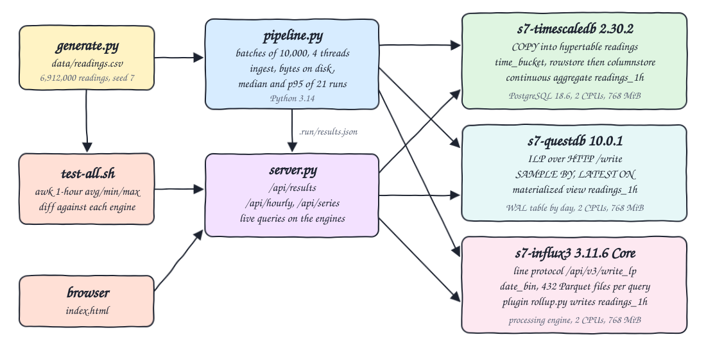
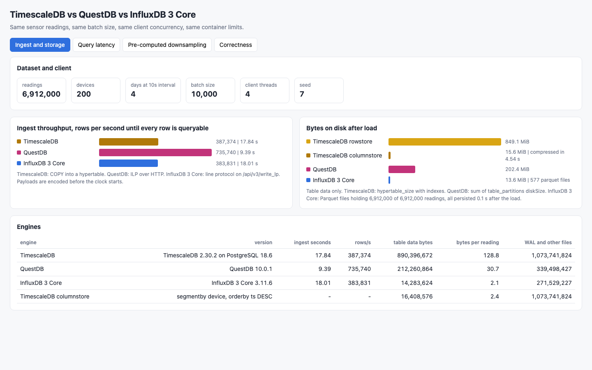
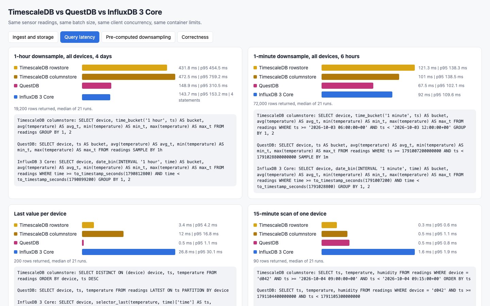
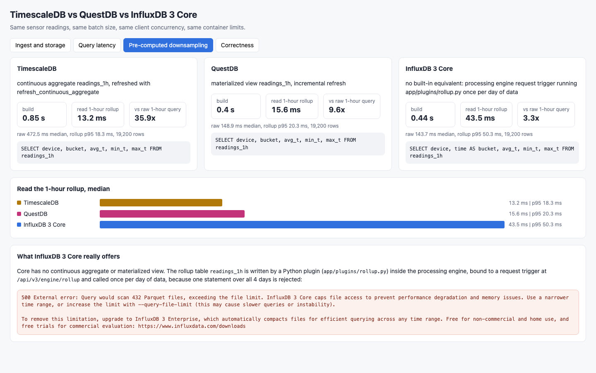
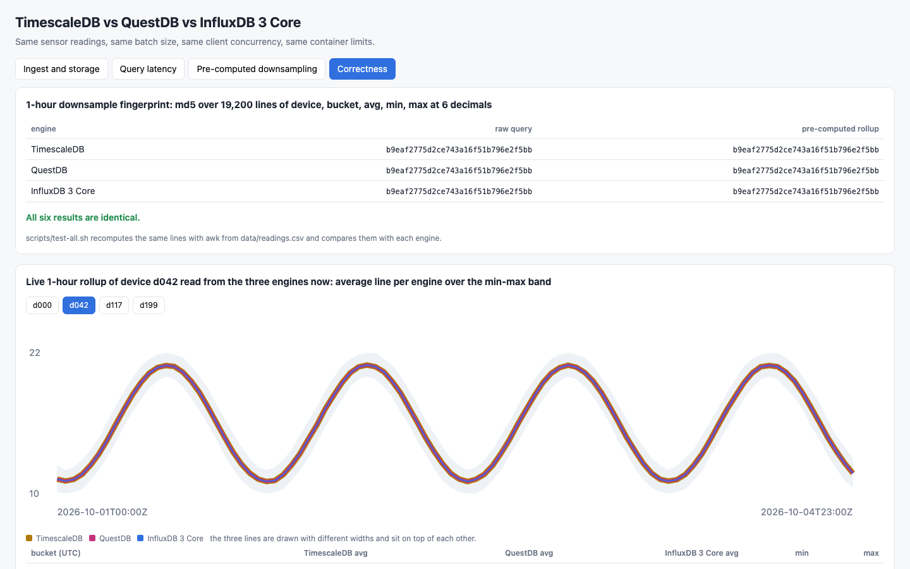

<p align="center"></p>

# timescaledb-vs-questdb-vs-influx3

Three time-series databases compared on ingest and downsampling with the same data: TimescaleDB 2.30.2 (on PostgreSQL 18.6), QuestDB 10.0.1 and InfluxDB 3 Core 3.11.6. A seeded generator writes 6,912,000 sensor readings (200 devices, 4 days, one reading every 10 seconds). The same rows go into each engine through its fast path with the same batch size (10,000) and the same client concurrency (4 threads), in containers with the same limits (2 CPUs, 768 MiB). The project measures ingest rows per second, bytes on disk, query latency (median and p95 of 21 runs) and the pre-computed downsampling path of each engine, and it proves first that the 1-hour downsample is identical in the three engines and equal to an independent awk calculation. A small Python 3.14 UI shows the results.

## How it Works

1. `setup.sh` creates the venv, pulls the three images and runs `app/generate.py`, which writes `data/readings.csv` (seed 7, `device,ts,temperature,humidity`).
2. `start-all.sh` recreates the three containers with empty volumes and runs `app/pipeline.py`.
3. For each engine the pipeline encodes every batch first, then starts the clock, sends the batches from 4 threads and stops the clock when `count` returns all 6,912,000 rows.
4. TimescaleDB gets `COPY` into a hypertable, QuestDB gets ILP over HTTP on `/write`, InfluxDB 3 Core gets line protocol on `/api/v3/write_lp`. QuestDB and InfluxDB receive byte-identical payloads.
5. Bytes on disk are read from each engine. TimescaleDB is measured as rowstore, then every chunk is compressed into the columnstore and measured again.
6. Four queries run 21 times each: 1-hour downsample of everything, 1-minute downsample of a 6-hour window, last value per device, and a 15-minute scan of one device (`time_bucket`, `SAMPLE BY`, `date_bin`).
7. The pre-computed path is built and read: a TimescaleDB continuous aggregate, a QuestDB materialized view, and for InfluxDB 3 Core a processing engine plugin, because Core has no equivalent object.
8. `app/server.py` serves the results and live 1-hour rows from the three engines to `index.html`.
9. `test-all.sh` recomputes the 1-hour downsample with awk from the CSV and diffs it against six live results (raw query and rollup of each engine).

## Architecture



## Features

* Same data everywhere: one seeded CSV, same timestamps and values, same batch size, same client threads, same container limits.
* Recommended fast path per engine: `COPY` into a hypertable, ILP over HTTP, line protocol write API.
* Storage: table data bytes per engine, TimescaleDB rowstore and columnstore stated separately, WAL and other files stated separately.
* Query latency: median and p95 of 21 runs for four queries, TimescaleDB measured both as rowstore and as columnstore.
* Pre-computed downsampling: continuous aggregate, materialized view, and the real InfluxDB 3 Core answer (a Python plugin on a request trigger).
* InfluxDB 3 Core limit shown, not hidden: the 4-day downsample as one statement is rejected by the 432 Parquet file cap and the server message is stored, displayed and tested.
* Correctness before timing: the 1-hour avg, min and max per device are identical across the three engines and equal to awk.
* UI with four tabs: ingest and storage, query latency, pre-computed downsampling, correctness with a live chart.

## Stack

* TimescaleDB 2.30.2 on PostgreSQL 18.6 (`docker.io/timescale/timescaledb:2.30.2-pg18`, arm64).
* QuestDB 10.0.1 (`docker.io/questdb/questdb:10.0.1`, arm64).
* InfluxDB 3 Core 3.11.6 (`docker.io/library/influxdb:3.11.6-core`, arm64).
* Python 3.14.7: generator, pipeline and HTTP server on the standard library plus `psycopg[binary]` 3.3.6 for `COPY`.
* podman 5.7.1 + podman-compose 1.5.0.
* awk: independent verification.

## API

| Method | Path | Returns |
|---|---|---|
| GET | `/api/results` | the measured results written by the pipeline: dataset, and per engine version, ingest, disk, query latencies, rollup build time and md5 fingerprints |
| GET | `/api/hourly?engine=timescaledb\|questdb\|influx3&source=raw\|rollup` | live 1-hour downsample as text lines `device epoch avg min max` with 6 decimals, from the raw table or from the pre-computed rollup |
| GET | `/api/series?device=d042` | live 1-hour rollup rows of one device from the three engines |

The UI accepts `?tab=ingest|queries|rollup|correct` and `&device=d042`.

## Key Design Decisions

* Values are quantized (temperature to 0.125, humidity to 0.5) so every sum is exact in a double. That is why avg, min and max match across engines and awk at 6 decimals. It also makes the data compress better than noisy real sensors would, so the storage numbers are flattering for the columnar formats.
* Ingest time ends when the engine returns the full row count, so asynchronous steps (QuestDB WAL apply, InfluxDB buffer) are inside the clock. Payload encoding is outside the clock.
* TimescaleDB has an extra index on `(device, ts DESC)`. Its rowstore size includes both indexes. The columnstore uses `segmentby device`, `orderby ts DESC`.
* Table data and WAL are reported separately: `hypertable_size` and `pg_ls_waldir` for TimescaleDB, `table_partitions` and the rest of `table_storage` for QuestDB, Parquet files and the rest of the data directory for InfluxDB 3 Core. The TimescaleDB WAL number is the recycled `pg_wal` of the whole cluster. The QuestDB number is taken right after the load, before its WAL purge.
* InfluxDB 3 Core authentication: the server is started with `INFLUXDB3_WITHOUT_AUTH=true`, so no token is used. Without it an admin token has to be created first.
* InfluxDB 3 Core memory options default to percentages (50% write buffer, 20% query pool, 20% file cache). With those defaults the container was killed once during the load at 768 MiB, so they are set to 192 MiB, 192 MiB and 64 MiB. TimescaleDB and QuestDB run with image defaults.
* `INFLUXDB3_FORCE_SNAPSHOT_MAX_AGE=5s` makes Core persist the write buffer to Parquet quickly, so every query runs against the same state on every run: 577 Parquet files holding all readings.
* InfluxDB 3 Core query limit: a query may touch 432 Parquet files (`query-file-limit`), 72 hours of 10-minute files. The 4-day downsample as one statement is rejected. The benchmark keeps the default and sends one statement per day (4 statements, times added). The last value query is limited to the final day for the same reason. Core has no compaction; the message points to Enterprise.
* InfluxDB 3 Core has no continuous aggregate or materialized view. The rollup is `app/plugins/rollup.py`, a processing engine plugin on a request trigger (`/api/v3/engine/rollup`), called once per day of data. It is not refreshed automatically. The Last Value Cache was not exercised.
* TimescaleDB is queried over the PostgreSQL wire protocol (psycopg), QuestDB and InfluxDB 3 Core over HTTP with JSON. Latency is client-observed and includes fetching and decoding the rows.
* With 21 runs the p95 is the second slowest run.
* The podman VM was shared with other running stacks during the measurement. Re-run on an idle machine before using the numbers.

## Verification

`./scripts/test-all.sh` output (15 checks):

```
computing the 1-hour downsample with awk from data/readings.csv
PASS csv holds the readings and devices the pipeline reports
PASS awk yields one bucket per device per hour
PASS timescaledb 1-hour downsample from raw equals awk
PASS timescaledb 1-hour downsample from rollup equals awk
PASS questdb 1-hour downsample from raw equals awk
PASS questdb 1-hour downsample from rollup equals awk
PASS influx3 1-hour downsample from raw equals awk
PASS influx3 1-hour downsample from rollup equals awk
PASS three engines stored the same number of readings
PASS timescaledb readings_1h is a continuous aggregate
PASS timescaledb compressed every chunk into the columnstore
PASS timescaledb columnstore is smaller than rowstore
PASS questdb readings_1h is a valid materialized view
PASS influxdb 3 core rejects the 4-day downsample as one statement
PASS influxdb 3 core rollup is a processing engine trigger
measured (engine ingest_rows_per_s table_bytes 1h_ms 1m_ms last_ms scan_ms rollup_ms):
timescaledb-rowstore 387374 890396672 431.83 121.31 3.42 0.27 13.17
timescaledb-columnstore 387374 16408576 472.49 101.0 11.99 0.45 13.17
questdb 735740 212260864 148.89 67.46 0.53 0.49 15.57
influx3 383831 14283624 143.7 92.0 26.83 1.63 43.47
all tests passed
```

Ingest of 6,912,000 readings, batches of 10,000, 4 client threads:

| Engine | Path | Seconds | Rows/s |
|---|---|---|---|
| TimescaleDB | `COPY` into hypertable | 17.84 | 387,374 |
| QuestDB | ILP over HTTP | 9.39 | 735,740 |
| InfluxDB 3 Core | line protocol `/api/v3/write_lp` | 18.01 | 383,831 |

Bytes on disk after load:

| Engine | Table data | Bytes per reading | WAL and other files |
|---|---|---|---|
| TimescaleDB rowstore | 890,396,672 | 128.8 | 1,073,741,824 |
| TimescaleDB columnstore (compressed in 4.54 s) | 16,408,576 | 2.4 | 1,073,741,824 |
| QuestDB | 212,260,864 | 30.7 | 339,498,427 |
| InfluxDB 3 Core (577 Parquet files) | 14,283,624 | 2.1 | 271,529,227 |

Query latency in ms, median / p95 of 21 runs:

| Query | TimescaleDB rowstore | TimescaleDB columnstore | QuestDB | InfluxDB 3 Core |
|---|---|---|---|---|
| 1-hour downsample, all devices, 4 days (19,200 rows) | 431.83 / 454.45 | 472.49 / 759.21 | 148.89 / 310.49 | 143.70 / 153.17 (4 statements) |
| 1-minute downsample, all devices, 6 hours (72,000 rows) | 121.31 / 138.30 | 101.00 / 138.45 | 67.46 / 102.12 | 92.00 / 109.63 |
| last value per device (200 rows) | 3.42 / 4.22 | 11.99 / 16.79 | 0.53 / 1.10 | 26.83 / 30.10 (final day only) |
| 15-minute scan of one device (90 rows) | 0.27 / 0.58 | 0.45 / 1.10 | 0.49 / 0.82 | 1.63 / 1.91 |

Pre-computed 1-hour downsampling:

| Engine | Mechanism | Build seconds | Read rollup median / p95 ms |
|---|---|---|---|
| TimescaleDB | continuous aggregate + `refresh_continuous_aggregate` | 0.85 | 13.17 / 18.26 |
| QuestDB | materialized view, incremental refresh | 0.40 | 15.57 / 20.29 |
| InfluxDB 3 Core | Python plugin on a request trigger, 4 calls | 0.44 | 43.47 / 50.32 |

InfluxDB 3 Core answer to the 4-day downsample as one statement:

```
500 External error: Query would scan 432 Parquet files, exceeding the file limit. InfluxDB 3 Core caps file access to prevent performance degradation and memory issues. Use a narrower time range, or increase the limit with --query-file-limit (this may cause slower queries or instability).
```

## Printscreens

Ingest and storage: the dataset and client settings, rows per second until every row is queryable, table bytes on disk with TimescaleDB rowstore and columnstore apart, and the per-engine table with versions and WAL bytes.



Query latency: one card per query with the median bar and p95 of the four variants and the SQL each engine ran. InfluxDB 3 Core shows `4 statements` on the 1-hour downsample.



Pre-computed downsampling: build time, rollup read latency and speedup against the raw 1-hour query per engine, and the InfluxDB 3 Core card stating that there is no built-in equivalent, with the server message for the rejected 4-day statement.



Correctness: the md5 fingerprint of the 1-hour downsample from the raw query and from the rollup of each engine (six equal values) and a live chart of one device read from the three engines, the three average lines on top of each other.



## Scripts

All scripts live in `scripts/` and run from any directory of the repository.

| Script | What it does |
|---|---|
| `./scripts/setup.sh` | Creates the Python 3.14 venv, installs psycopg, pulls the three images and generates `data/readings.csv` |
| `./scripts/start-all.sh` | Recreates the three engines with empty volumes, runs the load and measurement pipeline (a few minutes), starts the UI and prints the full link of each service |
| `./scripts/status.sh` | Shows every service port as UP or DOWN |
| `./scripts/test-all.sh` | Verifies the 1-hour downsample of the three engines against awk, the rollup objects and the InfluxDB 3 Core file limit |
| `./scripts/ui.sh` | Opens the UI in the browser |
| `./scripts/stop-all.sh` | Stops every service |
| `./scripts/sql-console.sh` | Opens `psql` on TimescaleDB; `sql-console.sh questdb` opens `psql` on QuestDB; `sql-console.sh influx3 "SELECT ..."` runs one statement on InfluxDB 3 Core |

Ports are declared in `scripts/ports.env`: timescaledb 30600, questdb 30601, influx3 30602, ui 30603.

```bash
./scripts/setup.sh
./scripts/start-all.sh
./scripts/status.sh
./scripts/test-all.sh
./scripts/ui.sh
./scripts/stop-all.sh
```
