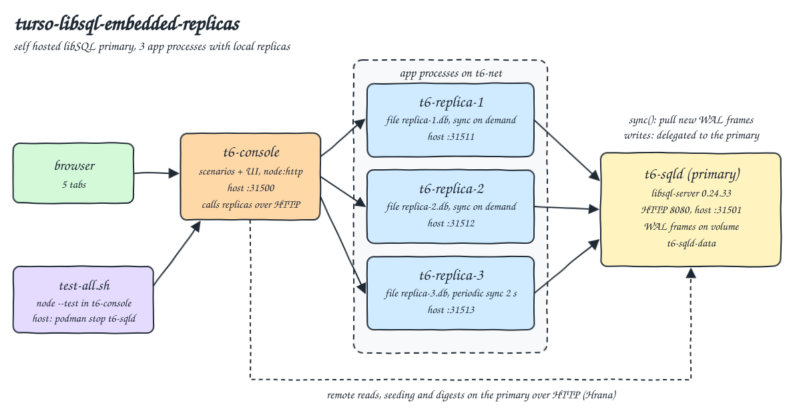
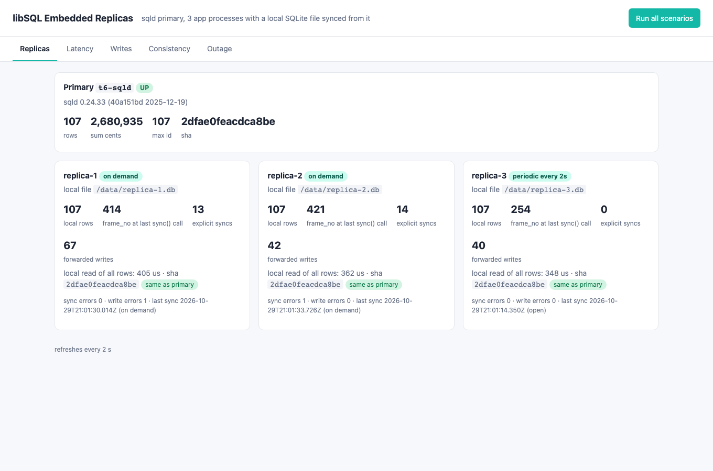
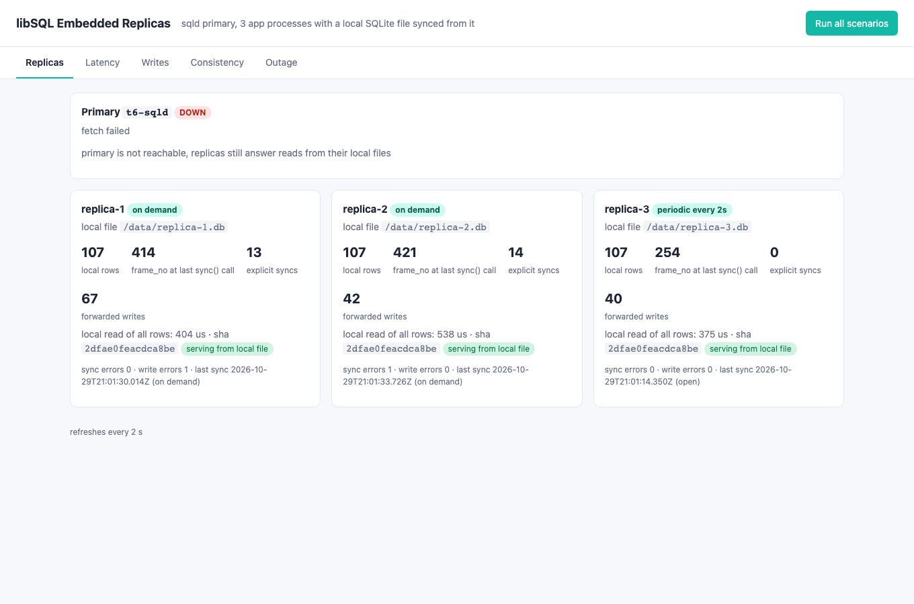
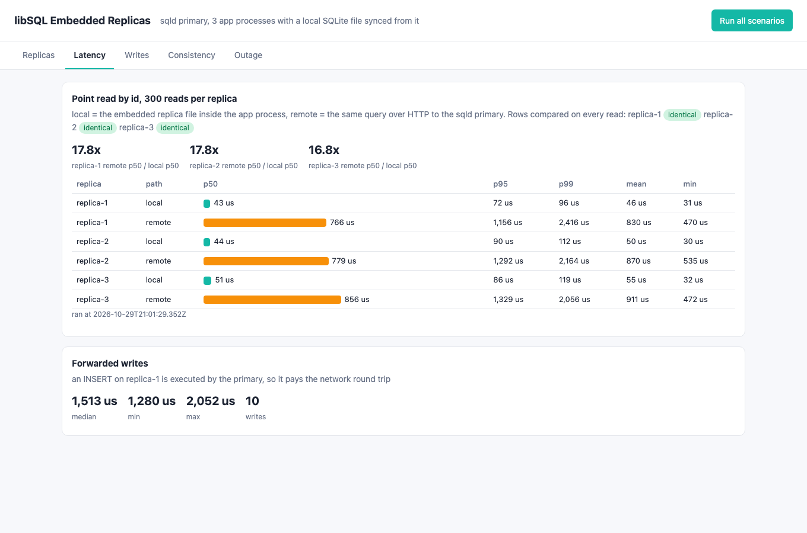
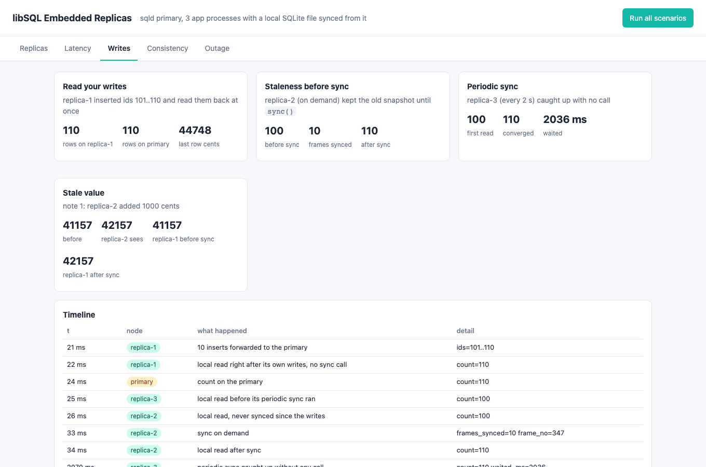
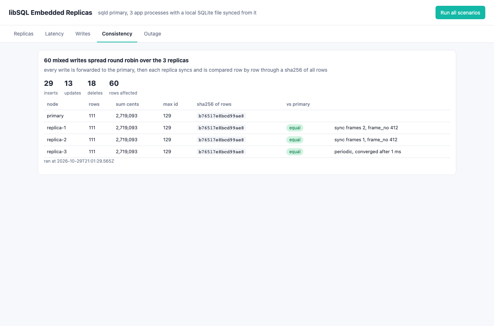
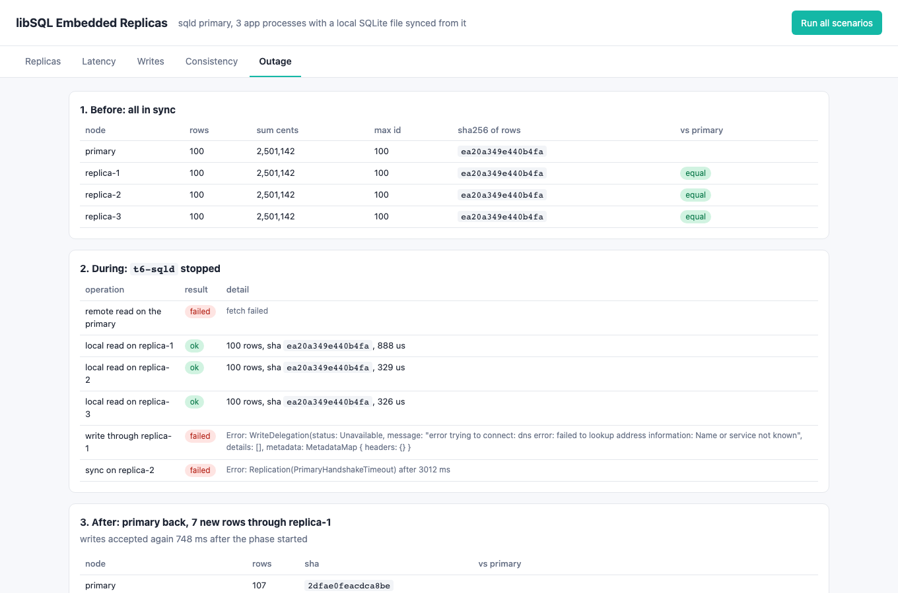

<p align="center"></p>

# turso-libsql-embedded-replicas

libSQL embedded replicas without a Turso cloud account. This POC runs a self hosted libSQL server (`sqld` 0.24.33) as the primary and three Node.js app processes (`@libsql/client` 0.18.0 on Node 26.13.0). Each one keeps a local SQLite file that is a replica of the primary. A console app and a web UI show that local reads take tens of microseconds while the same read over HTTP to the primary takes most of a millisecond, that writes go to the primary, that a replica reads its own writes, that sync can run on demand or on a timer, that a replica stays stale until it syncs, that replicas keep answering reads while the primary is down, and that they catch up when it comes back.

## How it Works

1. `t6-sqld` runs `ghcr.io/tursodatabase/libsql-server:v0.24.33` as a primary. It serves HTTP (Hrana) on 8080 and keeps its database and WAL on the volume `t6-sqld-data`.
2. `t6-replica-1`, `t6-replica-2` and `t6-replica-3` run `app/replica.js`. Each opens `createClient({ url: "file:/data/<name>.db", syncUrl: "http://t6-sqld:8080", readYourWrites: true })`. Replicas 1 and 2 sync only when asked. Replica 3 also sets `syncInterval: 2`, so it syncs every 2 seconds.
3. A replica runs reads on its local file. It sends writes to the primary, then pulls the frames for its own write, so it reads its own writes. `sync()` pulls every new WAL frame from the primary and returns `frame_no` and `frames_synced`.
4. Each replica process exposes a small HTTP API (`/read`, `/write`, `/sync`, `/digest`, `/bench`, `/state`). `t6-console` (`app/console.js`) runs the scenarios through those APIs. It also uses a remote `@libsql/client` on the primary to seed data and to read the primary's own view.
5. Input comes from `app/data.js`: 100 seeded notes (`id`, `author`, `cents`) and a seeded list of 60 insert, update and delete operations. The tests compute every expected digest from that same input.
6. A digest is the row count, the sum of `cents`, the max id and a sha256 over all rows ordered by id. Two nodes hold the same data exactly when their digests match.
7. `scripts/test-all.sh` reruns every scenario and runs `tests/replicas.test.js` inside `t6-console`. It then runs `tests/outage.test.js` on the host, which stops `t6-sqld` with podman, checks reads, writes and sync on the replicas, starts the primary again and checks the catch up.

## Architecture



## Features

* Self hosted primary: one `sqld` container stands in for Turso cloud. The embedded replica protocol is the same.
* Embedded replicas: each app process reads from its own SQLite file, so a point read takes about 45 us at p50. The same read over HTTP to the primary takes about 800 us, roughly 17x slower.
* Writes go to the primary: an `INSERT` sent to a replica runs on the primary (about 1.5 ms). The primary always holds the writes from every replica.
* Read your writes: after writing 10 rows, replica-1 reads all 110 at once without calling `sync()`.
* Staleness is visible: replica-2 serves the old 100 rows and the old value of note 1 until it calls `sync()`, which pulls exactly the missing frames.
* Periodic sync: replica-3 sets `syncInterval: 2` and catches up with no call, within one interval (about 2 s).
* Consistency: after 60 mixed writes from all 3 replicas, every replica and the primary have the same sha256 over all rows. That value matches the one the tests compute from the operation list.
* Primary outage: with `t6-sqld` stopped, every replica still answers reads from its last synced snapshot. Writes and `sync()` fail with clear errors.
* Catch up: once the primary is back, writes work again in under 1 s. The on demand replica catches up on its next `sync()` and the periodic one catches up on its own. The primary keeps its data on its volume.
* Lean: 256 MB for `sqld`, 128 MB for each of the 4 Node containers, 768 MB in total.

## Stack

* libSQL server `sqld` 0.24.33 (`ghcr.io/tursodatabase/libsql-server:v0.24.33`): the newest tagged server release (December 2025), Turso's open source SQLite fork that the cloud runs on. It ships only on ghcr.io, not Docker Hub.
* `@libsql/client` 0.18.0: the official TypeScript/JS client. It supports embedded replicas (`syncUrl`, `syncInterval`, `readYourWrites`) through the native `libsql` 0.5.29 binding, which ships prebuilt for linux arm64.
* Node.js 26.13.0 LTS (`docker.io/library/node:26.13.0-slim`): one image runs the replicas, the console, the UI and the in-container tests.
* Node built ins only: `node:http`, `fetch`, `node:crypto`, `node:test` and plain HTML, CSS and JS. No web framework and no test framework.
* podman + podman-compose: runs the 5 containers, the network `t6-net` and the volume `t6-sqld-data`.

## Contracts / APIs

| Method | Path / endpoint | Description |
|---|---|---|
| HTTP | `http://localhost:31501` | sqld primary: Hrana `/v2/pipeline`, `/health`, `/version` |
| GET | `http://localhost:31511`, `31512`, `31513` `/state` | Replica state: sync mode, last `sync()` result, sync/write counters, local digest |
| GET | `/digest` on a replica | Digest of the local file plus the read time in microseconds |
| POST | `/read` `{sql,args}` on a replica | Runs a query on the local file, returns rows and `us` |
| POST | `/write` `{sql,args}` on a replica | Sends a write to the primary, returns `rows_affected`, `last_insert_rowid`, `us` |
| POST | `/sync` on a replica | `sync()`, returns `frame_no`, `frames_synced`, `us` |
| POST | `/bench` `{n}` on a replica | n point reads on the local file and n on the primary, returns p50/p95/p99/mean and row mismatches |
| GET | `http://localhost:31500/` | UI |
| GET | `/api/results` | Last result of every scenario plus the last outage run |
| POST | `/api/run/{replication,writes,latency,consistency}` | Runs one scenario |
| POST | `/api/run-all` | Runs the four scenarios in order |
| POST | `/api/outage/{before,during,after}` | The three outage phases. The host test stops and starts `t6-sqld` between them |
| GET | `/api/topology` | Primary up/down, version and digest, plus `/state` of every replica |

```json
{"writes": {"read_your_writes": {"count": 110, "last_row": {"id": 110, "author": "ana", "cents": 44748}},
            "stale": {"name": "replica-2", "count": 100, "sha": "ea20a349e440b4fa"},
            "after_sync": {"name": "replica-2", "count": 110, "sha": "3cfffe2317f5687c", "sync": {"frames_synced": 10, "frame_no": 347}},
            "periodic": {"name": "replica-3", "first_count": 100, "count": 110, "waited_ms": 2036},
            "update": {"id": 1, "before": 41157, "writer": "replica-2", "writer_sees": 42157, "other": "replica-1", "other_before_sync": 41157, "other_after_sync": 42157}},
 "latency": {"replicas": [{"name": "replica-1", "local": {"p50": 43, "p95": 72, "p99": 96}, "remote": {"p50": 766, "p95": 1156, "p99": 2416}, "mismatches": []}]},
 "outage": {"during": {"primary_read": {"ok": false, "error": "fetch failed"},
                       "reads": [{"name": "replica-1", "ok": true, "value": {"count": 100, "sha": "ea20a349e440b4fa", "read_us": 888}}],
                       "write": {"ok": false, "error": "WriteDelegation(status: Unavailable, ...)"},
                       "sync": {"ok": false, "error": "Replication(PrimaryHandshakeTimeout)"}}}}
```

## Key data structures and design decisions

* One table, `notes(id INTEGER PRIMARY KEY, author TEXT, cents INTEGER)`. Every scenario drops it, recreates it and seeds 100 rows in one write batch on the primary, so results never depend on an earlier run. Replicas get the drop and the recreate as ordinary WAL frames.
* Each replica is its own container and process, with its database file on the container filesystem (`/data/<name>.db`). The replica file is a cache that can be rebuilt from the primary, so it gets no volume. Only the primary's data lives on a volume.
* Two on demand replicas and one periodic replica: replica-2 never syncs on its own, so the tests can rely on it being stale. Replica-3 shows what a timer does, and the test only asserts a bound (2 s interval + 1.5 s margin), never an exact time.
* The latency bench runs inside each replica process, so local and remote are timed in the same place with `process.hrtime`. Both run the same point query by id, interleaved, after 20 warm-up reads. Every pair of rows is compared, so a fast but wrong local read would show up as a mismatch.
* The digest is computed on rows read back from each node rather than on counters, so a wrong value in one row changes the sha.
* Outage phases are console endpoints, and the host test stops the container in between, because the console runs in a container and cannot drive podman. The UI shows the outcome of the last outage run.
* Errors are reported as they are. A write during the outage fails at once with `WriteDelegation(status: Unavailable ...)` because the primary's name no longer resolves on `t6-net`. `sync()` fails after about 3 s with `Replication(PrimaryHandshakeTimeout)`.
* After the primary returns, the first write can come before the replica reconnects. So each insert in the `after` phase checks whether its row already exists before retrying, for at most 30 s. That way a retry never inserts twice. In practice writes worked again in under 1 s.
* Changed from the plan: the Python `libsql` package (0.1.11) has no linux aarch64 wheel and this podman machine is arm64, so the app uses Node and `@libsql/client` instead of Python. The native `libsql` binding failed with `TLS error: no valid native root CA certificates found` on `node:slim`, even for a plain `http://` sync URL, so the Containerfile installs `ca-certificates`.
* The UI and the API only report what libSQL returned. All expected values live in the tests, computed from `app/data.js`. `tests/replicas.test.js` also opens its own fresh embedded replica and reads the primary directly instead of trusting the console.
* Every container, the network and the volume start with `t6-`, and every host port is in 31500-31599.

## How to run

Requirements: podman, podman-compose, curl, lsof and Node.js 20 or newer on the host (built ins only, for the outage test). Everything else runs in containers.

```bash
./scripts/setup.sh
./scripts/start-all.sh
./scripts/test-all.sh
./scripts/ui.sh
./scripts/stop-all.sh
```

`tests/replicas.test.js` (11 tests, inside `t6-console`) checks:

* Every replica holds exactly the 100 seeded rows after its first sync, and a fresh embedded replica opened by the test pulls frames and gets the same digest as the primary.
* The 10 inserts sent through replica-1 are on the primary, and replica-1 reads them back, including the exact last row, without a sync call.
* replica-2 still has the seeded digest before `sync()`, pulls at least 10 frames, and then matches the primary.
* replica-3 converges on its own within one sync interval plus margin.
* An update made on replica-2 is visible on replica-2 at once. replica-1 sees the old value until it syncs, then the new one.
* Local p50 is under 1 ms, remote p50 is more than 3x the local p50, and local and remote return identical rows.
* After 60 mixed operations from all 3 replicas, the primary (read directly) equals the digest of an in-memory model of the same operations, `rows_affected` equals the model's count (an update or delete of a missing id affects 0 rows), and every replica equals the primary.
* The UI page has every tab.

`tests/outage.test.js` (host) syncs everything, stops `t6-sqld`, and checks three things: a remote read fails, every replica still returns the seeded digest, and a write and a sync fail. It then starts the primary and checks four more: the primary kept its rows and gained the 7 new ones, the writer reads its own writes, replica-2 stays stale until its catch up `sync()` (7 or more frames), and replica-3 catches up on its own.

Mutation check: changing the model to count updates of missing ids, or expecting the new value on the stale replica, makes the suite fail.

```
running every scenario against the primary and the 3 embedded replicas
▶ replication from the primary
  ✔ every embedded replica holds exactly the seeded rows after its first sync
  ✔ a fresh embedded replica opened by the test bootstraps the same data as the primary
▶ writes, read your writes and staleness
  ✔ writes sent to an embedded replica are forwarded to the primary
  ✔ the writing replica reads its own writes without calling sync
  ✔ an on demand replica stays stale until it syncs, then matches the primary
  ✔ a periodic replica converges within one sync interval without any call
  ✔ an update made on one replica is invisible on another until that one syncs
▶ latency
  ✔ local reads take microseconds and are faster than remote reads to the primary
▶ consistency after mixed writes from every replica
  ✔ the primary holds the result of applying every operation in order
  ✔ every replica matches the primary after sync
▶ ui
  ✔ the page has every tab
ℹ tests 11
ℹ pass 11
ℹ fail 0
stopping t6-sqld to test reads during a primary outage
✔ replicas keep serving reads while the primary is down and catch up when it returns
ℹ tests 1
ℹ pass 1
ℹ fail 0
all tests passed
```

## Printscreens

Replicas tab: the primary is UP with 107 rows. Each of the 3 replicas shows its sync mode, its local file, its local row count, the `frame_no` of its last `sync()` call, its explicit sync and forwarded write counters, and a sha equal to the primary's. The page refreshes every 2 s.



Replicas tab with `t6-sqld` stopped: the primary is DOWN and cannot be read. All 3 replicas still answer from their local files (107 rows, same sha) in a few hundred microseconds.



Latency tab: 300 point reads per replica. Local reads come from the embedded file (p50 43 to 51 us) and remote reads go over HTTP to the primary (p50 766 to 856 us), about 17x slower. Every pair of rows was identical. Below, a forwarded write takes about 1.5 ms.



Writes tab: replica-1 inserted ids 101..110 and read 110 rows right away. replica-2 stayed at 100 until `sync()` pulled 10 frames. replica-3 went from 100 to 110 on its 2 s timer. Note 1 went from 41157 to 42157 on replica-2 while replica-1 still read 41157 until it synced. The timeline lists every step with its time.



Consistency tab: 60 mixed writes (29 inserts, 13 updates, 18 deletes, 60 rows affected) spread over the 3 replicas. The primary and all replicas have 111 rows and the same sha256.



Outage tab: before the outage all nodes were equal. During it the remote read, the write and the sync failed, and the 3 local reads returned the 100 seeded rows. After it the primary and replica-1 have 107 rows. replica-2 was still stale at 100 rows until it synced 7 frames, and replica-3 caught up on its own.



## Scripts

All scripts live in `scripts/` and run from any directory of the repository.

| Script | What it does |
|---|---|
| `./scripts/setup.sh` | Pulls the sqld and Node images and builds the app image |
| `./scripts/start-all.sh` | Starts the primary, waits for `/health`, starts the 3 replicas and the console, runs every scenario when there are no results, prints every link |
| `./scripts/status.sh` | Shows every service port as UP or DOWN |
| `./scripts/test-all.sh` | Reruns every scenario, runs the replica tests and the primary outage test |
| `./scripts/ui.sh` | Opens the UI in the browser |
| `./scripts/sql-console.sh` | Opens a SQL console on the primary (one statement per line) |
| `./scripts/stop-all.sh` | Stops every container and waits until the ports are free, the volume is kept |

Ports are declared in `scripts/ports.env`: UI 31500 (`http://localhost:31500`), sqld primary 31501 (`http://localhost:31501`), replica-1 31511, replica-2 31512, replica-3 31513 (`http://localhost:31511`).

```bash
./scripts/setup.sh
./scripts/start-all.sh
./scripts/status.sh
./scripts/ui.sh
./scripts/stop-all.sh
```
